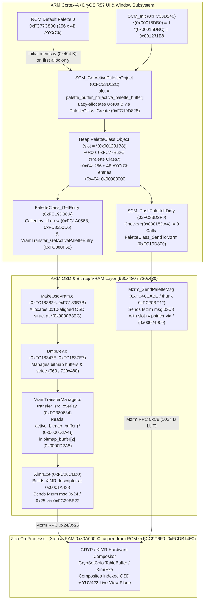

# HDMI-001 overlay/compositor pipeline

> **Independent review 2026-10-17 (`docs/HDMI001_INDEPENDENT_REVIEW.md`, C018–C022):** statements below about a 15-slot table zeroed at `0x001231B8`, a zero footer at `+0x404`, push call sites `0xFC380684`/`0xFC380FD6`, `PaletteClass_SendToMzrm` sending the palette, an *immediate* push, an *exact* ROM restore, and palette 0 being proven active in Rec/Live View are corrected there. The script was revised (range guard, 3-entry state check, diagnostic log); current SHA-256 `57fcc4ed493a4f6c611336c3530867452ef60b1ac4f95d2dfaa86d2ee31b1545`.

Updated: 2026-10-17  
Scope: GM1.10C read-only static analysis, end-to-end overlay composition trace, and offline-verified RAM-only Clean HDMI implementation (`READY_FOR_HARDWARE_TEST`; no camera execution performed)

## Executive result

Offline reverse engineering of the Canon PowerShot G3 X **`GM1.10C`** (`0x32A8` / `12968`) OSD, bitmap VRAM, `SCM.c` / `Palette Class.`, and `MzrmGraphic` / `XimrExe` composition pipeline is **complete**.

Two independent static analysis methods — (1) pinned CHDK r5491 `finsig_thumb2` (`21b9a14eb2043aeffdd2cb141081e7dcfe75f7e6`) executed against `GM1.10C` `PRIMARY.BIN` and (2) bounded Capstone/Ghidra disassembly of `SCM.c` (`0xFC33D10C..0xFC33D616`), `PaletteClass` (`0xFC19D800..0xFC19D906`), `VramTransferManager.c` (`0xFC380550..0xFC38142C`), `MakeOsdVram.c` (`0xFC183824..0xFC183B7B`), `BmpDev.c` (`0xFC18347E..0xFC1837E7`), and `XimrExe` (`0xFC20C6D0`) — confirm the exact `GM1.10C` palette control block, heap object layout, ROM default table, and hardware composition path:

- **`SCM.c` struct base (`palette_control`)**: **`0x00015DA4`** (literal pool `0xFC33D500`, referenced across `0xFC33D10C..0xFC33D58C`).
- **`palette_init_flag`**: **`0x00015DB0`** (`0x00015DA4 + 0x0C`, set to `1` by `SCM_Init` `0xFC33D240`).
- **`active_palette_buffer`**: **`0x00015DB4`** (`0x00015DA4 + 0x10`, active palette index `0..3`; `0` is set at startup by `0xFC0BFC40` and used by shooting/rec/live-view windows).
- **`palette_buffer_ptr`**: **`0x00015DBC`** (`0x00015DA4 + 0x18`, initialized by `SCM_Init` at `0xFC33D262..0xFC33D266` to `0x00123140 + 0x78` = **`0x001231B8`**, a `PaletteClass *` pointer array of at least 4 used entries; length unknown).
- **Why earlier raw word search missed `0x00015DBC` (`C015`)**: ARM RVCT 4.0 never emits `0x00015DBC` as a 4-byte literal in ROM; it loads base `0x00015DA4` from `0xFC33D500` and accesses `palette_buffer_ptr` via `ldr r1, [r4, #0x18]` (`0xFC33D14A`) and `str r0, [r4, #0x18]` (`0xFC33D266`).
- **`Palette Class.` heap object layout (`0x408` bytes)**:
  - `+0x000` (`4` B): Magic pointer **`0xFC77B62C`** (`"Palette Class."`, written by `PaletteClass_InitHeader` `0xFC19D8E8` and verified before every access by `PaletteClass_ValidateMagic` `0xFC19D8F2`).
  - `+0x004` (`0x400` = `1024` B): `256 x uint32_t` `AYCrCb` palette entries (`bits 25:24` = 2-bit alpha: `0 -> 0x00` transparent, `1 -> 0x40`, `2 -> 0x80`, `3 -> 0xFF`, proven by `DispDev_ConvertPaletteToHwLut` `0xFC1425FC`).
  - `+0x404` (`4` B): palette entry 256 (ROM `0xFFF7F7F7`; **corrected C019**, not a zero footer; left untouched by the script).
- **ROM default for Palette 0**: **`0xFC77C8B0`** (`0xFC77C8AC + 0 * 0x60C + 4`, computed by `SCM_GetRomDefaultPalette` `0xFC33D5FA`), where `entry[0] = 0x00800080` (transparent neutral chroma) and `entry[1] = 0xFFFFFFFF` (opaque white).

A guarded, reversible RAM-only Canon Basic implementation has been produced at [`firmware/tools/hdmi001_clean_overlay_gm110c.m`](file:///Users/avp/project/g3x-lite/firmware/tools/hdmi001_clean_overlay_gm110c.m) along with an offline static validator at [`tools/validate_hdmi001_script.py`](file:///Users/avp/project/g3x-lite/tools/validate_hdmi001_script.py). Final Phase 3C status for HDMI-001 is **`READY_FOR_HARDWARE_TEST`**.

---

## 1. End-to-End GM1.10C Overlay & Palette Pipeline

### 1.1 Architecture diagram



### 1.2 `SCM.c` state structure (`0x00015DA4..0x00015DC3`)

Both `finsig_thumb2` (`Found @0xfc33d12e`, `@0xfc33d132`, `@0xfc33d14a`) and direct disassembly of `0xFC33D10C..0xFC33D616` (asserting `"SCM.c"` at `0xFC33D4EC`) confirm the `SCM.c` control block at **`0x00015DA4`**:

| Address | Struct Offset | Symbol / Role | Type | Verified Producers & Consumers |
|---|---:|---|---|---|
| `0x00015DA4` | `+0x00` | `palette_control` | `uint8_t` | Dirty bitmask: bit 0 (`0x01`) tested by `SCM_IsDirtyBit0` (`0xFC33D2B4`) and cleared by `SCM_ClearDirtyBit0` (`0xFC33D2BE`); bit 1 (`0x02`) set by `SCM_MarkDirtyBit1` (`0xFC33D10C`); bits `0\|1` (`0x03`) set by `SCM_SetActivePalette` (`0xFC33D282`) and `SCM_MarkDirtyBits01` (`0xFC33D2D0`); cleared to `0` when `SCM_PushPaletteIfDirty` (`0xFC33D2F0`) pushes the palette to Zico |
| `0x00015DB0` | `+0x0C` | `palette_init_flag` | `uint32_t` | Set to `1` by `SCM_Init` (`0xFC33D240` at `0xFC33D260`); checked before every access (`if (*(0x00015DB0) == 0) DebugAssert("SCM.c", ...)`) |
| `0x00015DB4` | `+0x10` | `active_palette_buffer` | `uint32_t` | Active palette index (`0..3`), set by `SCM_SetActivePalette` (`0xFC33D282`). Startup (`0xFC0BFC40`) and shooting/rec window controllers (`0xFC0BFD48`, `0xFC1BB7BE`, `0xFC38176C`) select index `0` |
| `0x00015DB8` | `+0x14` | `secondary_palette_index` | `uint32_t` | Secondary index (`0..9`), initialized to `0` by `SCM_Init` (`0xFC33D26A`), updated by `0xFC33D55C` |
| `0x00015DBC` | `+0x18` | `palette_buffer_ptr` | `PaletteClass **` | Initialized by `SCM_Init` (`0xFC33D262..0xFC33D266`) to `0x00123140 + 0x78` = **`0x001231B8`** (pointer array; **corrected C018**: the `SCM_Init` loop initialises the 15 x 8-byte colour-override table at `0x00123140`, not this array) |
| `0x00015DC0` | `+0x1C` | `palette_lookup_ptr` | `uint16_t *` | Initialized by `SCM_Init` (`0xFC33D268..0xFC33D26E`) to ROM lookup table `0xFC77E0DC` |

### 1.3 `Palette Class.` object lifecycle and why Palette 0 persists across mode switches

1. **Lazy allocation on first request**:
   - `SCM_GetActivePaletteObject` (`0xFC33D12C`) checks `*(0x00015DB0) != 0` and `active_palette_buffer < 4`.
   - It indexes the 4-byte ROM flag array at `0xFC77C8A8` (`[0, 0, 0, 0]` in `GM1.10C`). Because `flag[slot_id] == 0`, it loads `tbl = *(0x00015DBC)` (`0x001231B8`) and checks `slot = tbl[slot_id]` (`0xFC33D14A..0xFC33D152`).
   - Only when `slot == 0` (`cmp r0, #0; bne #0xfc33d168`) does it call `SCM_GetRomDefaultPalette(slot_id)` (`0xFC33D5FA`, returning `0xFC77C8AC + slot_id * 0x60C + 4` = `0xFC77C8B0` for `slot_id = 0`) and `PaletteClass_Create(rom_default, 0x404)` (`0xFC19D828`).
2. **Heap object structure (`0x408` bytes)**:
   - `PaletteClass_Create` (`0xFC19D828`) allocates `0x404 + 4 = 0x408` bytes via heap allocator `0xFC33D7DC`.
   - `PaletteClass_InitHeader` (`0xFC19D8E8`) writes `0xFC77B62C` (`"Palette Class."`) at `slot + 0x00`.
   - `PaletteClass_CopyData` (`0xFC19D898`) validates the `"Palette Class."` magic (`0xFC19D8F2`) and copies `0x404` bytes (`1028` B) from `0xFC77C8B0` into `slot + 0x04`.
3. **Why zeroing `slot + 4` (`1024` B) suppresses UI overlays and why ROM `0xFC77C8B0` restores them**:
   - Once allocated, `tbl[0]` (`*(0x001231B8)`) is non-zero for the remainder of the boot session, so `SCM_GetActivePaletteObject` (`0xFC33D150`) returns the existing heap object without re-copying from ROM.
   - Two paths consume `slot + 4`:
     1. **Per-color UI lookup**: `PaletteClass_GetEntry(slot, color_idx)` (`0xFC19D8CA`) returns `*(uint32_t *)(slot + 4 + color_idx * 4)` to UI drawing primitives (`0xFC1A0568`, `0xFC3350D6`) and `VramTransfer_GetActivePaletteEntry` (`0xFC380F52`).
     2. **Hardware LUT push to Zico**: `SCM_PushPaletteIfDirty` (`0xFC33D2F0`, called from `0xFC3809C0` inside `0xFC3809AE`, reached from VRAM-transfer routine `0xFC380A46`; **corrected C020**) checks if `*(uint8_t *)0x00015DA4 != 0`. When dirty, it clears `*(uint8_t *)0x00015DA4 = 0` and calls `PaletteClass_SendToMzrm(slot)` (`0xFC19D800`) -> `0xFC20BF42` -> `Mzrm_SendPaletteMsg` (`0xFC4C2ABE`), which sends Mzrm message `0xC8` containing `slot + 4` to the Zico graphics co-processor via queue `*(0x00024900)`.
   - `DispDev_ConvertPaletteToHwLut` (`0xFC1425FC`) proves the 32-bit `AYCrCb` entry format: bits `25:24` (`(entry >> 24) & 3`) encode 2-bit alpha (`0 -> 0x00` transparent, `1 -> 0x40`, `2 -> 0x80`, `3 -> 0xFF`). Setting all 256 entries (`1024` bytes at `slot + 4`) to `0x00000000` sets alpha to `0` (`0x00` transparent) and triggers a push when `palette_control` (`0x00015DA4`) is poked to `3`. Copying `1024` bytes from immutable ROM `0xFC77C8B0` back to `slot + 4` and poking `palette_control = 3` restores the **ROM default** palette in place (not byte-exact: runtime-customised entries are lost until Canon re-applies them or the camera is power-cycled, C021).

### 1.4 Why XIMR/GRYP strings in `0xFCC9CDD0..0xFCCB9464` have no ARM cross-references (`E068` resolved)

`ZicoKick_Start` (`0xFC3DFD3C`, string `"ZicoKick Start\n\0"` at `0xFC3DFDCC`) copies four embedded co-processor firmware segments at boot (table at `0xFC3DFE08..0xFC3DFE44`), including ROM `0xFCC9C6F0..0xFCDB14E0` (`0x114DF0` bytes) to Zico Xtensa RAM `0x80A00000`. All `GVDN_MallocVGPalette`, `GrypSetColorTableBuffer`, `InitializeXimr`, and `XimrExe` strings at `0xFCC9CDD0..0xFCCB9464` live inside that embedded Xtensa firmware image rather than the ARM instruction space. The ARM side communicates with Zico via `MzrmGraphic` (`0xFC112FF6`, `XimrExe` `0xFC20C6D0` sending Mzrm messages `0x24`/`0x25`, and `Mzrm_SendPaletteMsg` `0xFC4C2ABE` sending message `0xC8`).

---

## 2. Historical `GM1.10E` Clean-Overlay Review (`C017`)

Reviewing `ranma`'s `GM1.10E` Canon Basic script (CHDK forum post 143433, 2020-05-11) against `GM1.10C` disassembly revealed three critical findings:

1. **Same `SCM.c` RAM layout (`0x00015DA4..0x00015DC0`)**:
   - Although `0x00015DBC` does not appear as a 4-byte literal in `GM1.10C` ROM (`C015`), both `finsig_thumb2` and `SCM.c` disassembly confirm `palette_buffer_ptr` is at `0x00015DA4 + 0x18 = 0x00015DBC` on `GM1.10C`.
2. **Inverted `strcmp` bug in `ranma`'s `check_compat()` (`C017`)**:
   - `ranma`'s script wrote:
     ```vb
     if strcmp("EC385\n\r",0xfc000584) = 0 then
         exit sub
     end if
     ```
   - `strcmp_FW` (`0xFC382A2C`, EventProc `"strcmp"`) follows standard C semantics and returns `0` when strings are **equal**. On `GM1.10E`/`GM1.10C`, `0xFC000584` is NOT `"EC385\n\r"` (`0xFC000584` was an EOS M100 offset from `srsa_4c`); on G3 X `GM1.10C`, `"EC385\n\r\0"` is at **`0xFC00052C`** while `0xFC000584` contains `"\x00\x00\x02\xfc Signature is OF"`. Thus `strcmp("EC385\n\r", 0xfc000584)` returned non-zero (`69`) and accidentally fell through to `strcmp("GM1.10E", 0xfc54e0b5) = 0`.
   - Our `GM1.10C` implementation fixes this by requiring `memcmp(0xfc020004, "gaonisoy", 8) <> 0`, `strcmp("EC385\n\r", 0xfc00052c) <> 0`, and `strcmp("GM1.10C", 0xfc54e08d) <> 0` to abort.
3. **Missing dirty-bit notification and one-way clearing in `ranma`'s script**:
   - `ranma`'s script zeroed `1024` bytes at `*slot + 4` without setting `palette_control` (`0x00015DA4`), relying on a subsequent UI redraw or mode change to mark the palette dirty, and required a camera reboot to restore overlays.
   - Our `GM1.10C` script pokes `*(uint8_t *)0x00015DA4 = 3` (`Poke8(palette_control, 3)`) so `SCM_PushPaletteIfDirty` (`0xFC33D2F0`) pushes the updated palette on the next OSD transfer (C020) to Zico (`Mzrm` message `0xC8`), and supports in-place toggle/restore from ROM `0xFC77C8B0`.

---

## 3. Verified GM1.10C Functions and Structures

| Symbol / Component | GM1.10C Address | Confirmation 1 | Confirmation 2 | Role |
|---|---:|---|---|---|
| `palette_control` | `0x00015DA4` (RAM) | `finsig_thumb2` (`@0xfc33d12e`) | `SCM.c` disassembly (`0xFC33D10C..0xFC33D314`, literal `0xFC33D500`) | `uint8_t` dirty bitmask (`0x03` triggers `SCM_PushPaletteIfDirty`) |
| `palette_init_flag` | `0x00015DB0` (RAM) | `SCM_Init` (`0xFC33D260`) | `SCM_GetActivePaletteObject` (`0xFC33D12E`) | `uint32_t` initialized flag (`1` when `SCM.c` is ready) |
| `active_palette_buffer` | `0x00015DB4` (RAM) | `finsig_thumb2` (`@0xfc33d132`) | `SCM_SetActivePalette` (`0xFC33D282`) | `uint32_t` active palette slot (`0..3`; value during Rec/Live View **unproven**, C022) |
| `palette_buffer_ptr` | `0x00015DBC` (RAM) | `finsig_thumb2` (`@0xfc33d14a`) | `SCM_Init` (`0xFC33D262..0xFC33D266`) | Pointer to `PaletteClass *` array at `0x001231B8` (length unknown, C018) |
| `scm_palette_table` | `0x001231B8` (RAM) | `SCM_Init` (`0xFC33D264`: `0x00123140 + 0x78`) | `tools/validate_hdmi001_script.py` ROM invariant check | `PaletteClass *` array (length unknown, C018) (`slot 0` = `*0x001231B8`) |
| `PaletteClass_Magic` | `0xFC77B62C` (ROM) | `PaletteClass_InitHeader` (`0xFC19D8E8`, lit `0xFC19D908`) | `PaletteClass_ValidateMagic` (`0xFC19D8F2`) | `"Palette Class.\0"` header tag stored at `slot + 0x00` |
| `rom_default_pal0` | `0xFC77C8B0` (ROM) | `SCM_GetRomDefaultPalette` (`0xFC33D5FA`, lit `0xFC33D61C`) | ROM inspection (`entry[0]=0x00800080`, `entry[1]=0xFFFFFFFF`) | Default 256-entry `AYCrCb` palette for slot 0 |
| `SCM_GetActivePaletteObject` | `0xFC33D12C` (ROM) | Ghidra `SeedAndReportOverlay.java` | Capstone disassembly `0xFC33D12C..0xFC33D174` | Returns `palette_buffer_ptr[active_palette_buffer]`, lazy-allocating from ROM if null |
| `SCM_PushPaletteIfDirty` | `0xFC33D2F0` (ROM) | Ghidra `SeedAndReportOverlay.java` | Capstone disassembly `0xFC33D2F0..0xFC33D314` | Clears `*(uint8_t *)0x00015DA4` and calls `PaletteClass_SendToMzrm` (`0xFC19D800`) |
| `PaletteClass_SendToMzrm` | `0xFC19D800` (ROM) | Ghidra `SeedAndReportOverlay.java` | Capstone disassembly `0xFC19D800..0xFC19D826` | Validates magic `0xFC77B62C`, passes `slot + 4` to `Mzrm_SendPaletteMsg` (`0xFC20BF42` -> `0xFC4C2ABE`) |
| `DispDev_ConvertPaletteToHwLut` | `0xFC1425FC` (ROM) | Ghidra `SeedAndReportOverlay.java` | Capstone disassembly `0xFC1425FC..0xFC14266A` | Converts 256 `AYCrCb` entries (`bits 25:24` = 2-bit alpha) into hardware LUT |
| `transfer_src_overlay` | `0xFC380634` (ROM) | `finsig_thumb2` (`0xfc380635`) | Capstone disassembly `0xFC380634..0xFC380730` | `VramTransferManager.c` overlay transfer; calls `SCM_PushPaletteIfDirty` at `0xFC380684` |
| `active_bitmap_buffer` / `bitmap_buffer` | `0x0000D2A4` / `0x0000D2A8` (RAM) | `finsig_thumb2` (`@0xfc38116e`, `@0xfc381174`) | `VramTransferManager.c` disassembly (`0xFC381168..0xFC38119A`, base `0x0000D264`) | Active double-buffer index and 2-element bitmap VRAM pointer table |
| `XimrExe` | `0xFC20C6D0` (ROM) | Ghidra `SeedAndReportOverlay.java` | Capstone disassembly `0xFC20C6D0..0xFC20C7AC` | Builds XIMR composition descriptor at `0x0001A438` and sends Mzrm RPC `0x24`/`0x25` |
| `SaveBmpVRAMData` / `SavePaletteData` | `0xFC558348` / `0xFC5584E8` (ROM) | `finsig_thumb2` EventProc scan | Direct EventProc table check at `0xFC558578..0xFC558590` (`C016`) | Diagnostic SD export routines (`SaveBmpVRAMData` calls `SavePaletteData` at `0xFC558432`); not suppression controls |

---

## 4. Guarded RAM-Only Implementation & Static Validation

### 4.1 Implementation artifact (`firmware/tools/hdmi001_clean_overlay_gm110c.m`)

- **Path**: [`firmware/tools/hdmi001_clean_overlay_gm110c.m`](file:///Users/avp/project/g3x-lite/firmware/tools/hdmi001_clean_overlay_gm110c.m)
- **Size / Lines / Encoding**: `3,186` bytes, `136` lines, pure 7-bit ASCII, LF line endings
- **SHA-256**: `57fcc4ed493a4f6c611336c3530867452ef60b1ac4f95d2dfaa86d2ee31b1545`

### 4.2 Five-layer runtime guard design

Before writing a single byte of RAM, `hdmi001_clean_overlay_gm110c.m` enforces five sequential guards (plus, since the 2026-10-17 review, a fail-closed heap-pointer range check `0x1000 <= slot < 0x10000000` before `*slot` is read):

1. **ROM DryOS signature guard**: `memcmp(0xfc020004, "gaonisoy", 8) = 0`
2. **ROM hardware platform guard**: `strcmp("EC385\n\r", 0xfc00052c) = 0`
3. **ROM exact firmware build guard**: `strcmp("GM1.10C", 0xfc54e08d) = 0`
4. **`SCM.c` initialization & table pointer guard**: `*0x00015db0 = 1` (`palette_init_flag`) AND `*0x00015dbc = 0x001231b8` (`palette_buffer_ptr`)
5. **Heap `Palette Class.` object & magic guard**: `slot = *0x001231b8 <> 0` AND `*slot = 0xfc77b62c` (`"Palette Class."`)

If any guard fails, the script performs **zero RAM writes**, displays `"Not GM1.10C!"` or `"Palette guard abort!"` via `LCDMsg_SetStr`, and exits cleanly.

### 4.3 Reversible toggle & rollback mechanics

- **Unless entries 1, 2 and 3 are all zero (i.e. stock or partially re-populated palette)**:
  1. Best-effort saves the current 1024-byte palette payload (`slot + 4`) to `A/G3XPAL0.BAK` on the SD card for offline forensic verification.
  2. Zeroes exactly `1024` bytes (`256 * 4`) at `slot + 4` (`memset(payload, 0, 1024)`), leaving the `"Palette Class."` header at `slot + 0` and palette entry 256 at `slot + 0x404` untouched.
  3. Marks `palette_control` dirty (`Poke8(0x00015da4, 3)`) so `SCM_PushPaletteIfDirty` updates the LUT on the next OSD transfer (C020).
  4. Displays `"Overlay disabled!"`.
- **When entries 1, 2 and 3 are all zero (overlay currently suppressed)**:
  1. Copies `1024` bytes from the verified ROM default Palette 0 table (`0xFC77C8B0`) back to `slot + 4` (`memcpy(payload, 0xfc77c8b0, 1024)`).
  2. Marks `palette_control` dirty (`Poke8(0x00015da4, 3)`).
  3. Displays `"Overlay ROM-restored!"`.
- **Secondary rollback**: Because all modifications are strictly in volatile heap/BSS RAM (`slot + 4` and `0x00015DA4`), powering the camera off and on unconditionally restores factory state.

### 4.4 Offline static validation (`tools/validate_hdmi001_script.py`)

Run:

```sh
python3 /Users/avp/project/g3x-lite/tools/validate_hdmi001_script.py
```

Verified output (`status: PASS`):
- Confirms `PRIMARY.BIN` size (`33,554,432` B) and SHA-256 (`9911855772e433c877a9914f16d3735e15a48ca63352633e8f10364182912578`).
- Confirms all 11 ROM binary invariants (`gaonisoy` at `0xFC020004`, `EC385\n\r\0` at `0xFC00052C`, `GM1.10C\0` at `0xFC54E08D`, `SCM.c` literal `0x00015DA4` at `0xFC33D500`, table base `0x00123140` at `0xFC33D508`, `add.w r0, r0, #0x78` at `0xFC33D264`, magic literal `0xFC77B62C` at `0xFC19D908`, `"Palette Class.\0"` at `0xFC77B62C`, ROM default palette literal `0xFC77C8AC` at `0xFC33D61C`, and Palette 0 entries `0x00800080` / `0xFFFFFFFF` at `0xFC77C8B0`).
- Confirms `hdmi001_clean_overlay_gm110c.m` is pure 7-bit ASCII, LF-only, balanced `sub`/`if` blocks, contains no forbidden calls, and (since the 2026-10-17 review) uses only allow-listed hex literals, places every guard before the first RAM write, and stays within a fixed RAM-write call budget.

---

## 5. Hardware Test Instructions & Observation Checklist (When Approved)

> **Gate**: Do not copy `hdmi001_clean_overlay_gm110c.m` to the SD card or run it on the camera until the owner explicitly approves hardware testing (and, if testing before Mini HDMI hardware arrives, approves rear-LCD overlay toggle testing). Note that Canon Basic activation on `GM1.10C` should first be confirmed with `firmware/tools/cbasic_activation_probe.m` (`docs/CANON_BASIC_ACTIVATION_INVESTIGATION.md`).

1. **Preparation**:
   - Use the prepared FAT32/MBR SD card with `"SCRIPT"` at partition VBR offset `0x1F0` and `/Volumes/G3X_DUMP/script.req` containing `"for DC_scriptdisk"` (17 B).
   - Copy `firmware/tools/hdmi001_clean_overlay_gm110c.m` to `/Volumes/G3X_DUMP/extend.m` and verify SHA-256 matches `57fcc4ed493a4f6c611336c3530867452ef60b1ac4f95d2dfaa86d2ee31b1545`.
2. **Execution & Toggle Test**:
   - Insert the SD card, power the camera on in **Shooting / Rec mode** first so `SCM_GetActivePaletteObject` initializes `palette_buffer_ptr[0]` (`*0x001231B8`), then switch to **Playback mode** (or press Playback button) and press **`FUNC./SET`**.
   - Confirm `"HDMI-001 GM1.10C"` followed by `"Overlay disabled!"` appears on screen.
   - Half-press the shutter (or return to Shooting / Live View mode) and observe:
     - Live-view video scene remains visible on rear LCD and (when connected) HDMI output.
     - Canon shooting icons, exposure bar, and grid/histograms are transparent.
     - Note whether any residual focus square appears in the upper-left corner (as reported on `GM1.10E`).
   - Return to Playback mode and press **`FUNC./SET`** a second time.
   - Confirm `"Overlay ROM-restored!"` appears and all stock Canon UI graphics return in Shooting / Live View mode without rebooting.
3. **Post-test inspection**:
   - Inspect `G3XPAL0.BAK` on the SD card (expected size `1,024` bytes) and compare against ROM `0xFC77C8B0..0xFC77CCAF`.

---

## 6. Reproducible Static Commands

```sh
# 1. Run Ghidra overlay seed & report script
JAVA_HOME=/opt/local/Library/Java/JavaVirtualMachines/jdk-25-azul-zulu.jdk/Contents/Home \
  /opt/local/share/java/ghidra-12.1.4/support/analyzeHeadless \
  /Users/avp/project/g3x-lite/analysis-workspace/ghidra g3x-gm110c-v2 \
  -process PRIMARY.BIN -noanalysis \
  -scriptPath /Users/avp/project/g3x-lite/tools/ghidra \
  -postScript SeedAndReportOverlay.java /tmp/g3x-overlay-report.txt

# 2. Run Ghidra display/compositor string xref report script
JAVA_HOME=/opt/local/Library/Java/JavaVirtualMachines/jdk-25-azul-zulu.jdk/Contents/Home \
  /opt/local/share/java/ghidra-12.1.4/support/analyzeHeadless \
  /Users/avp/project/g3x-lite/analysis-workspace/ghidra g3x-gm110c-v2 \
  -process PRIMARY.BIN -noanalysis \
  -scriptPath /Users/avp/project/g3x-lite/tools/ghidra \
  -postScript ReportDisplayStringRefs.java /tmp/g3x-display-string-refs.txt

# 3. Run offline static validator for HDMI-001 script and ROM invariants
python3 /Users/avp/project/g3x-lite/tools/validate_hdmi001_script.py
```

## Primary sources

- Ranma, G3 X GM1.10E clean-overlay script and HDMI stability report, CHDK forum post 143433, 2020-05-11: <https://chdk.setepontos.com/d/12600-g3-x-100c-fw-dump/18> (retrieved 2026-10-17).
- srsa_4c, clean-overlay mechanism and per-camera address requirement: <https://chdk.setepontos.com/d/13489-clean-canon-overlays-g7x-ii-g5x-eos-m10-m3-also-m5-m6-m100-via-script/42> (retrieved 2026-10-17).
- Pinned CHDK r5491 [`tools/finsig_thumb2.c`](https://github.com/01luna/CHDK/blob/21b9a14eb2043aeffdd2cb141081e7dcfe75f7e6/tools/finsig_thumb2.c) (`21b9a14eb2043aeffdd2cb141081e7dcfe75f7e6`).
- Local proprietary ROM `firmware/dumps/GM1.10C/PRIMARY.BIN`, SHA-256 `9911855772e433c877a9914f16d3735e15a48ca63352633e8f10364182912578`; analyzed locally only and not redistributed.
