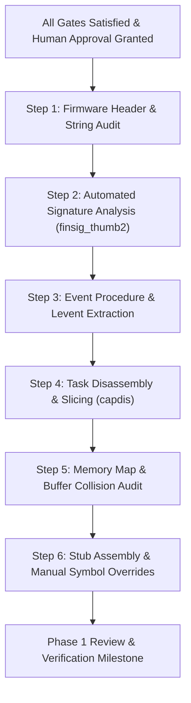

# Phase 1 Entry Checklist & Transition Protocol

Updated: 2026-10-16  
Phase: 0D — Port Readiness Audit  
Target Phase: Phase 1 — Offline Firmware Analysis  
Scope: Gating requirements and execution protocol for entering Phase 1. Strict read-only boundaries apply.

---

## 1. Phase 1 Scope & Safety Definition

Transitioning from **Phase 0 (Read-Only Archaeology)** to **Phase 1 (Offline Firmware Analysis)** permits the introduction and local inspection of proprietary binary firmware images, automated symbol extraction, and reverse engineering tooling.

### Strict Phase 1 Boundaries:
- **PERMITTED in Phase 1**:
  - Lawful acquisition of a private Canon PowerShot G3 X firmware dump (`PRIMARY.BIN`).
  - Offline, read-only disassembly and symbol recovery using CHDK tools (`finsig_thumb2`, `capdis`, `find_eventproc`) and Ghidra (via read-only REA provider).
  - Storing firmware images and Ghidra databases strictly in Git-ignored local directories.
  - Generating documentation, memory maps, and stub tables.
- **STRICTLY PROHIBITED in Phase 1**:
  - Flashing any code or modifying camera ROM/NVRAM.
  - Booting or executing experimental payloads (`DISKBOOT.BIN` or `PS.FI2`) on physical camera hardware.
  - Connecting the camera for invasive debug or memory modification.
  - Committing firmware binaries, decompiled assembly dumps, proprietary code, or Ghidra projects to Git.
  - Bypassing safeguards or testing unreviewed code.

---

## 2. Mandatory Pre-Requisite Gating Checklist

Before any Phase 1 activity may begin, every item below must be satisfied and recorded.

| Gate | Requirement | Verification Method | Status | Sign-off / Evidence |
|---|---|---|---|---|
| **GATE-01** | Physical Camera Firmware Version Identification | Owner-confirmed physical camera firmware screen (`docs/FIRMWARE_ACQUISITION_PLAN.md` §1). | Confirmed: **Canon PowerShot G3 X**, internal firmware **`GM1.10C`**, public firmware **`1.1.0.0`**, platform ID **`0x32A8` (`12968`)**, `PAL D` (serial number intentionally not stored). | **RESOLVED** | Owner physical camera firmware screen (`E037`). |
| **GATE-02** | Authorized Firmware Image Acquisition (`GM1.10C`) | Obtain verified, uncorrupted `GM1.10C` `PRIMARY.BIN` via owner-preferred Strategy S1 (Canon Basic read-only dump) per `docs/FIRMWARE_ACQUISITION_PLAN.md` §3–§4 after owner approval. | 1. Verify exact byte count = `33,554,432` bytes (`0x2000000`, 32 MiB; primary-source verified in dumper `romsize = 0x2000000`, `E039`/`C008`). 2. Verify `"gaonisoy"` signature at offset `0x20004` (`0xFC020004`) and `"GM1.10C"` string. 3. Compute and document SHA-256 hash; store strictly under `.gitignore`-protected `private/firmware/g3x/110c/PRIMARY.BIN` (`E036`). | **PENDING (READY FOR OWNER APPROVAL)** | Candidate A/B dumper source verified (`E039`, `E040`); awaiting owner execution after Gate A3 approval. |
| **GATE-03** | Historical Patch Dependency Resolution | Since the owner's camera is `GM1.10C` whereas `g3x_110e.patch` targeted `GM1.10E` (`C011`), `GM1.10C` requires primary symbol/task extraction from `GM1.10C` `PRIMARY.BIN` regardless of patch availability. | Primary path: Clean-room generation on `GM1.10C` using `finsig_thumb2` + `capdis`. Optional supplementary reference: If `g3x_110e.patch` is later provided, audit per `docs/PATCH_AUDIT_110E.md` for structural comparison only (never copy `110e` addresses onto `110c`). | **PENDING PHASE 1** | Target difference (`110c` vs `110e`) documented (`C011`). |
| **GATE-04** | Toolchain & Host Environment Readiness | Ensure host environment (macOS x86_64) has prerequisites installed for analysis tools. | 1. Native C compiler (`clang`/`gcc`), `make`, and Capstone library/headers (`CAPSTONE_TOOLS_LINK`) required by CHDK `tools/Makefile` for `finsig_thumb2` and `capdis` (`E035`). 2. Python 3 environment. 3. Optional: JDK 17+ and Ghidra 12.1.x (if REA is authorized). | **PENDING** | Tools not yet built or configured. |
| **GATE-05** | Human Authorization & Phase Transition Sign-Off | Explicit human owner approval for (1) on-camera S1 Canon Basic dump execution (`Approval A3`) and (2) advancing from Phase 0D to Phase 1 (`Approval A2`). | Owner issues explicit approval in response to `docs/FIRMWARE_ACQUISITION_PLAN.md` §5.2 (`Approval A3` and `Approval A2`). Approval recorded in `docs/PROJECT_STATE.md`. | **PENDING** | Awaiting owner sign-off on `Approval A3` / `Approval A2`. |

---

## 3. Step-by-Step Phase 1 Execution Protocol

Once Gates 01 through 05 are fully satisfied, the executing agent must execute Phase 1 strictly according to the following sequenced protocol:

### Protocol Steps:

1. **Step 1: Firmware Header & String Audit**
   - Command: Run `strings` and header inspection on `private/firmware/g3x/110c/PRIMARY.BIN`.
   - Confirm DryOS release banner string (expecting `DryOS release 0057`).
   - Confirm camera model string (`PowerShot G3 X`), platform ID (`0x32A8` / `12968`), and internal firmware version string (`GM1.10C`).
   - Verify ROM base offset at `0xFC000000` (`"gaonisoy"` at file offset `0x20004`).

2. **Step 2: Automated Signature Analysis (`finsig_thumb2`)**
   - Build via CHDK `tools/Makefile`: `make -C tools finsig_thumb2` (links `finsig_thumb2.o stubs_load.o firmware_load_ng.o ptp_op_names.o` with Capstone per E035/C007).
   - Execute signature finder against the verified image and `0xfc000000` base.
   - Outputs generated: `stubs_auto.S`, `funcs_by_name.csv`, `funcs_by_address.csv`.
   - Record total symbols resolved, unresolved symbols, and ambiguous signatures.

3. **Step 3: Event Procedure & Logical Event Extraction**
   - Build via CHDK `tools/Makefile`: `make -C tools find_eventproc find_levent` (links with `dumputil.o` per E035).
   - Extract Canon event procedures: Identify `_PT_MFOn`, `_PT_MFOff`, `_PutInNdFilter_FW`, `_MoveFocusLensToDistance_FW`, and shutter/aperture event procs.
   - Record exact entry addresses and compare against generated stubs.

4. **Step 4: Task Disassembly & Slicing (`capdis`)**
   - Build via CHDK `tools/Makefile`: `make -C tools capdis` (links `capdis.o stubs_load.o firmware_load_ng.o` with Capstone per E035/C007).
   - Disassemble core task routines:
     - `task_CaptSeq`: Capture sequence task loop; identify raw buffer pointer offset.
     - `task_FileWrite`: File writing task; determine `fwt_data_struct` layout and chunk count.
     - `task_TricInitTask`: FI2 boot task sequence; generate FI2 bypass patch.
     - `task_Startup`: Locate `CreateTask` calls, initialization order, and cache invalidation routine.

5. **Step 5: Memory Map & Buffer Collision Audit**
   - Map memory pool boundaries:
     - Identify `MEMISOSTART` (firmware heap start).
     - Identify ARAM heap range (`ARAM_HEAP_START`, `ARAM_HEAP_SIZE`).
     - Map video display buffers, 1080p HDMI overlay buffers, and live-view framebuffers.
   - Perform static conflict analysis to address the historical HDMI instability reported by author ranma.

6. **Step 6: Stub Assembly & Manual Symbol Overrides**
   - Populate `platform/g3x/sub/<version>/stubs_entry.S` with verified addresses.
   - Add manual overrides to `stubs_entry_2.S` for any functions missed by `finsig_thumb2`.
   - Verify that all pointers compile cleanly in Thumb-2 syntax.

---

## 4. Phase 1 Exit Criteria

Phase 1 is complete when:
1. Complete, non-conflicting symbol stubs (`stubs_auto.S`, `stubs_entry.S`, `stubs_entry_2.S`) exist for the target firmware revision.
2. Disassembled task source files (`capt_seq.c`, `filewrite.c`, `boot.c`) are produced and reviewed.
3. Memory layout and safe allocation boundaries (`MEMISOSTART`, ARAM vs DRAM) are documented with zero unresolved address collisions.
4. Clean, reproducible build of CHDK core (`platform/g3x`) compiles without warnings under `arm-none-eabi-gcc`.
5. Human sign-off is obtained prior to entering Phase 2 (Non-Volatile/Non-Invasive Boot Evaluation).
