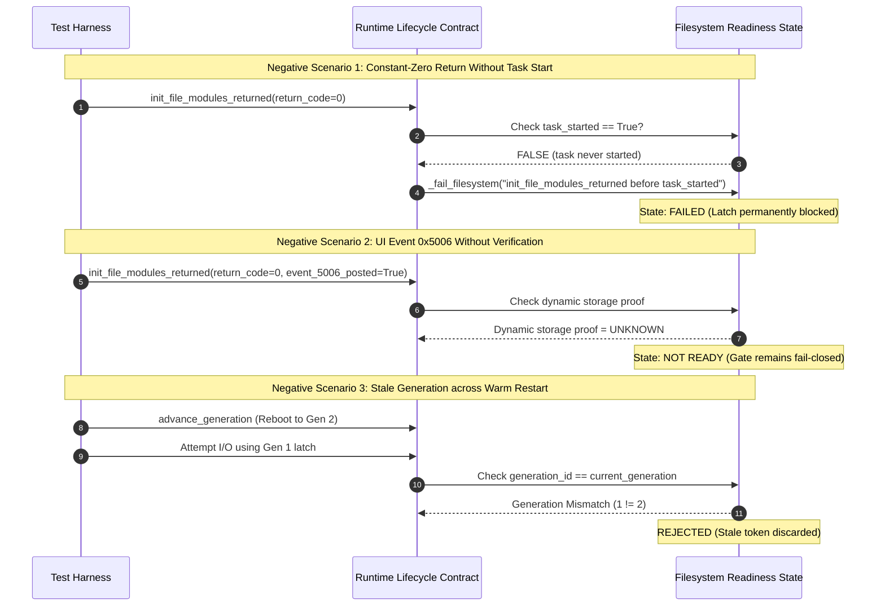

# PORT-12B — U2 Filesystem Readiness Proof Obligations (Offline)

**Worker**: Gemini Worker 2 (PORT-12B Filesystem U2)  
**Coordinator**: Gemini Coordinator  
**Tech Lead**: ChatGPT  
**Baseline**: `origin/main` @ `581b1a4bb30456bf18c46dc4bcf61b0375aee251`  
**Date**: 2026-10-28  
**Status**: **`RESEARCH_COMPLETE / DRAFT_PR_FOR_REVIEW`**  
**Safety Gate**: **`STRICT NO-GO FOR HARDWARE DEPLOYMENT`** (Phase 0 Offline Read-Only Investigation)

---

## 1. Executive Summary & Objective

The objective of milestone **PORT-12B (Issue #21)** is to translate the **U2 prerequisite** (`InitFileModules` entry vs. actual filesystem mount readiness) into formal static evidence requirements, mathematical obligations, and robust offline negative tests.

### Key Conclusions
1. **Static Entry Observation vs. Mount Readiness**:
   - **`STATIC_VERIFIED`**: Creator `sub_fc0bd0b4` (`0xFC0BD0B4..0xFC0BD0DB`), ASCII string `"InitFileModules"` (`0xFC0BD1AC`), priority `0x19`, stack `0x1000`, and Thumb entry pointer **`0xFC0BD071`** (instruction address `0xFC0BD070`) are statically verified in GM1.10C ROM slice `S2A`.
   - **`UNKNOWN / CONTRADICTED`**: Observing entry `0xFC0BD071` or observing normal return from callee `sub_fc0d9ccc` does **NOT** prove filesystem mount completion. ROM slice `S2B` proves that `sub_fc0d9ccc` (`0xFC0D9CCC..0xFC0D9CF5`) contains zero conditional branches of its own and concludes with `movs r0, #0; pop {r4, pc}`; thus **`r0 = 0` is a hardcoded constant on normal return**, providing zero evidence of dynamic SD card or FAT32 volume readiness.
2. **Event `0x5006` Is Insufficient**:
   - In Canon DryOS, event `0x5006` is a high-level UI notification event dispatched asynchronously via message queues. Receiving or posting event `0x5006` does not prove that FAT directory cluster chains are verified or that file I/O operations (`Fopen_Fut`, `Fread_Fut`, `Fwrite_Fut`) will succeed without bus fault.
3. **Fail-Closed Governance Invariant**:
   - `init_file_modules_entry_verified = False` remains strictly unchanged in `GM110C_PRECONDITIONS`.
   - No `core_spytask_can_start` hook or latch integration is authorized for deployment in Phase 0.

---

## 2. Canonical Call Sequence and Observation Limits

### 2.1 The `InitFileModules` Call Sequence
Based on verified GM1.10C ROM slices `S2A` and `S2B` (`docs/PORT11A_GM110C_ROM_EVIDENCE.md:21, 388–390, 402, 454–459`):

```
task_Startup (or system init dispatcher)
   │
   ▼
sub_fc0bd0b4 (InitFileModules Creator Function)
   │  r0 = 0xFC0BD1AC ("InitFileModules")
   │  r1 = 0x19       (Priority: 25)
   │  r2 = 0x1000     (Stack Size: 4096 bytes)
   │  r3 = 0xFC0BD071 (Thumb entry pointer to instruction address 0xFC0BD070)
   ▼
j_CreateTask [INFERRED] (0xFC31BBC4 -> ATCM 0xBFE14A3C)
   │
   ▼
task_InitFileModules (Entry: 0xFC0BD071, Slice S2A)
   ├── 0xFC0BD074: bl 0xFC0D9CCC (Callee 1: Lower-level storage/host controller init)
   │      └── Ends with: movs r0, #0; pop {r4, pc} (Constant r0=0 on normal return)
   ├── 0xFC0BD078: bl 0xFC0D9CF6 (Callee 2: Mount completion / event dispatch)
   └── 0xFC0BD07C: ... Task completion / exit
```

### 2.2 What Each Observation Can and Cannot Prove

| Observation Target | Static Evidence | What It PROVES | What It CANNOT Prove |
|---|---|---|---|
| **Creator `sub_fc0bd0b4`** | Loads `"InitFileModules"`, prio `0x19`, stack `0x1000`, entry `0xFC0BD071`. | The task name, scheduling priority, stack allocation, and initial execution vector. | Whether the task creator was reached during cold boot or warm restart. |
| **Entry Vector `0xFC0BD071`** | Slice `S2A` instruction bytes at `0xFC0BD070`. | Statically verified entry point of `task_InitFileModules`. | Does **not** prove that hardware SD controller is powered, clocked, or initialized. |
| **Callee 1 `sub_fc0d9ccc` Return** | Slice `S2B`: contains no conditional branches, returns `r0 = 0`. | Proves that the subroutine reached its epilogue without an unhandled CPU fault. | **Cannot prove storage mount readiness**: `r0 = 0` is unconditionally hardcoded; it evaluates to 0 regardless of whether an SD card is inserted, formatted, or corrupted. |
| **Callee 2 `sub_fc0d9cf6` Execution** | Dispatches mount sequence and notifies system. | Subroutine is invoked sequentially after `sub_fc0d9ccc`. | Does not prove that the FAT volume table is mounted, cluster allocation tables are valid, or that file descriptors are writable. |
| **UI Event `0x5006`** | DryOS event flag posted to message queue. | An asynchronous notification message was enqueued to UI tasks. | Does not prove synchronous readiness; message processing is subject to task scheduling latency and queue race conditions. |

---

## 3. Formal Mount-Readiness Proof Obligations

To safely transition filesystem readiness from `UNKNOWN` to verified in any future implementation, five formal obligations must be satisfied:

### Obligation 1: Dynamic Return & Status Code Semantics
- **Requirement**: The readiness latch must inspect a **dynamic status code** reflecting physical media state rather than a static return value.
- **Deficiency in Historical Port**: Ranma inserted `bl core_spytask_can_start` immediately after `bl sub_fc0d9cf6` without evaluating return registers or SD status flags (`platform/g3x/sub/110e/boot.c:493–515`). If `sub_fc0d9cf6` failed internally, `core_spytask_can_start` fired anyway, creating a false-ready condition.

### Obligation 2: Event `0x5006` Asynchronous Decoupling
- **Requirement**: Event `0x5006` must be recognized as an asynchronous UI notification, not a filesystem I/O authorization grant.
- **Mathematical Bound**:
  $$\text{PostEvent}(0x5006) \not\implies \text{FilesystemReady}(\text{SD0})$$
- Even if event `0x5006` indicates that Canon's UI has acknowledged storage presence, file operations must wait until the underlying FAT driver confirms volume handle binding.

### Obligation 3: Storage Driver & Handle Table Verification
- **Requirement**: Proving mount readiness requires demonstrating that:
  1. The SD host controller DMA channel is idle and error-free.
  2. The FAT32 boot sector and BIOS Parameter Block (BPB) have been parsed into kernel memory.
  3. The root directory cluster and File Allocation Table are accessible without read timeout.
  4. At least one file descriptor from the pool is allocatable.

### Obligation 4: Generation-Bound Latch Invalidation
- **Requirement**: The readiness latch must be cryptographically or monotonically bound to a **`boot_generation` token**:
  $$\text{LatchState} = \langle \text{Ready}, \text{GenerationID} \rangle$$
- If a camera experiences an unexpected software reboot or warm restart without full power dissipation, any lingering `spytask_can_start` latch from generation $N$ must fail-closed and reject operations in generation $N+1$.

### Obligation 5: Warm-Restart Re-Enumeration Precondition
- **Requirement**: During warm restart (soft reboot), the SD card hardware retains its bus state unless explicitly power-cycled.
- Because Canon's boot code skips certain hardware initialization loops during warm restart, `InitFileModules` must be proven to re-initialize or reset the SD host controller without bus lockup.

---

## 4. Synthetic Negative Tests Architecture

To demonstrate why constant-zero returns and unverified UI events cannot open the readiness gate, we implement dedicated offline negative tests in `tests/test_port12b_filesystem_u2.py`:



---

## 5. Concise Evidence-Request Checklist for Future Separately Authorized Research

The following checklist specifies the exact bounded evidence required from future authorized research before U2 filesystem readiness can be considered:
- [ ] **E-01**: Static disassembly of `sub_fc0d9cf6` and its nested callees (specifically `[0xFC0D9D54]`) to identify internal error return paths.
- [ ] **E-02**: Static identification of the DryOS FAT volume descriptor table address in RAM.
- [ ] **E-03**: Call-graph analysis from `task_Startup` to confirm whether `sub_fc0bd0b4` is invoked synchronously during early boot.
- [ ] **E-04**: Analysis of SD card host controller interrupt handlers across warm restart.
- [ ] **E-05**: Verification of whether Canon's `Fopen_Fut` checks an internal mount bitmask or directly executes SCSI/SD commands.

---

## 6. Safety Compliance

- Zero modifications to runtime preconditions (`init_file_modules_entry_verified` remains `False`).
- Zero payload files or hooks modified.
- Zero ROM scans or hardware operations performed.
- Hardware gate remains **`STRICT NO-GO`**.
