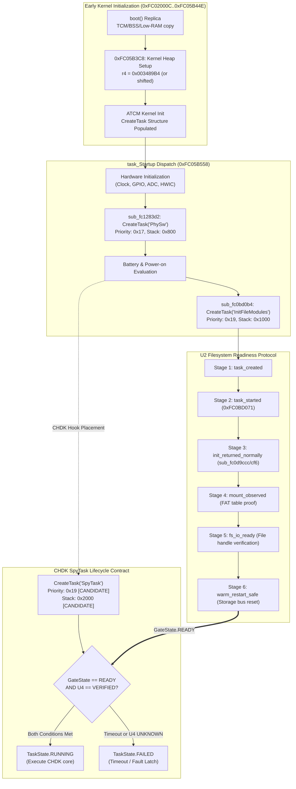

# PORT-12C — U4 SpyTask Startup Scheduling and Gating Contract (Offline)

**Worker**: Gemini Worker 3 (PORT-12C SpyTask U4)  
**Coordinator**: Gemini Coordinator  
**Tech Lead**: ChatGPT  
**Baseline**: `origin/main` @ `581b1a4bb30456bf18c46dc4bcf61b0375aee251`  
**Date**: 2026-10-28  
**Status**: **`RESEARCH_COMPLETE / DRAFT_PR_FOR_REVIEW`**  
**Safety Gate**: **`STRICT NO-GO FOR HARDWARE DEPLOYMENT`** (Phase 0 Offline Read-Only Investigation)

---

## 1. Executive Summary & Objective

The objective of milestone **PORT-12C (Issue #22)** is to define a defensible static and lifecycle contract for creating and scheduling **`SpyTask`** on Canon PowerShot G3 X (Firmware **GM1.10C**, DIGIC 6), without assuming that Ranma's historical GM1.10E launch point, scheduling priority, or stack allocation are verified or safe for GM1.10C.

### Key Conclusions
1. **Decoupling Historical GM1.10E Parameters from GM1.10C Ground Truth**:
   - **`HISTORICAL_CANDIDATE` (GM1.10E)**: Ranma created `SpyTask` at the tail end of `task_Startup_my` after 19 stock subroutines with:
     ```c
     CreateTask_spytask(); // _CreateTask("SpyTask", 0x19, 0x2000, spytask, 0)
     ```
   - **`UNKNOWN` on GM1.10C (U4)**:
     - Priority `0x19` (25) directly collides with stock `InitFileModules` (priority `0x19`, verified in Slice `S2A`). Under DryOS priority-based round-robin scheduling, running compute-heavy CHDK scripts at priority 25 risks starving filesystem write flushes and storage driver completion callbacks.
     - Stack size `0x2000` (8,192 B): In stock DryOS, normal tasks allocate between 1,024 B (`InitFileModules`) and 2,048 B (`PhySw`). An 8 KiB stack allocated from the DryOS heap during early startup must be accounted for against heap headroom.
2. **Fail-Closed Gating Contract**:
   - `SpyTask` MUST remain in `TaskState.WAITING_GATE` until all 6 filesystem readiness stages (U2) are proven AND U4 is verified.
   - Unlike legacy CHDK ports (which timed out after 10 seconds and launched anyway, causing storage corruptions and kernel panics), our offline model enforces **`spytask_gate_timeout() -> TaskState.FAILED`**.
3. **Phase 0 Safety Gate**:
   - In `tools/port9a_runtime_lifecycle.py`, `u4_spytask_creation_priority_and_dependencies` remains **`EvidenceStatus.UNKNOWN`**.
   - No code hooks are installed, no `SpyTask` payload is un-commented, and all runtime switches remain fail-closed.

---

## 2. Dependency Graph: From `task_Startup` to `SpyTask`

The following dependency graph models the stock Canon startup sequence and CHDK task creation order on GM1.10C:



---

## 3. Parameter Comparison: Historical GM1.10E vs. GM1.10C Ground Truth

| Parameter / Dimension | Ranma GM1.10E Patch | GM1.10C Tracked Evidence | Status / Risk Evaluation |
|---|---|---|:---:|
| **Launch Site** | End of `task_Startup_my`, line 484 (`P:1759`) after `sub_fc0bb6fe`. | Currently disabled in `boot_prototype.c:411–416` ("Prevents premature thread execution"). | **`HISTORICAL_CANDIDATE`**. Launch site in `task_Startup` on GM1.10C requires verified subroutines. |
| **Task Name** | `"SpyTask"` | `"SpyTask"` | **`HISTORICAL_CANDIDATE`** |
| **Scheduling Priority** | `0x19` (25 decimal) | Stock `InitFileModules` is `0x19` (`S2A`), stock `PhySw` is `0x17` (`S3A`). | **`UNKNOWN` (Collision Risk)**: Sharing priority 25 with filesystem driver risks thread starvation. Priority `0x1E` or `0x20` is a safer candidate. |
| **Stack Allocation** | `0x2000` (8,192 bytes) | Stock tasks allocate `0x800` (2 KiB) or `0x1000` (4 KiB). | **`UNKNOWN` (Heap Impact)**: 8 KiB stack is large for DryOS; must be proved against heap fragmentation. |
| **Continuation Branch** | Tail branch `b.w sub_fc0d0126` (`P:1762`). | `b.w sub_fc0d0126` (`C:434`). | **`VERIFIED_IN_EXISTING_DOCS`** (Addresses match in both builds; semantic continuation). |
| **Readiness Synchronization** | Gated by `core_spytask_can_start()` latch in `InitFileModules`. | Gated by 6-stage lifecycle state machine in `port9a_runtime_lifecycle.py`. | **`INFERRED` (Design Contract)**. Fail-closed latch with zero legacy bypass. |

---

## 4. Explicit Ownership, Task Lifetime, Stack, and Restart Assumptions

1. **CPU Execution Context**:
   - **Mode**: DryOS user tasks execute in ARM **System Mode** (privileged, sharing User-mode register bank `r0–r14`) with **IRQ and FIQ enabled** (`CPSR[7:6] = 0b00`).
   - **Exception Handlers**: `SpyTask` runs outside interrupt context; blocking calls (`SleepTask`, `TakeSemaphore`) are permitted.
2. **Stack Ownership & Lifetime**:
   - The task stack (`0x2000` bytes) is dynamically allocated by the DryOS `CreateTask` kernel allocator from DryOS Pool 0 (`0x003C89B4..0x00600013`).
   - The stack memory is owned by DryOS and freed only when the task exits. Because `SpyTask` is an infinite event loop, its stack allocation is **permanent** until shutdown or reboot.
3. **Interrupt & Concurrency Boundary**:
   - `SpyTask` must never disable interrupts globally or execute lengthy compute loops without yielding (`SleepTask(10)` or `ReceiveMessageQueue`).
4. **Shutdown & Restart Lifecycle**:
   - On camera power-down, lens retraction, or warm restart, `SpyTask` must terminate gracefully.
   - If a restart occurs, `SpyTask` must release all held DryOS semaphores, condvars, and mutexes. Lingering locks cause the next boot generation to freeze on kernel initialization.

---

## 5. Offline Synthetic Positive and Negative Traces

To verify the U4 contract deterministically, `tests/test_port12c_spytask_u4.py` implements six synthetic traces:

### Trace 1: Early-Start Attempt Before Filesystem Ready
- `create_spytask()` invoked during early boot.
- `GateState` is `ARMED`, but filesystem is only at `TASK_CREATED`.
- **Verdict**: `SpyTask` stays in `WAITING_GATE`. It does NOT run.

### Trace 2: Absent U2 Proof
- All early boot tasks run, but `InitFileModules` fails mount verification.
- **Verdict**: `GateState` transitions to `FAILED`; `SpyTask` remains blocked and does not start.

### Trace 3: Gate READY but U4 UNKNOWN (GM1.10C Baseline)
- All 6 U2 filesystem readiness stages are satisfied (`GateState.READY`).
- Static evidence profile has `u4_spytask_creation_priority_and_dependencies = EvidenceStatus.UNKNOWN`.
- **Verdict**: `_try_run_spytask()` logs `spytask_blocked_u4` and refuses to advance `SpyTask` to `RUNNING`.

### Trace 4: Duplicated Task Creation
- Software attempts to invoke `create_spytask()` twice in the same boot cycle.
- **Verdict**: Second call is ignored (`create_spytask_repeat`), returning existing state without corrupting task handles.

### Trace 5: Stale Generation across Warm Restart
- Boot generation advances from 1 to 2.
- A lingering latch or notification from generation 1 attempts to release `SpyTask` in generation 2.
- **Verdict**: Generation mismatch is detected; gate transitions to `FAILED`; `SpyTask` is contained.

### Trace 6: Fault-After-Replacement Containment
- Intercept is installed, and tasks are created. A CPU prefetch abort occurs before filesystem readiness.
- **Verdict**: Fault is latched; all subsequent task advancement is blocked fail-closed.

---

## 6. Ranked Unknowns & Proof Checklist for Later Authorized Research

The following unknowns must be resolved before `SpyTask` can be enabled on GM1.10C:
1. **Rank 1 (Priority Collision)**: Statically determine whether DryOS task priority `0x19` causes scheduling conflicts with `InitFileModules` (`0x19`), `PhySw` (`0x17`), or `DisplayTask`.
2. **Rank 2 (Stack Placement & Sizing)**: Verify whether a 4 KiB stack (`0x1000`) is sufficient for `SpyTask` to reduce heap footprint.
3. **Rank 3 (Display Subsystem Dependency)**: Determine whether `SpyTask` depends on Canon's display subsystem (`task_Display`) being online before executing GUI primitives.
4. **Rank 4 (Warm Restart Clean Teardown)**: Prove that `SpyTask` terminates cleanly during software-triggered reboot without leaving dangling semaphore locks.

---

## 7. Safety Compliance

- Zero code hooks installed.
- No `SpyTask` uncomment in `boot_prototype.c`.
- Zero ROM reads or hardware operations performed.
- Hardware gate remains **`STRICT NO-GO`**.
