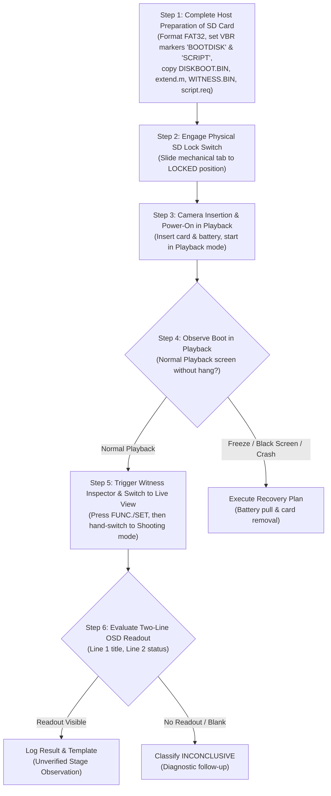

# PORT-16: Owner Trial and Recovery Plan for Corrected First-Boot Candidate

**Target Device**: Canon PowerShot G3 X (`AGENTS.md:3; docs/PORT16_CANDIDATE_BUILD.md:4; docs/CHDK_PORT0D_BOOT_RECOVERY.md:3`) `[VERIFIED: docs/PORT16_CANDIDATE_BUILD.md:4; docs/CHDK_PORT0D_BOOT_RECOVERY.md:3]`  
**Target Firmware Revision**: GM1.10C (Platform ID `0x32A8` = 12968 dec, DIGIC 6, DryOS 57) (`docs/CHDK_PORT0D_BOOT_RECOVERY.md:3; docs/PORT16_CANDIDATE_BUILD.md:4; docs/FIRMWARE_ACQUISITION_PLAN.md:17-21`) `[VERIFIED: docs/CHDK_PORT0D_BOOT_RECOVERY.md:3; docs/PORT16_CANDIDATE_BUILD.md:4; docs/FIRMWARE_ACQUISITION_PLAN.md:17-21]`  
**Document Status**: Candidate Owner Trial & Recovery Plan (`docs/PORT16_CANDIDATE_BUILD.md:1-8`) `[VERIFIED: docs/PORT16_CANDIDATE_BUILD.md:1-8]`  
**Safety Gate**: **STRICT NO-GO FOR HARDWARE EXECUTION** (`docs/PORT16_CANDIDATE_BUILD.md:27, 450`) `[VERIFIED: docs/PORT16_CANDIDATE_BUILD.md:27, 450]`. The hardware procedure may ONLY start after the owner's separate, explicit phase-transition approval under `AGENTS.md:18-22` and `docs/SAFETY.md:7` `[VERIFIED: AGENTS.md:18-22; docs/SAFETY.md:7]`. This trial plan and the passing host checks do NOT grant that approval; `docs/PORT16_CANDIDATE_BUILD.md:27, 450` still records hardware NO-GO (`docs/PORT16_CANDIDATE_BUILD.md:27, 450`) `[VERIFIED: docs/PORT16_CANDIDATE_BUILD.md:27, 450]`. If and when explicit owner phase-transition approval is granted, the human owner carries out every physical step by hand (`AGENTS.md:18-22; docs/SAFETY.md:7`) `[VERIFIED: AGENTS.md:18-22; docs/SAFETY.md:7]`.  
**Baseline Git Commit**: `a554718` (`origin/agentbridge/g3x-lite/port-16-firstboot-pipeline/integration`) `[VERIFIED: git rev-parse origin/agentbridge/g3x-lite/port-16-firstboot-pipeline/integration]`  

---

## 1. Candidate Identity & Cryptographic Ledger

The first-boot candidate was built and validated offline in milestone `p16-candidate-rebuild-r3` (`docs/PORT16_CANDIDATE_BUILD.md:1-28`) `[VERIFIED: docs/PORT16_CANDIDATE_BUILD.md:1-28]`. All metrics and artifact hashes below are cited directly from `docs/PORT16_CANDIDATE_BUILD.md` and `docs/PORT16_WITNESS_ADDRESS.md` and must match the rebuilt candidate artifacts bit-for-bit before any physical trial is attempted (`docs/PORT16_CANDIDATE_BUILD.md:350-372`) `[VERIFIED: docs/PORT16_CANDIDATE_BUILD.md:350-372]`.

### 1.1 Candidate Build Invocations and Addresses
- **Candidate Build Command**: `python3 -B tools/build_candidate_port2a.py` (`docs/PORT16_CANDIDATE_BUILD.md:113`) `[VERIFIED: docs/PORT16_CANDIDATE_BUILD.md:113]`
- **Pinned Toolchain**: `toolchains/gcc-arm-none-eabi-5_4-2016q3` (ARM GNU-RM 5.4.1 2016q3) (`docs/PORT16_CANDIDATE_BUILD.md:20, 80-101`) `[VERIFIED: docs/PORT16_CANDIDATE_BUILD.md:20, 80-101]`
- **Candidate Core Origin (`_start`)**: `0x003489B4` (Thumb-2 vector entry `0x003489B5`) (`docs/PORT16_CANDIDATE_BUILD.md:122, 163, 244, 279; docs/PORT16_WITNESS_ADDRESS.md:90, 279`) `[VERIFIED: docs/PORT16_CANDIDATE_BUILD.md:163; docs/PORT16_WITNESS_ADDRESS.md:90]`
- **Candidate Boot Witness Symbol Address (`boot_witness`)**: **`0x0035F7A0`** (Section `.data`, Type `D`, 16-byte aligned, 32 bytes) (`docs/PORT16_CANDIDATE_BUILD.md:23, 125, 163, 208, 247, 276; docs/PORT16_WITNESS_ADDRESS.md:15-16, 143, 213, 276`) `[VERIFIED: docs/PORT16_CANDIDATE_BUILD.md:23; docs/PORT16_WITNESS_ADDRESS.md:15-16]`
- **Candidate Linker End Symbol (`_end`)**: **`0x00366CB0`** (Section `.bss`, Type `B`, shifted heap boundary) (`docs/PORT16_CANDIDATE_BUILD.md:24, 163, 228, 250, 278; docs/PORT16_WITNESS_ADDRESS.md:218, 278`) `[VERIFIED: docs/PORT16_CANDIDATE_BUILD.md:24; docs/PORT16_WITNESS_ADDRESS.md:218]`
- **Loader Handoff Address**: `0x00008000` (`docs/PORT16_CANDIDATE_BUILD.md:124; docs/CHDK_PORT0D_BOOT_RECOVERY.md:23`) `[VERIFIED: docs/PORT16_CANDIDATE_BUILD.md:124; docs/CHDK_PORT0D_BOOT_RECOVERY.md:23]`
- **Encoding Scheme**: Dancingbits Row 13 with single-byte header `0x00` (`docs/PORT16_CANDIDATE_BUILD.md:127-128; docs/CHDK_PORT0D_BOOT_RECOVERY.md:134-136`) `[VERIFIED: docs/PORT16_CANDIDATE_BUILD.md:127-128; docs/CHDK_PORT0D_BOOT_RECOVERY.md:134-136]`

### 1.2 Pinned Candidate Release Artifacts
All hashes and file lengths are recorded in the cryptographically locked manifest `candidate_port2a/candidate_manifest.json` (`docs/PORT16_CANDIDATE_BUILD.md:175-181, 358-372`) `[VERIFIED: docs/PORT16_CANDIDATE_BUILD.md:175-181, 358-372]`:

| Artifact Filename | Relative Worktree Path | Exact Size (Bytes) | SHA-256 Checksum | Classification |
|---|---|---:|---|:---:|
| **`DISKBOOT.BIN`** | `candidate_port2a/DISKBOOT.BIN` | 118,001 | `9468257364d753d9880791bfce0c0792dd5d0fee29b832566a5eca622a906136` | `VERIFIED: docs/PORT16_CANDIDATE_BUILD.md:362` |
| **`candidate_main.bin`** | `candidate_port2a/candidate_main.bin` | 116,816 | `420b3842ed56b59dc7cd24d0fb5e311fad1aec36ed38825b435d5030a314a56e` | `VERIFIED: docs/PORT16_CANDIDATE_BUILD.md:359` |
| **`candidate_main.elf`** | `candidate_port2a/candidate_main.elf` | 211,616 | `2a07ef02109ecc35bc1865bd0ccf7a8329a17dcf3574fa43691295a6d3ae3c93` | `VERIFIED: docs/PORT16_CANDIDATE_BUILD.md:358` |
| **`candidate_loader.bin`** | `candidate_port2a/candidate_loader.bin` | 118,000 | `2dab82272a15db45685f411926d6da32b54e158808a6ff3919b0c035c28a914a` | `VERIFIED: docs/PORT16_CANDIDATE_BUILD.md:361` |
| **`candidate_loader.elf`** | `candidate_port2a/candidate_loader.elf` | 120,176 | `61812193ec9de3fa4a43094e0fd595ac5982251641a81bc980248c8b24ac5509` | `VERIFIED: docs/PORT16_CANDIDATE_BUILD.md:360` |
| **`witness_inspector_gm110c.m`** | `candidate_port2a/witness_inspector_gm110c.m` | 5,580 | `7a53835f7048b3c9e8be3c545efb9b14a85676a7b856de7899ae00dcd697c28f` | `VERIFIED: docs/PORT16_CANDIDATE_BUILD.md:363` |
| **`witness_inspector_payload.bin`**| `candidate_port2a/witness_inspector_payload.bin`| 444 | `241420a6eea2d7cbedd14046ec4f5988ed0404c5a82bb5d2ed6693fd74e612e2` | `VERIFIED: docs/PORT16_CANDIDATE_BUILD.md:364` |
| **`candidate_manifest.json`** | `candidate_port2a/candidate_manifest.json` | 2,766 | `d1cac2f4a0de41b5058d7776a63fe19dbbb7acd42bccc99c63ad7bfb22310135` | `VERIFIED: docs/PORT16_CANDIDATE_BUILD.md:370` |
| **`witness_inspector_metadata.json`**| `candidate_port2a/witness_inspector_metadata.json`| 288 | `8b78003bb5feeb9b7159a0f8147bb7028a8ba809d2fd926e7bcd8359b3844295` | `VERIFIED: docs/PORT16_CANDIDATE_BUILD.md:371` |

---

## 2. Host-Side Pre-Trial Verification Protocol

Before touching any physical camera hardware or SD card, the owner must re-run and verify the host-side build and validation pipeline to confirm that the host environment produces bit-for-bit identical candidate artifacts (`docs/PORT16_CANDIDATE_BUILD.md:18-22, 107-189; docs/SAFETY.md:7`) `[VERIFIED: docs/PORT16_CANDIDATE_BUILD.md:18-22; docs/SAFETY.md:7]`.

### 2.1 Passed Host Checks Summary
In milestone `p16-candidate-rebuild-r3`:
1. `candidate_build` (`tools/build_candidate_port2a.py`) passed cleanly with exit code `0` (`docs/PORT16_CANDIDATE_BUILD.md:21, 118`) `[VERIFIED: docs/PORT16_CANDIDATE_BUILD.md:21, 118]`.
2. `candidate_validate` (`tools/validate_candidate_port2a.py`) passed cleanly with exit code `0` across all 7 test suites (`docs/PORT16_CANDIDATE_BUILD.md:22, 150, 183`) `[VERIFIED: docs/PORT16_CANDIDATE_BUILD.md:22, 150, 183]`:
   - Suite 1: Canonical production invariance (`DISKBOOT.BIN`, `loader/g3x/main.c`, `platform/g3x/sub/110c/boot.c` unaltered) (`docs/PORT16_CANDIDATE_BUILD.md:158-161, 396-404`) `[VERIFIED: docs/PORT16_CANDIDATE_BUILD.md:158-161]`.
   - Suite 2: Candidate core artifacts (`_start=0x003489B4`, `boot_witness=0x0035F7A0`, `_end=0x00366CB0`, Thumb-2 entry `0xF000B800`) (`docs/PORT16_CANDIDATE_BUILD.md:162-164`) `[VERIFIED: docs/PORT16_CANDIDATE_BUILD.md:162-164]`.
   - Suite 3: Candidate loader artifacts & payload embedding (`0x280` payload matches `candidate_main.bin`, handoff sequence verified) (`docs/PORT16_CANDIDATE_BUILD.md:165-167`) `[VERIFIED: docs/PORT16_CANDIDATE_BUILD.md:165-167]`.
   - Suite 4: Encoded SD bootloader (`DISKBOOT.BIN` reversible decoding verified) (`docs/PORT16_CANDIDATE_BUILD.md:168-169`) `[VERIFIED: docs/PORT16_CANDIDATE_BUILD.md:168-169]`.
   - Suite 5: Disjoint memory and stack lifetime (zero overlap across Loader Stack `0x7FE0..0x8000`, Core Boot Stack `0x3F00..0x4000`, Core `0x003489B4`, BSS `0x00365204`, and Shifted Heap `0x00366CB0`) (`docs/PORT16_CANDIDATE_BUILD.md:170-171; docs/CHDK_PORT2A_CANDIDATE_INTEGRATION.md:98-108`) `[VERIFIED: docs/PORT16_CANDIDATE_BUILD.md:170-171]`.
   - Suite 6: Associated Canon Basic inspector integration (444 B payload, size binding, freshness invariants) (`docs/PORT16_CANDIDATE_BUILD.md:172-173`) `[VERIFIED: docs/PORT16_CANDIDATE_BUILD.md:172-173]`.
   - Suite 7: Candidate manifest integrity (all 7 release artifacts match manifest hashes) (`docs/PORT16_CANDIDATE_BUILD.md:174-182`) `[VERIFIED: docs/PORT16_CANDIDATE_BUILD.md:174-182]`.

### 2.2 Re-Running Candidate Build & Validation on the Host
The owner executes the following exact sequence on the host workstation before preparing the SD card:

```bash
# Step 1: Confirm toolchain availability and version
toolchains/gcc-arm-none-eabi-5_4-2016q3/bin/arm-none-eabi-gcc --version

# Step 2: Bootstrap canonical platform headers (PORT-8A deterministic bootstrap)
python3 -B tools/bootstrap_chdk_platform.py

# Step 3: Rebuild candidate artifacts directly from working tree source
python3 -B tools/build_candidate_port2a.py

# Step 4: Execute candidate validator across all 7 suites
python3 -B tools/validate_candidate_port2a.py

# Step 5: Verify SHA-256 checksum of generated DISKBOOT.BIN
sha256sum candidate_port2a/DISKBOOT.BIN
```
`[VERIFIED: tools/build_candidate_port2a.py; tools/validate_candidate_port2a.py; docs/PORT16_CANDIDATE_BUILD.md:113, 145]`

**Owner Host Acceptance Criterion**: Exit codes for Steps 2, 3, and 4 must all be `0`, and Step 5 must yield exact checksum `9468257364d753d9880791bfce0c0792dd5d0fee29b832566a5eca622a906136` (`docs/PORT16_CANDIDATE_BUILD.md:362`) `[VERIFIED: docs/PORT16_CANDIDATE_BUILD.md:362]`. If any command fails or any hash differs, the trial is immediately aborted (`docs/SAFETY.md:7`) `[VERIFIED: docs/SAFETY.md:7]`.

---

## 3. Owner Preconditions Checklist

Every item in this checklist must be physically confirmed by the owner before inserting any card into the camera (`docs/SAFETY.md:7; AGENTS.md:18-22`) `[VERIFIED: docs/SAFETY.md:7; AGENTS.md:18-22]`:

- [ ] **1. Exact Camera Model**: Canon PowerShot G3 X (`AGENTS.md:3; docs/SAFETY.md:7; docs/CHDK_PORT0D_BOOT_RECOVERY.md:3; docs/PORT16_CANDIDATE_BUILD.md:4`) `[VERIFIED: docs/SAFETY.md:7; docs/CHDK_PORT0D_BOOT_RECOVERY.md:3; docs/PORT16_CANDIDATE_BUILD.md:4]`. Confirm that the physical camera body label displays "PowerShot G3 X" `[INFERRED]`.
- [ ] **2. Exact Firmware Revision GM1.10C Confirmation (Blocking Precondition)**: Target firmware build is strictly `GM1.10C` (Platform ID `0x32A8` = 12968 dec) (`AGENTS.md:3; docs/PORT16_CANDIDATE_BUILD.md:4; docs/FIRMWARE_ACQUISITION_PLAN.md:17-21`) `[VERIFIED: docs/PORT16_CANDIDATE_BUILD.md:4; docs/FIRMWARE_ACQUISITION_PLAN.md:17-21]`.
  - *Firmware Confirmation Method*: A tracked on-camera procedure to independently query or display the internal build letter (`GM1.10C`) from stock firmware menus or key combinations is `[UNKNOWN: no procedure to display the internal build letter on camera without Canon Basic is tracked in the repository]`. Standard Canon setup menus display only the public version string `1.1.0.0`, which cannot differentiate internal build `GM1.10C` from `GM1.10E` (`docs/FIRMWARE_ACQUISITION_PLAN.md:19-20`) `[VERIFIED: docs/FIRMWARE_ACQUISITION_PLAN.md:19-20]`. Unsupported key combinations (e.g. `ver.req` with `FUNC./SET + DISP.`) are unverified and not supported on G3 X (`docs/CANON_BASIC_ACTIVATION_INVESTIGATION.md:1-18; docs/RESEARCH_LOG.md:10, 43`) `[VERIFIED: docs/CANON_BASIC_ACTIVATION_INVESTIGATION.md:1-18; docs/RESEARCH_LOG.md:10, 43]`.
  - *Mandatory Blocking Precondition*: Exact confirmation of internal build `GM1.10C` is a mandatory blocking precondition (`docs/SAFETY.md:7; docs/FIRMWARE_ACQUISITION_PLAN.md:19-25`) `[VERIFIED: docs/SAFETY.md:7; docs/FIRMWARE_ACQUISITION_PLAN.md:19-25]`. If the owner cannot confirm internal build `GM1.10C` on the physical camera via prior verified diagnostic records (e.g. `docs/RESEARCH_LOG.md:50: E037`), the owner **MUST NOT** proceed with this trial (`docs/SAFETY.md:7; docs/FIRMWARE_ACQUISITION_PLAN.md:25`) `[VERIFIED: docs/SAFETY.md:7; docs/FIRMWARE_ACQUISITION_PLAN.md:25]`. Do NOT proceed if the revision is `1.00C`, `GM1.10E`, or any unverified build (`docs/CANON_BASIC_ACTIVATION_INVESTIGATION.md:34-35; docs/FIRMWARE_ACQUISITION_PLAN.md:25`) `[VERIFIED: docs/CANON_BASIC_ACTIVATION_INVESTIGATION.md:34-35; docs/FIRMWARE_ACQUISITION_PLAN.md:25]`.
- [ ] **3. Dedicated, Fully Charged Battery (NB-10L)**: The trial requires reliable, uninterrupted power (`docs/SAFETY.md:7: "verify model/revision, reliable power, reversible loading, known recovery path, owner approval..."`) `[VERIFIED: docs/SAFETY.md:7]`. The Canon NB-10L battery must be freshly charged to 100% using an external charger `[INFERRED: docs/SAFETY.md:7]`. Low battery during early boot can cause abrupt shutdown during hardware driver initialization `[INFERRED]`.
- [ ] **4. Dedicated Spare SD Card**: Use a dedicated spare SD card (e.g. 16 GB or 32 GB SDHC card formatted with FAT32 or FAT16) dedicated solely to testing (`docs/SAFETY.md:7; docs/CHDK_PORT0D_BOOT_RECOVERY.md:107`) `[VERIFIED: docs/SAFETY.md:7; docs/CHDK_PORT0D_BOOT_RECOVERY.md:107]`. The card must contain zero personal photographs or critical files `[INFERRED: docs/SAFETY.md:7]`.
- [ ] **5. Physical Write-Protect Lock Switch Operable**: The SD card's physical write-protect slide switch must be inspected and confirmed intact and functional (`docs/CHDK_PORT0D_BOOT_RECOVERY.md:93-100`) `[VERIFIED: docs/CHDK_PORT0D_BOOT_RECOVERY.md:93-100]`.
- [ ] **6. Phase 0 Safety Boundary and Owner Phase-Transition Approval**: The hardware procedure may ONLY start after the owner's separate, explicit phase-transition approval under `AGENTS.md:18-22` and `docs/SAFETY.md:7` `[VERIFIED: AGENTS.md:18-22; docs/SAFETY.md:7]`. A person carrying out the steps by hand does NOT authorize the trial, and this plan and the passing host checks do NOT grant that approval (`docs/PORT16_CANDIDATE_BUILD.md:27, 450`) `[VERIFIED: docs/PORT16_CANDIDATE_BUILD.md:27, 450]`. `docs/PORT16_CANDIDATE_BUILD.md:27, 450` still records hardware `NO-GO` (`docs/PORT16_CANDIDATE_BUILD.md:27, 450`) `[VERIFIED: docs/PORT16_CANDIDATE_BUILD.md:27, 450]`.

---

## 4. Ordered Owner Step-by-Step Trial Protocol

The trial proceeds through five sequential steps executed entirely by the owner in a single powered session (`AGENTS.md:18-22; docs/SAFETY.md:7`) `[VERIFIED: AGENTS.md:18-22; docs/SAFETY.md:7]`. All SD card files and VBR markers are prepared on the host workstation BEFORE the card is locked and inserted into the camera:



### Step 1: Complete Host Preparation of SD Card (All Files & Markers Before Camera Insertion)
The owner prepares all files, request tokens, and boot markers on the SD card before the card ever enters the camera (`firmware/tools/witness_inspector_gm110c.m:1-100; docs/CANON_BASIC_ACTIVATION_INVESTIGATION.md:20-50; docs/CHDK_PORT0D_BOOT_RECOVERY.md:53, 111-120`) `[VERIFIED: firmware/tools/witness_inspector_gm110c.m:1-100; docs/CANON_BASIC_ACTIVATION_INVESTIGATION.md:20-50; docs/CHDK_PORT0D_BOOT_RECOVERY.md:53, 111-120]`:

1. Connect the dedicated spare SD card to the host workstation via an external USB card reader.
2. Format the card partition as standard FAT32 (or FAT16) (`docs/CHDK_PORT0D_BOOT_RECOVERY.md:107`) `[VERIFIED: docs/CHDK_PORT0D_BOOT_RECOVERY.md:107]`.
3. **Write VBR Marker 1 (`BOOTDISK`)**: Write the exact 8-byte ASCII string `BOOTDISK` at byte offset `0x40` (64 dec) of the partition Volume Boot Record (VBR, sector 0 of the filesystem partition) (`docs/CHDK_PORT0D_BOOT_RECOVERY.md:53, 111-120`) `[VERIFIED: docs/CHDK_PORT0D_BOOT_RECOVERY.md:53, 111-120]`:
   ```bash
   # Linux VBR preparation (replace /dev/sdX1 with your actual target partition):
   echo -n "BOOTDISK" | sudo dd of=/dev/sdX1 bs=1 seek=64 count=8 conv=notrunc
   ```
4. **Write VBR Marker 2 (`SCRIPT`)**: Write the exact 6-byte ASCII string `SCRIPT` at byte offset `0x1F0` (496 dec) of the partition Volume Boot Record (`docs/CANON_BASIC_ACTIVATION_INVESTIGATION.md:22, 48`) `[VERIFIED: docs/CANON_BASIC_ACTIVATION_INVESTIGATION.md:22, 48]`:
   ```bash
   # Linux VBR Canon Basic marker preparation:
   echo -n "SCRIPT" | sudo dd of=/dev/sdX1 bs=1 seek=496 count=6 conv=notrunc
   ```
5. **Copy Candidate Bootloader (`DISKBOOT.BIN`)**: Copy `candidate_port2a/DISKBOOT.BIN` (118,001 B, SHA-256 `9468257364d753d9880791bfce0c0792dd5d0fee29b832566a5eca622a906136`) directly to the root directory of the SD card (`docs/PORT16_CANDIDATE_BUILD.md:362; docs/CHDK_PORT0D_BOOT_RECOVERY.md:128`) `[VERIFIED: docs/PORT16_CANDIDATE_BUILD.md:362; docs/CHDK_PORT0D_BOOT_RECOVERY.md:128]`.
6. **Copy Canon Basic Inspector Script (`extend.m`)**: Copy `candidate_port2a/witness_inspector_gm110c.m` (5,580 B, SHA-256 `7a53835f7048b3c9e8be3c545efb9b14a85676a7b856de7899ae00dcd697c28f`) to the SD card root directory and rename it to `extend.m` (`firmware/tools/witness_inspector_gm110c.m:1-25; docs/CANON_BASIC_ACTIVATION_INVESTIGATION.md:50`) `[VERIFIED: firmware/tools/witness_inspector_gm110c.m:1-25; docs/CANON_BASIC_ACTIVATION_INVESTIGATION.md:50]`.
7. **Copy Witness Inspector Native Payload (`WITNESS.BIN`)**: Copy `candidate_port2a/witness_inspector_payload.bin` (444 B, SHA-256 `241420a6eea2d7cbedd14046ec4f5988ed0404c5a82bb5d2ed6693fd74e612e2`) directly to the SD card root directory named `WITNESS.BIN` (accessed at camera runtime as path `A/WITNESS.BIN`) (`firmware/tools/witness_inspector_gm110c.m:100; docs/PORT16_CANDIDATE_BUILD.md:364`) `[VERIFIED: firmware/tools/witness_inspector_gm110c.m:100; docs/PORT16_CANDIDATE_BUILD.md:364]`.
8. **Create Canon Basic Request File (`script.req`)**: Create a plain ASCII file named `script.req` on the SD card root containing exactly the 17-byte string `for DC_scriptdisk` (no trailing carriage return or newline) (`docs/CANON_BASIC_ACTIVATION_INVESTIGATION.md:20, 49`) `[VERIFIED: docs/CANON_BASIC_ACTIVATION_INVESTIGATION.md:20, 49]`:
   ```bash
   echo -n "for DC_scriptdisk" > /media/.../script.req
   ```
9. Sync and unmount the SD card cleanly on the host workstation (`sync && sudo umount /media/...`) `[INFERRED]`.

*Pre-Insertion Inventory Verification*: The SD card now contains all four required files (`DISKBOOT.BIN`, `extend.m`, `WITNESS.BIN`, `script.req`) and both VBR boot sector signatures (`BOOTDISK` at `0x40`, `SCRIPT` at `0x1F0`). Zero card modification or file additions occur after this point.

### Step 2: Engage Physical SD Card Write-Protect (LOCK) Switch
1. Remove the SD card from the host card reader.
2. Slide the mechanical write-protect switch on the side of the SD card to the **LOCKED** position (`docs/CHDK_PORT0D_BOOT_RECOVERY.md:93-100`) `[VERIFIED: docs/CHDK_PORT0D_BOOT_RECOVERY.md:93-100]`.
   - *Hardware Requirement*: DryOS `StartDiskboot` reads GPIO `0xD20B053C` bit 16 via `sub_fc05c4e0(1)` (`docs/CHDK_PORT0D_BOOT_RECOVERY.md:93-100`) `[VERIFIED: docs/CHDK_PORT0D_BOOT_RECOVERY.md:93-100]`. If the card is UNLOCKED, `StartDiskboot` immediately aborts and skips loading `DISKBOOT.BIN`, continuing stock firmware boot (`docs/CHDK_PORT0D_BOOT_RECOVERY.md:96, 178-179`) `[VERIFIED: docs/CHDK_PORT0D_BOOT_RECOVERY.md:96, 178-179]`.

### Step 3: Insert Card & Battery into Camera
1. Ensure the camera is powered completely off.
2. Insert the fully charged Canon NB-10L battery into the camera battery compartment (`docs/SAFETY.md:7`) `[VERIFIED: docs/SAFETY.md:7]`.
3. Insert the prepared, locked SD card into the SD card slot.
4. Firmly close and latch the battery/card door `[INFERRED]`.

### Step 4: First Boot Execution in Playback Mode
To allow Canon Basic inspector activation in the same powered session, the owner powers on the camera directly into Playback mode (`docs/CANON_BASIC_ACTIVATION_INVESTIGATION.md:23, 51-53`) `[VERIFIED: docs/CANON_BASIC_ACTIVATION_INVESTIGATION.md:23, 51-53]`:

1. Power on the camera by pressing the **Playback** button (`docs/CANON_BASIC_ACTIVATION_INVESTIGATION.md:23, 51-53`) `[VERIFIED: docs/CANON_BASIC_ACTIVATION_INVESTIGATION.md:23, 51-53]`.
2. Observe internal execution flow and camera behavior:
   - **Internal Execution Flow**:
     * ROM `StartDiskboot` (`0xFC05BBEA`) validates the locked card and `BOOTDISK` VBR marker (`docs/CHDK_PORT0D_BOOT_RECOVERY.md:46-54`) `[VERIFIED: docs/CHDK_PORT0D_BOOT_RECOVERY.md:46-54]`.
     * `DISKBOOT.BIN` is loaded to `0x40008000`, verified, and branched to at `0x00008001` in Thumb-2 mode (`docs/CHDK_PORT0D_BOOT_RECOVERY.md:58-65, 145-149`) `[VERIFIED: docs/CHDK_PORT0D_BOOT_RECOVERY.md:58-65, 145-149]`.
     * Candidate loader executes `my_restart()`, copies core payload to `0x003489B4`, records **Stage 1 (LOADER_REACHED = `0x01`)** into `boot_witness` at **`0x0035F7A0`** (`chdk-port/loader/g3x/main_prototype.c:40-55; docs/PORT16_WITNESS_ADDRESS.md:15-16; docs/PORT16_CANDIDATE_BUILD.md:23, 125, 163`) `[VERIFIED: chdk-port/loader/g3x/main_prototype.c:40-55; docs/PORT16_WITNESS_ADDRESS.md:15-16; docs/PORT16_CANDIDATE_BUILD.md:23]` (historical note: `docs/CHDK_PORT2A_CANDIDATE_INTEGRATION.md:58-69` recorded the pre-PORT-16 historical address `0x0035F780`), synchronizes L1 caches via DCCISW/ICIALLU, enforces disabled interrupts (`cpsid if`), and branches to core entry `0x003489B5` (`chdk-port/loader/g3x/main_prototype.c:58-95`) `[VERIFIED: chdk-port/loader/g3x/main_prototype.c:58-95]`.
     * Candidate core executes `boot()`, copies Low RAM, High RAM, and ATCM, zeroes Canon BSS strictly up to `0x003489B4`, and branches to `sub_fc05b3c8_my` (`chdk-port/platform/g3x/sub/110c/boot_prototype.c:85-158`) `[VERIFIED: chdk-port/platform/g3x/sub/110c/boot_prototype.c:85-158]`.
     * `sub_fc05b3c8_my()` calls `witness_record_core()` (`chdk-port/platform/g3x/sub/110c/boot_prototype.c:32-43, 170`), setting **Stage 2 (CORE_REACHED = `0x03`)** in `boot_witness` at `0x0035F7A0`, shifts the DryOS heap base to `new_sa` (`&_end = 0x00366CB0`), and dispatches into DryOS kernel initialization (`chdk-port/platform/g3x/sub/110c/boot_prototype.c:164-258`) `[VERIFIED: chdk-port/platform/g3x/sub/110c/boot_prototype.c:164-258]`.
     * DryOS initial task spawns hooked `task_Startup_my()` (`chdk-port/platform/g3x/sub/110c/boot_prototype.c:338-369`) `[VERIFIED: chdk-port/platform/g3x/sub/110c/boot_prototype.c:338-369]`.
     * `task_Startup_my()` initializes camera drivers, spawns `SD1stInit` via `sub_fc31b1f4`, omits `StartDiskboot` to prevent bootloop, keeps `SpyTask` completely disabled (`chdk-port/platform/g3x/sub/110c/boot_prototype.c:380-417`), calls `witness_record_continuation()` (`chdk-port/platform/g3x/sub/110c/boot_prototype.c:46-56, 430`) setting **Stage 3 (CONTINUATION_ATTEMPTED = `0x07`)** in `boot_witness` at `0x0035F7A0`, and executes terminal branch `b.w sub_fc0d0126` to continue stock Canon firmware boot (`chdk-port/platform/g3x/sub/110c/boot_prototype.c:433-435`) `[VERIFIED: chdk-port/platform/g3x/sub/110c/boot_prototype.c:380-435]`.
   - **Visual Observability from Boot Stub Source**:
     * Citing the boot stub source `chdk-port/platform/g3x/sub/110c/boot_prototype.c:1-436`, there are **NO** screen drawing routines, **NO** LCDMsg calls, and **NO** LED blinking sequences implemented in `boot()` or `task_Startup_my()` (`chdk-port/platform/g3x/sub/110c/boot_prototype.c:1-436`) `[VERIFIED: chdk-port/platform/g3x/sub/110c/boot_prototype.c:1-436]`.
     * Direct visual presentation of the witness structure from `boot_prototype.c` alone is **NOT PRESENT** in source; direct visual output from the boot binary itself is `[UNKNOWN: no display or LED routines in chdk-port/platform/g3x/sub/110c/boot_prototype.c:1-436]`.
   - **Expected Observable Result at Boot**:
     * The camera powers on normally without crashing or freezing `[INFERRED: chdk-port/platform/g3x/sub/110c/boot_prototype.c:433-435; docs/CHDK_PORT0D_BOOT_RECOVERY.md:171]`.
     * The LCD powers on into stock Playback mode, displaying existing photographs or "No images" (`docs/CANON_BASIC_ACTIVATION_INVESTIGATION.md:23`) `[INFERRED: docs/CANON_BASIC_ACTIVATION_INVESTIGATION.md:23]`. Actual display behaviour with this candidate is `[UNKNOWN until established by the owner's trial report]`.
     * Lens remains safely retracted in Playback mode `[INFERRED: docs/CHDK_PORT0D_BOOT_RECOVERY.md:187]`.
     * If the camera hangs, displays a black screen, or shuts off immediately, the trial has failed (proceed immediately to Section 6 Recovery Plan) `[INFERRED: docs/SAFETY.md:7]`.

### Step 5: On-Camera Witness Inspection & Live View Switch (Same Powered Session)
**Zero restart or card re-preparation occurs between Step 4 and Step 5.** Inspection executes in the exact same powered session while volatile DRAM retains the boot witness structure (`firmware/tools/witness_inspector_gm110c.m:1-189; docs/PORT16_CANDIDATE_BUILD.md:23-26`) `[VERIFIED: firmware/tools/witness_inspector_gm110c.m:1-189]`:

1. While the camera remains powered in Playback mode, press the **`FUNC./SET`** button once (`docs/CANON_BASIC_ACTIVATION_INVESTIGATION.md:23, 51-53`) `[VERIFIED: docs/CANON_BASIC_ACTIVATION_INVESTIGATION.md:23, 51-53]`.
   - Canon Basic detects `script.req` and the VBR `SCRIPT` marker, parses `extend.m`, allocates memory, loads `A/WITNESS.BIN` (444 B), synchronizes L1 Harvard caches, invokes the native inspector at `buf + 1`, reads `boot_witness` at `0x0035F7A0`, registers two OSD message handles (`h_title` and `h_status`), and finishes non-blocking (`firmware/tools/witness_inspector_gm110c.m:90-189`) `[VERIFIED: firmware/tools/witness_inspector_gm110c.m:90-189]`.
2. **Hand-Switch to Shooting Mode (Live View) Without Restarting**:
   - Immediately after pressing `FUNC./SET`, switch the camera by hand from Playback mode to Shooting mode (Live View) without powering off or restarting the camera (e.g. press the shutter button half-way or press the Playback/Shooting button) (`firmware/tools/witness_inspector_gm110c.m:185-188; docs/CHDK_PORT1G1_CRITICAL_FIXES.md:58-65`) `[INFERRED: firmware/tools/witness_inspector_gm110c.m:185-188]`.
   - *Technical Rationale*: The inspector script specifies:
     *"Message descriptors are intentionally retained in firmware RAM for Live View inspection in Shooting mode. Total dynamic footprint is strictly bounded to 112 bytes (two 56-byte descriptors)"* (`firmware/tools/witness_inspector_gm110c.m:185-188`) `[VERIFIED: source comment text at firmware/tools/witness_inspector_gm110c.m:185-188]`. That comment only states the intended descriptor retention for Live View inspection. The expectation that the Playback display may occlude the OSD messages and that the retained descriptors become visibly rendered after switching to Shooting mode is `[INFERRED: firmware/tools/witness_inspector_gm110c.m:185-188; docs/CANON_BASIC_ACTIVATION_INVESTIGATION.md:12, 23]`. Whether the readout is actually observable on the physical camera display is `[UNKNOWN until established by the owner's trial report]`.
3. **Observe Two-Line OSD Readout on LCD**:
   - Inspect the on-screen display in Live View for the two retained text lines. Expected result: two text lines rendered on the LCD `[INFERRED: firmware/tools/witness_inspector_gm110c.m:6-16, 83-84, 185-188]`; actual physical observability `[UNKNOWN until established by the owner's trial report]`. The strings, colours and positions below are what the inspector source defines (source definitions `[VERIFIED]`), not observed display results:
     * **Line 1 (`h_title` at position 60, 140)**: Stage indicator string (e.g. `CONT_ATTEMPTED` in Yellow) (`firmware/tools/witness_inspector_gm110c.m:7-12, 83`) `[VERIFIED source definition: firmware/tools/witness_inspector_gm110c.m:7-12, 83; on-screen appearance INFERRED]`.
     * **Line 2 (`h_status` at position 60, 180)**: Integrity & freshness string (e.g. `FRESHNESS_UNVERIFIED` in Yellow) (`firmware/tools/witness_inspector_gm110c.m:13-16, 84`) `[VERIFIED source definition: firmware/tools/witness_inspector_gm110c.m:13-16, 84; on-screen appearance INFERRED]`.
4. **Meaning If No Readout Is Observed**:
   - If the owner sees NO readout on the LCD in Live View (blank screen or standard Canon UI with no inspector text overlay), the trial outcome is **INCONCLUSIVE** (`firmware/tools/witness_inspector_gm110c.m:185-188; docs/CANON_BASIC_ACTIVATION_INVESTIGATION.md:12, 23-25`) `[INFERRED]`.
   - A missing readout indicates one of four failure modes:
     1. Canon Basic script activation failed to trigger (e.g. `script.req` or VBR `SCRIPT` marker unread, or `FUNC./SET` did not launch interpreter) (`docs/CANON_BASIC_ACTIVATION_INVESTIGATION.md:10, 23-25`) `[INFERRED]`.
     2. `A/WITNESS.BIN` was missing from the SD card root or returned a file open error (`firmware/tools/witness_inspector_gm110c.m:100-106`) `[VERIFIED: firmware/tools/witness_inspector_gm110c.m:100-106]`.
     3. The DryOS display compositor failed to composite the retained `LCDMsg` descriptors onto the active display layer (`firmware/tools/witness_inspector_gm110c.m:185-188`) `[INFERRED]`.
     4. The camera booted factory stock firmware directly without executing `DISKBOOT.BIN` (or crashed/rebooted prior to inspector execution) (`docs/CHDK_PORT0D_BOOT_RECOVERY.md:96, 178-179`) `[INFERRED]`.
5. Capture a clear digital photograph of the camera LCD showing any displayed text overlay, error code, or standard UI icons for documentation (`Section 7`).

---

## 5. Witness Inspection Architecture & Output Matrix

### 5.1 Host Tool Status for Post-Trial Witness Readout
- **Host-Side Result Inspection Tool**: `[UNKNOWN: no post-trial host inspection tool is tracked in the repository]`
  - While host-side offline *validators* exist (`tools/validate_candidate_port2a.py`, `tools/validate_witness_inspector.py`, `tools/validate_boot_witness.py`), the repository contains **no tracked host tool** that connects over USB or reads raw DRAM dumps to inspect the boot witness post-trial `[VERIFIED: codebase search in tools/ and tests/]`.
  - In the first-boot candidate, CHDK `SpyTask` and CHDK task startup are disabled (`chdk-port/platform/g3x/sub/110c/boot_prototype.c:412-417`) `[VERIFIED: chdk-port/platform/g3x/sub/110c/boot_prototype.c:412-417]`, so no CHDK log file is written to the SD card during boot `[INFERRED: chdk-port/platform/g3x/sub/110c/boot_prototype.c:412-417]`. Whether Canon firmware filesystem tasks may write files during or after boot is `[UNKNOWN]`.

### 5.2 Tracked On-Camera Witness Inspector
The tracked on-camera witness inspector associated with the candidate in `candidate_port2a/` consists of two artifacts (`docs/PORT16_CANDIDATE_BUILD.md:363-364`) `[VERIFIED: docs/PORT16_CANDIDATE_BUILD.md:363-364]`:
1. `candidate_port2a/witness_inspector_gm110c.m` (5,580 B, SHA-256 `7a53835f7048b3c9e8be3c545efb9b14a85676a7b856de7899ae00dcd697c28f`) (`docs/PORT16_CANDIDATE_BUILD.md:363`) `[VERIFIED: docs/PORT16_CANDIDATE_BUILD.md:363]`.
2. `candidate_port2a/witness_inspector_payload.bin` (444 B, SHA-256 `241420a6eea2d7cbedd14046ec4f5988ed0404c5a82bb5d2ed6693fd74e612e2`, target address `0x0035F7A0`) (`docs/PORT16_CANDIDATE_BUILD.md:364; docs/PORT16_CANDIDATE_BUILD.md:26, 434`) `[VERIFIED: docs/PORT16_CANDIDATE_BUILD.md:364]`.

### 5.3 Witness Inspector Output Matrix
The inspector executes native Thumb-2 instructions at `buf + 1`, reads `boot_witness` at `0x0035F7A0`, verifies magic `0x5749544E` (`"WITN"`), version `0x00010001`, and checksum, and creates two OSD message lines using native DryOS `LCDMsg` handles (source behaviour; physical rendering is INFERRED/UNKNOWN as stated below) (`firmware/tools/witness_inspector_gm110c.m:6-16, 52-89, 136-164; tools/validate_witness_inspector.py:65-74, 218-250`) `[VERIFIED: firmware/tools/witness_inspector_gm110c.m:6-16, 136-164; tools/validate_witness_inspector.py:218-250]`:
- **Line 1 (`h_title`)**: Position `(60, 140)` (`firmware/tools/witness_inspector_gm110c.m:83`) `[VERIFIED: firmware/tools/witness_inspector_gm110c.m:83]`
- **Line 2 (`h_status`)**: Position `(60, 180)` (`firmware/tools/witness_inspector_gm110c.m:84`) `[VERIFIED: firmware/tools/witness_inspector_gm110c.m:84]`

**Label scope for this matrix**: every `[VERIFIED]` label below refers to inspector or validator *source logic* (strings, colours, sentinels, classification branches). None of them is a physical display result. The expected on-screen rendering of each row is `[INFERRED: firmware/tools/witness_inspector_gm110c.m:185-188]`, and whether any row is actually observable on the camera LCD is `[UNKNOWN until established by the owner's trial report]`.

| Stage Observation | Expected On-Screen Display (INFERRED) | Display Colors | Return Sentinel | Diagnostic Classification & Semantic Invariants |
|---|---|---|---|---|
| **STAGE 3 OBSERVED**<br>(Unverified Continuation / Freshness Unverified) | **Line 1**: `CONT_ATTEMPTED`<br>**Line 2**: `FRESHNESS_UNVERIFIED` | Line 1: **Yellow** (Color 4)<br>Line 2: **Yellow** (Color 4) | `0x57495404`<br>(1464423428 dec) | **UNVERIFIED STAGE OBSERVATION (Not a PASS)**: All 3 early boot stages were recorded in witness memory: loader handoff (`0x01`), core pre-kernel (`0x03`), and continuation attempted (`0x07`) (`firmware/tools/witness_inspector_gm110c.m:8, 20`).<br>**Critical Semantic Invariants** (`firmware/tools/witness_inspector_gm110c.m:18-24; tools/validate_witness_inspector.py:494-504`):<br>1. This result does **NOT** confirm boot success or handoff completion (`firmware/tools/witness_inspector_gm110c.m:19`).<br>2. A matching fixed nonce (`0x32A80001`) or a stale replay from previous execution produces the exact same output (`firmware/tools/witness_inspector_gm110c.m:22; tools/validate_witness_inspector.py:494-504`).<br>3. Misleading success coloring (Green / Color 2) is strictly prohibited (`firmware/tools/witness_inspector_gm110c.m:21; tools/validate_witness_inspector.py:501`).<br>4. Result based on this observation alone is **INCONCLUSIVE** pending independent evidence (`firmware/tools/witness_inspector_gm110c.m:24`). |
| **STAGE 2 OBSERVED**<br>(Core Stage Recorded) | **Line 1**: `CORE_REACHED`<br>**Line 2**: `FRESHNESS_UNVERIFIED` | Line 1: **White** (Color 1)<br>Line 2: **Yellow** (Color 4) | `0x57495402`<br>(1464423426 dec) | **PARTIAL STAGE RECORDED (INCONCLUSIVE Current-Attempt Attribution)**: Stage 2 (`CORE_REACHED` = `0x03`) was recorded in witness memory (`firmware/tools/witness_inspector_gm110c.m:9; tools/validate_witness_inspector.py:242-243`) `[VERIFIED: firmware/tools/witness_inspector_gm110c.m:9; tools/validate_witness_inspector.py:242-243]`. Line 2 displays `FRESHNESS_UNVERIFIED` because `expected_nonce` defaults to `0` in the inspector script (`firmware/tools/witness_inspector_gm110c.m:28`), so no dynamic challenge check is executed (`tools/validate_witness_inspector.py:234-243`) `[VERIFIED: firmware/tools/witness_inspector_gm110c.m:28; tools/validate_witness_inspector.py:234-243]`. Attribution of this record to the current trial attempt is **INCONCLUSIVE** (it cannot be distinguished from stale memory retained across reboot); this observation does **not** prove that execution succeeded nor that later stages were never reached `[INFERRED]`. |
| **STAGE 1 OBSERVED**<br>(Loader Stage Recorded) | **Line 1**: `LOADER_REACHED`<br>**Line 2**: `FRESHNESS_UNVERIFIED` | Line 1: **White** (Color 1)<br>Line 2: **Yellow** (Color 4) | `0x57495401`<br>(1464423425 dec) | **PARTIAL STAGE RECORDED (INCONCLUSIVE Current-Attempt Attribution)**: Stage 1 (`LOADER_REACHED` = `0x01`) was recorded in witness memory (`firmware/tools/witness_inspector_gm110c.m:10; tools/validate_witness_inspector.py:240-241`) `[VERIFIED: firmware/tools/witness_inspector_gm110c.m:10; tools/validate_witness_inspector.py:240-241]`. Line 2 displays `FRESHNESS_UNVERIFIED` because `expected_nonce` defaults to `0` in the inspector script (`firmware/tools/witness_inspector_gm110c.m:28`), skipping any dynamic challenge check (`tools/validate_witness_inspector.py:234-243`) `[VERIFIED: firmware/tools/witness_inspector_gm110c.m:28; tools/validate_witness_inspector.py:234-243]`. Attribution of this record to the current trial attempt is **INCONCLUSIVE** (it cannot be distinguished from stale memory retained across reboot); this observation does **not** prove that execution succeeded nor that later stages were never reached `[INFERRED]`. |
| **FAIL**<br>(Corrupt Witness) | **Line 1**: `WITNESS_INVALID`<br>**Line 2**: `INVALID / CORRUPT` | Line 1: **Red** (Color 3)<br>Line 2: **Red** (Color 3) | `0x574954EE` | **FAIL**: Memory at `0x0035F7A0` contains uninitialized memory, bad magic, unsupported version, or checksum mismatch (`firmware/tools/witness_inspector_gm110c.m:12, 16; tools/validate_witness_inspector.py:221-233`) `[VERIFIED]`. |
| **FAIL**<br>(Stale Nonce Mismatch)| **Line 1**: `STALE / REPLAY`<br>**Line 2**: `NONCE_MISMATCH` | Line 1: **Yellow** (Color 4)<br>Line 2: **Yellow** (Color 4) | `0x574954FF` | **FAIL**: Dynamic challenge nonce mismatch detected (`firmware/tools/witness_inspector_gm110c.m:11, 15; tools/validate_witness_inspector.py:236-237`) `[VERIFIED]`. |
| **FAIL**<br>(Script Error) | **Line 1**: `PORT-1G: ERR_COMPAT` or `ERR_READ`<br>**Line 2**: `FIRMWARE MISMATCH` or `SIZE MISMATCH` | Line 1: **White** (Color 1)<br>Line 2: **White** (Color 1) | N/A (Script abort) | **FAIL**: Canon Basic detected firmware signature mismatch or `WITNESS.BIN` file size mismatch (`firmware/tools/witness_inspector_gm110c.m:111-115, 176-181`) `[VERIFIED]`. |
| **INCONCLUSIVE**<br>(Blank / No Readout) | *(No text visible / Screen blank)* | None | None | **INCONCLUSIVE**: Script failed to launch, Playback compositor occluded OSD layer, Live View mode switch was not performed, or camera booted stock firmware without executing DISKBOOT (`firmware/tools/witness_inspector_gm110c.m:185-188; docs/CANON_BASIC_ACTIVATION_INVESTIGATION.md:23-25; docs/CHDK_PORT0D_BOOT_RECOVERY.md:96, 178-179`) `[INFERRED]`. |

### 5.4 Independent Evidence Required for Trial PASS After Continuation
`firmware/tools/witness_inspector_gm110c.m:24` establishes critical semantic invariant 6:
*"Continuation confirmation requires independent post-continuation evidence outside the witness."* (`firmware/tools/witness_inspector_gm110c.m:24`) `[VERIFIED: firmware/tools/witness_inspector_gm110c.m:24]`.

To promote a physical trial result from an unverified stage observation (`CONT_ATTEMPTED / FRESHNESS_UNVERIFIED`) to a confirmed **PASS**, the following independent evidence is required:
1. **Dynamic Challenge / Nonce Freshness Proof**: Verification against a dynamically randomized challenge nonce generated per-boot cycle and validated by host comparison, disproving stale DRAM retention (`firmware/tools/witness_inspector_gm110c.m:22, 134-136; tools/validate_witness_inspector.py:494-505`) `[VERIFIED: firmware/tools/witness_inspector_gm110c.m:22; tools/validate_witness_inspector.py:494-505]`.
2. **Post-Continuation DryOS Kernel Multi-Tasking Execution**: Independent verification that DryOS tasks (`task_Startup`, `SD1stInit`, etc.) continued normal execution and multi-threaded scheduling after the continuation branch `b.w sub_fc0d0126` (`chdk-port/platform/g3x/sub/110c/boot_prototype.c:433-435`) `[VERIFIED: chdk-port/platform/g3x/sub/110c/boot_prototype.c:433-435]`.
3. **Execution Artifacts Outside Volatile DRAM**: Telemetry, persistent log files, or host-observable execution records created outside static volatile memory proving that candidate instructions ran during the current power cycle `[INFERRED: firmware/tools/witness_inspector_gm110c.m:24]`.

**Status of Independent Post-Continuation Evidence**: `[UNKNOWN: no tracked mechanism or tool in the repository defines or captures independent post-continuation evidence]`.  
Because no tracked tool or code in the repository defines or captures this post-continuation evidence, the physical trial outcome based on `CONT_ATTEMPTED / FRESHNESS_UNVERIFIED` alone **CANNOT** be classified as a PASS; the trial result remains strictly **INCONCLUSIVE** (`firmware/tools/witness_inspector_gm110c.m:18-24; tools/validate_witness_inspector.py:494-504`) `[VERIFIED: firmware/tools/witness_inspector_gm110c.m:18-24; tools/validate_witness_inspector.py:494-504]`.

---

## 6. Recovery and Rollback Procedures

If during the trial the camera hangs, freezes, displays a black screen, or fails to respond to controls, the owner executes this strict recovery procedure (`docs/SAFETY.md:7; docs/CHDK_PORT0D_BOOT_RECOVERY.md:177-188`) `[VERIFIED: docs/SAFETY.md:7; docs/CHDK_PORT0D_BOOT_RECOVERY.md:177-188]`:

### 6.1 Emergency Hardware Power-Cut (Battery Pull)
1. Do not repeatedly press the power button or press other buttons `[INFERRED: docs/SAFETY.md:7]`.
2. Open the battery door immediately and remove the Canon NB-10L battery to cut all electrical power to the CPU, DRAM, and peripheral controllers `[INFERRED: docs/SAFETY.md:7; docs/CHDK_PORT0D_BOOT_RECOVERY.md:177-188]`.
3. Eject the SD card from the camera slot (`docs/CHDK_PORT0D_BOOT_RECOVERY.md:180-182`) `[VERIFIED: docs/CHDK_PORT0D_BOOT_RECOVERY.md:180-182]`.
4. Leave the camera unpowered with the battery removed before attempting any further operations `[INFERRED: docs/SAFETY.md:7]`.

### 6.2 SD Card Gating Mechanisms (Skipping Payload Load)
The Canon G3 X DryOS bootloader enforces three hardware-gated mechanisms that abort `StartDiskboot` and skip loading `DISKBOOT.BIN` (`docs/CHDK_PORT0D_BOOT_RECOVERY.md:93-100, 177-184`) `[VERIFIED: docs/CHDK_PORT0D_BOOT_RECOVERY.md:93-100, 177-184]`:
1. **Sliding the SD Card Switch to UNLOCKED**:
   - The physical write-protect sensor switch in the card slot (`GPIO 0xD20B053C`, bit 16 read via `sub_fc05c4e0(1)`) reports `0` when the card is unlocked (`docs/CHDK_PORT0D_BOOT_RECOVERY.md:93-100`) `[VERIFIED: docs/CHDK_PORT0D_BOOT_RECOVERY.md:93-100]`.
   - DryOS `StartDiskboot` detects bit 16 is clear, aborts loading immediately, and skips loading `DISKBOOT.BIN`, proceeding to stock camera startup (`0xFC05B912`) (`docs/CHDK_PORT0D_BOOT_RECOVERY.md:96, 178-179`) `[VERIFIED: docs/CHDK_PORT0D_BOOT_RECOVERY.md:96, 178-179]`.
2. **Removing the SD Card Completely**:
   - Starting the camera without an SD card causes SD filesystem mount to fail, aborting `StartDiskboot` and skipping payload load (`docs/CHDK_PORT0D_BOOT_RECOVERY.md:180-182`) `[VERIFIED: docs/CHDK_PORT0D_BOOT_RECOVERY.md:180-182]`.
3. **Erasing the `"BOOTDISK"` VBR Marker**:
   - Erasing `"BOOTDISK"` at offset `0x40` of the card boot sector causes `strncmp` at `0xFC37B2AE` to fail, causing `StartDiskboot` to abort and skip payload load (`docs/CHDK_PORT0D_BOOT_RECOVERY.md:111-120, 183-184`) `[VERIFIED: docs/CHDK_PORT0D_BOOT_RECOVERY.md:111-120, 183-184]`.

### 6.3 Stock Firmware Boot Verification & Mandatory Abort Rule
1. Re-insert the charged NB-10L battery into the camera with **no SD card installed** (or with a blank, unlocked card) `[INFERRED: docs/SAFETY.md:7; docs/CHDK_PORT0D_BOOT_RECOVERY.md:180-182]`.
2. Close the battery door and press the **ON/OFF** button.
3. Verify whether the camera returns to factory Canon GM1.10C stock operation:
   - Lens extends normally `[INFERRED]`.
   - LCD displays live image with standard Canon UI icons `[INFERRED]`.
   - Menus, zoom lever, and buttons respond normally `[INFERRED]`.
4. **Mandatory Abort Rule**: If stock boot stays abnormal (e.g. lens fails to extend, LCD remains blank, reboot loops, or camera crashes), **STOP IMMEDIATELY, DO NOT RETRY**, and report back using the report-back template in Section 7 (`docs/SAFETY.md:7; docs/CHDK_PORT0D_BOOT_RECOVERY.md:185-188`) `[VERIFIED: docs/SAFETY.md:7; docs/CHDK_PORT0D_BOOT_RECOVERY.md:185-188]`.

### 6.4 Volatile Memory Scope, Recovery Limits, and Failure Persistence Risks
- The first-boot candidate executable code resides entirely in volatile DRAM (`0x00008000..0x00008280` and `0x003489B4..0x00366CB0`) (`docs/PORT16_CANDIDATE_BUILD.md:23-24; docs/CHDK_PORT0D_BOOT_RECOVERY.md:99-106`) `[VERIFIED: docs/PORT16_CANDIDATE_BUILD.md:23-24]`.
- No routine in `candidate_loader` or `boot_prototype.c` commands SPI Flash erase/write registers (`0xFC000000..0xFDFFFFFF`) or EEPROM calibration data (`SetParameterData`) (`docs/CHDK_PORT0D_BOOT_RECOVERY.md:185-188; chdk-port/platform/g3x/sub/110c/boot_prototype.c:1-436`) `[VERIFIED: docs/CHDK_PORT0D_BOOT_RECOVERY.md:185-188; chdk-port/platform/g3x/sub/110c/boot_prototype.c:1-436]`.
- **Recovery Limits and Failure Persistence Risks**: Recovery limits for this candidate on physical camera hardware are `[UNKNOWN: physical hardware behavior and persistence boundaries cannot be established offline]`. As identified in `docs/CHDK_PORT0D_BOOT_RECOVERY.md:185-188`, physical failure persistence risks include:
  1. *Flash ROM / FROM Corruption*: If unhandled faults or unexpected downstream routines command SPI Flash (`0xFC000000..0xFDFFFFFF`) or EEPROM calibration parameter writes (`SetParameterData`) (`docs/CHDK_PORT0D_BOOT_RECOVERY.md:186`) `[VERIFIED: docs/CHDK_PORT0D_BOOT_RECOVERY.md:186]`.
  2. *Physical Mechanical Damage*: If motor or lens drivers are commanded into physical hard stops without monitoring limit switches (`docs/CHDK_PORT0D_BOOT_RECOVERY.md:187`) `[VERIFIED: docs/CHDK_PORT0D_BOOT_RECOVERY.md:187]`.
  3. *Watchdog Panic Loops*: If an unhandled kernel exception or deadlock fails to service the DryOS hardware watchdog timer (`docs/CHDK_PORT0D_BOOT_RECOVERY.md:188`) `[VERIFIED: docs/CHDK_PORT0D_BOOT_RECOVERY.md:188]`.

---

## 7. Owner Report-Back Template

Following trial execution, the owner copies and fills out the structured report-back form below to document the physical outcome:

```markdown
# G3X Lite -- First-Boot Trial Hardware Report

**Date of Trial**: YYYY-MM-DD  
**Camera Model**: Canon PowerShot G3 X  
**Firmware Version Verified on Camera**: GM1.10C (Yes/No)  
**Battery Charge Level**: 100% (Yes/No)  
**SD Card Model & Capacity**: [e.g. SanDisk Ultra 32GB SDHC]  
**Filesystem Format**: [e.g. FAT32, cluster size 32 KiB]  

### 1. Candidate Hash Verification
- `DISKBOOT.BIN` SHA-256: [Record exact output of sha256sum candidate_port2a/DISKBOOT.BIN]
  - Expected: `9468257364d753d9880791bfce0c0792dd5d0fee29b832566a5eca622a906136`
  - Match: (CONFIRMED / MISMATCH)
- `candidate_manifest.json` SHA-256: [Record exact output of sha256sum candidate_port2a/candidate_manifest.json]
  - Expected: `d1cac2f4a0de41b5058d7776a63fe19dbbb7acd42bccc99c63ad7bfb22310135`
  - Match: (CONFIRMED / MISMATCH)

### 2. Physical Boot Observation (Playback Mode)
- Power-on Method: Playback button
- Power LED: (Green / Off / Blinking)
- Lens Behavior: (Remained retracted / Extended / Jerked)
- LCD Display: (Playback active "No images" / Playback displaying photo / Black screen / Frozen)
- Canon UI Responsiveness: (Responsive / Unresponsive / Delayed)
- Estimated Time to Ready: [seconds]

### 3. Witness Inspector Readout (Live View in Same Session)
- Execution Method: FUNC./SET in Playback -> Hand-switch to Shooting Mode (Live View)
- Line 1 (`h_title`): [e.g. CONT_ATTEMPTED / CORE_REACHED / LOADER_REACHED / WITNESS_INVALID / None]
- Line 1 Color: (Yellow / White / Red / None)
- Line 2 (`h_status`): [e.g. FRESHNESS_UNVERIFIED / NONCE_MISMATCH / INVALID / CORRUPT / None]
- Line 2 Color: (Yellow / Red / None)
- Final Outcome Classification: (STAGE 3 OBSERVED / PARTIAL / FAIL / INCONCLUSIVE)
  *Note: Stage 3 (CONT_ATTEMPTED / FRESHNESS_UNVERIFIED) alone without independent post-continuation evidence is INCONCLUSIVE.*

### 4. Recovery Verification
- Power-off Method: (Clean power button / Battery pull required)
- Normal Stock Reboot with Unlocked/Ejected Card: (NORMAL / ABNORMAL)
- Camera Health: (Fully operational / Issues noted)
- Mandatory Rule: If stock boot was abnormal, was the trial stopped without retry? (Yes/No)

### 5. Photographs and Qualitative Notes
- Attached Photos: [List file names of LCD photographs or screenshots]
- Notes: [Describe any unexpected sounds, delays, or display anomalies]
```

---

## 8. Known Limitations & Descoping Disclosure

### 8.1 Descoping of U1–U4 and Memory Obligations from PORT-16
All runtime task interception and complex memory obligation items were explicitly descoped from milestone PORT-16 (`docs/PORT16_CANDIDATE_BUILD.md:13, 27, 444-450; docs/PORT16_WITNESS_ADDRESS.md:15-32`) `[INFERRED: docs/PORT16_CANDIDATE_BUILD.md:13, 27; docs/PORT16_WITNESS_ADDRESS.md:15-32]`:
- **U1 (`CreateTask` Prologue & Continuation Hook)**: `hook_CreateTask` interception at `0xBFE14A3C` (`docs/PORT11A_GM110C_ROM_EVIDENCE.md:20, 95-189; docs/PORT11B_RUNTIME_SAFETY_MODEL.md:35`) is **NOT ACTIVE** in the first-boot candidate (`chdk-port/platform/g3x/sub/110c/boot_prototype.c:58-79, 412-417`) `[VERIFIED: chdk-port/platform/g3x/sub/110c/boot_prototype.c:412-417]`. Whether dynamic task creation interception functions without crashing is `[UNKNOWN]`.
- **U2 (`InitFileModules` Filesystem Readiness)**: Prerequisite U2 is the `InitFileModules` readiness gate (`init_file_modules_entry_verified` / interface I2), and `0xFC0BD070` is the instruction address of the `InitFileModules` task entry (Thumb entry pointer `0xFC0BD071`) (`docs/PORT13_U2_OBLIGATIONS.md:1-4, 21`) `[VERIFIED: docs/PORT13_U2_OBLIGATIONS.md:1-4, 21]`. That static entry evidence proves only that the task exists; it does not establish dynamic filesystem readiness (`docs/PORT13_U2_OBLIGATIONS.md:22-24`) `[VERIFIED: docs/PORT13_U2_OBLIGATIONS.md:22-24]`. `InitFileModules` readiness therefore remains an **open, unresolved requirement**; the first-boot candidate does not depend on it, because CHDK task startup is disabled (`chdk-port/platform/g3x/sub/110c/boot_prototype.c:412-417`) `[INFERRED: chdk-port/platform/g3x/sub/110c/boot_prototype.c:412-417]`. Whether CHDK can safely rely on a ready filesystem during boot is `[UNKNOWN]`.
- **U3 (`task_PhySw` Keyboard Task Interception)**: Keyboard polling replacement at `0xFC1283D2` (`docs/PORT11A_GM110C_ROM_EVIDENCE.md:16, 476`) is **NOT ACTIVE**; `task_Startup_my()` executes the unmodified stock Canon `sub_fc1283d2` routine (`chdk-port/platform/g3x/sub/110c/boot_prototype.c:408-410`) `[VERIFIED: chdk-port/platform/g3x/sub/110c/boot_prototype.c:408-410]`. Whether CHDK keyboard interception functions on physical hardware is `[UNKNOWN]`.
- **U4 (`SpyTask` Gate & Multitasking Lifecycle)**: CHDK `SpyTask` creation is explicitly commented out in `task_Startup_my()` (`// " bl CreateTask_spytask\n"`) to prevent premature thread execution and watchdog timeouts (`chdk-port/platform/g3x/sub/110c/boot_prototype.c:412-417; docs/PORT13_OBLIG_U4.md:1-50`) `[VERIFIED: chdk-port/platform/g3x/sub/110c/boot_prototype.c:412-417]`. Whether CHDK multitasking core functions on physical hardware is `[UNKNOWN]`.
- **Memory Obligations (`OBLIG-MEM-01` through `OBLIG-MEM-19`) and Open Limitations**: While milestone PORT-16 confirms the static spatial disjointness of five memory regions (Loader Stack `0x7FE0..0x8000`, Boot Stack `0x3F00..0x4000`, Relocated Core `0x003489B4`, CHDK BSS `0x00365204`, and Shifted DryOS Heap `0x00366CB0`) and the corrected `boot_witness` address (`0x0035F7A0`) in host builds (`docs/PORT16_CANDIDATE_BUILD.md:23-25, 170-171; docs/PORT16_WITNESS_ADDRESS.md:15-16`) `[VERIFIED: docs/PORT16_CANDIDATE_BUILD.md:23-25, 170-171]`, these build and address reports demonstrate **static checks only** `[VERIFIED]`. They do not waive or satisfy the formal memory obligations (`docs/PORT13_MEMORY_OBLIGATIONS.md:17-18; docs/PORT14_Q_MEM03_BSS.md:24`) `[VERIFIED: docs/PORT13_MEMORY_OBLIGATIONS.md:17-18; docs/PORT14_Q_MEM03_BSS.md:24]`. Under the foundational epistemic principle established in `docs/PORT13_MEMORY_OBLIGATIONS.md:17-18`, **bounds are not ownership**: static instruction copy ranges and section boundaries do not prove subsystem ownership or runtime memory safety (`docs/PORT13_MEMORY_OBLIGATIONS.md:17-18`) `[VERIFIED: docs/PORT13_MEMORY_OBLIGATIONS.md:17-18]`. Furthermore, key foundational assumptions such as the Canon BSS zeroing range in `OBLIG-MEM-03` remain unproven from primary ROM evidence and stay strictly `INFERRED` (`docs/PORT14_Q_MEM03_BSS.md:24`) `[VERIFIED: docs/PORT14_Q_MEM03_BSS.md:24]`. All nineteen memory obligations remain open limitations `[INFERRED]`. Milestone scope (what PORT-16 closes: static candidate rebuild, address correction, and trial plan artifacts) is strictly separate from hardware safety (which remains unproven on physical hardware) `[VERIFIED: docs/PORT16_CANDIDATE_BUILD.md:27; docs/SAFETY.md:7]`.

### 8.2 Scope of the First-Boot Trial
The owner trial plan validates exclusively:
1. That Canon DryOS `StartDiskboot` accepts `candidate_port2a/DISKBOOT.BIN` encoded via dancingbits row 13 (`docs/CHDK_PORT0D_BOOT_RECOVERY.md:13-66`) `[INFERRED: docs/CHDK_PORT0D_BOOT_RECOVERY.md:13-66]`.
2. That `candidate_loader` successfully copies core to `0x003489B4` and hands off execution (`chdk-port/loader/g3x/main_prototype.c:40-95`; historical `docs/CHDK_PORT2A_CANDIDATE_INTEGRATION.md:58-69`) `[INFERRED: chdk-port/loader/g3x/main_prototype.c:40-95]`.
3. That `boot()` properly zeroes Canon BSS up to `0x003489B4`, reserves shifted DryOS heap above `_end` (`0x00366CB0`), spawns `SD1stInit`, records the witness stages, and returns cleanly to stock Canon firmware startup (`chdk-port/platform/g3x/sub/110c/boot_prototype.c:85-435`) `[INFERRED: chdk-port/platform/g3x/sub/110c/boot_prototype.c:85-435]`.
4. It does **NOT** validate CHDK scripting, GUI, keyboard shortcuts, RAW capture, movie overrides, or persistent filesystem writing, all of which remain safely dormant and unexecuted `[INFERRED: chdk-port/platform/g3x/sub/110c/boot_prototype.c:412-417]`.
