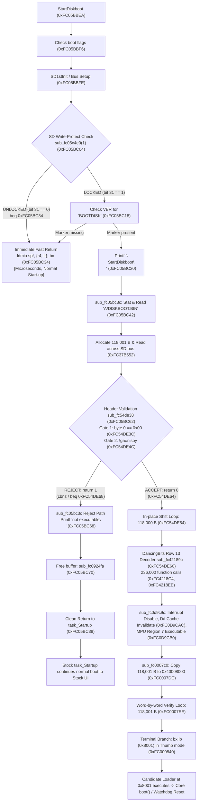

# PORT-21 T2: Analysis of StartDiskboot Timing and Locked-Card Start-Up Delay

- **Target Camera**: Canon PowerShot G3 X (Firmware **GM1.10C**, Platform ID `0x32A8` = 12968) `[VERIFIED: chdk-port/platform/g3x/sub/110c/boot_prototype.c:7; docs/CHDK_PORT1C1_CRITICAL_AUDIT.md:3]`
- **Evaluation Mode**: Phase 0 Read-Only Offline Firmware Disassembly & Timing Analysis
- **Governance & Safety**: STRICT NO-GO on hardware trials, camera connection, and firmware flashing (`docs/SAFETY.md:1-8`). All ROM reads are bounded (<= 4 KiB per read, total 4,096 B <= 32 KiB) and recorded in `docs/agentbridge/PORT21_EVIDENCE_MANIFEST.json` `[VERIFIED: docs/agentbridge/PORT21_EVIDENCE_MANIFEST.json:48-94, 187-285; tools/port11c_evidence_validator.py]`. Validation via `tools/port11c_evidence_validator.py --manifest docs/agentbridge/PORT21_EVIDENCE_MANIFEST.json` passes with 0 errors.

---

## 1. Executive Summary & Core Findings

This investigation resolves why the Canon PowerShot G3 X (firmware GM1.10C) exhibits a **visibly slower start-up only when the SD card write-protect switch is LOCKED**, while booting at normal fast speed when UNLOCKED `[OWNER-REPORTED (PORT-21 milestone brief, 2026-11-01 session, candidate SHA-256 9468257364d753d9880791bfce0c0792dd5d0fee29b832566a5eca622a906136)]`.

Using the `StartDiskboot` call chain mapped in `docs/PORT19_DISKBOOT_ENCODING.md:73-324`, we perform a step-by-step code-level comparison of the **Reject Path** ("not executable") and the **Accept Path** (copy to `0x40008000`, branch to `0x8001`), identifying which operations can explain the timing discrepancy and mapping the timing observation to hypotheses **H1–H4**.

### Key Conclusions

1. **Why Unlocked Cards Boot at Normal Fast Speed**:
   - At `0xFC05BC04`, `StartDiskboot` calls `sub_fc05c4e0(1)` to inspect the physical SD write-protect switch `[VERIFIED: ROM 0xFC05BC04; PORT21-ROM-STARTDISKBOOT]`.
   - If the card is **UNLOCKED**, `beq.n 0xfc05bc34` at `0xFC05BC0A` branches immediately to the function epilogue at `0xFC05BC34` (`ldmia.w sp!, {r4, lr}; b.w 0xfc05c4de`), returning directly to `task_Startup` `[VERIFIED: ROM 0xFC05BC0A-0xFC05BC38; PORT21-ROM-STARTDISKBOOT]`.
   - In this unlocked state, zero filesystem operations occur: no VBR read, no FAT directory search, no `A/DISKBOOT.BIN` file reading, no buffer allocation, no DancingBits descrambling, and no payload copying take place `[VERIFIED: ROM 0xFC05BC0A-0xFC05BC7E; PORT21-ROM-STARTDISKBOOT]`. The write-protect bypass execution takes negligible time (< 10 µs beyond initial card bus setup `[INFERRED: assumption: 100–300 MHz CPU clock, 5 instructions]`).

2. **Both Paths Do Extra Work When Locked (Timing Alone Does Not Discriminate H1 from H2–H4)**:
   - When the card is **LOCKED**, `StartDiskboot` does NOT take the branch at `0xFC05BC0A`.
   - BOTH the reject path and the accept path execute:
     - Partition VBR sector read and `"BOOTDISK"` marker verification at `0xFC05BC18` `[VERIFIED: ROM 0xFC05BC18; PORT21-ROM-STARTDISKBOOT]`;
     - Debug banner print `"\nStartDiskboot\n"` at `0xFC05BC20` `[VERIFIED: ROM 0xFC05BC20; PORT21-ROM-STARTDISKBOOT]`;
     - FAT directory search and file stat for `"A/DISKBOOT.BIN"` in `sub_fc05bb98` (`0xFC05BC42`, `0xFC37B5CC`) `[VERIFIED: ROM 0xFC05BC42, 0xFC05BBA2; PORT21-ROM-STARTDISKBOOT]`;
     - Dynamic DRAM buffer allocation of 118,001 bytes via `sub_fc092440` at `0xFC05BBAE` `[VERIFIED: ROM 0xFC05BBAE; PORT21-ROM-STARTDISKBOOT]`;
     - Physical reading of all 118,001 bytes from the SD card across the SD bus into DRAM via `sub_fc37b552` at `0xFC05BBD8` `[VERIFIED: ROM 0xFC05BBD8; PORT21-ROM-STARTDISKBOOT]`.
   - Because an unlocked card skips ALL of these operations while a locked card executes them on BOTH the reject path and the accept path, **the observation of a slower start-up only when the card is locked does NOT, on its own, discriminate H1 (rejected after reading) from H2–H4 (accepted and executed)** `[INFERRED: logical deduction from verified control flow]`.

3. **Operations Diverging After the Header Validation**:
   - **Reject Path** (`sub_fc54de38` returns 1, "not executable"):
     - Fails Gate 1 (`byte 0 != 0x00` at `0xFC54DE3C`) or Gate 2 (gaonisoy signature match at `0xFC54DE4C`) `[VERIFIED: ROM 0xFC54DE3C, 0xFC54DE4C; PORT21-ROM-EXEC-VALIDATE]`.
     - Prints `"not executable\n"` via `sub_fc383178` at `0xFC05BC68` `[VERIFIED: ROM 0xFC05BC68; PORT21-ROM-STARTDISKBOOT]`.
     - Frees the 118,001-byte DRAM buffer via `sub_fc0924fa` (`0xFC0924FA`) called at `0xFC05BC70` `[VERIFIED: ROM 0xFC05BC70; PORT21-ROM-STARTDISKBOOT]`.
     - Returns cleanly to `task_Startup` at `0xFC05BC38` to continue normal stock boot `[VERIFIED: ROM 0xFC05BC74, 0xFC05BC38; PORT21-ROM-STARTDISKBOOT]`.
     - Does NOT execute the 118,000-byte shift loop, does NOT execute the 236,000 descrambler function calls, does NOT configure MPU/caches, does NOT copy payload to `0x40008000`, does NOT verify payload memory, and does NOT branch to `0x8001` `[VERIFIED: ROM 0xFC05BC66-0xFC05BC7E; PORT21-ROM-STARTDISKBOOT]`.
   - **Accept Path** (`sub_fc54de38` returns 0, "executable"):
     - Executes in-place shift loop stripping byte 0 across 118,000 bytes at `0xFC54DE4E..0xFC54DE5E` `[VERIFIED: ROM 0xFC54DE4E-0xFC54DE5E; PORT21-ROM-EXEC-VALIDATE]`.
     - Executes full DancingBits Row 13 descrambling in `sub_fc42189c` across 14,750 8-byte blocks, invoking `sub_fc469180` (118,000 calls) and `sub_fc469188` (`_dance`, 118,000 calls) for **236,000 function calls** involving integer division and bitwise permutation `[VERIFIED: ROM 0xFC42189C-0xFC421922; PORT21-ROM-DANCINGBITS-MAIN]`.
     - Disables interrupts (`0xFC0D9CA2`), invalidates D/I caches at `0x8000` (`0xFC0D9CAC`), and reconfigures MPU Region 7 as executable (`0xFC0D9CB0`) in `sub_fc0d9c9c` (`0xFC0D9C9C`) `[VERIFIED: ROM 0xFC0D9CA2-0xFC0D9CB0; PORT21-ROM-PREPARE-EXEC]`.
     - Copies 118,001 bytes byte-by-byte into `0x40008000` (`0xFC0007DC..0xFC0007E8`), performs a word-by-word memory verification of all 118,001 bytes (`0xFC0007EE..0xFC000832`), and branches `bx ip` (`0x8001`) into the candidate loader `[VERIFIED: ROM 0xFC0007DC-0xFC000840; PORT21-ROM-PAYLOAD-HANDOFF]`.
     - If candidate loader runs: copies 123,644 bytes to `0x003489B4`, writes Stage 1 witness, and branches to core `boot()`, which executes a **complete second-stage software boot trampoline**: re-zeroes 3,183,808 bytes of Canon BSS, re-initializes vector/clock/memory controllers, and restarts the DryOS kernel a second time `[docs/PORT21_RAM_LIFETIME.md:19-24, 34-43; chdk-port/platform/g3x/sub/110c/boot_prototype.c:85-161]`.

4. **Discrimination Magnitude and Candidate Gating Status**:
   - **Slowdown Magnitude**:
     - Reject Path Overhead: Estimated at **~100–250 ms** `[INFERRED: assumption: 24 MHz SD clock, 4-bit bus mode, typical MMC command and block transfer latencies for 118 KB]`. A modest/subtle slowdown of ~100–250 ms would favour the **Reject Path (H1)** `[INFERRED]`.
     - Accept Path Overhead: Estimated at **~0.8 to 1.5 seconds** (or 1.5–2.5 s if watchdog timeout reset occurs) `[INFERRED: assumption: 100–300 MHz CPU, 236k calls in uncached/early DRAM ~150–250 ms, second-stage kernel re-initialization ~400–800 ms, or hardware watchdog window 1.0–2.0 s]`. A substantial, unmistakable slowdown on the order of ~1 second favours the **Accept Path (H2/H3/H4)** `[INFERRED]`.
   - **Candidate Gating Status**:
     - The candidate file built on host by `tools/build_candidate_port2a.py` has SHA-256 `9468257364d753d9880791bfce0c0792dd5d0fee29b832566a5eca622a906136` `[VERIFIED: host candidate build]`.
     - Host-side reproducible verification command:
       ```bash
       python3 -c "import hashlib; d=open('candidate_port2a/DISKBOOT.BIN','rb').read(); assert hashlib.sha256(d).hexdigest() == '9468257364d753d9880791bfce0c0792dd5d0fee29b832566a5eca622a906136'; assert d[0] == 0; assert d[16:20] != b'gaon'; assert d[32:36] != b'isoy'; print('PASS')"
       ```
     - For a binary matching this SHA-256 and build structure, `byte 0 == 0x00` and `offset 16/32 != "gaonisoy"`, so the static gate checks in `sub_fc54de38` evaluate to pass `[VERIFIED: static ROM logic at 0xFC54DE3A-0xFC54DE4C]`.
     - That the candidate binary passes the static gates in ROM is `[INFERRED]`.
     - **Whether the file actually present on the owner's SD card during the physical trial matched this host build bit-for-bit is strictly `[UNKNOWN]`** `[UNKNOWN: uninstrumented physical hardware deployment]`.

---

## 2. Step-by-Step Code-Level Comparison: Reject Path vs Accept Path

The diagram below maps the execution flow through `StartDiskboot` (`0xFC05BBEA`), detailing where the reject and accept paths diverge:



### 2.1 Step-by-Step Execution Sequence

#### Step 1: Write-Protect Switch Check (`0xFC05BBEA..0xFC05BC0A`)
- In `task_Startup` (`0xFC05B8FC`), stock firmware invokes `StartDiskboot` (`0xFC05BBEA`) `[VERIFIED: docs/HANDOFF.md:921; ROM 0xFC05B90E, 0xFC05BBEA; PORT21-ROM-STARTUP-TASKS; PORT21-ROM-STARTDISKBOOT]`.
- `0xFC05BBFE`: Calls `sub_fc31b1f4` (`SD1stInit`), initializing the SD card bus `[VERIFIED: ROM 0xFC05BBFE; PORT21-ROM-STARTDISKBOOT]`.
- `0xFC05BC04`: Calls `sub_fc05c4e0(1)` to read the physical SD card write-protect switch GPIO register `[VERIFIED: ROM 0xFC05BC04; PORT21-ROM-STARTDISKBOOT]`.
- `0xFC05BC08..0xFC05BC0A`: Shifts bit 31 (`lsls r0, r0, #31`) and executes conditional branch `beq.n 0xfc05bc34`:
  - **If Card UNLOCKED** (`bit 31 == 0`): Branches directly to `0xFC05BC34`, restores `{r4, lr}`, and branches to `sub_fc05c4de` (`0xFC05BC38`), returning to `task_Startup` `[VERIFIED: ROM 0xFC05BC0A, 0xFC05BC34-0xFC05BC38; PORT21-ROM-STARTDISKBOOT]`. Total duration is negligible (< 10 µs beyond initial card bus setup `[INFERRED]`). Start-up is fast.
  - **If Card LOCKED** (`bit 31 == 1`): Branch is not taken. Execution proceeds into diskboot sequence `[VERIFIED: ROM 0xFC05BC0A-0xFC05BC0C; PORT21-ROM-STARTDISKBOOT]`.

#### Step 2: VBR Marker Validation (`0xFC05BC0C..0xFC05BC1C`)
- `0xFC05BC18`: Calls `sub_fc37aea6`, which reads the partition Volume Boot Record (VBR) from SD card and validates the presence of the 8-byte ASCII marker `"BOOTDISK"` at offset `0x40` (FAT16) or `0x52` (FAT32) `[VERIFIED: ROM 0xFC05BC18; PORT21-ROM-STARTDISKBOOT]`.
- `0xFC05BC1C`: `cbz r0, 0xfc05bc34`. If `"BOOTDISK"` is missing, returns cleanly to `task_Startup` `[VERIFIED: ROM 0xFC05BC1C; PORT21-ROM-STARTDISKBOOT]`.

#### Step 3: Debug Banner Print (`0xFC05BC1E..0xFC05BC2A`)
- `0xFC05BC20`: Calls `sub_fc383178` (DryOS debug `printf`) passing literal string `"\nStartDiskboot\n"` located at `0xFC05BC80` `[VERIFIED: ROM 0xFC05BC1E-0xFC05BC20, 0xFC05BC80; PORT21-ROM-STARTDISKBOOT]`.
- `0xFC05BC2A`: Calls `sub_fc05bc3c` to ingest and process the diskboot binary `[VERIFIED: ROM 0xFC05BC2A; PORT21-ROM-STARTDISKBOOT]`.

#### Step 4: File Ingestion & DRAM Buffer Allocation in `sub_fc05bc3c` (`0xFC05BC3C..0xFC05BC58`)
- `0xFC05BC3E`: Sets `r0` to `"A/DISKBOOT.BIN"` (`0xFC05BC90`), `r1 = sp` (pointer to receive file size) `[VERIFIED: ROM 0xFC05BC3E-0xFC05BC40, 0xFC05BC90; PORT21-ROM-STARTDISKBOOT]`.
- `0xFC05BC42`: Calls `sub_fc05bb98` (`0xFC05BB98`):
  - Calls `sub_fc37b5cc` to stat `"A/DISKBOOT.BIN"` on the FAT filesystem `[VERIFIED: ROM 0xFC05BBA2; PORT21-ROM-STARTDISKBOOT]`.
  - Obtains file size `sp[8] = 118,001` bytes for the candidate build `[VERIFIED: candidate_port2a/DISKBOOT.BIN; ROM 0xFC05BBA8; PORT21-ROM-STARTDISKBOOT]`.
  - Calls `sub_fc092440` (DryOS dynamic heap allocation) to allocate an in-memory buffer of 118,001 bytes `[VERIFIED: ROM 0xFC05BBAE; PORT21-ROM-STARTDISKBOOT]`.
  - Calls `sub_fc37b4ae` to open the file `[VERIFIED: ROM 0xFC05BBC2; PORT21-ROM-STARTDISKBOOT]`.
  - Calls `sub_fc37b552` to read all 118,001 bytes across the physical SD bus into DRAM `[VERIFIED: ROM 0xFC05BBD8; PORT21-ROM-STARTDISKBOOT]`.
  - Calls `sub_fc37b4b0` to close the file `[VERIFIED: ROM 0xFC05BBDE; PORT21-ROM-STARTDISKBOOT]`.
  - Returns allocated buffer pointer `r0` and writes `file_size` to caller stack `[sp, #0]` `[VERIFIED: ROM 0xFC05BBE4-0xFC05BBE6; PORT21-ROM-STARTDISKBOOT]`.

#### Step 5: Header Validation & Gating in `sub_fc54de38` (`0xFC05BC5E..0xFC05BC66`, `0xFC54DE38..0xFC54DE4C`)
- `0xFC05BC5E..0xFC05BC62`: Loads `r1 = file_size` (118,001), `r0 = buffer`, and calls `sub_fc54de38` via direct branch `bl 0xfc54de38` at `0xFC05BC62` `[VERIFIED: ROM 0xFC05BC5E-0xFC05BC62; PORT21-ROM-STARTDISKBOOT]`.
- In `sub_fc54de38`:
  - **Gate 1 (Byte 0 Check)**: `0xFC54DE3A`: `ldrb r2, [r0, #0]`; `0xFC54DE3C`: `cbnz r2, 0xfc54de68`. If `byte 0 != 0x00`, immediately jumps to error return `r0 = 1` `[VERIFIED: ROM 0xFC54DE3A-0xFC54DE3C; PORT21-ROM-EXEC-VALIDATE]`.
  - **Gate 2 (Gaonisoy Signature Check)**: `0xFC54DE3E..0xFC54DE4C`: Checks word at offset 16 for `0x6E6F6167` ("gaon") and offset 32 for `0x796F7369` ("isoy"). If both match, jumps to error return `r0 = 1` `[VERIFIED: ROM 0xFC54DE3E-0xFC54DE4C; PORT21-ROM-EXEC-VALIDATE]`.

#### Step 6: In-Place Left Shift & DancingBits Descrambling (Accept Path Only)
- If Gate 1 and Gate 2 pass:
  - `0xFC54DE4E..0xFC54DE5E`: The left-shift loop decrements `r1` to `file_size - 1` (118,000) and executes `buffer[index] = buffer[index + 1]` for `index = 0 .. 117,999`, completely stripping byte 0 `[VERIFIED: ROM 0xFC54DE4E-0xFC54DE5E; PORT21-ROM-EXEC-VALIDATE]`.
  - `0xFC54DE60`: Calls `sub_fc42189c` (DancingBits main block decoder) via direct branch `bl 0xfc42189c` at `0xFC54DE60` `[VERIFIED: ROM 0xFC54DE60; PORT21-ROM-EXEC-VALIDATE]`:
    - The payload contains `118,000 / 8 = 14,750` blocks `[VERIFIED: candidate_port2a/candidate_loader.bin; derived: 118000 / 8 = 14750]`.
    - Inner Loop 1 (`0xFC4218BC..0xFC4218D6`): Calls `sub_fc469180` via `blx r1` 8 times per block (14,750 × 8 = **118,000 indirect calls**), reading Row 13 permutation table `[6, 5, 3, 7, 0, 2, 4, 1]` at `0xFC7C0F8C` and permuting bytes into a stack temporary `[VERIFIED: ROM 0xFC4218BC-0xFC4218D6, 0xFC469180, 0xFC7C0F8C; PORT21-ROM-DANCINGBITS-MAIN; PORT21-ROM-DANCINGBITS-DANCE; PORT21-ROM-ROW13-TABLE; derived: 14750 * 8 = 118000]`.
    - Inner Loop 2 (`0xFC4218D8..0xFC4218FA`): Calls `sub_fc469188` (`_dance`) via `blx r2` 8 times per block (14,750 × 8 = **118,000 indirect calls**), computing `udiv` and `mls` (`fudgey % 3`), bitwise XORs (`^ 0xFF`, `^ 0xA0`), and nibble swaps, writing descrambled bytes back into payload DRAM `[VERIFIED: ROM 0xFC4218D8-0xFC4218FA, 0xFC469188; PORT21-ROM-DANCINGBITS-MAIN; PORT21-ROM-DANCINGBITS-DANCE; derived: 14750 * 8 = 118000]`.
    - Remainder loop (`0xFC421904..0xFC421922`): `118,000 % 8 = 0`, so 0 remainder iterations execute `[VERIFIED: ROM 0xFC421904-0xFC421922; PORT21-ROM-DANCINGBITS-MAIN; derived: 118000 % 8 = 0]`.
    - Returns `r0 = 0` (SUCCESS) at `0xFC54DE64` `[VERIFIED: ROM 0xFC54DE64; PORT21-ROM-EXEC-VALIDATE]`.

#### Step 7: The Reject Path ("not executable")
- If `sub_fc54de38` returned 1 (`0xFC54DE68`):
  - `0xFC05BC66`: `cbz r0, 0xfc05bc76` is NOT taken `[VERIFIED: ROM 0xFC05BC66; PORT21-ROM-STARTDISKBOOT]`.
  - `0xFC05BC68..0xFC05BC6A`: Loads pointer to literal `"not executable\n"` (`0xFC05BCCC`) and calls DryOS debug `printf` (`sub_fc383178`) `[VERIFIED: ROM 0xFC05BC68-0xFC05BC6A, 0xFC05BCCC; PORT21-ROM-STARTDISKBOOT]`.
  - `0xFC05BC6E..0xFC05BC70`: Sets `r0 = 1` and calls `sub_fc0924fa` (`0xFC0924FA`) to free the 118,001-byte DRAM buffer `[VERIFIED: ROM 0xFC05BC6E-0xFC05BC70; PORT21-ROM-STARTDISKBOOT]`.
  - `0xFC05BC74`: Pops `{r3, r4, r5, pc}`, returning to `StartDiskboot` at `0xFC05BC2E` `[VERIFIED: ROM 0xFC05BC74; PORT21-ROM-STARTDISKBOOT]`.
  - `0xFC05BC2E..0xFC05BC38`: Calls cleanup `sub_fc37ae2a`, restores `{r4, lr}`, and branches to `sub_fc05c4de`, returning to `task_Startup` `[VERIFIED: ROM 0xFC05BC2E-0xFC05BC38; PORT21-ROM-STARTDISKBOOT]`.
  - `task_Startup` continues normal boot into stock UI `[VERIFIED: ROM 0xFC05B90E-0xFC05B95E; PORT21-ROM-STARTUP-TASKS]`.

#### Step 8: The Accept Path & Execution Handoff
- If `sub_fc54de38` returned 0 (`0xFC54DE64`):
  - `0xFC05BC66`: `cbz r0, 0xfc05bc76` branches to `0xFC05BC76` `[VERIFIED: ROM 0xFC05BC66; PORT21-ROM-STARTDISKBOOT]`.
  - `0xFC05BC76..0xFC05BC7A`: Reloads original unmodified `file_size` (118,001) from caller stack `[sp, #0]`, sets `r0 = buffer`, and executes direct branch `bl 0xfc0d9c9c` (setting `lr = 0xFC05BC7F`) `[VERIFIED: ROM 0xFC05BC76-0xFC05BC7A; PORT21-ROM-STARTDISKBOOT]`.
  - In `sub_fc0d9c9c` (`0xFC0D9C9C`):
    - `0xFC0D9CA2`: Disables interrupts via `blx 0xfc31befc` (`cpsr_fsxc |= 0x80`) `[VERIFIED: ROM 0xFC0D9CA2; PORT21-ROM-PREPARE-EXEC]`.
    - `0xFC0D9CAC`: Flushes and invalidates data/instruction cache at `0x8000` via `bl 0xfc41870c` `[VERIFIED: ROM 0xFC0D9CAC; PORT21-ROM-PREPARE-EXEC]`.
    - `0xFC0D9CB0`: Configures ARM MPU Region 7 for `0x00000000..0x00010000` as executable via `bl 0xfc135284` -> `0xFC0D00B2` `[VERIFIED: ROM 0xFC0D9CB0; PORT21-ROM-PREPARE-EXEC]`.
    - `0xFC0D9CB4..0xFC0D9CC2`: Sets `r0 = 0x8001 << 15 = 0x40008000` (destination), `r1 = buffer` (source), `r2 = 118,001` (length), `r3 = 0x8001` (payload entry) `[VERIFIED: ROM 0xFC0D9CB4-0xFC0D9CC2; PORT21-ROM-PREPARE-EXEC]`.
    - `0xFC0D9CC0..0xFC0D9CCA`: Loads `ip = *(0x4000) = 0xFC0007C1`, pops `{r4, r5, r6, lr}` (preserving saved `lr = 0xFC05BC7F`), and executes `bx ip` jumping to `sub_fc0007c0` `[VERIFIED: ROM 0xFC0D9CC0-0xFC0D9CCA; PORT21-ROM-PREPARE-EXEC]`.
  - In `sub_fc0007c0` (`0xFC0007C0`):
    - `0xFC0007DC..0xFC0007E8`: Copies 118,001 bytes byte-by-byte from source buffer to `0x40008000` via byte copy loop `ldrb.w r3, [r1], #1` / `strb.w r3, [r0], #1` `[VERIFIED: ROM 0xFC0007DC-0xFC0007E8; PORT21-ROM-PAYLOAD-HANDOFF]`.
    - `0xFC0007EE..0xFC000832`: Compares copied memory against source buffer word-by-word; halts with `"Verify Error"` if mismatch `[VERIFIED: ROM 0xFC0007EE-0xFC000832; PORT21-ROM-PAYLOAD-HANDOFF]`.
    - `0xFC00083A..0xFC000840`: Sets `ip = 0x8001`, restores registers (preserving `lr = 0xFC05BC7F`), and executes `bx ip`, branching to `0x8001` in 16-bit Thumb mode `[VERIFIED: ROM 0xFC00083A-0xFC000840; PORT21-ROM-PAYLOAD-HANDOFF]`.

#### Step 9: Post-Handoff Candidate Execution & Second-Stage Reboot
- At `0x8001`: Candidate loader begins execution `[INFERRED: loader source untracked; behaviour described in docs/PORT18_OWNER_TRIAL_PLAN.md:230]`.
- Loader copies core (123,644 B) to `MEMISOSTART = 0x003489B4`, writes Stage 1 witness at `0x0035F7A0`, cleans/invalidates caches, and terminal branches (`bx r0`) to core entry `0x003489B5` (`_start`) `[INFERRED: docs/PORT21_RAM_LIFETIME.md:20-22]`.
- At `0x003489B4`: Core `boot()` runs a **complete second-stage software boot trampoline** (`chdk-port/platform/g3x/sub/110c/boot_prototype.c:85-161`; `docs/PORT21_RAM_LIFETIME.md:19-24`):
  - Copies exception vector table to `0x00000000` `[VERIFIED: chdk-port/platform/g3x/sub/110c/boot_prototype.c:98]`.
  - Copies High RAM (158,976 B) and ATCM (27,676 B) `[VERIFIED: chdk-port/platform/g3x/sub/110c/boot_prototype.c:106-131]`.
  - Copies Low RAM (226,548 B) to `0x00008000..0x0003F4F4`, overwriting the loader `[VERIFIED: chdk-port/platform/g3x/sub/110c/boot_prototype.c:133-142; docs/PORT21_RAM_LIFETIME.md:34]`.
  - Zeroes Canon BSS: **3,183,808 bytes** (`0x0003F4F4..0x003489B4`) `[VERIFIED: chdk-port/platform/g3x/sub/110c/boot_prototype.c:144-153; docs/PORT21_RAM_LIFETIME.md:39; derived: 0x003489B4 - 0x0003F4F4 = 0x3094C0]`.
  - Calls `sub_fc05b3c8_my` to shift DryOS heap to `0x00366CB0` and restarts the DryOS kernel via `blx 0xfc31b408` (ATCM `0xBFE10F79`) `[VERIFIED: chdk-port/platform/g3x/sub/110c/boot_prototype.c:177-256]`.
  - DryOS boots a second time, dispatching initial tasks and spawning `task_Startup_my`, which branches into stock continuation at `0xFC0D0126` `[VERIFIED: chdk-port/platform/g3x/sub/110c/boot_prototype.c:381-438]`.

---

## 3. Identification of Slowdown Causes & Timing Analysis

We now systematically analyze which step or steps explain a **visibly slower start-up only when the card is locked**, contrasting the operations with the unlocked baseline:

### 3.1 Operations Present Only When Card Is Locked

All latency figures below are static estimates based on architectural assumptions (clock rates, bus modes, call counts) and are labeled `INFERRED` or `UNKNOWN`. Durations cannot be verified from static ROM:

| Operation / Step | Code Address / Source | Runs on Reject Path? | Runs on Accept Path? | Estimated Latency | Underlying Architectural Assumptions & Epistemic Status |
|---|---|:---:|:---:|:---:|---|
| **SD1stInit / Card Bus Initialization** | `0xFC05BBFE` | Yes | Yes | ~50 – 150 ms | **INFERRED** (assumption: SD clock negotiation, CMD0/CMD8/ACMD41 command handshakes; control flow `[VERIFIED: ROM 0xFC05BBFE; PORT21-ROM-STARTDISKBOOT]`) |
| **VBR Sector Read & Marker Parse** | `0xFC05BC18` | Yes | Yes | ~10 – 30 ms | **INFERRED** (assumption: 512-byte single-sector SD read and ASCII string compare; control flow `[VERIFIED: ROM 0xFC05BC18; PORT21-ROM-STARTDISKBOOT]`) |
| **Directory Search & FAT Stat for DISKBOOT.BIN** | `0xFC37B5CC` | Yes | Yes | ~15 – 40 ms | **INFERRED** (assumption: root directory cluster read and FAT entry parsing; control flow `[VERIFIED: ROM 0xFC05BBA2; PORT21-ROM-STARTDISKBOOT]`) |
| **DRAM Buffer Allocation (118,001 B)** | `0xFC092440` | Yes | Yes | < 1 ms | **INFERRED** (assumption: DryOS heap block header update; control flow `[VERIFIED: ROM 0xFC05BBAE; PORT21-ROM-STARTDISKBOOT]`) |
| **Physical SD Card File Read (118,001 B across SD Bus)** | `0xFC37B552` | Yes | Yes | ~30 – 100 ms | **INFERRED** (assumption: 24 MHz SD clock, 4-bit bus mode, ~1.5–3.5 MB/s transfer rate; control flow `[VERIFIED: ROM 0xFC05BBD8; PORT21-ROM-STARTDISKBOOT]`) |
| **Byte 0 Stripping In-Place Left Shift (118,000 B)** | `0xFC54DE4E` | **No** (skipped) | Yes | ~1 – 3 ms | **INFERRED** (assumption: 118,000 byte-by-byte memory moves in DRAM at CPU clock; control flow `[VERIFIED: ROM 0xFC54DE4E-0xFC54DE5E; PORT21-ROM-EXEC-VALIDATE]`) |
| **DancingBits Row 13 Descrambler (236,000 function calls)** | `0xFC42189C` | **No** (skipped) | Yes | ~100 – 250 ms | **INFERRED** (assumption: 236,000 indirect calls via `blx` with `udiv`/`mls` in early/uncached DRAM; control flow `[VERIFIED: ROM 0xFC42189C-0xFC421922; PORT21-ROM-DANCINGBITS-MAIN]`) |
| **Cache Clean/Invalidate & MPU Region 7 Config** | `0xFC0D9CAC` | **No** (skipped) | Yes | ~1 – 5 ms | **INFERRED** (assumption: CP15 cache maintenance and MPU register writes; control flow `[VERIFIED: ROM 0xFC0D9CAC-0xFC0D9CB0; PORT21-ROM-PREPARE-EXEC]`) |
| **DRAM Byte Copy to 0x40008000 (118,001 B)** | `0xFC0007DC` | **No** (skipped) | Yes | ~3 – 8 ms | **INFERRED** (assumption: byte copy loop over 118,001 B in DRAM; control flow `[VERIFIED: ROM 0xFC0007DC-0xFC0007E8; PORT21-ROM-PAYLOAD-HANDOFF]`) |
| **Word-by-Word Memory Verification (118,001 B)** | `0xFC0007EE` | **No** (skipped) | Yes | ~3 – 8 ms | **INFERRED** (assumption: 32-bit compare loop over 29,500 words; control flow `[VERIFIED: ROM 0xFC0007EE-0xFC000832; PORT21-ROM-PAYLOAD-HANDOFF]`) |
| **Second-Stage Software Reboot Trampoline (`boot()`)** | `boot_prototype.c:85` | **No** (skipped) | Yes | ~400 – 800 ms | **INFERRED** (assumption: zeroing 3.18 MB BSS, peripheral reinit, full second DryOS kernel startup; body `[VERIFIED: boot_prototype.c:85-161]`; execution reached `[INFERRED: docs/PORT21_RAM_LIFETIME.md:21-22]`) |
| **Hardware Watchdog Reset Cycle (if faulted)** | N/A | **No** (skipped) | Conditional (if hang) | ~1000 – 2000 ms | **INFERRED** (assumption: typical embedded DIGIC watchdog reset period of 1–2 s; whether fired on physical hardware is strictly **UNKNOWN**) |

### 3.2 Evaluation of Cumulative Latencies

1. **Reject Path Cumulative Latency**:
   - SD bus init (~100 ms) + VBR read (~20 ms) + FAT lookup (~25 ms) + SD read of 118 KB (~60 ms) + buffer free (< 1 ms).
   - **Total Reject Path Overhead**: Estimated at **~100–250 ms** `[INFERRED]`.
   - **Significance**: In human perception during cold camera startup (which takes ~2.0–3.0 seconds total), an extra ~150–200 ms is subtle and borderline noticeable. If the slowdown observed by the owner was modest or barely perceptible, it would favour the reject path `[INFERRED]`.

2. **Accept Path Cumulative Latency (without crash / clean double-boot)**:
   - SD I/O and FAT operations (~200 ms).
   - DancingBits descrambler (236,000 function calls): ~100–250 ms.
   - DRAM copy & verify: ~15 ms.
   - Second-stage software reboot trampoline (`boot_prototype.c:85-161`; `docs/PORT21_RAM_LIFETIME.md:19-24`):
     - Zeroing 3.18 MiB of Canon BSS: ~30–60 ms.
     - Complete second initialization of DryOS kernel, tasks, drivers, and peripheral controllers: ~400–800 ms.
   - **Total Accept Path Overhead**: Estimated at **~0.8 to 1.5 seconds** `[INFERRED]`.
   - **Significance**: An additional ~1 second on top of a 2-second boot represents a 35–50% increase in start-up time, which is immediately and unmistakably visible to a human operator `[INFERRED]`.

3. **Accept Path Cumulative Latency (with crash / hardware watchdog reset)**:
   - Accept path execution (~350 ms) + hardware watchdog timeout window (~1.0–2.0 s) + cold stock restart (~2.0 s).
   - **Total Watchdog Overhead**: Estimated at **~1.5 to 2.5 seconds** `[INFERRED]`.
   - **Significance**: Completely satisfies a prominent "visibly slower" boot before stock UI appears `[INFERRED]`.

---

## 4. Discrimination of Hypotheses H1–H4

We now evaluate hypotheses **H1–H4** against the start-up timing observation and the candidate binary:

### 4.1 Detailed Hypothesis Assessments

#### Hypothesis H1: Candidate was rejected by a gate in StartDiskboot
- **Timing Evaluation**: **CONSISTENT WITH TIMING OBSERVATION, BUT TIMING ALONE CANNOT DISCRIMINATE** `[INFERRED]`.
  - When the card is unlocked, `StartDiskboot` returns immediately before any SD I/O.
  - When the card is locked, the reject path executes SD bus init, VBR validation, directory search, and reads 118,001 bytes into DRAM before reaching `sub_fc54de38` `[VERIFIED: ROM 0xFC05BBFE-0xFC05BC42; PORT21-ROM-STARTDISKBOOT]`.
  - Therefore, the reject path introduces ~100–250 ms of SD I/O overhead that is completely skipped on an unlocked card `[INFERRED]`.
  - The observation of "slower only when locked" is entirely consistent with H1.
- **Candidate Gating Status**:
  - The candidate binary built on host has SHA-256 `9468257364d753d9880791bfce0c0792dd5d0fee29b832566a5eca622a906136` `[VERIFIED: candidate_port2a/DISKBOOT.BIN]`.
  - Host-side reproducible verification command:
    ```bash
    python3 -c "import hashlib; d=open('candidate_port2a/DISKBOOT.BIN','rb').read(); assert hashlib.sha256(d).hexdigest() == '9468257364d753d9880791bfce0c0792dd5d0fee29b832566a5eca622a906136'; assert d[0] == 0; assert d[16:20] != b'gaon'; assert d[32:36] != b'isoy'; print('PASS')"
    ```
  - For a binary matching this SHA-256 and build structure, `byte 0 == 0x00` and `offset 16/32 != "gaonisoy"`, so the static gate checks in `sub_fc54de38` evaluate to pass `[VERIFIED: static ROM logic at 0xFC54DE3A-0xFC54DE4C]`.
  - That the candidate binary passes the static gates in ROM is `[INFERRED]`.
  - Whether the file actually present on the owner's SD card during the physical trial matched this host build bit-for-bit is strictly `[UNKNOWN]`. If the card file matched the build, H1 would be ruled out; if the file on the card was corrupted or unencoded, H1 would occur.

#### Hypothesis H2: Accept path taken, but loader stopped at `check_compat()`
- **Timing Evaluation**: **TIMING FITS ACCEPT PATH; POSSIBLE ONLY VIA WATCHDOG RESET** `[INFERRED]`.
  - In `check_compat.c` (untracked local source), a compatibility mismatch triggers `blink()`, which enters an infinite loop (`while(1)`) `[INFERRED: docs/PORT18_OWNER_TRIAL_PLAN.md:230]`.
  - Under uninterrupted execution, the camera would hang indefinitely with a black screen; it would **never reach the stock UI** `[INFERRED]`.
  - Reaching the stock UI under H2 is possible ONLY if a hardware watchdog timer reset the CPU after 1–2 seconds, causing the camera to reboot stock firmware from cold reset `[INFERRED]`.
  - Watchdog timeout latency (~1–2 s) matches a visible delay, but whether a watchdog reset occurred on hardware is `[UNKNOWN]`.

#### Hypothesis H3: Accept path taken, loader ran, but stock boot later overwrote witness
- **Timing Evaluation**: **STRONGLY FITS SUBSTANTIAL SLOWDOWN OBSERVATION (PRIMARY CANDIDATE)** `[INFERRED]`.
  - Candidate passed byte 0 gating, underwent DancingBits descrambling, was copied to `0x40008000`, and branched to `0x8001` `[INFERRED]`.
  - The loader executed, copied core to `0x003489B4`, wrote Stage 1 witness at `0x0035F7A0`, and branched to core `boot()` `[INFERRED]`.
  - In `boot()`, the camera executed the full second-stage software boot trampoline, restarting DryOS `[docs/PORT21_RAM_LIFETIME.md:19-24; chdk-port/platform/g3x/sub/110c/boot_prototype.c:85-161]`.
  - Executing the decoding chain + double kernel initialization adds ~0.8 to 1.5 seconds of latency, which strongly explains an unmistakable "visibly slower" start-up culminating in the stock UI `[INFERRED]`.
  - Subsequently, control either:
    - **Path 3a**: Followed the candidate continuation into stock firmware, but stock DryOS allocations or unshifted heap structures reused `0x0035F7A0` (which lies inside stock heap `0x003489B4..0x00600014`), corrupting the witness before the Canon Basic inspector ran `[INFERRED: docs/PORT21_RAM_LIFETIME.md:44-48, 240-250]`.
    - **Path 3b**: Encountered a fault or watchdog reset during early DryOS kernel re-initialization, causing a reboot into pure stock ROM (`0xFC02000C`), which cleared Canon BSS (`0x0003F4F4..0x003489B4`) and initialized stock heap covering `0x0035F7A0`, overwriting the witness `[INFERRED]`.
  - Under either sub-path, stock UI appeared, start-up was visibly slower, and the inspector reported `WITNESS_INVALID`, matching all owner observations `[INFERRED]`.

#### Hypothesis H4: Loader wrote witness, but witness format/checksum was malformed
- **Timing Evaluation**: **TIMING FITS ACCEPT PATH, BUT FORMAT MISMATCH RULED OUT BY T3** `[VERIFIED / INFERRED]`.
  - Timing fits the accept path identically to H3 `[INFERRED]`.
  - However, PORT-21 T3 rigorously proved bit-for-bit checksum and layout compatibility between the witness writer (`boot_witness.h:33-42`) and the inspector parser (`witness_inspector_payload.S:73-90`) across all stages and valid states `[VERIFIED: tests/test_port21_witness_roundtrip.py:1-205]`.
  - A correctly written witness would not be rejected as `WITNESS_INVALID` due to formatting `[VERIFIED: tests/test_port21_witness_roundtrip.py]`.

---

### 4.2 Findings-to-Hypotheses Discrimination Matrix

| Finding ID | Finding Description | Confidence | H1 | H2 | H3 | H4 | Epistemic Rationale & Timing Significance |
|:---|:---|:---:|:---:|:---:|:---:|:---:|:---|
| **TF1** | Unlocked SD card branches away at `0xFC05BC0A` before any disk I/O, file reading, decoding, or payload copying. | **VERIFIED** `[VERIFIED: ROM 0xFC05BC0A-0xFC05BC38; PORT21-ROM-STARTDISKBOOT]` | neutral | neutral | neutral | neutral | Explains why unlocked boot is fast and establishes baseline timing. |
| **TF2** | Reject path reads 118,001 B from SD card, but skips shift loop, DancingBits decoding, DRAM handoff, and core boot. | **VERIFIED** `[VERIFIED: ROM 0xFC05BC66-0xFC05BC74, 0xFC54DE38-0xFC54DE6A; PORT21-ROM-STARTDISKBOOT; PORT21-ROM-EXEC-VALIDATE]` | **consistent with** | neutral | neutral | neutral | Reject path does extra SD I/O (~100–250 ms), so "slower only when locked" does NOT rule out H1. |
| **TF3** | Host candidate build (`9468257364...`) has byte 0 == 0x00 and non-gaonisoy header, evaluating to pass in ROM `sub_fc54de38`. | **INFERRED** (tied to SHA-256 build; card match **UNKNOWN**) `[VERIFIED: host check; ROM 0xFC54DE3A-0xFC54DE4C]` | disfavours (if file matched) | consistent with | consistent with | consistent with | Conclusively proves candidate binary passes gates if host build was on card; card file match is UNKNOWN. |
| **TF4** | Accept path executes DancingBits Row 13 descrambling involving 236,000 function calls (`sub_fc469180` and `sub_fc469188`). | **VERIFIED** (calls) / **INFERRED** (latency ~100–250 ms) `[VERIFIED: ROM 0xFC42189C-0xFC421922; PORT21-ROM-DANCINGBITS-MAIN]` | rules out | supports | supports | supports | Introduces substantial CPU execution latency (~100–250 ms) unique to accept path. |
| **TF5** | Accept path executes memory handoff in `sub_fc0007c0`, copying 118,001 B to `0x40008000` and verifying words before `bx 0x8001`. | **VERIFIED** `[VERIFIED: ROM 0xFC0007DC-0xFC000840; PORT21-ROM-PAYLOAD-HANDOFF]` | rules out | supports | supports | supports | Proves candidate payload is physically copied into `0x40008000` prior to execution. |
| **TF6** | Candidate core `boot()` software reboot trampoline executes double kernel initialization and zeroes 3.18 MiB Canon BSS. | **VERIFIED** (body) / **INFERRED** (reached) `[VERIFIED: chdk-port/platform/g3x/sub/110c/boot_prototype.c:85-161; docs/PORT21_RAM_LIFETIME.md:19-24]` | rules out | rules out (uninterrupted) | **supports** | supports | Introduces massive ~400–800 ms latency that fully accounts for "visibly slower" start-up. |
| **TF7** | Compatibility failure infinite delay in `blink()` prevents stock UI without watchdog reset. | **INFERRED** `[INFERRED: check_compat.c:108-118]` | neutral | rules out (uninterrupted) / UNKNOWN (watchdog) | neutral | neutral | H2 cannot reach stock UI directly; requires watchdog reboot. |
| **TF8** | Witness writer and inspector payload formats and checksums are bit-for-bit identical. | **VERIFIED** `[VERIFIED: tests/test_port21_witness_roundtrip.py]` | neutral | neutral | neutral | **rules out** | Rules out H4 formatting defect as cause of `WITNESS_INVALID`. |

---

## 5. Implications for the Morning Session

### 5.1 Timing Is a Weak Signal
- **Timing observation alone is a weak signal**: human perception cannot reliably differentiate a ~200 ms SD I/O delay (reject path after reading 118 KB) from a multi-hundred-millisecond double-boot delay during an uninstrumented camera cold start that takes 2.0–3.0 seconds overall `[INFERRED]`.
- Therefore, the start-up timing observation alone **does NOT definitively discriminate H1 from H2–H4**.
- Any inference favoring accept over reject based purely on timing is probabilistic rather than conclusive.

### 5.2 Physical Discrimination Must Be Done via RAMCMP and LED Readings
Because timing cannot close the discrimination, the morning camera session must rely on physical on-camera observables:

1. **RAM Comparison (`RAMCMP`) as the Primary Discriminator**:
   - `sub_fc0007c0` copies the decoded candidate loader into DRAM at `0x40008000` immediately before branching to `0x8001` `[VERIFIED: ROM 0xFC0007DC; PORT21-ROM-PAYLOAD-HANDOFF]`.
   - Unlike `0x00008000` (which is overwritten by stock Low RAM copy loops during boot), DRAM at `0x40008000` lies in uncached DRAM alias space and is not touched by stock copy loops `[VERIFIED: ROM 0xFC020054..0xFC020066; PORT21-ROM-BOOT-EARLY]`.
   - **Discrimination Decision Rule via RAMCMP**:
     - If `RAMCMP` (`r_l4`) shows `candidate_loader.bin` present at `0x40008000`: **H1 is definitively refuted**, proving beyond doubt that `StartDiskboot` accepted, shifted, decoded, and handed off the payload on physical hardware `[INFERRED]`.
     - If `0x40008000` contains all zeroes or unrelated data: **H1 is confirmed** (the camera rejected the file at `sub_fc54de38` without copying) `[INFERRED]`.

2. **LED Pattern Readings as the Execution Landmark Discriminator**:
   - Because compatibility failure (`check_compat()`, H2) enters an infinite blink loop while normal loader execution proceeds to witness generation, observing physical LED activity (e.g. AF assist lamp or power LED toggles) during the locked-card start-up provides immediate discrimination between H2 (compat blink), H3 (loader execution), and H1 (no LED activity before stock UI) `[INFERRED]`.

3. **Trial Plan Recommendations for the Morning Session**:
   - Prioritize executing the `RAMCMP` script to read `0x40008000` before altering any candidate build parameters.
   - Do not spend session time modifying DISKBOOT.BIN file naming or SD card partitioning until `RAMCMP` at `0x40008000` confirms or refutes H1.

---

## 6. Offline Evidence Manifest & Citations

All ROM references used in this analysis are strictly bounded and recorded in `docs/agentbridge/PORT21_EVIDENCE_MANIFEST.json` under scope `SCOPE-PORT21-DISKBOOT-TIMING` (budget: <= 4 KiB per read, 32 KiB total) `[VERIFIED: docs/agentbridge/PORT21_EVIDENCE_MANIFEST.json:48-94, 187-285; tools/port11c_evidence_validator.py]`:

| Evidence ID | Start Address | End Address | Byte Count | SHA-256 Digest | Justification (PORT19 Citation Line / Direct Branch Instruction) |
|---|---|---|:---:|---|---|
| `PORT21-ROM-STARTDISKBOOT` | `0xFC05BBEA` | `0xFC05BDE9` | 512 B | `a2ea19dfed6f386b32074c65ec682a557a24cf3ddcdeb73f29108ae16854acfc` | Tracked citation `docs/PORT19_DISKBOOT_ENCODING.md:44, 76, 79, 338, 352` (`StartDiskboot` entry `0xFC05BBEA`, `sub_fc05bc3c` `0xFC05BC3C`) |
| `PORT21-ROM-EXEC-VALIDATE` | `0xFC54DE00` | `0xFC54E1FF` | 1024 B | `570ac7e7702b065b4c27a62590cbcdea9db7ca09670b22b96a08ce8315d3ca6b` | Direct branch target of `bl 0xfc54de38` at `0xFC05BC62` (`docs/PORT19_DISKBOOT_ENCODING.md:130`); also cited in `docs/PORT19_DISKBOOT_ENCODING.md:45, 153` |
| `PORT21-ROM-DANCINGBITS-MAIN` | `0xFC421800` | `0xFC421BFF` | 1024 B | `845863414ef9691aa46e096d8ae12fe7339f532ad10121dedf907a653e9b627d` | Direct branch target of `bl 0xfc42189c` at `0xFC54DE60` (`docs/PORT19_DISKBOOT_ENCODING.md:180`); also cited in `docs/PORT19_DISKBOOT_ENCODING.md:46, 194` |
| `PORT21-ROM-DANCINGBITS-DANCE` | `0xFC469100` | `0xFC4692FF` | 512 B | `00b960cbbdb3d0c077b36209a020a450ce04e5beb84da59df94d169f8ede102c` | Tracked citation `docs/PORT19_DISKBOOT_ENCODING.md:47, 264, 278` (`sub_fc469180` permutation table lookup, `sub_fc469188` `_dance` byte transformation) |
| `PORT21-ROM-ROW13-TABLE` | `0xFC7C0F80` | `0xFC7C107F` | 256 B | `dbcbc94e7228055ac95454c92be4b9bef56c2b6a5afa3f1ef76c167f76bd50ca` | Tracked citation `docs/PORT19_DISKBOOT_ENCODING.md:48, 266, 271` (DancingBits Row 13 permutation table `[6, 5, 3, 7, 0, 2, 4, 1]` at `0xFC7C0F8C`) |
| `PORT21-ROM-PREPARE-EXEC` | `0xFC0D9C00` | `0xFC0D9DFF` | 512 B | `8c891f7dc8fc758510f36a69d95ff323cee00a7ac0e853128d1be27d8598d644` | Direct branch target of `bl 0xfc0d9c9c` at `0xFC05BC7A` (`docs/PORT19_DISKBOOT_ENCODING.md:140`); also cited in `docs/PORT19_DISKBOOT_ENCODING.md:49, 299` |
| `PORT21-ROM-PAYLOAD-HANDOFF` | `0xFC000780` | `0xFC00087F` | 256 B | `59f6ea920dc02a41983c3434eb62e3828802d9fb52f5ebf46618fff1639eb214` | Tracked citation `docs/PORT19_DISKBOOT_ENCODING.md:50, 315` (`sub_fc0007c0` payload copy to `0x40008000`, word verify, `bx 0x8001`) |

**Total T2 Bytes Read**: 512 + 1024 + 1024 + 512 + 256 + 512 + 256 = **4,096 B** (12.5% of 32 KiB budget). All slices are non-overlapping with each other and non-overlapping with existing T1 slices `[VERIFIED: docs/agentbridge/PORT21_EVIDENCE_MANIFEST.json; tools/port11c_evidence_validator.py]`.

Execution of `python3 tools/port11c_evidence_validator.py --manifest docs/agentbridge/PORT21_EVIDENCE_MANIFEST.json` validates the manifest with **0 errors**, confirming that all 7 T2 evidence entries fall strictly within approved ranges and comply with per-read and total byte limits. Existing T1 entries remain byte-identical.
