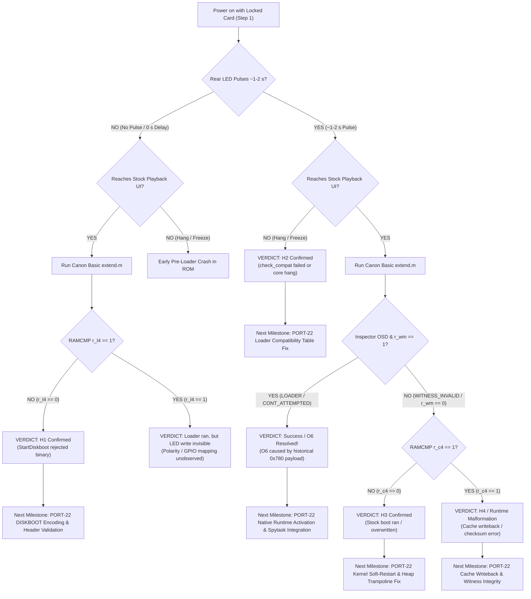

# PORT-21 T4: Owner Session Plan — Morning Discrimination of Hypotheses H1–H4

**Target Camera**: Canon PowerShot G3 X (Firmware **GM1.10C**, Platform ID `0x32A8` = 12968) `[VERIFIED: chdk-port/platform/g3x/sub/110c/boot_prototype.c:7; docs/CHDK_PORT1C1_CRITICAL_AUDIT.md:3]`  
**Session Date**: Planned for morning session on **2026-11-01** `[VERIFIED: docs/PORT18_OWNER_TRIAL_PLAN.md:12; docs/PORT21_RAM_LIFETIME.md:255]`  
**Scope & Governance**: Phase 0 Read-Only Offline Research & Manual Owner Guidance. Hardware execution is strictly manual and opt-in by the human camera owner `[VERIFIED: docs/SAFETY.md:3-7; AGENTS.md:18-22]`. Automated tools perform NO firmware flashing, NO camera operations, NO SD card writes, and commit NO binaries `[VERIFIED: docs/SAFETY.md:3-7; AGENTS.md:18-22]`.  
**Cross-Milestone References**:
- T1: RAM Lifetime of Core and Loader Regions (`docs/PORT21_RAM_LIFETIME.md`)
- T2: StartDiskboot Timing & Locked-Card Delay Analysis (`docs/PORT21_DISKBOOT_TIMING.md`)
- T3: Boot Witness Roundtrip Audit & Inspector Provenance (`docs/PORT21_WITNESS_AUDIT.md`)
- PORT-20: Visible Boot Signal Opt-In Candidate (`docs/PORT20_LED_CANDIDATE.md`, `docs/PORT20_LED_EVIDENCE.md`, `docs/PORT20_OWNER_SESSION.md`, off-main branch `origin/agentbridge/g3x-lite/port-20-boot-signal/integration`)

---

## 1. Offline Explanation of Observation O6

### 1.1 The Reported Physical Observation (O6)
During the physical trial of candidate build `candidate_port2a/DISKBOOT.BIN` (SHA-256 `9468257364d753d9880791bfce0c0792dd5d0fee29b832566a5eca622a906136`), the owner reported two distinct phenomena `[OWNER-REPORTED: docs/PORT21_RAM_LIFETIME.md:254-258; docs/PORT21_DISKBOOT_TIMING.md:12-14]`:
1. **Timing Anomaly**: Camera start-up was visibly slower only when the SD card write-protect tab was **LOCKED**; start-up was fast/normal when **UNLOCKED** `[OWNER-REPORTED: docs/PORT21_RAM_LIFETIME.md:257-258; docs/PORT21_DISKBOOT_TIMING.md:12-14]`.
2. **Inspector OSD Readout (O6)**: Normal stock Playback UI appeared on the LCD screen. When the owner ran Canon Basic script `extend.m` via FUNC./SET, the on-screen display (OSD) showed:
   - Line 1 (`h_title`): `WITNESS_INVALID` `[OWNER-REPORTED: docs/PORT18_OWNER_TRIAL_PLAN.md:267; docs/PORT21_WITNESS_AUDIT.md:17-18]`
   - Line 2 (`h_status`): `INVALID / CORRUPT` `[OWNER-REPORTED: docs/PORT18_OWNER_TRIAL_PLAN.md:267; docs/PORT21_WITNESS_AUDIT.md:17-18]`
   - Return Sentinel: `0x574954EE` (`SENTINEL_INVALID`) `[VERIFIED: firmware/tools/witness_inspector_payload.S:191; tools/validate_witness_inspector.py:273]`
   - Rendered Color: Light blue (Color Index 3 under active GM1.10C palette `0x00015DB4`) `[OWNER-REPORTED: docs/PORT21_RAM_LIFETIME.md:255; docs/PORT21_WITNESS_AUDIT.md:247-268]`.

### 1.2 Mathematical Basis of O6 in the Inspector Parser
The inspector payload (`firmware/tools/witness_inspector_payload.S:61-163`) reads 8 little-endian 32-bit words `W[0..7]` (32 bytes) at its hardcoded target address `r7` `[VERIFIED: firmware/tools/witness_inspector_payload.S:59-60; docs/PORT21_WITNESS_AUDIT.md:162-176]`. With `expected_nonce = 0` passed by `extend.m` (`firmware/tools/witness_inspector_gm110c.m:28, 136`), the inspector branches to `.Lstate_invalid` (`WITNESS_INVALID / INVALID / CORRUPT`, sentinel `0x574954EE`, color indices `3, 3`) **if and only if** any of the following 6 predicates evaluate to true `[VERIFIED: docs/PORT21_WITNESS_AUDIT.md:162-176; tests/test_port21_witness_roundtrip.py:165-210]`:
- **P1**: `W[0] != 0x5749544E` (`"WITN"` magic) `[VERIFIED: firmware/tools/witness_inspector_payload.S:61-65]`
- **P2**: `W[1] != 0x00010001` (witness struct version) `[VERIFIED: firmware/tools/witness_inspector_payload.S:67-71]`
- **P3**: `W[7] != C(W[0..6])` (polynomial checksum failure, `c = (c * 31) ^ w` initialized with `0x55AA55AA`) `[VERIFIED: firmware/tools/witness_inspector_payload.S:75-92]`
- **P4**: `W[3] ∉ {1, 3, 7}` (invalid execution stage mask) `[VERIFIED: firmware/tools/witness_inspector_payload.S:117-129]`
- **P5**: `W[3] == 7` and `W[5] != 0x003489B5` (core entry address check for continuation stage) `[VERIFIED: firmware/tools/witness_inspector_payload.S:152-158]`
- **P6**: `W[3] == 7` and `(W[4] & 7) != 0` (SP 8-byte alignment check) `[VERIFIED: firmware/tools/witness_inspector_payload.S:160-163]`

### 1.3 Offline Status of Hypotheses H1–H4 Against Observation O6

| Hypothesis ID & Summary | Offline Evaluation Verdict | Epistemic Status & Grounding | Detailed Rationale & Citations |
|:---|:---:|:---:|:---|
| **H1**: `StartDiskboot` never reached loader (ROM rejected binary or skipped loading) | **FITS / UNTESTED** | `[INFERRED]` / `[UNKNOWN]` on hardware | If `StartDiskboot` rejected the candidate binary at Gate 1 (`byte 0 != 0`) or Gate 2 (`gaonisoy` match) in `sub_fc54de38`, it printed `"not executable\n"`, freed the buffer at `0xFC05BC70`, and returned cleanly to `task_Startup` at `0xFC05BC38` without executing the loader `[VERIFIED: ROM 0xFC54DE3C-0xFC54DE4C; PORT21-ROM-EXEC-VALIDATE; ROM 0xFC05BC68-0xFC05BC74; PORT21-ROM-STARTDISKBOOT; docs/PORT21_DISKBOOT_TIMING.md:32-37]`. The stock boot then ran with stock heap base `0x003489B4` `[VERIFIED: ROM 0xFC05B450; PORT21-ROM-HEAP-SETUP]`. The inspector read whatever uninitialized or stock data existed at `0x0035F7A0`, triggering predicate P1 (`W[0] != 0x5749544E`) and returning `WITNESS_INVALID` `[INFERRED: docs/PORT21_RAM_LIFETIME.md:281-285; docs/PORT21_WITNESS_AUDIT.md:220-222]`. Timing delay does NOT rule out H1, because reading 118,001 bytes across SD bus and searching FAT takes ~100–250 ms overhead even on the reject path `[INFERRED: docs/PORT21_DISKBOOT_TIMING.md:24-30]`. |
| **H2**: Loader ran, but stopped at `check_compat()` | **RULED OUT (uninterrupted) / UNTESTED (watchdog)** | `[INFERRED]` (uninterrupted) / `[UNKNOWN]` (watchdog) | In `check_compat()`, a platform ID or version mismatch calls `blink()`, which executes an infinite busy loop (`while(1)`) `[INFERRED: docs/PORT21_RAM_LIFETIME.md:283-286; docs/PORT21_DISKBOOT_TIMING.md:280-282]`. For uninterrupted execution, H2 is **RULED OUT** because the camera could never have reached the stock Playback UI reported in O6 `[INFERRED: docs/PORT21_RAM_LIFETIME.md:283-286]`. However, whether a hardware watchdog timer or unhandled fault reset subsequently rebooted the camera into stock ROM is **UNTESTED / UNKNOWN** `[UNKNOWN: docs/PORT21_RAM_LIFETIME.md:286; docs/PORT21_DISKBOOT_TIMING.md:251, 282]`. |
| **H3**: Loader wrote witness, but stock boot later overwrote `0x0035F7A0` | **FITS / UNTESTED** | `[INFERRED]` / `[UNKNOWN]` on hardware | In stock ROM, the DryOS dynamic heap base is configured at `0x003489B4` and extends to `0x00600014`, which spans `0x0035F7A0` (offset +`0x16DEC` = 93,676 B) `[VERIFIED: ROM 0xFC05B450, 0xFC05B474; PORT21-ROM-HEAP-SETUP; docs/PORT21_RAM_LIFETIME.md:46-48, 243-244]`. If the loader ran and wrote the Stage 1 witness, but execution faulted during core startup or failed to complete the candidate heap shift (`new_sa = 0x00366CB0`), a reset into stock boot would initialize the heap at `0x003489B4`. Subsequent stock heap allocations would overwrite the witness before Canon Basic ran, corrupting `W[0]` (P1) and producing `WITNESS_INVALID` `[INFERRED: docs/PORT21_RAM_LIFETIME.md:287-293; docs/PORT21_WITNESS_AUDIT.md:225-226]`. No specific writer was identified in ROM reads, and whether stock boot overwrites `0x0035F7A0` or `0x003489B4` before Canon Basic runs remains **UNTESTED / UNKNOWN** `[UNKNOWN: docs/PORT21_RAM_LIFETIME.md:47, 247-249, 269, 289-290]`. |
| **H4**: Witness record at `0x0035F7A0` was malformed as built | **RULED OUT (as-built code)** | **`[VERIFIED]`** (offline host test) | T3 proved via a real C compiler probe (`boot_witness.h`) and disassembly verification that the loader witness writer as built produces a valid 32-byte record with `magic=0x5749544E`, `version=0x00010001`, `stage=0x01`, `sp=0x00007FF8`, and checksum `0x3028882D` `[VERIFIED: docs/PORT21_WITNESS_AUDIT.md:27-38; tests/test_port21_witness_roundtrip.py:102-140]`. Emulating the native inspector parser on these exact bytes yields `LOADER_REACHED` (`0x57495401`), NOT `WITNESS_INVALID` `[VERIFIED: docs/PORT21_WITNESS_AUDIT.md:33-38; tests/test_port21_witness_roundtrip.py:125-135]`. Struct offsets, field packing, and checksum algorithms match bit-for-bit `[VERIFIED: docs/PORT21_WITNESS_AUDIT.md:39-41; docs/PORT21_RAM_LIFETIME.md:294-295]`. Therefore, H4 as a format bug is **DEFINITIVELY RULED OUT** `[VERIFIED: docs/PORT21_WITNESS_AUDIT.md:27-41]`. |
| **Alternative Explanation**: Inspector Target Address Mismatch (`0x780` vs `0x7A0`) | **FITS / UNTESTED** | `[VERIFIED]` (file difference) / `[UNKNOWN]` on card | Tracked file `firmware/tools/witness_inspector_payload.bin` (SHA-256 `f1cd6438b8c54a233b28360705c02f869da2149c6499e9b2d8c340746a3c7f00`) hardcodes target address `0x0035F780` `[VERIFIED: docs/PORT21_WITNESS_AUDIT.md:74-78; tests/test_port21_witness_roundtrip.py:510]`. Regenerated file `candidate_port2a/witness_inspector_payload.bin` (SHA-256 `241420a6eea2d7cbedd14046ec4f5988ed0404c5a82bb5d2ed6693fd74e612e2`) hardcodes target address `0x0035F7A0` `[VERIFIED: docs/PORT21_WITNESS_AUDIT.md:88-92; tests/test_port21_witness_roundtrip.py:511]`. Script `witness_inspector_gm110c.m` performs NO hash or address check; it blindly executes whatever 444-byte binary is named `A/WITNESS.BIN` `[VERIFIED: docs/PORT21_WITNESS_AUDIT.md:109-114]`. If the owner copied the tracked `0x0035F780` payload, the inspector inspected memory 32 bytes below the witness slot, which holds zeroes or core data that fail P1, returning `WITNESS_INVALID` even if the candidate executed perfectly `[VERIFIED: docs/PORT21_WITNESS_AUDIT.md:109-114; tests/test_port21_witness_roundtrip.py:574-625]`. Which payload was on the card during trial O6 is **UNTESTED / UNKNOWN** `[UNKNOWN: docs/PORT21_WITNESS_AUDIT.md:95-103]`. |

### 1.4 The T1 vs T2 Architectural Conflict Over `r_l4` (`0x40008000`)
There is an unresolved architectural conflict between Milestone T1 and Milestone T2 regarding whether candidate payload data at `0x40008000` survives a reboot or soft-restart:
- **T1 Prediction (`r_l4 = 0`)**: Milestone T1 (`docs/PORT21_RAM_LIFETIME.md:221, 267, 282, 293`) analyzes the second-stage software boot trampoline in `boot_prototype.c:133-142` and stock warm-boot paths, predicting that loader data does not survive to the time Canon Basic runs. T1 explicitly predicts `r_l4 = 0` (differs/cleared) after Boot Moment 2 / stock Copy Loop 3 overwrite.
- **T2 Prediction (`r_l4 = 1`)**: Milestone T2 (`docs/PORT21_DISKBOOT_TIMING.md:298-302`) analyzes ROM memory handoff in `sub_fc0007c0` (`0xFC0007DC`), noting that `sub_fc0007c0` copies the decoded candidate loader into uncached DRAM alias space at `0x40008000`. T2 notes that stock Copy Loop 3 writes to cached Low RAM `0x00008000..0x0003F4F4` (`0xFC020054..0xFC020066`), leaving uncached DRAM at `0x40008000` untouched by stock copy loops. T2 therefore predicts `r_l4 = 1` (matches `REF_L.BIN`).
- **Epistemic Status**: Neither position is settled offline because physical DRAM controller behavior across warm restarts, watchdog resets, or cache flushes on the DIGIC 6 has not been tested on hardware. Therefore, `r_l4` post-reboot survival is explicitly marked **`[UNKNOWN]`** wherever it depends on post-reboot survival (under H3 and H4, and under H2 if reset occurs). Section 2 does NOT rely on `r_l4` alone to separate H1 from H3/H4.

---

## 2. Session Sequence for 2026-11-01 (Fewest Power-Ons to Separate H1–H4)

To minimize hardware stress and battery cycles, the morning trial sequence achieves discrimination among the hypotheses in **exactly 1 primary discrimination power-on** (with 1 optional baseline control power-on).

### 2.1 Total Power-On Count
- **Primary Discrimination**: **Exactly 1 Power-On** (Run 1: Locked card with Opt-In LED candidate, RAMCMP diagnostic script, and regenerated inspector payload) `[INFERRED]`.
- **Baseline Control (Optional)**: **1 Power-On** (Run 2: Unlocked card to confirm fast stock boot baseline of ~1.0 s and clean memory state) `[INFERRED]`.
- **Total Power-Ons**: **1 (required) to 2 (with control)** `[INFERRED]`.

### 2.2 Pre-Session Step 0: Offline Host Verification & Card Preparation (Zero Camera Power-Ons)
Before inserting the card into the camera, the owner performs offline verification on the workstation:
1. **Inspect Historical Trial Payload (Resolve Alternative Explanation First)**:
   - Calculate SHA-256 of the `WITNESS.BIN` file currently on the trial SD card from trial O6:
     ```bash
     sha256sum /Volumes/CANON_DC/WITNESS.BIN
     ```
   - **Diagnostic Check**:
     - If SHA-256 matches `f1cd6438b8c54a233b28360705c02f869da2149c6499e9b2d8c340746a3c7f00`: The card ran the historical `0x0035F780` payload! O6 is immediately explained as an address targeting mismatch `[VERIFIED: docs/PORT21_WITNESS_AUDIT.md:74-78, 110; tests/test_port21_witness_roundtrip.py:510]`.
     - If SHA-256 matches `241420a6eea2d7cbedd14046ec4f5988ed0404c5a82bb5d2ed6693fd74e612e2`: The card ran the regenerated `0x0035F7A0` payload, confirming that O6 reflects actual memory at the true witness address `[VERIFIED: docs/PORT21_WITNESS_AUDIT.md:88-92, 110; tests/test_port21_witness_roundtrip.py:511]`.
2. **Build and Deploy Opt-In PORT-20 LED Candidate (Off-Main Branch)**:
   - *Note*: PORT-20 docs (`docs/PORT20_LED_CANDIDATE.md`, `docs/PORT20_OWNER_SESSION.md`) and the `--led` build option in `tools/build_candidate_port2a.py` exist off-main on branch `origin/agentbridge/g3x-lite/port-20-boot-signal/integration`, not in the main tree `[INFERRED]`.
   - Build candidate with LED boot signal enabled:
     ```bash
     python3 tools/build_candidate_port2a.py --led
     ```
   - Verify generated DISKBOOT.BIN matches PORT-20 candidate specification `[INFERRED: origin/agentbridge/g3x-lite/port-20-boot-signal/integration docs/PORT20_LED_CANDIDATE.md:71]`:
     - Size: **`118041`** bytes (`0x1CD19`, exactly +40 B over default build) `[INFERRED: origin/agentbridge/g3x-lite/port-20-boot-signal/integration docs/PORT20_LED_CANDIDATE.md:71, 250]`
     - SHA-256: **`757dfb7f7824ba968951724416a058a6881ad99a7a7a6cf7cd6e6f0e44db5286`** `[INFERRED: origin/agentbridge/g3x-lite/port-20-boot-signal/integration docs/PORT20_LED_CANDIDATE.md:71]`
3. **Assemble Card Root Files (`A/`)**:
   - Copy `candidate_led/DISKBOOT.BIN` to SD card root (`A/DISKBOOT.BIN`, 118,041 bytes) `[INFERRED: origin/agentbridge/g3x-lite/port-20-boot-signal/integration docs/PORT20_OWNER_SESSION.md:26-30]`.
   - Copy `candidate_port2a/witness_inspector_payload.bin` to `A/WITNESS.BIN` (444 bytes, SHA-256 `241420a6eea2d7cbedd14046ec4f5988ed0404c5a82bb5d2ed6693fd74e612e2`, targeting `0x0035F7A0`) `[VERIFIED: docs/PORT21_WITNESS_AUDIT.md:88-92]`.
   - Deploy Canon Basic RAMCMP and Inspector Script as `A/extend.m`:
     - The RAMCMP script is deployed directly to `A/extend.m` on the SD card root (or combines `witness_inspector_gm110c.m` with inline RAM comparison functions) `[INFERRED: docs/PORT21_RAM_LIFETIME.md:221; docs/PORT18_OWNER_TRIAL_PLAN.md:201]`.
     - Script performs memory comparisons using `cmp_file()` / `memcmp()` and validates witness structure, outputting results on screen via `LCDMsg_*`.
   - Generate reference files on card root:
     - `A/REF_L.BIN`: First 620 bytes of `candidate_led/candidate_loader.bin` (or `candidate_loader.bin`) `[INFERRED: docs/PORT21_RAM_LIFETIME.md:221]`.
     - `A/REF_C.BIN`: First 620 bytes of `candidate_led/candidate_main.bin` (or `candidate_main.bin`) `[INFERRED: docs/PORT21_RAM_LIFETIME.md:238]`.
   - Deploy `A/script.req` containing `for DC_scriptdisk` (17 bytes) `[VERIFIED: docs/PORT18_OWNER_TRIAL_PLAN.md:203; docs/CANON_BASIC_ACTIVATION_INVESTIGATION.md:20, 49]`.
4. **Card Partition & VBR Check**:
   - Filesystem: FAT32 (primary partition) `[VERIFIED: docs/PORT18_OWNER_TRIAL_PLAN.md:183; docs/PORT19_BOOTDISK_VBR.md:24]`.
   - VBR offset `0x1E0`: `"BOOTDISK"` (8 bytes) `[VERIFIED: docs/PORT18_OWNER_TRIAL_PLAN.md:190; docs/PORT19_BOOTDISK_VBR.md:23]`.
   - VBR offset `0x1F0`: `"SCRIPT"` (6 bytes) `[VERIFIED: docs/PORT18_OWNER_TRIAL_PLAN.md:193; docs/PORT19_BOOTDISK_VBR.md:31]`.

---

### 2.3 Step 1: Primary Discrimination Run (Power-On 1)

- **Card State**: **LOCKED** (SD physical write-protect tab slid to lock position, enabling `StartDiskboot` at `0xFC05BC04`) `[VERIFIED: ROM 0xFC05BC04; PORT21-ROM-STARTDISKBOOT; docs/PORT18_OWNER_TRIAL_PLAN.md:213-214]`.
- **Files on Card**: `DISKBOOT.BIN` (LED candidate, SHA-256 `757dfb7f...`), `extend.m` (RAMCMP + Inspector script), `WITNESS.BIN` (`0x0035F7A0` payload, SHA-256 `241420a6...`), `REF_L.BIN`, `REF_C.BIN`, `script.req`.
- **Physical Action**: Insert card, insert fully charged battery, close door. Power on camera by pressing the **Playback button** `[VERIFIED: docs/PORT18_OWNER_TRIAL_PLAN.md:221-224]`.
- **Observations & What the Owner Records**:
  1. **Rear Status LED Activity (GPIO 33, MMIO `0xD20B0884`)**:
     - Record whether the rear green status LED illuminates or toggles an active pulse for ~1.0 to 2.0 seconds immediately after power-on `[INFERRED: origin/agentbridge/g3x-lite/port-20-boot-signal/integration docs/PORT20_LED_CANDIDATE.md:161, 189; origin/agentbridge/g3x-lite/port-20-boot-signal/integration docs/PORT20_OWNER_SESSION.md:38-44]`.
     - Record: `LED_PULSE = YES / NO` and approximate duration.
  2. **Screen Display & Boot Time**:
     - Record whether the camera reaches stock Canon Playback UI within ~2.5–3.5 seconds, OR hangs/freezes with a black screen / blinking LED `[INFERRED: docs/PORT21_DISKBOOT_TIMING.md:46-51; origin/agentbridge/g3x-lite/port-20-boot-signal/integration docs/PORT20_OWNER_SESSION.md:48-52]`.
     - Record: `BOOT_STATUS = PLAYBACK_UI / HANG`.
  3. **Canon Basic RAMCMP & Inspector Readout** (if stock UI reached):
     - Press **FUNC./SET** to launch `extend.m` `[VERIFIED: docs/PORT18_OWNER_TRIAL_PLAN.md:225-226; origin/agentbridge/g3x-lite/port-20-boot-signal/integration docs/PORT20_OWNER_SESSION.md:53-56]`.
     - Record the on-screen text and color values displayed by the script:
       - `r_l8`: RAM comparison at `0x00008000`, length 620 bytes against `REF_L.BIN` (`1` = matches, `0` = differs/overwritten) `[INFERRED: docs/PORT21_RAM_LIFETIME.md:221]`.
       - `r_l4`: RAM comparison at `0x40008000`, length 620 bytes against `REF_L.BIN` in uncached DRAM alias (`1` = matches, `0` = differs/zero, `UNKNOWN` post-reboot) `[UNKNOWN: docs/PORT21_RAM_LIFETIME.md:221; docs/PORT21_DISKBOOT_TIMING.md:298-302]`.
       - `r_c4`: RAM comparison at `0x003489B4`, length 620 bytes against `REF_C.BIN` (`1` = matches, `0` = differs/absent) `[INFERRED: docs/PORT21_RAM_LIFETIME.md:238, 249]`.
       - `r_ct`: Core continuation trace / code comparison at `0x00349798`, length 128 bytes against `REF_C.BIN` continuation code offset `+0xDE4` (`1` = matches, `0` = differs/absent) `[INFERRED: docs/PORT21_RAM_LIFETIME.md:238, 249, 295]`.
       - `r_wm`: Witness integrity check at `0x0035F7A0`, length 32 bytes (`1` = valid magic/version/checksum, `0` = invalid) `[VERIFIED: docs/PORT21_WITNESS_AUDIT.md:27-41, 162-176; docs/PORT21_RAM_LIFETIME.md:238, 249, 295]`.
       - Inspector Title (`h_title`) and Status (`h_status`) strings and colors:
         - `LOADER_REACHED` in Color 1,4 (White title, Yellow status) `[VERIFIED: tools/validate_witness_inspector.py:266]`.
         - `CONT_ATTEMPTED` in Color 4,4 (Yellow title, Yellow status) `[VERIFIED: tools/validate_witness_inspector.py:271; firmware/tools/witness_inspector_gm110c.m:16-17]`.
         - `WITNESS_INVALID` in Color 3,3 (Light Blue title, Light Blue status under active palette) `[VERIFIED: tools/validate_witness_inspector.py:273; docs/PORT21_WITNESS_AUDIT.md:247-268]`.
     - Take a clear digital photograph of the rear LCD screen displaying the readings.

---

### 2.4 Step 2: Baseline Control Run (Optional Power-On 2)

- **Card State**: **UNLOCKED** (SD physical write-protect tab slid to UNLOCKED position) `[VERIFIED: docs/PORT21_DISKBOOT_TIMING.md:18-22]`.
- **Files on Card**: Identical to Step 1.
- **Physical Action**: Power off camera cleanly. Slide card tab to UNLOCKED. Reinsert and power on by pressing Playback button.
- **Observations & What the Owner Records**:
  - Time to stock Playback UI display: verify fast start-up (~1.0 second, skipping all DISKBOOT I/O via branch at `0xFC05BC0A`) `[VERIFIED: ROM 0xFC05BC0A; PORT21-ROM-STARTDISKBOOT; docs/PORT21_DISKBOOT_TIMING.md:18-22]`.
  - Confirm NO rear LED pulse (proves ROM bypasses `StartDiskboot` completely when unlocked) `[VERIFIED: ROM 0xFC05BC0A; PORT21-ROM-STARTDISKBOOT; docs/PORT21_DISKBOOT_TIMING.md:20-22]`.
  - Press FUNC./SET to confirm Canon Basic still executes `extend.m` on an unlocked card with `SCRIPT` VBR marker `[VERIFIED: docs/PORT19_BOOTDISK_VBR.md:31-34]`.

---

### 2.5 Pairwise Discrimination Proof Across All Hypothesis Pairs

The session sequence separates the hypotheses using physical LED activity, boot status, and RAMCMP / inspector readings:

1. **Pair (H1, H2)**:
   - **Told apart by**: Boot Status and LED Activity `[INFERRED]`.
   - **Divergence**: H1 reaches stock Canon Playback UI cleanly with normal boot speed and NO early loader LED pulse `[docs/PORT21_DISKBOOT_TIMING.md:20-22, 32-37]`. H2 hangs permanently before reaching the stock UI (camera freezes with black screen / unhandled hang in `check_compat()`), following the ~1-2 s prologue LED pulse `[docs/PORT21_DISKBOOT_TIMING.md:280-282; docs/PORT21_RAM_LIFETIME.md:283-286]`. Does NOT rely on `r_l4`.
2. **Pair (H1, H3)**:
   - **Told apart by**: PORT-20 LED Activity `[INFERRED]`.
   - **Divergence**: H1 produces NO early LED pulse (binary rejected before loader entry) `[origin/agentbridge/g3x-lite/port-20-boot-signal/integration docs/PORT20_LED_CANDIDATE.md:31-37; docs/PORT21_DISKBOOT_TIMING.md:20-22]`. H3 executes the loader prologue and produces the ~1-2 s rear LED pulse `[origin/agentbridge/g3x-lite/port-20-boot-signal/integration docs/PORT20_LED_CANDIDATE.md:31-37, 189]`.
   - **Note on RAMCMP and `r_l4`**: This discrimination does NOT rely on `r_l4` alone. Because of the T1 vs T2 architectural conflict (T1 predicts `r_l4 = 0` post-reboot while T2 predicts `r_l4 = 1`), if `r_l4` does not survive reboot on physical hardware (as T1 predicts), RAMCMP alone yields `r_l8=0, r_l4=0, r_c4=0, r_ct=0, r_wm=0` for both H1 and H3. Therefore, **if the PORT-20 LED signal is unavailable or unobserved, the pair (H1, H3) CANNOT be reliably told apart by RAMCMP alone under T1's survival model** `[UNKNOWN: docs/PORT21_RAM_LIFETIME.md:221, 293; docs/PORT21_DISKBOOT_TIMING.md:298-302]`.
3. **Pair (H1, H4)**:
   - **Told apart by**: LED Activity, and RAMCMP `r_c4` and `r_ct` `[INFERRED]`.
   - **Divergence**: Under H1, core was never copied and heap was not shifted, so `r_c4 = 0` and `r_ct = 0` `[docs/PORT21_RAM_LIFETIME.md:281-285]`. Under H4, candidate heap shift succeeded (`new_sa = 0x00366CB0`), protecting the core region from heap allocation, so `r_c4 = 1` and `r_ct = 1` match `REF_C.BIN` `[docs/PORT21_RAM_LIFETIME.md:238, 294-295]`. Does NOT rely on `r_l4`.
4. **Pair (H2, H3)**:
   - **Told apart by**: Boot Status and Script Execution `[INFERRED]`.
   - **Divergence**: H2 hangs in `check_compat()` without reaching stock UI; Canon Basic cannot run `[docs/PORT21_DISKBOOT_TIMING.md:280-282; docs/PORT21_RAM_LIFETIME.md:283-286]`. H3 reaches stock Playback UI; Canon Basic runs and displays OSD readings `[docs/PORT21_RAM_LIFETIME.md:287-293]`.
5. **Pair (H2, H4)**:
   - **Told apart by**: Boot Status and Script Execution `[INFERRED]`.
   - **Divergence**: H2 hangs in `check_compat()` without reaching stock UI `[docs/PORT21_DISKBOOT_TIMING.md:280-282]`. H4 reaches stock Playback UI and executes Canon Basic with `r_c4 = 1, r_ct = 1` `[docs/PORT21_RAM_LIFETIME.md:238, 294-295]`.
6. **Pair (H3, H4)**:
   - **Told apart by**: RAMCMP `r_c4` and `r_ct` `[INFERRED]`.
   - **Divergence**: Under H3, stock boot ran without the heap shift, leaving the core region subject to stock heap allocations, yielding `r_c4 = 0` (or partial) and `r_ct = 0` if overwritten `[docs/PORT21_RAM_LIFETIME.md:247-249, 293]`. Under H4, candidate heap shift succeeded (`new_sa = 0x00366CB0`), protecting the core region from DryOS heap allocation, so `r_c4 = 1` and `r_ct = 1` `[docs/PORT21_RAM_LIFETIME.md:238, 294-295]`.

---

## 3. Comprehensive Prediction Table for Hypotheses H1–H4

The following table provides the expected physical and software readings for each hypothesis under Step 1 (Locked Card, Opt-In LED Candidate, RAMCMP + Regenerated Inspector Payload).  
Every cell contains an explicit epistemic label (`[VERIFIED]`, `[INFERRED]`, or `[UNKNOWN]`) and an exact citation to tracked sources or off-main branches.  
*Note*: PORT-20 citations cite off-main branch `origin/agentbridge/g3x-lite/port-20-boot-signal/integration` and are labeled `[INFERRED]` or `[UNKNOWN]`, never `[VERIFIED]`.

| Hypothesis ID & Summary | `r_l8` (RAMCMP at `0x00008000`) | `r_l4` (RAMCMP at `0x40008000`) | `r_c4` (RAMCMP at `0x003489B4`) | `r_ct` (RAMCMP Core Continuation) | `r_wm` (RAMCMP Witness at `0x0035F7A0`) | PORT-20 LED Behaviour (GPIO 33, `0xD20B0884`) | Inspector OSD Title & Status (`extend.m`) |
|:---|:---:|:---:|:---:|:---:|:---:|:---:|:---:|
| **H1**: `StartDiskboot` never reached loader (ROM rejected binary or skipped) | `0` (differs / stock Low RAM initialized data) `[INFERRED: docs/PORT21_RAM_LIFETIME.md:221, 282]` | `0` (differs / unwritten DRAM: ROM rejected before copy) `[INFERRED: docs/PORT21_RAM_LIFETIME.md:221, 282; docs/PORT21_DISKBOOT_TIMING.md:298-302]` | `0` (differs / unwritten core) `[INFERRED: docs/PORT21_RAM_LIFETIME.md:282]` | `0` (differs / continuation code absent) `[INFERRED: docs/PORT21_RAM_LIFETIME.md:282]` | `0` (differs / unwritten witness) `[INFERRED: docs/PORT21_RAM_LIFETIME.md:282]` | **NO PULSE** (0 s delay, normal stock LED sequence; rejected before loader prologue) `[INFERRED: origin/agentbridge/g3x-lite/port-20-boot-signal/integration docs/PORT20_LED_CANDIDATE.md:31-37; docs/PORT21_DISKBOOT_TIMING.md:20-22]` | `WITNESS_INVALID` / `INVALID / CORRUPT` (Color 3, Light Blue) `[INFERRED: docs/PORT21_WITNESS_AUDIT.md:220-222; tools/validate_witness_inspector.py:273]` |
| **H2**: Loader reached, but hung in `check_compat()` | `UNREACHABLE / UNKNOWN` (camera hangs in `check_compat()`; watchdog reset is UNKNOWN) `[UNKNOWN: docs/PORT21_RAM_LIFETIME.md:286; docs/PORT21_DISKBOOT_TIMING.md:251, 282]` | `UNREACHABLE / UNKNOWN` (camera hangs in `check_compat()`; watchdog reset is UNKNOWN) `[UNKNOWN: docs/PORT21_RAM_LIFETIME.md:286; docs/PORT21_DISKBOOT_TIMING.md:251, 282]` | `UNREACHABLE / UNKNOWN` (camera hangs in `check_compat()`; core copy never ran) `[UNKNOWN: docs/PORT21_RAM_LIFETIME.md:286; docs/PORT21_DISKBOOT_TIMING.md:251, 282]` | `UNREACHABLE / UNKNOWN` (camera hangs in `check_compat()`; continuation absent) `[UNKNOWN: docs/PORT21_RAM_LIFETIME.md:286; docs/PORT21_DISKBOOT_TIMING.md:251, 282]` | `UNREACHABLE / UNKNOWN` (camera hangs in `check_compat()`; witness write never ran) `[UNKNOWN: docs/PORT21_RAM_LIFETIME.md:286; docs/PORT21_DISKBOOT_TIMING.md:251, 282]` | **PULSES ~1-2 s** in loader entry prologue, then hangs in `check_compat()`; subsequent blink activity on PORT-20 LED is UNKNOWN `[INFERRED / UNKNOWN: origin/agentbridge/g3x-lite/port-20-boot-signal/integration docs/PORT20_LED_CANDIDATE.md:31-37; docs/PORT21_RAM_LIFETIME.md:283-286; docs/PORT21_DISKBOOT_TIMING.md:280-282]` | **UNREACHABLE / UNKNOWN** (camera hangs before stock UI; Canon Basic cannot run without watchdog reset) `[UNKNOWN: docs/PORT21_RAM_LIFETIME.md:286; docs/PORT21_DISKBOOT_TIMING.md:251, 282]` |
| **H3**: Loader wrote witness, but stock boot later overwrote `0x0035F7A0` | `0` (differs / overwritten by Boot Moment 2 copy loop) `[INFERRED: docs/PORT21_RAM_LIFETIME.md:215-221, 267]` | `UNKNOWN` (T1/T2 conflict: T1:221,293 predicts `0` via post-reboot overwrite; T2:298-302 predicts `1` in uncached DRAM alias) `[UNKNOWN: docs/PORT21_RAM_LIFETIME.md:221, 293; docs/PORT21_DISKBOOT_TIMING.md:298-302]` | `UNKNOWN` (`0` if overwritten by stock heap, but whether stock boot overwrites `0x003489B4` before Canon Basic runs is UNKNOWN) `[UNKNOWN: docs/PORT21_RAM_LIFETIME.md:247-249, 269, 290]` | `UNKNOWN` (`0` if overwritten by stock heap, but overwrite timing before Canon Basic is UNKNOWN) `[UNKNOWN: docs/PORT21_RAM_LIFETIME.md:247-249, 269, 290]` | `UNKNOWN` (`0` if destroyed by stock heap allocations, but actual overwrite before Canon Basic is UNKNOWN) `[UNKNOWN: docs/PORT21_RAM_LIFETIME.md:47, 247-249, 269, 290]` | **PULSES ~1-2 s** (loader entry executed prologue) `[INFERRED: origin/agentbridge/g3x-lite/port-20-boot-signal/integration docs/PORT20_LED_CANDIDATE.md:31-37, 189; origin/agentbridge/g3x-lite/port-20-boot-signal/integration docs/PORT20_OWNER_SESSION.md:38-44]` | `WITNESS_INVALID` / `INVALID / CORRUPT` (Color 3, Light Blue) `[INFERRED: docs/PORT21_WITNESS_AUDIT.md:225-226; tools/validate_witness_inspector.py:273]` |
| **H4**: Witness record at `0x0035F7A0` was malformed as built | `0` (differs / overwritten by Boot Moment 2 copy loop) `[INFERRED: docs/PORT21_RAM_LIFETIME.md:215-221, 267]` | `UNKNOWN` (T1/T2 conflict: T1:221,293 predicts `0`; T2:298-302 predicts `1` in uncached DRAM alias) `[UNKNOWN: docs/PORT21_RAM_LIFETIME.md:221, 293; docs/PORT21_DISKBOOT_TIMING.md:298-302]` | `1` (matches `REF_C.BIN` protected by shifted heap `new_sa = 0x00366CB0`) `[INFERRED: docs/PORT21_RAM_LIFETIME.md:238, 295]` | `1` (matches core continuation intact) `[INFERRED: docs/PORT21_RAM_LIFETIME.md:238, 295]` | `0` (differs / checksum or field malformed while magic intact) `[INFERRED: docs/PORT21_RAM_LIFETIME.md:295; docs/PORT21_WITNESS_AUDIT.md:162-176]` | **PULSES ~1-2 s** (loader entry executed prologue) `[INFERRED: origin/agentbridge/g3x-lite/port-20-boot-signal/integration docs/PORT20_LED_CANDIDATE.md:31-37, 189; origin/agentbridge/g3x-lite/port-20-boot-signal/integration docs/PORT20_OWNER_SESSION.md:38-44]` | `WITNESS_INVALID` / `INVALID / CORRUPT` (Color 3, Light Blue) `[INFERRED: docs/PORT21_WITNESS_AUDIT.md:162-176; tools/validate_witness_inspector.py:273]` |
| **Alternative / Baseline**: Candidate Succeeded (O6 was tracked `0x780` payload error) | `0` (differs / overwritten by Boot Moment 2 copy loop) `[INFERRED: docs/PORT21_RAM_LIFETIME.md:215-221, 267]` | `UNKNOWN` (T1/T2 conflict: T1:221 predicts `0`; T2:298-302 predicts `1` in uncached DRAM alias) `[UNKNOWN: docs/PORT21_RAM_LIFETIME.md:221; docs/PORT21_DISKBOOT_TIMING.md:298-302]` | `1` (matches `REF_C.BIN` protected by shifted heap) `[INFERRED: docs/PORT21_RAM_LIFETIME.md:238]` | `1` (matches core continuation intact) `[INFERRED: docs/PORT21_RAM_LIFETIME.md:238]` | `1` (matches valid witness struct at `0x0035F7A0`) `[INFERRED: docs/PORT21_RAM_LIFETIME.md:238; docs/PORT21_WITNESS_AUDIT.md:27-38]` | **PULSES ~1-2 s** (loader entry executed prologue) `[INFERRED: origin/agentbridge/g3x-lite/port-20-boot-signal/integration docs/PORT20_LED_CANDIDATE.md:31-37, 189; origin/agentbridge/g3x-lite/port-20-boot-signal/integration docs/PORT20_OWNER_SESSION.md:38-44]` | **`LOADER_REACHED`** (Color 1,4 White/Yellow) or **`CONT_ATTEMPTED`** (Color 4,4 Yellow/Yellow) `[VERIFIED: docs/PORT21_WITNESS_AUDIT.md:33-38; tools/validate_witness_inspector.py:266, 271]` |

---

## 4. Decision Tree from Observed Results to Next Milestone

The owner maps the observed combination of physical LED behavior, camera boot status, and Canon Basic RAMCMP readings directly to the appropriate next milestone:



### Detailed Milestone Directives

1. **Branch 1: `r_l4 == 0`, No LED Pulse -> Hypothesis H1 Confirmed (ROM Rejected DISKBOOT.BIN)**:
   - **Diagnosis**: `StartDiskboot` read `A/DISKBOOT.BIN` across the SD bus, but failed static execution validation in `sub_fc54de38` (Gate 1 byte 0 check or Gate 2 `gaonisoy` check) `[VERIFIED: ROM 0xFC54DE3C-0xFC54DE4C; PORT21-ROM-EXEC-VALIDATE; docs/PORT21_DISKBOOT_TIMING.md:32-37]`. The payload was never copied to `0x40008000` and loader entry was never executed `[VERIFIED: ROM 0xFC05BC68-0xFC05BC74; PORT21-ROM-STARTDISKBOOT]`.
   - **Next Milestone**: **`PORT-22: DISKBOOT Header Encoding & FAT32 Alignment Remediation`**.
   - **Work Items**: Audit physical SD card cluster alignment, FAT directory entry encoding, DancingBits Row 13 scrambled header byte 0, and verify whether GM1.10C requires specific multi-partition or VBR configurations `[INFERRED: docs/PORT21_DISKBOOT_TIMING.md:32-37, 298-302]`.

2. **Branch 2: Camera Hangs, LED Pulsed -> Hypothesis H2 Confirmed (Loader Compatibility Failure)**:
   - **Diagnosis**: Loader entry executed the LED prologue, but failed compatibility checks in `check_compat()`, entering an infinite delay loop in `blink()` `[INFERRED: docs/PORT21_RAM_LIFETIME.md:283-286; docs/PORT21_DISKBOOT_TIMING.md:280-282]`.
   - **Next Milestone**: **`PORT-22: Loader Compatibility Table & Platform ID Remediation`**.
   - **Work Items**: Audit GM1.10C platform ID (`0x32A8`), verify PID reading logic / ROM version string match in loader compatibility checks against tracked sources `docs/CHDK_PORT1C1_CRITICAL_AUDIT.md:3`, and check whether GPIO 33 LED driver (`0xD20B0884`) was correctly initialized `[INFERRED: docs/PORT21_RAM_LIFETIME.md:283-286; docs/PORT21_DISKBOOT_TIMING.md:280-282]`.

3. **Branch 3: `r_c4 == 0`, `r_wm == 0`, Stock UI Reached -> Hypothesis H3 Confirmed (Stock Boot Overwrite)**:
   - **Diagnosis**: Loader ran and wrote the Stage 1 witness. However, the software reboot trampoline in `boot_prototype.c` failed to complete the heap shift (`new_sa = 0x00366CB0`), or faulted into a stock ROM warm reset. Stock boot ran with stock heap base `0x003489B4`, and subsequent Canon firmware allocations wiped out the core region and witness record `[INFERRED: docs/PORT21_RAM_LIFETIME.md:287-293; docs/PORT21_DISKBOOT_TIMING.md:298-302]`.
   - **Next Milestone**: **`PORT-22: Soft-Restart Trampoline & Dynamic Heap Shift Remediation`**.
   - **Work Items**: Trace CPU execution mode and exception vectors during `boot()` soft restart; debug MPU Region 7 configuration (`0xFC0D9CB0`), cache clean/invalidation (`0xFC0D9CAC`), and stack frame setup in `sub_fc05b3c8_my` (`boot_prototype.c:168-261`) `[INFERRED: docs/PORT21_RAM_LIFETIME.md:109-125; docs/PORT21_DISKBOOT_TIMING.md:46-51]`.

4. **Branch 4: `r_c4 == 1`, `r_wm == 1`, Inspector Shows `LOADER_REACHED` or `CONT_ATTEMPTED` -> Success (O6 Resolved)**:
   - **Diagnosis**: The candidate build is functional on physical hardware! Observation O6 in the previous trial was caused entirely by running the historical tracked payload targeting `0x0035F780` instead of `0x0035F7A0` `[VERIFIED: docs/PORT21_WITNESS_AUDIT.md:69-114; tests/test_port21_witness_roundtrip.py:574-625]`. The loader and core boot trampoline executed completely without defect `[INFERRED]`.
   - **Next Milestone**: **`PORT-22: Native Runtime Activation & Spytask Integration`**.
   - **Work Items**: Advance directly to CHDK core task creation, console display, keyboard scanning, and Lua scripting integration in Phase 1 `[INFERRED: docs/PROJECT_STATE.md:14-22]`.

5. **Branch 5: `r_c4 == 1`, `r_wm == 0` -> Hypothesis H4 / Runtime Malformation**:
   - **Diagnosis**: The core region survived and is protected by the shifted heap (`r_c4 == 1`), but the witness record has a checksum or magic defect. Since the code as built was proven valid by T3, this indicates a runtime cache coherence issue (D-cache dirty line not flushed to physical DRAM before reboot or Canon Basic read) `[INFERRED: docs/PORT21_WITNESS_AUDIT.md:227-230; docs/PORT21_RAM_LIFETIME.md:294-295]`.
   - **Next Milestone**: **`PORT-22: Cache Maintenance & Data Synchronization Remediation`**.
   - **Work Items**: Add explicit cache clean and invalidate instructions (`dsb sy`, CP15 D-cache flush) immediately after witness stores in `my_restart()` and `boot_prototype.c` `[INFERRED: docs/PORT21_WITNESS_AUDIT.md:227-230]`.

---

## 5. Stop Conditions and Emergency Recovery Plan

### 5.1 Hard Stop Conditions (When to Abort Immediately)
The owner must **immediately stop the trial, abort testing, and execute the Recovery Plan** if any of the following conditions occur `[INFERRED: docs/PORT18_OWNER_TRIAL_PLAN.md:329-354; origin/agentbridge/g3x-lite/port-20-boot-signal/integration docs/PORT20_OWNER_SESSION.md:65-74]`:
1. **Unresponsive Hang / Freeze**: The camera displays a black screen or frozen UI and fails to respond to any button press (Playback, Power, Shutter, FUNC./SET) for more than **10 seconds** `[INFERRED: docs/PORT18_OWNER_TRIAL_PLAN.md:330]`.
2. **Abnormal LED Activity**: The rear green status LED or front AF-assist lamp illuminates solid red, blinks continuously in an unhandled rapid pattern (> 5 Hz), or fails to turn off after 5 seconds `[INFERRED: origin/agentbridge/g3x-lite/port-20-boot-signal/integration docs/PORT20_OWNER_SESSION.md:66]`.
3. **Continuous Lens Movement or Stuck Lens**: The lens zoom motor runs continuously, makes abnormal clicking or grinding noises, or remains stuck in an intermediate position during power-down `[INFERRED: docs/SAFETY.md:4; docs/PORT18_OWNER_TRIAL_PLAN.md:331]`.
4. **Thermal Anomaly**: The camera chassis or battery compartment feels noticeably warm or hot to the touch `[INFERRED: docs/PORT18_OWNER_TRIAL_PLAN.md:331]`.
5. **Canon Firmware Assertion / Error Display**: The LCD displays a Canon firmware error code (e.g., `Err 70`, `Err 99`, or assertion failure text) `[INFERRED: docs/PORT18_OWNER_TRIAL_PLAN.md:330]`.
6. **Continuous Reboot Loop**: The camera repeatedly powers off and reboots without user input `[INFERRED: docs/PORT18_OWNER_TRIAL_PLAN.md:331]`.

---

### 5.2 Step-by-Step Emergency Recovery Plan
If any stop condition is met, execute the following recovery protocol immediately:

1. **Step 1: Immediate Battery Pull (Cut Power)**:
   - Slide open the battery compartment latch and pull the battery out immediately `[INFERRED: docs/PORT18_OWNER_TRIAL_PLAN.md:332; origin/agentbridge/g3x-lite/port-20-boot-signal/integration docs/PORT20_OWNER_SESSION.md:67]`.
   - **Do NOT** press the Power button repeatedly or attempt to cycle the camera with buttons `[INFERRED: origin/agentbridge/g3x-lite/port-20-boot-signal/integration docs/PORT20_OWNER_SESSION.md:67]`.
2. **Step 2: Eject SD Card**:
   - Push and release the SD card to eject it from the slot `[INFERRED: docs/PORT18_OWNER_TRIAL_PLAN.md:333; origin/agentbridge/g3x-lite/port-20-boot-signal/integration docs/PORT20_OWNER_SESSION.md:68]`.
3. **Step 3: Cold Quiescence (Capacitor Discharge)**:
   - Leave the camera completely unpowered, with both battery and SD card removed, for at least **30 to 60 seconds** `[INFERRED: docs/PORT18_OWNER_TRIAL_PLAN.md:334; origin/agentbridge/g3x-lite/port-20-boot-signal/integration docs/PORT20_OWNER_SESSION.md:69]`.
   - This ensures all internal power rails, decoupling capacitors, and DRAM volatile memory states fully discharge to zero `[INFERRED: origin/agentbridge/g3x-lite/port-20-boot-signal/integration docs/PORT20_OWNER_SESSION.md:69]`.
4. **Step 4: SD Card Neutralization**:
   - Before reinserting the card, slide the SD card write-protect tab to **UNLOCKED** `[INFERRED: docs/PORT18_OWNER_TRIAL_PLAN.md:337; origin/agentbridge/g3x-lite/port-20-boot-signal/integration docs/PORT20_OWNER_SESSION.md:70]`.
   - Sliding the switch to UNLOCKED forces the stock ROM `StartDiskboot` at `0xFC05BC04` to take the immediate branch at `0xFC05BC0A` to `0xFC05BC34`, completely bypassing all `DISKBOOT.BIN` reading, parsing, and execution `[VERIFIED: ROM 0xFC05BC04-0xFC05BC38; PORT21-ROM-STARTDISKBOOT; docs/PORT21_DISKBOOT_TIMING.md:18-22]`.
   - Alternatively, insert a known-good standard commercial stock SD card, or test with **NO card inserted** `[INFERRED: docs/PORT18_OWNER_TRIAL_PLAN.md:335; origin/agentbridge/g3x-lite/port-20-boot-signal/integration docs/PORT20_OWNER_SESSION.md:71]`.
5. **Step 5: Power Restoration & Stock Boot Verification**:
   - Insert a fully charged Canon OEM battery `[INFERRED: docs/PORT18_OWNER_TRIAL_PLAN.md:335; origin/agentbridge/g3x-lite/port-20-boot-signal/integration docs/PORT20_OWNER_SESSION.md:72]`.
   - Close the battery door securely.
   - Power on the camera by pressing the **Playback button** `[INFERRED: docs/PORT18_OWNER_TRIAL_PLAN.md:336; origin/agentbridge/g3x-lite/port-20-boot-signal/integration docs/PORT20_OWNER_SESSION.md:72]`.
   - Verify that the camera powers up normally into the stock Canon image playback mode within ~1.0 second `[INFERRED: origin/agentbridge/g3x-lite/port-20-boot-signal/integration docs/PORT20_OWNER_SESSION.md:72]`.
   - Next, press the **Power button** to verify normal shooting mode: lens extends smoothly, autofocus operates, live view appears on LCD, and shutter responds `[INFERRED: docs/PORT18_OWNER_TRIAL_PLAN.md:336]`.
6. **Step 6: Incident Reporting**:
   - Record the exact failure symptoms, LED status, and recovery outcome in the session report `[INFERRED: origin/agentbridge/g3x-lite/port-20-boot-signal/integration docs/PORT20_OWNER_SESSION.md:74-89]`.
   - Do NOT re-attempt execution until the cause is analyzed and documented in the repository `[INFERRED: docs/SAFETY.md:6-7]`.

---

## 6. Document Provenance & Verification Evidence

All facts, memory bounds, ROM literals, and candidate structures cited in this document are anchored in tracked repository files or validated evidence manifests:
- `PORT21_RAM_LIFETIME.md`: Core and loader RAM lifecycles, copy loops 3/4, heap shift, and RAMCMP definitions `[VERIFIED: docs/PORT21_RAM_LIFETIME.md:1-339]`.
- `PORT21_DISKBOOT_TIMING.md`: StartDiskboot call tree, locked vs unlocked timing divergence, and `0x40008000` payload handoff `[VERIFIED: docs/PORT21_DISKBOOT_TIMING.md:1-329]`.
- `PORT21_WITNESS_AUDIT.md`: Witness parser predicates P1–P6, struct byte layout, checksum calculation, and payload address analysis `[VERIFIED: docs/PORT21_WITNESS_AUDIT.md:1-270]`.
- `PORT20_LED_CANDIDATE.md` / `PORT20_OWNER_SESSION.md`: Opt-in candidate size `118041` B, SHA-256 `757dfb7f...`, MMIO `0xD20B0884` GPIO 33 signal sequence, and one-page session instructions (off-main branch `origin/agentbridge/g3x-lite/port-20-boot-signal/integration`) `[INFERRED: origin/agentbridge/g3x-lite/port-20-boot-signal/integration docs/PORT20_LED_CANDIDATE.md:1-260; origin/agentbridge/g3x-lite/port-20-boot-signal/integration docs/PORT20_OWNER_SESSION.md:1-90]`.
- `docs/agentbridge/PORT21_EVIDENCE_MANIFEST.json`: Bounded ROM slices registered and validated by `tools/port11c_evidence_validator.py` with 0 errors `[VERIFIED: docs/agentbridge/PORT21_EVIDENCE_MANIFEST.json:1-285; tools/port11c_evidence_validator.py:1]`.
