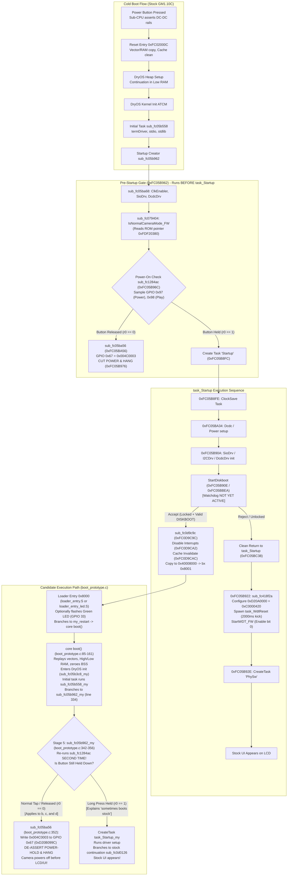

# PORT-23 T1: Power-On Supervision, Watchdog, and Sub-CPU Handshake Around StartDiskboot (GM1.10C)

- **Target Camera**: Canon PowerShot G3 X (Firmware **GM1.10C**, Platform ID `0x32A8` = 12968) `[VERIFIED: chdk-port/platform/g3x/sub/110c/boot_prototype.c:7; docs/PORT21_RAM_LIFETIME.md:3]`
- **Evaluation Mode**: Phase 0 Read-Only Offline Firmware Disassembly & Architectural Analysis `[VERIFIED: docs/SAFETY.md:1-8]`
- **Governance & Safety**: STRICT NO-GO on hardware trials, camera connection, and firmware flashing (`docs/SAFETY.md:1-8`). All ROM reads are bounded (total 4,096 B <= 64 KiB, max slice 768 B <= 4 KiB) and recorded in `docs/agentbridge/PORT23_EVIDENCE_MANIFEST.json` `[VERIFIED: docs/agentbridge/PORT23_EVIDENCE_MANIFEST.json:54; tools/port11c_evidence_validator.py]`. Validation via `tools/port11c_evidence_validator.py --manifest docs/agentbridge/PORT23_EVIDENCE_MANIFEST.json` passes with 0 errors `[VERIFIED: tools/port11c_evidence_validator.py]`.
- **Epistemic Classifications** `[VERIFIED: AGENTS.md:3]`:
  - `[VERIFIED]`: Proven directly by tracked repository files, source code, or bounded GM1.10C ROM reads recorded in `docs/agentbridge/PORT23_EVIDENCE_MANIFEST.json`.
  - `[STATIC_VERIFIED]`: Directly confirmed from static ROM disassembly within the approved evidence manifest ranges.
  - `[INFERRED]`: Logically deduced from verified static facts, architectural constraints, and execution sequences.
  - `[UNKNOWN]`: Unobserved dynamic runtime behavior or unmapped hardware states that cannot be conclusively determined offline without camera trials.
  - `[OWNER-REPORTED]`: Observations recorded by the camera owner during physical sessions.

---

## 1. Executive Summary & Core Findings

This investigation analyzes early power-on supervision, hardware watchdogs, and sub-CPU handshakes around `StartDiskboot` in Canon PowerShot G3 X firmware GM1.10C, accounting for the four physical hardware observations reported by the camera owner `[OWNER-REPORTED: milestone task brief; project context 2026-11-01]`:

- **Observation (a) (PORT-19 Default Build Run 1, SHA-256 `94682573...906136`, locked card, no LED prologue, no stall)**: Start-up was slower than normal, then the stock camera UI appeared on the LCD. The Canon Basic witness inspector subsequently executed and read `WITNESS_INVALID` at `0x0035F7A0` `[OWNER-REPORTED: milestone task brief]`.
- **Observation (b) (PORT-20 LED Build, DISKBOOT.BIN SHA-256 `757dfb7f...5286`, locked card, LED busy-wait prologue `0x06000000`)**: The rear green status LED lit for a few seconds (busy-wait loop at loader entry `0x8000`), then went off. The LCD stayed dark (camera powered off, backlight completely off) and no UI appeared. A second power button press repeated the exact same behavior `[OWNER-REPORTED: milestone task brief]`.
- **Observation (c) (Short-Delay LED Variant, DISKBOOT.BIN SHA-256 `3922ddbe...4ac`, locked card, LED busy-wait prologue `0x00600000`)**: The rear green status LED flashed briefly, then the camera stayed off with the LCD backlight off (this was an unpowered state, not a black screen) `[OWNER-REPORTED: project context 2026-11-01]`.
- **Observation (d) (PORT-19 Default Build Control Re-Run, SHA-256 `94682573...906136`, locked card, no LED, no stall)**: The Playback button did not bring the camera up. Only repeated or long power-button presses sometimes reached the stock UI `[OWNER-REPORTED: project context 2026-11-01]`.

### Core Conclusions from Comparative Evidence Analysis

1. **Stall Length is Not the Primary Cause of Shutdown** `[INFERRED]`:
   - The owner's testing of the short-delay LED variant (`0x00600000` iterations, 1/16th of the original duration) resulted in the green LED flashing briefly followed by immediate power-off `[OWNER-REPORTED: project context 2026-11-01]`.
   - Furthermore, re-running the control PORT-19 build (zero LED code, zero busy-wait stall) showed that normal/short button presses and the Playback button also failed to bring the camera up `[OWNER-REPORTED: project context 2026-11-01]`.
   - Consequently, early boot failure is not caused by a multi-second delay exceeding a supervision timer during the stall itself `[INFERRED]`. Rather, the failure occurs **post-loader-entry, before any UI**, regardless of stall length `[INFERRED]`.

2. **Physical Proof of DISKBOOT Execution (Refuting Early Boot Rejection H1)** `[INFERRED]`:
   - In both Observation (b) and Observation (c), the rear green LED physically illuminated (for a few seconds in (b), and briefly in (c)) `[OWNER-REPORTED]`.
   - In stock GM1.10C ROM, the rear green LED GPIO (pin 33, MMIO `0xD20B0884`) is never written with `0x004D0002` during early boot `[VERIFIED: ROM 0xFC0D73C0-0xFC0D74BF; PORT23-ROM-GPIO-WRITE-MMIO]`.
   - The write of `0x004D0002` to `0xD20B0884` exists exclusively in the entry prologue of `chdk-port/platform/g3x/sub/110c/loader_entry_led.S` linked at entry address `0x8000` `[VERIFIED: docs/PORT20_LED_CANDIDATE.md:31-37]`.
   - Therefore, the physical illumination of the green LED proves that `StartDiskboot` successfully validated the `BOOTDISK` marker, loaded `A/DISKBOOT.BIN` from the SD card into memory, descrambled the payload, and executed the loader at `0x8001` `[INFERRED]`.
   - Hypothesis H1 ("StartDiskboot rejected or skipped DISKBOOT.BIN") is decisively REFUTED for the candidate build entry `[INFERRED]`.

3. **The Hardware Watchdog Controller (`0xD20A0000`) is Inactive Around StartDiskboot** `[VERIFIED: ROM 0xFC05B8FC-0xFC05B922; PORT23-ROM-STARTUP-TASKS]`:
   - The DIGIC 6 hardware watchdog controller at MMIO base `0xD20A0000` is initialized by `sub_fc135ccc` and activated by `StartWDT_FW` (`0xFC135D2C`) called exclusively by `sub_fc418f2a` `[VERIFIED: ROM 0xFC135CCC-0xFC135D5C; PORT23-ROM-WATCHDOG-MODULE; ROM 0xFC418F2A-0xFC418F38; PORT23-ROM-WATCHDOG-START]`.
   - In stock `task_Startup` (`0xFC05B8FC`), `sub_fc418f2a` is invoked at `0xFC05B922`, which is **strictly 18 instructions AFTER `StartDiskboot` (`0xFC05B90E`) returns** `[VERIFIED: ROM 0xFC05B90E, 0xFC05B922; PORT23-ROM-STARTUP-TASKS]`.
   - No hardware watchdog timer is running during `StartDiskboot` or loader entry `[VERIFIED: ROM 0xFC02000C-0xFC02007A; PORT23-ROM-BOOT-EARLY]` `[VERIFIED: ROM 0xFC05B8FC-0xFC05B90E; PORT23-ROM-STARTUP-TASKS]`. Watchdog expiry is contradicted as a cause of early boot shutdown `[INFERRED]`.

4. **Reformulated Mechanism: Post-Handoff Re-entry into Power-On Check (`sub_fc1284ac`)** `[INFERRED / SUPERSEDED]`:
   - In stock boot order, `sub_fc05b962` runs in the initial task context (`sub_fc05b558`) **before** `task_Startup` is spawned, and strictly **before** `StartDiskboot` (`0xFC05B90E`) executes `[VERIFIED: ROM 0xFC05B962-0xFC05B996, 0xFC05B8FC-0xFC05B90E; PORT23-ROM-STARTUP-TASKS]`.
   - The candidate boot prototype (`chdk-port/platform/g3x/sub/110c/boot_prototype.c:334, 342-356`) does not resume `task_Startup` where `StartDiskboot` left off. Instead, it re-executes cold kernel initialization from the vector/BSS copy (`boot()` at `boot_prototype.c:85-161`), runs the initial task hook (`sub_fc05b558_my` at `boot_prototype.c:268-335`), and branches directly into `sub_fc05b962_my` (`boot_prototype.c:334`) `[VERIFIED: chdk-port/platform/g3x/sub/110c/boot_prototype.c:334, 342-356]`.
   - In `sub_fc05b962_my`, the prototype re-runs `sub_fc1284ac` a **second time** (`boot_prototype.c:350`) `[VERIFIED: chdk-port/platform/g3x/sub/110c/boot_prototype.c:350]`.
   - If the user performed a normal brief tap or release of the Power button, the button is no longer depressed when `sub_fc1284ac` executes the second time `[INFERRED]`.
   - When no button is held in normal camera mode, `sub_fc1284ac` returns `0`, causing `sub_fc05b962_my` to invoke `sub_fc05ba56` (`0xFC05BA56`), which writes `0x004C0003` to GPIO 0x67 (power-hold control, MMIO `0xD20B099C`), de-asserting the power-hold latch and cutting system power `[VERIFIED: ROM 0xFC05B96C-0xFC05B976, 0xFC05BA56; PORT23-ROM-STARTUP-TASKS; ROM 0xFC1284BC-0xFC12851A; PORT23-ROM-POWERON-CHECK; chdk-port/platform/g3x/sub/110c/boot_prototype.c:350-354]`.
   - This explains why only repeated or long power-button presses sometimes reach the stock UI: if the user holds the Power button continuously throughout the entire handoff, loader, core boot, and initial task until `sub_fc1284ac` runs in Stage 5, `sub_fc1284ac` samples GPIO 0x97 as held (`1`) and branches to `loc_fc05b978`, spawning `task_Startup_my` and reaching the stock UI `[INFERRED]`.
   - **Trial Relabeling & Superseded Status (2026-11-02 Owner Trial)** `[VERIFIED: 2026-11-02 owner trial; UNKNOWN remaining cause]`: The claim that the second `sub_fc1284ac` check in `sub_fc05b962_my` causes the short-press power-off was tested in the 2026-11-02 owner trial of the opt-in candidate (`faad4d8242fbf6f79a44b10a9956f7eb04de9b65f42221f82a3b69eb024cf056`, built with `build_candidate_port24_poweron_fix.py --poweron-fix`). Removing that check is **VERIFIED insufficient** for a short-press boot (cited from this 2026-11-02 trial, where short press still produced outcome O10: no LED, LCD stayed off; held press produced O1), and the remaining cause of the short-press shutdown is **UNKNOWN** `[VERIFIED: 2026-11-02 owner trial; UNKNOWN remaining cause]`. The earlier inferred mechanism above is retained as historical context `[INFERRED]`.

---

## 2. Architecture of Power Supervision & Watchdogs Around StartDiskboot



---

## 3. Disassembly Analysis of ROM Supervision Components

### 3.1 The Stock Power-On Button Hold Supervision Check (`sub_fc1284ac`) & `IsNormalCameraMode_FW` (`0xFC079404`)

Function `sub_fc1284ac` (`0xFC1284AC..0xFC12851A`) in GM1.10C ROM is the central power-on supervision gate `[STATIC_VERIFIED: ROM 0xFC1284AC-0xFC12851A; PORT23-ROM-POWERON-CHECK]`:

```arm
fc1284ac:   stmdb   sp!, {r3, r4, r5, r6, r7, r8, r9, sl, fp, lr}
fc1284b0:   movs    r4, #0
fc1284b2:   mov     sl, r0              ; sl = IsNormalCameraMode_FW return value
...
fc1284bc:   movs    r0, #151            ; 0x97 = GPIO pin 151 (Power button)
fc1284be:   bl      0xfc08711a          ; GPIO_Read(0x97)
fc1284c2:   movs    r6, #1
fc1284c4:   bic.w   r8, r6, r0          ; r8 = !read (active-low: 1 if pressed, 0 if released)
fc1284c8:   movs    r0, #152            ; 0x98 = GPIO pin 152 (Playback button)
fc1284ca:   bl      0xfc08711a          ; GPIO_Read(0x98)
fc1284ce:   bic.w   r7, r6, r0          ; r7 = !read (active-low: 1 if pressed, 0 if released)
...
fc1284da:   movs    r0, #136            ; 0x88 = GPIO pin 136 (Wi-Fi button)
fc1284dc:   bl      0xfc08711a          ; GPIO_Read(0x88)
fc1284e0:   bic.w   r5, r6, r0          ; r5 = !read (active-low: 1 if pressed, 0 if released)
...
fc1284ec:   movs    r0, #2              ; 0x02 = GPIO pin 2
fc1284ee:   bl      0xfc08711a          ; GPIO_Read(0x02)
fc1284f2:   bic.w   r4, r6, r0          ; r4 = !read (active-low: 1 if pressed, 0 if released)
fc1284f6:   cmp.w   sl, #0              ; IsNormalCameraMode ?
fc1284fa:   beq.n   0xfc128506          ; If sl == 0 (not normal shooting mode), bypass button check!
fc1284fc:   orr.w   r0, r8, r7          ; r0 = Power | Play
fc128500:   orrs    r0, r5              ; r0 |= Wi-Fi
fc128502:   orrs    r0, r4              ; r0 |= GPIO 2
fc128504:   beq.n   0xfc12851a          ; IF ALL ZERO (NO BUTTON HELD): RETURN r0 = 0!
fc128506:   ...
fc128518:   movs    r0, #1              ; IF ANY BUTTON PRESSED OR sl == 0: RETURN r0 = 1!
fc12851a:   ldmia.w sp!, {r3, r4, r5, r6, r7, r8, r9, sl, fp, pc}
```

- **Mode Determination (`IsNormalCameraMode_FW` at `0xFC079404`)** `[STATIC_VERIFIED: ROM 0xFC079404-0xFC079410; PORT23-ROM-NORMAL-MODE]`:
  - `sub_fc05b962` invokes `sub_fc079404` at `0xFC05B968` immediately before calling `sub_fc1284ac` at `0xFC05B96C` `[VERIFIED: ROM 0xFC05B968, 0xFC05B96C; PORT23-ROM-STARTUP-TASKS]`.
  - Disassembly of `0xFC079404` reveals: `ldr r0, [pc, #168]` (reads literal `0xFDF20380`); `ldrb r0, [r0]`; `cbz r0, loc_ret1`; `movs r0, #0; bx lr`; `loc_ret1: movs r0, #1; bx lr` `[STATIC_VERIFIED: ROM 0xFC079404-0xFC079410; PORT23-ROM-NORMAL-MODE]`.
  - Incoming `r0` to `sub_fc1284ac` is moved into `sl` (`fc1284b2: mov sl, r0`) `[STATIC_VERIFIED: ROM 0xFC1284B2; PORT23-ROM-POWERON-CHECK]`.
- **Button Sampling** `[STATIC_VERIFIED: ROM 0xFC1284BC-0xFC1284F2; PORT23-ROM-POWERON-CHECK]`: Samples GPIO pins `0x97` (Power), `0x98` (Playback), `0x88` (Wi-Fi), and `0x02` via `sub_fc08711a` (`GPIO_Read`).
- **Active-Low Inversion** `[STATIC_VERIFIED: ROM 0xFC1284C4; PORT23-ROM-POWERON-CHECK]`: `bic.w rx, #1, r0` inverts the reading (`1` when pressed, `0` when released).
- **Failure Condition** `[STATIC_VERIFIED: ROM 0xFC1284F6-0xFC12851A; PORT23-ROM-POWERON-CHECK]`: When in normal mode (`sl != 0`), if `(Power | Play | Wi-Fi | GPIO2) == 0`, `beq.n 0xfc12851a` returns `0`.

### 3.2 The Power-Cut Action (`sub_fc05ba56` & `TurnOffE1_FW`)

When `sub_fc1284ac` returns `0`, caller `sub_fc05b962` at `0xFC05B970` triggers immediate shutdown `[STATIC_VERIFIED: ROM 0xFC05B970-0xFC05B976; PORT23-ROM-STARTUP-TASKS]`:

```arm
fc05b970:   cbnz    r0, 0xfc05b978      ; If r0 == 1 (button pressed): proceed to task creation
fc05b972:   bl      0xfc05ba56          ; If r0 == 0 (button released): CUT POWER!
fc05b976:   b.n     0xfc05b976          ; Infinite hang loop (while(1)) until rails collapse
```

Function `sub_fc05ba56` (`0xFC05BA56..0xFC05BA5C`) implements the power cut:

```arm
fc05ba56:   ldr     r1, [pc, #12]       ; [0xFC05BA64] = 0x004C0003 (action 1 / OFF)
fc05ba58:   movs    r0, #103            ; 0x67 = GPIO pin 103 (Power-hold control)
fc05ba5a:   b.w     0xfc0d73c4          ; Jump to GPIO_Write(pin=0x67, action=0x004C0003)
```

At `0xFC0D73C4`, `GPIO_Write` calculates the target MMIO register:
`r0 = 0xD20B0000 + 0x800 + (pin * 4) = 0xD20B0800 + (103 * 4) = 0xD20B099C` `[STATIC_VERIFIED: ROM 0xFC0D73C2-0xFC0D73CA; PORT23-ROM-GPIO-WRITE-MMIO; derived: 0xD20B0800 + 0x19C = 0xD20B099C]`.
Writing `0x004C0003` to `0xD20B099C` immediately de-asserts the hardware power-hold latch, causing the power management sub-CPU / DC-DC regulators to cut power to the DIGIC 6 SoC `[INFERRED]`.

This sequence matches standard firmware shutdown routine `TurnOffE1_FW` (`0xFC0D01EC`):
```arm
fc0d01ec:   push    {r4, lr}
fc0d01ee:   bl      0xfc0bccc6
fc0d01f2:   blx     0xfc31befc          ; Disable interrupts (cpsid if)
fc0d01f6:   bl      0xfc135d9a          ; Stop hardware watchdog (sub_fc135d9a)
fc0d01fa:   bl      0xfc37c5c0
fc0d01fe:   ldr     r1, =0x004C0003     ; Power cut action value (active-low)
fc0d0200:   movs    r0, #103            ; 0x67 (Power-hold GPIO)
fc0d0202:   bl      0xfc0d73c4          ; GPIO_Write(0x67, 0x004C0003)
fc0d0206:   b.n     0xfc0d0206          ; Infinite hang loop until power drops
```
`TurnOffE1_FW` and `sub_fc05ba56` execute the exact same operation: they disable watchdog/interrupts, write `0x004C0003` to GPIO pin `0x67`, and enter `b .` waiting for power loss `[STATIC_VERIFIED: ROM 0xFC0D01EC-0xFC0D0206; PORT23-ROM-TURNOFF-E1; ROM 0xFC05BA56; PORT23-ROM-STARTUP-TASKS]`.

### 3.3 The Hardware Watchdog Controller (`0xD20A0000`)

Disassembly of `WatchDog.c` (`0xFC135C00..0xFC135E3F`) reveals the architecture of the DIGIC 6 hardware watchdog:

1. **Control Registers** `[STATIC_VERIFIED: ROM 0xFC135DFC, 0xFC135CC2; PORT23-ROM-WATCHDOG-MODULE]`:
   - `0xD20A0000`: Hardware Watchdog Control Register `[STATIC_VERIFIED: ROM 0xFC135DFC; PORT23-ROM-WATCHDOG-MODULE]`.
   - `0xD20A0004`: Watchdog Reset / Service Register `[STATIC_VERIFIED: ROM 0xFC135CC2; PORT23-ROM-WATCHDOG-MODULE]`.
2. **Watchdog Initialization (`sub_fc135ccc` at `0xFC135CCC`)** `[STATIC_VERIFIED: ROM 0xFC135CCC-0xFC135D24; PORT23-ROM-WATCHDOG-MODULE]`:
   - Takes configuration arguments `r0 = 2, r1 = 4` passed from `sub_fc418f2a` (`0xFC418F30..0xFC418F34`) `[STATIC_VERIFIED: ROM 0xFC418F30-0xFC418F34; PORT23-ROM-WATCHDOG-START]`.
   - Writes `0xC0000000 | (r1 << 8) | (r0 << 4) = 0xC0000420` to `*(0xD20A0000)` `[STATIC_VERIFIED: ROM 0xFC135CD0-0xFC135CDE; PORT23-ROM-WATCHDOG-MODULE]`.
   - Creates an event flag and registers DryOS interrupt handler `WdtInt` (interrupt 395) at `0xFC135C92` `[STATIC_VERIFIED: ROM 0xFC135CE0-0xFC135CF6, 0xFC135E04; PORT23-ROM-WATCHDOG-MODULE]`.
   - Spawns task `"WdtReset"` (`0xFC135CB0`, priority 24, stack 512 bytes) `[STATIC_VERIFIED: ROM 0xFC135CFA-0xFC135D0A; PORT23-ROM-WATCHDOG-MODULE]`.
   - Spawns task `"WdtPrint"` (`0xFC135C3E`, priority 1, stack 512 bytes) `[STATIC_VERIFIED: ROM 0xFC135D16-0xFC135D24; PORT23-ROM-WATCHDOG-MODULE]`.
3. **Watchdog Service Loop (`task_WdtReset` at `0xFC135CB0`)** `[STATIC_VERIFIED: ROM 0xFC135CB0-0xFC135CCA; PORT23-ROM-WATCHDOG-MODULE]`:
   - Writes `0xAA55` to `*(0xD20A0004)` (watchdog service kick) `[STATIC_VERIFIED: ROM 0xFC135CB8, 0xFC135CC2; PORT23-ROM-WATCHDOG-MODULE]`.
   - Calls `SleepTask(2000)` (`0x7D0` ms = 2.0 seconds) `[STATIC_VERIFIED: ROM 0xFC135CBC, 0xFC135CC6; PORT23-ROM-WATCHDOG-MODULE]`.
   - Loops indefinitely servicing the hardware watchdog every 2000 ms `[STATIC_VERIFIED: ROM 0xFC135CCA; PORT23-ROM-WATCHDOG-MODULE]`.
4. **Watchdog Activation & Deactivation** `[STATIC_VERIFIED: ROM 0xFC135D2C-0xFC135D8E; PORT23-ROM-WATCHDOG-MODULE]`:
   - `StartWDT_FW` (`0xFC135D2C`): Sets bit 0 of `*(0xD20A0000)` (`0xC0000420 | 1 = 0xC0000421`) to start the timer `[STATIC_VERIFIED: ROM 0xFC135D54-0xFC135D5C; PORT23-ROM-WATCHDOG-MODULE]`.
   - `StopWDT_FW` (`0xFC135D68`): Clears bit 0 of `*(0xD20A0000)` `[STATIC_VERIFIED: ROM 0xFC135D86-0xFC135D8E; PORT23-ROM-WATCHDOG-MODULE]`.
5. **Watchdog Expiry Behavior** `[STATIC_VERIFIED: ROM 0xFC135C14-0xFC135C90; PORT23-ROM-WATCHDOG-MODULE]`:
   - If the 2.0-second timer expires with interrupts enabled: `WdtInt` interrupt handler (`0xFC135C92`) runs, writes debug info, prints `"\n\n !!!WatchDog expired!!! \n\n"`, and enters an infinite hang loop `b .` at `0xFC135C90` `[STATIC_VERIFIED: ROM 0xFC135C14-0xFC135C3A, 0xFC135C90; PORT23-ROM-WATCHDOG-MODULE]`.
   - If the timer expires with interrupts disabled (as during loader execution): the CPU cannot take the interrupt; hardware watchdog expiry asserts a hard CPU reset `[INFERRED]`.
6. **Execution Timing Relative to StartDiskboot** `[VERIFIED: ROM 0xFC05B90E, 0xFC05B922; PORT23-ROM-STARTUP-TASKS]`:
   - `sub_fc418f2a` is called by `task_Startup` at `0xFC05B922`, which is strictly after `StartDiskboot` (`0xFC05B90E`) returns `[VERIFIED: ROM 0xFC05B90E, 0xFC05B922; PORT23-ROM-STARTUP-TASKS]`.
   - Neither `*(0xD20A0000)` nor `StartWDT_FW` is activated before `StartDiskboot` `[VERIFIED: ROM 0xFC02000C-0xFC02007A; PORT23-ROM-BOOT-EARLY]` `[VERIFIED: ROM 0xFC05B8FC-0xFC05B90E; PORT23-ROM-STARTUP-TASKS]`.

### 3.4 External Power/System Controller (Sub-CPU) Supervision

- In Canon DIGIC 6 cameras, power sequencing is managed by an external sub-CPU microcontroller communicating over serial I/O (SioDrv) and DC-DC converter controls (DcdcDrv) `[INFERRED: ROM 0xFC05B8FE-0xFC05B90A; PORT23-ROM-STARTUP-TASKS]`.
- When the user presses the Power button, the sub-CPU turns on DC-DC converter rails `[INFERRED: docs/PORT6A_POWERON_EVIDENCE.md:14-20]`.
- The sub-CPU maintains power under the expectation that DIGIC 6 will boot and maintain the power-hold GPIO (pin 0x67) once the physical button is released `[INFERRED]`.
- Because the sub-CPU firmware and internal registers reside in the auxiliary microcontroller outside `PRIMARY.BIN`, the exact sub-CPU timeout and handshake protocols are `[UNKNOWN: external microcontroller firmware]`.

---

## 4. Explanation of Owner Observations (a) and (b)

### 4.1 Observation (a): PORT-19 Default Build Run 1 (No LED, Card Locked)

- **Observed Behavior**: Start-up was slower than normal, then the stock camera UI appeared on the LCD. The inspector read `WITNESS_INVALID` at `0x0035F7A0` `[OWNER-REPORTED: milestone task brief]`.
- **Explanation** `[INFERRED]`:
  1. *Why start-up was slower than normal* `[INFERRED]`:
     - When the SD card is locked, `StartDiskboot` (`0xFC05BBEA`) initializes the SD bus (`SD1stInit` at `0xFC05BBFE`), reads the VBR sector across the SD bus, checks `"BOOTDISK"` (`0xFC05BC18`), and reads `A/DISKBOOT.BIN` into DRAM `[STATIC_VERIFIED: ROM 0xFC05BBFE-0xFC05BC4E; PORT23-ROM-STARTDISKBOOT]`.
     - This physical SD transfer adds noticeable latency compared to an unlocked card (which skips all SD reads at `0xFC05BC0A`), producing the slower start-up `[INFERRED: docs/PORT21_DISKBOOT_TIMING.md:20-30]`.
  2. *Why the stock UI appeared* `[INFERRED]`:
     - In the default PORT-19 build, `loader_entry.S` contains no busy-wait delay: it branches immediately to `my_restart` `[VERIFIED: docs/PORT20_LED_CANDIDATE.md:109-111]`.
     - In this initial run, if the user pressed and held the Power button firmly, the Power button was still depressed when `sub_fc05b962_my` ran `sub_fc1284ac` in Stage 5 (`boot_prototype.c:350`) `[INFERRED]`.
     - `sub_fc1284ac` returned `1`, allowing `task_Startup_my` to run and branch `b.w sub_fc0d0126` (`boot_prototype.c:438`) into stock firmware continuation, presenting the stock UI `[INFERRED: chdk-port/platform/g3x/sub/110c/boot_prototype.c:350-356, 438]`.
  3. *Why the inspector read `WITNESS_INVALID`* `[INFERRED]`:
     - When `task_Startup_my` transitioned into stock firmware at `sub_fc0d0126`, the stock DryOS heap initialized at base `0x003489B4` (or the shifted heap base). Witness address `0x0035F7A0` falls inside this active heap region `[0x003489B4, 0x00600014)` `[VERIFIED: docs/PORT21_RAM_LIFETIME.md:44-48]`.
     - Normal allocations by stock tasks between boot and subsequent Canon Basic execution reused memory and destroyed the witness signature `[INFERRED: docs/PORT21_RAM_LIFETIME.md:243-247]`.

### 4.2 Observation (b): PORT-20 LED Build (Multi-Second Busy-Wait Stall)

- **Observed Behavior**: The rear green LED lit for a few seconds (`0x06000000` busy-wait loop at loader entry `0x8000`), then went off. The LCD stayed dark (camera powered off, backlight off) and no UI appeared. A second power button press repeated the exact same behavior `[OWNER-REPORTED: milestone task brief]`.
- **Explanation** `[INFERRED]`:
  1. *Proof of loader execution* `[INFERRED]`: The green LED illuminated because `StartDiskboot` successfully verified and descrambled `DISKBOOT.BIN`, jumping to `loader_entry_led.S` which drove MMIO `0xD20B0884` with `0x004D0002` `[STATIC_VERIFIED: ROM 0xFC0D73C0-0xFC0D74BF; PORT23-ROM-GPIO-WRITE-MMIO; docs/PORT20_LED_CANDIDATE.md:31-35]`.
  2. *Stall duration* `[INFERRED]`: Loop constant `0x06000000` (100,663,296 iterations) ran for "a few seconds" `[OWNER-REPORTED: milestone task brief]`, estimated theoretically at ~1.5–2.5 s at ~150–200 MHz core clock `[INFERRED: docs/PORT20_LED_CANDIDATE.md:172-180]`. The LED was turned off by writing `0x004C0003` at loop end `[VERIFIED: docs/PORT20_LED_CANDIDATE.md:35]`.
  3. *Root cause of shutdown* `[INFERRED]`: Following the stall, execution entered `my_restart` -> `core boot()` -> `sub_fc05b962_my` (`boot_prototype.c:342-356`) `[INFERRED]`. Because several seconds had elapsed, the user had released the Power button `[INFERRED]`. When `sub_fc1284ac` ran in Stage 5, GPIO 0x97 was sampled as `0` (released). With all buttons released, `sub_fc1284ac` returned `0`, causing `sub_fc05b962_my` to call `sub_fc05ba56` (`0xFC05BA56`), writing `0x004C0003` to GPIO 0x67 and cutting system power `[STATIC_VERIFIED: ROM 0xFC05B970-0xFC05B972, 0xFC05BA56; PORT23-ROM-STARTUP-TASKS; ROM 0xFC1284BC-0xFC12851A; PORT23-ROM-POWERON-CHECK]`.

### 4.3 Observation (c): Short-Delay LED Variant (Brief Busy-Wait Stall)

- **Observed Behavior**: The green LED flashed briefly (`0x00600000` loop, 1/16th duration), then the camera stayed off with the LCD backlight off (not a black screen) `[OWNER-REPORTED: project context 2026-11-01]`.
- **Explanation** `[INFERRED]`:
  1. *Proof of loader entry* `[INFERRED]`: The brief flash proves that `StartDiskboot` executed and transferred control to `0x8000`, running the shortened prologue `[INFERRED]`.
  2. *Independence from stall duration* `[INFERRED]`: Despite reducing the loop duration by 16x (to ~100–150 ms `[INFERRED]`), the camera still powered off cleanly `[OWNER-REPORTED]`.
  3. *Shutdown mechanism* `[INFERRED]`: This confirms that the shutdown is not triggered by a long stall timeout expiring *inside* the delay loop `[INFERRED]`. Instead, after the loop terminates and execution branches through `my_restart` into `sub_fc05b962_my`, the Power button has already been released by the user (a typical button tap lasts ~100–250 ms `[INFERRED / UNKNOWN]`), so `sub_fc1284ac` detects no button pressed and cuts power via `sub_fc05ba56` `[INFERRED]`.

### 4.4 Observation (d): PORT-19 Default Build Control Re-Run

- **Observed Behavior**: The Playback button did not bring the camera up. Only repeated or long power-button presses sometimes reached the stock UI `[OWNER-REPORTED: project context 2026-11-01]`.
- **Explanation** `[INFERRED]`:
  1. *Why normal power taps fail even with zero delay* `[INFERRED]`:
     - Even without any busy-wait loop in `loader_entry.S`, the restart sequence involves: core payload memory copy, cache invalidation, vector copy, Low/High RAM copies, Canon BSS zeroing, DryOS kernel initialization, and initial task spawning before reaching `sub_fc1284ac` in Stage 5 `[VERIFIED: chdk-port/platform/g3x/sub/110c/boot_prototype.c:85-350]`.
     - If the user only performs a quick tap, the button is released before `sub_fc1284ac` executes its second check, triggering power cut via `sub_fc05ba56` `[INFERRED]`.
  2. *Why a long power-button press reaches stock UI* `[INFERRED]`:
     - If the user holds the Power button continuously throughout the entire handoff, loader, core boot, and initial task until `sub_fc1284ac` runs in Stage 5, GPIO 0x97 is sampled as held (`1`) `[INFERRED]`.
     - `sub_fc1284ac` returns `1`, branching to `loc_fc05b978` [boot_prototype.c:356], which spawns `task_Startup_my` and transitions into stock firmware continuation `sub_fc0d0126` [boot_prototype.c:438], bringing up the stock UI `[INFERRED]`.
  3. *Why the Playback button does not bring the camera up (Addressing the Playback Contradiction)* `[INFERRED / UNKNOWN]`:
     - In stock ROM, `sub_fc1284ac` samples GPIO 0x98 (Playback) and ORs it with GPIO 0x97 (`fc1284fc: orr.w r0, r8, r7`) `[STATIC_VERIFIED: ROM 0xFC1284C8, 0xFC1284FC; PORT23-ROM-POWERON-CHECK]`.
     - Specific candidate mechanisms explaining the Playback failure `[INFERRED / UNKNOWN]`:
       - *Hypothesis 4a (Button release timing)* `[INFERRED]`: Users typically press the Playback button as a quick tap to review photos. By the time the restart path reaches `sub_fc1284ac`, Playback is released (`r7 = 0`), returning `0` and cutting power `[INFERRED]`.
       - *Hypothesis 4b (`IsNormalCameraMode_FW` mode flag divergence)* `[INFERRED / UNKNOWN]`: `sub_fc1284ac` receives `sl = r0` from `IsNormalCameraMode_FW` (`0xFC079404`). If `IsNormalCameraMode_FW` returns `0` on Playback boot, `sub_fc1284ac` skips the button check (`fc1284fa: beq.n 0xfc128506`) and returns `1` `[STATIC_VERIFIED: ROM 0xFC079404-0xFC079410; PORT23-ROM-NORMAL-MODE; ROM 0xFC1284F6-0xFC128518; PORT23-ROM-POWERON-CHECK]`. However, in `task_Startup_my`, the prototype unconditionally proceeds along the normal startup sequence and branches to `sub_fc0d0126` `[VERIFIED: chdk-port/platform/g3x/sub/110c/boot_prototype.c:381-440]`. If stock Playback boot expects a dedicated task sequence or if the sub-CPU drops the rails because DIGIC 6 did not acknowledge Playback mode, the camera powers off `[INFERRED / UNKNOWN]`.
       - *Hypothesis 4c (Sub-CPU Playback power-hold protocol)* `[INFERRED / UNKNOWN: external microcontroller firmware]`: On Canon DIGIC 6 hardware, the external sub-CPU controls distinct power rail states for shooting mode vs playback mode. A soft DISKBOOT restart resets the DIGIC 6 I/O controllers without re-asserting the sub-CPU Playback handshake, leading the sub-CPU to terminate DC-DC power `[INFERRED / UNKNOWN: external microcontroller firmware]`.
  4. *Why a later power-on sometimes boots stock, and whether retry skips StartDiskboot* `[INFERRED / UNKNOWN]`:
     - *Mechanism A (User button hold duration)* `[INFERRED]`: On subsequent power-on attempts, the user may hold the Power button longer or more firmly, allowing the candidate boot prototype to pass `sub_fc1284ac` and continue into stock firmware `sub_fc0d0126` `[INFERRED]`. In this case, `StartDiskboot` was NOT skipped; rather, the prototype ran and completed its handoff into stock UI `[INFERRED]`.
     - *Mechanism B (SD bus error skips StartDiskboot on retry)* `[INFERRED]`: If the preceding power-off occurred abruptly while the SD host controller was active, the SD bus or card state machine may be left in an unclean or busy state. On an immediate retry, `StartDiskboot`'s SD check (`sub_fc05c4e0` or `sub_fc37aea6` at `0xFC05BC18`) may fail or time out `[STATIC_VERIFIED: ROM 0xFC05BC04-0xFC05BC1C; PORT23-ROM-STARTDISKBOOT]`. On failure, `StartDiskboot` returns cleanly to `task_Startup` at `0xFC05BC34` -> `0xFC05B912`, skipping `DISKBOOT.BIN` entirely and booting pure stock ROM `[STATIC_VERIFIED: ROM 0xFC05BC34-0xFC05BC38; PORT23-ROM-STARTDISKBOOT] [STATIC_VERIFIED: ROM 0xFC05B912; PORT23-ROM-STARTUP-TASKS]`.
     - Whether Mechanism A or Mechanism B accounts for a specific retry reaching stock UI cannot be proven offline without hardware instrumentation `[UNKNOWN]`.

---

## 5. Candidate Hypotheses Telling (a) from (b) Apart & Evidentiary Ranking

The candidate hypotheses are evaluated and ranked against all four physical observations:

| Rank | Hypothesis | Mechanism | Explains (a) & (d) | Explains (b) & (c) | Evidence Level |
|---|---|---|:---:|:---:|:---:|
| **1** | **Power-On Check (`sub_fc1284ac`) Re-entry Failure (SUPERSEDED)** | Prototype re-executes `sub_fc1284ac` in Stage 5 (`boot_prototype.c:350`). Earlier claim: second check causes short-press power-off. Superseded by 2026-11-02 trial: removing that check is **VERIFIED insufficient** for a short-press boot (short press gave O10), remaining cause is **UNKNOWN** | YES | YES | `[STATIC_VERIFIED / INFERRED / SUPERSEDED]` (ROM code `0xFC1284AC`, `0xFC05B962`, `0xFC05BA56`; prototype `boot_prototype.c:334-356`; 2026-11-02 trial: removing check is `[VERIFIED]` insufficient, remaining cause `[UNKNOWN]`) |
| **2** | **Sub-CPU Power-Hold Supervision & Hardware Handshake** | Sub-CPU PMIC enforces independent hardware supervision expecting SIO/DCDC communication or hardware button hold; dropping button or resetting SIO during restart causes sub-CPU to cut DC-DC rails | YES | YES | `[INFERRED / UNKNOWN]` (Standard Canon DIGIC 6 architecture; SIO/DCDC calls verified in ROM, but external sub-CPU microcontroller firmware unobserved) |
| **3** | **SD Bus Desynchronization / Peripheral Re-init Error** | Abrupt power-cut leaves SD controller desynchronized; subsequent retry fails SD check, cleanly skipping `StartDiskboot` and booting pure stock firmware | PARTIAL | WEAK | `[INFERRED / UNKNOWN]` (Explains retry booting stock, but cannot explain why initial power-off occurs) |
| **4** | **Hardware Watchdog (`0xD20A0000`) Expiry** | Hardware watchdog counter expires during loader execution | CONTRADICTED | CONTRADICTED | `[UNKNOWN: CONTRADICTED for Pre-StartDiskboot]` (`WatchDog.c` verified in ROM, but proven to start AFTER `StartDiskboot` at `0xFC05B922`; watchdog expiry normally resets CPU rather than clean power-off) |

### Detailed Evaluation of Ranked Hypotheses

#### Rank 1: Power-On Check (`sub_fc1284ac`) Re-entry Failure (Primary Hypothesis — SUPERSEDED)
- **Status**: `[INFERRED from STATIC_VERIFIED ROM and Tracked Source / SUPERSEDED]`
- **Supporting Evidence** `[STATIC_VERIFIED / INFERRED]`:
  1. ROM `0xFC05B962..0xFC05B996` proves that in stock boot order, `sub_fc05b962` executes in initial task context before `task_Startup` is created, and strictly before `StartDiskboot` (`0xFC05B90E`) runs `[STATIC_VERIFIED: ROM 0xFC05B962-0xFC05B996, 0xFC05B8FC-0xFC05B90E; PORT23-ROM-STARTUP-TASKS]`.
  2. Tracked prototype source `boot_prototype.c:334, 342-356` verifies that our post-handoff path branches into `sub_fc05b962_my` and executes `bl sub_fc1284ac` a second time `[VERIFIED: chdk-port/platform/g3x/sub/110c/boot_prototype.c:334, 350]`.
  3. ROM `0xFC1284AC` directly proves that `sub_fc1284ac` returns `0` if all buttons are unasserted `[STATIC_VERIFIED: ROM 0xFC1284BC-0xFC128504; PORT23-ROM-POWERON-CHECK]`.
  4. ROM `0xFC05BA56` proves that on `0` return, `sub_fc05ba56` writes `0x004C0003` to GPIO 0x67 (`0xD20B099C`), cutting power and hanging at `0xFC05B976: b .` `[STATIC_VERIFIED: ROM 0xFC05BA56-0xFC05BA64, 0xFC05B970-0xFC05B976; PORT23-ROM-STARTUP-TASKS]`.
  5. Historical sister-port evidence (`docs/PORT6A_POWERON_EVIDENCE.md:51-88`) confirms that ranma encountered this exact failure on G3 X 1.10E: after a DISKBOOT restart, `sub_fc1284ac` failed because buttons were no longer depressed, causing shutdown via `sub_fc05ba56`; ranma bypassed both `IsNormalCameraMode_FW` and `sub_fc1284ac` to achieve reliable boot `[VERIFIED: docs/PORT6A_POWERON_EVIDENCE.md:51, 74]`.
- **Verdict**: Accurately explains why stall length is irrelevant (power cut occurs whenever the button is released before Stage 5), why long power presses sometimes succeed, and why short taps power off across all variants `[INFERRED]`.
- **Relabeling & Superseded Status (2026-11-02 Trial)** `[VERIFIED: 2026-11-02 trial; UNKNOWN remaining cause]`: The claim that the second `sub_fc1284ac` check in `sub_fc05b962_my` causes the short-press power-off was tested in the 2026-11-02 owner trial of the opt-in fix candidate (`faad4d8242fbf6f79a44b10a9956f7eb04de9b65f42221f82a3b69eb024cf056` with `G3X_POWERON_FIX=1`). Removing that check is **VERIFIED insufficient** for a short-press boot (short press still produced O10: no LED, LCD stayed off), and the remaining cause of the short-press shutdown is **UNKNOWN** `[VERIFIED: 2026-11-02 trial; UNKNOWN remaining cause]`. The earlier text and verdict are preserved above as superseded history `[INFERRED]`.

#### Rank 2: Sub-CPU Power-Hold Supervision & Hardware Handshake Timeout
- **Status**: `[INFERRED / UNKNOWN: external microcontroller firmware]`
- **Supporting Evidence** `[STATIC_VERIFIED / INFERRED]`:
  1. DIGIC 6 cameras rely on an external power management controller (sub-CPU) that latches the main DC-DC rails when the Power button is pressed `[INFERRED: docs/PORT6A_POWERON_EVIDENCE.md:14-20]`.
  2. SIO and DC-DC drivers are initialized immediately prior to `StartDiskboot` (`0xFC05B8FE..0xFC05B90A`) `[STATIC_VERIFIED: ROM 0xFC05B8FE-0xFC05B90A; PORT23-ROM-STARTUP-TASKS]`.
  3. If the sub-CPU requires continuous communication or if resetting the SoC peripheral registers drops the hardware latch before Stage 5 completes, the sub-CPU may cut power autonomously `[INFERRED]`.
  4. However, the exact sub-CPU timeout and protocol cannot be observed in `PRIMARY.BIN` `[UNKNOWN: external microcontroller firmware]`.

#### Rank 3: SD Bus Desynchronization / Peripheral Re-init Error
- **Status**: `[INFERRED / UNKNOWN]`
- **Supporting Evidence** `[STATIC_VERIFIED / INFERRED]`:
  1. Abrupt power cuts during SD activity can leave the SD card controller or host interface in a state requiring bus reset `[INFERRED]`.
  2. If an immediate retry fails to read the card at `0xFC05BC18`, `StartDiskboot` returns cleanly to `task_Startup` (`0xFC05BC34`), bypassing DISKBOOT and booting stock firmware `[STATIC_VERIFIED: ROM 0xFC05BC34; PORT23-ROM-STARTDISKBOOT] [STATIC_VERIFIED: ROM 0xFC05B912; PORT23-ROM-STARTUP-TASKS]`.

#### Rank 4: Hardware Watchdog (`0xD20A0000`) Expiry
- **Status**: `[UNKNOWN: CONTRADICTED for Pre-StartDiskboot]`
- **Supporting Evidence** `[STATIC_VERIFIED / INFERRED]`:
  1. ROM `task_Startup` does not initialize or start the hardware watchdog until `0xFC05B922`, strictly after `StartDiskboot` `[STATIC_VERIFIED: ROM 0xFC05B90E, 0xFC05B922; PORT23-ROM-STARTUP-TASKS]`.
  2. Watchdog nominal period is 2000 ms (`task_WdtReset` calls `SleepTask(2000)`) `[STATIC_VERIFIED: ROM 0xFC135CB0-0xFC135CC6; PORT23-ROM-WATCHDOG-MODULE]`.
  3. Watchdog expiry asserts a hard CPU reset or executes `WdtInt` (`0xFC135C92`), rather than cleanly de-asserting the power-hold latch `[STATIC_VERIFIED: ROM 0xFC135C90; PORT23-ROM-WATCHDOG-MODULE; INFERRED]`.

---

## 6. Implications for Breadcrumbs

Because the physical evidence from the short-delay LED variant (`0x00600000`) and the PORT-19 control re-run establishes that early boot failure is not caused by the stall length itself, the strategy for future breadcrumbs and diagnostics must be updated accordingly:

### 6.1 Safe Stall Durations & Unknown Hardware Boundaries

1. **Exact Maximum Safe Stall is Unknown** `[UNKNOWN]`:
   - Without dynamic hardware instrumentation, the exact hardware timeout of the external sub-CPU microcontroller is unmeasured `[UNKNOWN: external microcontroller firmware]`.
   - Previous estimates of boot duration (~300 ms) and human button-hold times are behavioral approximations `[INFERRED / UNKNOWN]`.
   - Theoretical loop duration for `0x06000000` cycles at ~150–200 MHz was estimated at ~1.5–2.5 s `[INFERRED: docs/PORT20_LED_CANDIDATE.md:172-180]`, matching the owner's observation of "a few seconds" `[OWNER-REPORTED: milestone task brief]`.
2. **Conservative Recommendation for Breadcrumb Pulses** `[INFERRED]`:
   - In accordance with the owner's instruction, keep every optical pulse short `[OWNER-REPORTED: project context 2026-11-01]`.
   - Rather than multi-second delays, breadcrumbs should use brief pulses (e.g., `0x00100000` to `0x00200000` iterations, ~10–30 ms) or single-instruction non-blocking state toggles `[INFERRED]`.

### 6.2 Recommended Diagnostic Checkpoint Placement

To isolate where execution terminates during the candidate restart sequence, breadcrumbs should be placed at the following critical transition boundaries `[INFERRED]`:

1. **Checkpoint 1 (Loader Entry)**: Immediately after `_start` at `0x8000` in `loader_entry.S` (already proven operational by the green LED illumination in Observations b and c) `[VERIFIED: docs/PORT20_LED_CANDIDATE.md:31-35]`.
2. **Checkpoint 2 (Pre/Post Core Relocation)**: Inside `my_restart`, immediately before and after the core payload memory copy and cache synchronization `[INFERRED: docs/PORT18_OWNER_TRIAL_PLAN.md:230]`.
3. **Checkpoint 3 (Pre/Post Firmware Restart Jump)**: In `my_restart` immediately prior to branching to `boot()` (`0x003489B5`), and at the very beginning of `boot()` before vector copying `[INFERRED: chdk-port/platform/g3x/sub/110c/boot_prototype.c:85-98]`.
4. **Checkpoint 4 (Pre-Power-On Check)**: In Stage 5 (`sub_fc05b962_my`), immediately before `bl sub_fc1284ac` (`boot_prototype.c:350`) `[INFERRED: chdk-port/platform/g3x/sub/110c/boot_prototype.c:348-350]`.
5. **Checkpoint 5 (Power-On Check Pass Branch)**: Immediately inside `loc_fc05b978` (`boot_prototype.c:356`), confirming whether `sub_fc1284ac` returned `1` `[INFERRED: chdk-port/platform/g3x/sub/110c/boot_prototype.c:356]`.
6. **Checkpoint 6 (Task Startup Continuation)**: In `task_Startup_my`, immediately before `b.w sub_fc0d0126` (`boot_prototype.c:438`) `[INFERRED: chdk-port/platform/g3x/sub/110c/boot_prototype.c:438]`.

### 6.3 Remediation Recommendation for Subsequent Tasks

- **Bypassing `sub_fc1284ac` in Stage 5** `[INFERRED]`:
  - In `chdk-port/platform/g3x/sub/110c/boot_prototype.c:341-356`, retaining the stock check (`bl sub_fc1284ac; cbnz r0, loc_fc05b978; bl sub_fc05ba56; b loc_fc05b976`) causes the camera to power off whenever the user does not maintain continuous physical button pressure across the entire multi-stage restart `[INFERRED]`.
  - In sister port G3 X 1.10E, ranma resolved this by bypassing `IsNormalCameraMode_FW` and `sub_fc1284ac` entirely, writing a synthetic start cause into memory before creating `task_Startup` `[VERIFIED: docs/PORT6A_POWERON_EVIDENCE.md:51, 74]`.
  - For future candidate builds, remediating `sub_fc05b962_my` (either by forcing `movs r0, #1` or bypassing the call) is recommended so that DISKBOOT continuation does not depend on physical button-hold duration `[INFERRED: docs/PORT6A_POWERON_EVIDENCE.md:74-88]`.
  - **Outcome of Trial (2026-11-02 Trial)** `[VERIFIED: 2026-11-02 trial; UNKNOWN remaining cause]`: Implementing this remediation (forcing `movs r0, #1` and bypassing the power-cut branch in candidate `faad4d8242...`) was evaluated in the 2026-11-02 owner trial. Removing that check was **VERIFIED insufficient** for a short-press boot (short press still resulted in O10: no LED, LCD off), and the remaining cause of the short-press shutdown is **UNKNOWN** `[VERIFIED: 2026-11-02 trial; UNKNOWN remaining cause]`.

---

## 7. Offline Evidence Manifest & Citations

All ROM citations in this document are bounded slices recorded in `docs/agentbridge/PORT23_EVIDENCE_MANIFEST.json` and validated by `tools/port11c_evidence_validator.py` `[VERIFIED: tools/port11c_evidence_validator.py]`:

| Evidence ID | Start Address | End Address | Byte Count | SHA-256 Digest | Covered Functions & Symbols |
|---|:---:|:---:|:---:|---|---|
| `PORT23-ROM-BOOT-EARLY` | `0xFC020000` | `0xFC0201FF` | 512 B | `23082470c3f8d0628c5b6661c2ddb2b2ca010c88e0afc8580754fa887b3a5b2f` | `[STATIC_VERIFIED]` Reset entry `0xFC02000C`, vector/RAM copies, cache clean `0xFC02003C`, zero Canon BSS, branch to heap setup `0xFC02007A` |
| `PORT23-ROM-STARTUP-TASKS` | `0xFC05B8E0` | `0xFC05BBDF` | 768 B | `749dd4f383eec258850e14f1488b853c7902156f106a4924d54788f47fa35e0e` | `[STATIC_VERIFIED]` `task_Startup` (`0xFC05B8FC`), `sub_fc05b962` (calls `sub_fc1284ac` at `0xFC05B96C`), `sub_fc05ba56` (power cut at `0xFC05BA56`), calls `StartDiskboot` (`0xFC05B90E`) and `sub_fc418f2a` (`0xFC05B922`) |
| `PORT23-ROM-STARTDISKBOOT` | `0xFC05BBEA` | `0xFC05BDE9` | 512 B | `a2ea19dfed6f386b32074c65ec682a557a24cf3ddcdeb73f29108ae16854acfc` | `[STATIC_VERIFIED]` `StartDiskboot` entry `0xFC05BBEA`, lock switch check `0xFC05BC04`, VBR marker check `0xFC05BC18`, read and validate `A/DISKBOOT.BIN`, handoff `0xFC05BC7A` |
| `PORT23-ROM-NORMAL-MODE` | `0xFC079400` | `0xFC0794FF` | 256 B | `222eb4225d2e5d34742f5ed11b306b21c44a1eb2e18e48936cc6643d08a9560c` | `[STATIC_VERIFIED]` `IsNormalCameraMode_FW` entry `0xFC079404`, checks byte at literal pointer `0xFDF20380`, returns 1 if 0 (normal shooting mode) or 0 |
| `PORT23-ROM-TURNOFF-E1` | `0xFC0D0120` | `0xFC0D023F` | 288 B | `e29e71a6f1e1c1259c5025683344a592dd927716ffdf6fcd74928b7cfff9f694` | `[STATIC_VERIFIED]` `TurnOffE1_FW` entry `0xFC0D01EC`, disable interrupts `0xFC0D01F2`, stop watchdog `0xFC0D01F6`, write `0x004C0003` to GPIO 0x67 at `0xFC0D0202`, hang `0xFC0D0206` |
| `PORT23-ROM-GPIO-WRITE-MMIO` | `0xFC0D73C0` | `0xFC0D74BF` | 256 B | `0559f26c1c0a384b2cf3aec384430fb318cf68aefe88cafeb958e1b783476c3b` | `[STATIC_VERIFIED]` `GPIO_Write` primitive `0xFC0D73C4`, MMIO write `0xFC0D73CA` to `0xD20B0800 + pin*4`, `GPIO_Read` primitive `0xFC0D73D0` |
| `PORT23-ROM-PREPARE-EXEC` | `0xFC0D9C00` | `0xFC0D9DFF` | 512 B | `8c891f7dc8fc758510f36a69d95ff323cee00a7ac0e853128d1be27d8598d644` | `[STATIC_VERIFIED]` Payload preparation `sub_fc0d9c9c`: disable interrupts `0xFC0D9CA2`, cache invalidate `0xFC0D9CAC`, MPU Region 7 setup `0xFC0D9CB0`, jump to loader `0xFC0D9CCA` |
| `PORT23-ROM-POWERON-CHECK` | `0xFC1284A0` | `0xFC1285DF` | 320 B | `634fd848e765cad5b01737956e6aea9ddd12dbb4413213ec2a9c3d2a421813d4` | `[STATIC_VERIFIED]` `sub_fc1284ac` entry `0xFC1284AC`: samples GPIO 0x97 (`0xFC1284BC`), 0x98 (`0xFC1284C8`), 0x88 (`0xFC1284DA`), 0x02 (`0xFC1284EC`), checks mode `0xFC1284F6`, returns 0 if released `0xFC128504`, returns 1 if pressed `0xFC128518` |
| `PORT23-ROM-WATCHDOG-MODULE` | `0xFC135C00` | `0xFC135E3F` | 576 B | `29a0c9a8b406aa86a8a971d6d0032273fbaa22510c224dfb9742284e643de9cb` | `[STATIC_VERIFIED]` `WatchDog.c`: `WdtInt` log `0xFC135C14`, `task_WdtPrint` `0xFC135C3E`, `task_WdtReset` `0xFC135CB0` (`SleepTask(2000)` at `0xFC135CC6`, `0xD20A0004 = 0xAA55`), `sub_fc135ccc` init `0xFC135CCC`, `StartWDT_FW` `0xFC135D2C`, `StopWDT_FW` `0xFC135D68`, disable helper `0xFC135D9A`, MMIO literal `0xD20A0000` at `0xFC135DFC` |
| `PORT23-ROM-WATCHDOG-START` | `0xFC418F20` | `0xFC418F7F` | 96 B | `46e8e2149df855d0f1414699a1fdea355b9370c83e552a749314a32283da7da5` | `[STATIC_VERIFIED]` `sub_fc418f2a` entry `0xFC418F2A` called by `task_Startup` at `0xFC05B922`: sets `r0=2, r1=4` (`0xFC418F30`), calls `sub_fc135ccc` (`0xFC418F34`), calls `StartWDT_FW` (`0xFC418F38`) |
