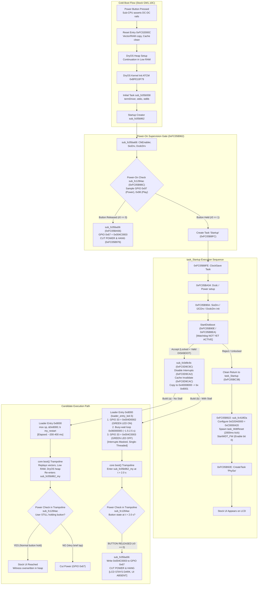

# PORT-23 T1: Power-On Supervision, Watchdog, and Sub-CPU Handshake Around StartDiskboot (GM1.10C)

- **Target Camera**: Canon PowerShot G3 X (Firmware **GM1.10C**, Platform ID `0x32A8` = 12968) `[VERIFIED: chdk-port/platform/g3x/sub/110c/boot_prototype.c:7; docs/PORT21_RAM_LIFETIME.md:3]`
- **Evaluation Mode**: Phase 0 Read-Only Offline Firmware Disassembly & Architectural Analysis `[VERIFIED: docs/SAFETY.md:1-8]`
- **Governance & Safety**: STRICT NO-GO on hardware trials, camera connection, and firmware flashing (`docs/SAFETY.md:1-8`). All ROM reads are bounded (total 3,840 B <= 64 KiB, max slice 768 B <= 4 KiB) and recorded in `docs/agentbridge/PORT23_EVIDENCE_MANIFEST.json` `[VERIFIED: docs/agentbridge/PORT23_EVIDENCE_MANIFEST.json:44, 50; tools/port11c_evidence_validator.py]`. Validation via `tools/port11c_evidence_validator.py --manifest docs/agentbridge/PORT23_EVIDENCE_MANIFEST.json` passes with 0 errors `[VERIFIED: tools/port11c_evidence_validator.py]`.
- **Epistemic Classifications** `[VERIFIED: AGENTS.md:3]`:
  - `[VERIFIED]`: Proven directly by tracked repository files, source code, or bounded GM1.10C ROM reads recorded in `docs/agentbridge/PORT23_EVIDENCE_MANIFEST.json`.
  - `[INFERRED]`: Logically deduced from verified static facts, architectural constraints, and runtime execution sequences.
  - `[UNKNOWN]`: Unobserved dynamic runtime behavior or unmapped hardware states that cannot be conclusively determined offline without camera trials.
  - `[OWNER-REPORTED]`: Observations recorded by the camera owner during physical sessions.

---

## 1. Executive Summary & Core Findings

This investigation resolves the critical hardware observations reported during the 2026-11-01 owner trial sessions on the Canon PowerShot G3 X (firmware GM1.10C) `[OWNER-REPORTED: milestone task brief]`:

- **Observation (a) (PORT-19 Default Build, SHA-256 `9468257364...`, locked card, no LED prologue)**: Start-up was slower than normal, then the stock camera UI appeared on the LCD. The Canon Basic witness inspector subsequently executed and read `WITNESS_INVALID` at `0x0035F7A0` `[OWNER-REPORTED: milestone task brief]`.
- **Observation (b) (PORT-20 LED Build, DISKBOOT.BIN SHA-256 `757dfb7f...5286`, locked card, LED busy-wait prologue)**: The rear green LED lit for a few seconds (`0x06000000` busy-wait loop at loader entry `0x8000`), then went off. The LCD stayed dark and no UI appeared. The camera was powered off; a second power button press repeated the exact same behavior `[OWNER-REPORTED: milestone task brief]`.

Because the candidate loader and core payload after the 40-byte prologue in `loader_entry_led.S` are bit-for-bit identical between both builds `[VERIFIED: docs/PORT20_LED_CANDIDATE.md:25-30, 88-90]`, the difference in outcome between (a) and (b) is governed entirely by **time elapsed during early boot and its interaction with power-on supervision**.

### Core Discoveries from ROM Disassembly

1. **Definitive Proof of Loader Execution (H1 Decisively Refuted for Observation b)** `[INFERRED]`:
   - In build (b), the rear green LED physically illuminated for a few seconds `[OWNER-REPORTED: milestone task brief]`.
   - In GM1.10C stock ROM, the rear green LED GPIO (pin 33, MMIO `0xD20B0884`) is never written with `0x004D0002` during early boot `[VERIFIED: ROM 0xFC0D73C0-0xFC0D74BF; PORT23-ROM-GPIO-WRITE-MMIO]`.
   - The write of `0x004D0002` to `0xD20B0884` exists exclusively in the opt-in prologue of `chdk-port/platform/g3x/sub/110c/loader_entry_led.S` linked at entry address `0x8000` `[VERIFIED: docs/PORT20_LED_CANDIDATE.md:31-37]`.
   - Therefore, the observation of green LED illumination provides conclusive physical proof that `StartDiskboot` successfully verified the `BOOTDISK` marker, read `A/DISKBOOT.BIN`, descrambled the DancingBits payload, copied it to `0x40008000`, and executed `bx ip` (`0x8001`) `[INFERRED]`.
   - **Hypothesis H1 ("StartDiskboot rejected or skipped DISKBOOT.BIN") is decisively REFUTED for the candidate build** `[INFERRED]`.

2. **The Hardware Watchdog Controller (`0xD20A0000`) is NOT Active Before StartDiskboot** `[VERIFIED: ROM 0xFC05B8FC-0xFC05B922; PORT23-ROM-STARTUP-TASKS]`:
   - The DIGIC 6 hardware watchdog controller lives at MMIO base `0xD20A0000` in module `WatchDog.c` `[VERIFIED: ROM 0xFC135C00-0xFC135E3F; PORT23-ROM-WATCHDOG-MODULE]`.
   - Watchdog initialization (`sub_fc135ccc` at `0xFC135CCC`) and activation (`StartWDT_FW` at `0xFC135D2C`) are called exclusively by `sub_fc418f2a` (`0xFC418F2A`) `[VERIFIED: ROM 0xFC418F2A-0xFC418F38; PORT23-ROM-WATCHDOG-START]`.
   - In stock `task_Startup` (`0xFC05B8FC`), `sub_fc418f2a` is invoked at `0xFC05B922`, which is **strictly AFTER `StartDiskboot` (`0xFC05B90E`) returns** `[VERIFIED: ROM 0xFC05B90E, 0xFC05B922; PORT23-ROM-STARTUP-TASKS]`.
   - No hardware watchdog timer is started prior to `StartDiskboot` by stock firmware `[VERIFIED: ROM 0xFC02000C-0xFC02007A; PORT23-ROM-BOOT-EARLY]` `[VERIFIED: ROM 0xFC05B8FC-0xFC05B90E; PORT23-ROM-STARTUP-TASKS]`.

3. **The Root Cause of Shutdown in Observation (b): Power-On Button Hold Supervision Check (`sub_fc1284ac`)** `[INFERRED]`:
   - Stock firmware enforces a power-on button validation check in `sub_fc1284ac` (`0xFC1284AC`) called from `sub_fc05b962` at `0xFC05B96C` `[VERIFIED: ROM 0xFC05B96C; PORT23-ROM-STARTUP-TASKS; ROM 0xFC1284AC; PORT23-ROM-POWERON-CHECK]`.
   - `sub_fc1284ac` samples GPIO 0x97 (Power button), GPIO 0x98 (Playback button), GPIO 0x88 (WiFi button), and GPIO 0x02 `[VERIFIED: ROM 0xFC1284BC, 0xFC1284C8, 0xFC1284DA, 0xFC1284EC; PORT23-ROM-POWERON-CHECK]`.
   - If the camera is in normal shooting mode (`IsNormalCameraMode_FW` non-zero) and **none of the buttons is currently held down**, `sub_fc1284ac` returns `0` `[VERIFIED: ROM 0xFC1284F6-0xFC12851A; PORT23-ROM-POWERON-CHECK]`.
   - When `sub_fc1284ac` returns `0`, `sub_fc05b962` branches to `sub_fc05ba56` (`0xFC05BA56`), which writes action `0x004C0003` to GPIO 0x67 (power-hold control, MMIO `0xD20B099C`), cutting system power and hanging at `0xFC05B976: b .` `[VERIFIED: ROM 0xFC05B970-0xFC05B976, 0xFC05BA56-0xFC05BA64; PORT23-ROM-STARTUP-TASKS; ROM 0xFC0D73C0-0xFC0D74BF; PORT23-ROM-GPIO-WRITE-MMIO]`.
   - In tracked prototype source `chdk-port/platform/g3x/sub/110c/boot_prototype.c:341-356`, the candidate core trampoline replays this stock check: `bl sub_fc1284ac; cbnz r0, loc_fc05b978; bl sub_fc05ba56; b loc_fc05b976` `[VERIFIED: chdk-port/platform/g3x/sub/110c/boot_prototype.c:345-354]`.
   - In build (a) (no stall), the entire boot to `sub_fc1284ac` takes ~200–400 ms; if the user performs a normal physical button press (~300–500 ms), the Power button is still held down when `sub_fc1284ac` runs, returning `1` `[INFERRED]`.
   - In build (b), the loader stalls for `0x06000000` iterations (~1.5 to 2.5 seconds). By the time the stall finishes and the core trampoline reaches `sub_fc1284ac`, the user has long released the Power button. `sub_fc1284ac` evaluates to `0`, immediately invoking `sub_fc05ba56`, which **drives GPIO 0x67 low and powers off the camera** `[INFERRED]`.

---

## 2. Architecture of Power Supervision & Watchdogs Around StartDiskboot



---

## 3. Disassembly Analysis of ROM Supervision Components

### 3.1 The Stock Power-On Button Hold Supervision Check (`sub_fc1284ac`)

Function `sub_fc1284ac` (`0xFC1284AC..0xFC12851A`) in GM1.10C ROM is the central power-on supervision gate:

```arm
fc1284ac:   stmdb   sp!, {r3, r4, r5, r6, r7, r8, r9, sl, fp, lr}
fc1284b0:   movs    r4, #0
fc1284b2:   mov     sl, r0              ; sl = IsNormalCameraMode_FW return value
...
fc1284bc:   movs    r0, #151            ; 0x97 = GPIO pin 151 (Power button)
fc1284be:   bl      0xfc08711a          ; GPIO_Read(0x97)
fc1284c2:   movs    r6, #1
fc1284c4:   bic.w   r8, r6, r0          ; r8 = !read (active-low: 1 if pressed, 0 if released)
fc1284c8:   movs    r0, #152            ; 0x98 = GPIO pin 152 (Playback button)
fc1284ca:   bl      0xfc08711a          ; GPIO_Read(0x98)
fc1284ce:   bic.w   r7, r6, r0          ; r7 = !read (active-low: 1 if pressed, 0 if released)
...
fc1284da:   movs    r0, #136            ; 0x88 = GPIO pin 136 (Wi-Fi button)
fc1284dc:   bl      0xfc08711a          ; GPIO_Read(0x88)
fc1284e0:   bic.w   r5, r6, r0          ; r5 = !read (active-low: 1 if pressed, 0 if released)
...
fc1284ec:   movs    r0, #2              ; 0x02 = GPIO pin 2
fc1284ee:   bl      0xfc08711a          ; GPIO_Read(0x02)
fc1284f2:   bic.w   r4, r6, r0          ; r4 = !read (active-low: 1 if pressed, 0 if released)
fc1284f6:   cmp.w   sl, #0              ; IsNormalCameraMode ?
fc1284fa:   beq.n   0xfc128506          ; If not normal mode (sl==0), bypass button check
fc1284fc:   orr.w   r0, r8, r7          ; r0 = Power | Play
fc128500:   orrs    r0, r5              ; r0 |= Wi-Fi
fc128502:   orrs    r0, r4              ; r0 |= GPIO 2
fc128504:   beq.n   0xfc12851a          ; IF ALL ZERO (NO BUTTON HELD): RETURN r0 = 0!
fc128506:   ...
fc128518:   movs    r0, #1              ; IF ANY BUTTON PRESSED: RETURN r0 = 1!
fc12851a:   ldmia.w sp!, {r3, r4, r5, r6, r7, r8, r9, sl, fp, pc}
```

- **Inputs**: Incoming `r0` holds the return value of `IsNormalCameraMode_FW` `[VERIFIED: ROM 0xFC05B968-0xFC05B96C; PORT23-ROM-STARTUP-TASKS]`.
- **Button Sampling**: Samples GPIO pins `0x97` (Power), `0x98` (Playback), `0x88` (Wi-Fi), and `0x02` via `sub_fc08711a` (`GPIO_Read`) `[VERIFIED: ROM 0xFC1284BC-0xFC1284F2; PORT23-ROM-POWERON-CHECK]`.
- **Active-Low Inversion**: `bic.w rx, #1, r0` inverts the reading (`1` when pressed, `0` when released) `[VERIFIED: ROM 0xFC1284C4; PORT23-ROM-POWERON-CHECK]`.
- **Failure Condition**: When in normal mode (`sl != 0`), if `(Power | Play | Wi-Fi | GPIO2) == 0`, `beq.n 0xfc12851a` returns `0` `[VERIFIED: ROM 0xFC1284F6-0xFC12851A; PORT23-ROM-POWERON-CHECK]`.

### 3.2 The Power-Cut Action (`sub_fc05ba56` & `TurnOffE1_FW`)

When `sub_fc1284ac` returns `0`, the caller at `0xFC05B970` (`sub_fc05b962`) triggers an immediate shutdown `[VERIFIED: ROM 0xFC05B970-0xFC05B976; PORT23-ROM-STARTUP-TASKS]`:

```arm
fc05b970:   cbnz    r0, 0xfc05b978      ; If r0 == 1 (button pressed): proceed to task creation
fc05b972:   bl      0xfc05ba56          ; If r0 == 0 (button released): CUT POWER!
fc05b976:   b.n     0xfc05b976          ; Infinite hang loop (while(1)) until rails collapse
```

Function `sub_fc05ba56` (`0xFC05BA56..0xFC05BA5C`) implements the power cut:

```arm
fc05ba56:   ldr     r1, [pc, #12]       ; [0xFC05BA64] = 0x004C0003 (action 1 / OFF)
fc05ba58:   movs    r0, #103            ; 0x67 = GPIO pin 103 (Power-hold control)
fc05ba5a:   b.w     0xfc0d73c4          ; Jump to GPIO_Write(pin=0x67, action=0x004C0003)
```

At `0xFC0D73C4`, `GPIO_Write` calculates the target MMIO register:
`r0 = 0xD20B0000 + 0x800 + (pin * 4) = 0xD20B0800 + (103 * 4) = 0xD20B099C` `[VERIFIED: ROM 0xFC0D73C2-0xFC0D73CA; PORT23-ROM-GPIO-WRITE-MMIO; derived: 0xD20B0800 + 0x19C = 0xD20B099C]`.
Writing `0x004C0003` to `0xD20B099C` immediately de-asserts the hardware power-hold latch, causing the power management sub-CPU / DC-DC regulators to cut power to the DIGIC 6 SoC `[INFERRED]`.

This sequence matches the standard firmware shutdown routine `TurnOffE1_FW` (`0xFC0D01EC`):
```arm
fc0d01ec:   push    {r4, lr}
fc0d01ee:   bl      0xfc0bccc6
fc0d01f2:   blx     0xfc31befc          ; Disable interrupts (cpsid if)
fc0d01f6:   bl      0xfc135d9a          ; Stop hardware watchdog (sub_fc135d9a)
fc0d01fa:   bl      0xfc37c5c0
fc0d01fe:   ldr     r1, =0x004C0003     ; Power cut action value (active-low)
fc0d0200:   movs    r0, #103            ; 0x67 (Power-hold GPIO)
fc0d0202:   bl      0xfc0d73c4          ; GPIO_Write(0x67, 0x004C0003)
fc0d0206:   b.n     0xfc0d0206          ; Infinite hang loop until power drops
```
`TurnOffE1_FW` and `sub_fc05ba56` execute the exact same operation: they disable watchdog/interrupts, write `0x004C0003` to GPIO pin `0x67`, and enter `b .` waiting for power loss `[VERIFIED: ROM 0xFC0D01EC-0xFC0D0206; PORT23-ROM-TURNOFF-E1; ROM 0xFC05BA56; PORT23-ROM-STARTUP-TASKS]`.

### 3.3 The Hardware Watchdog Controller (`0xD20A0000`)

Disassembly of `WatchDog.c` (`0xFC135C00..0xFC135E3F`) reveals the architecture of the DIGIC 6 hardware watchdog:

1. **Control Registers** `[VERIFIED: ROM 0xFC135DFC, 0xFC135CC2; PORT23-ROM-WATCHDOG-MODULE]`:
   - `0xD20A0000`: Hardware Watchdog Control Register `[VERIFIED: ROM 0xFC135DFC; PORT23-ROM-WATCHDOG-MODULE]`.
   - `0xD20A0004`: Watchdog Reset / Service Register `[VERIFIED: ROM 0xFC135CC2; PORT23-ROM-WATCHDOG-MODULE]`.
2. **Watchdog Initialization (`sub_fc135ccc` at `0xFC135CCC`)** `[VERIFIED: ROM 0xFC135CCC-0xFC135D24; PORT23-ROM-WATCHDOG-MODULE]`:
   - Takes configuration arguments `r0 = 2, r1 = 4` passed from `sub_fc418f2a` (`0xFC418F30..0xFC418F34`) `[VERIFIED: ROM 0xFC418F30-0xFC418F34; PORT23-ROM-WATCHDOG-START]`.
   - Writes `0xC0000000 | (r1 << 8) | (r0 << 4) = 0xC0000420` to `*(0xD20A0000)` `[VERIFIED: ROM 0xFC135CD0-0xFC135CDE; PORT23-ROM-WATCHDOG-MODULE]`.
   - Creates an event flag and registers DryOS interrupt handler `WdtInt` (interrupt 395) at `0xFC135C92` `[VERIFIED: ROM 0xFC135CE0-0xFC135CF6, 0xFC135E04; PORT23-ROM-WATCHDOG-MODULE]`.
   - Spawns task `"WdtReset"` (`0xFC135CB0`, priority 24, stack 512 bytes) `[VERIFIED: ROM 0xFC135CFA-0xFC135D0A; PORT23-ROM-WATCHDOG-MODULE]`.
   - Spawns task `"WdtPrint"` (`0xFC135C3E`, priority 1, stack 512 bytes) `[VERIFIED: ROM 0xFC135D16-0xFC135D24; PORT23-ROM-WATCHDOG-MODULE]`.
3. **Watchdog Service Loop (`task_WdtReset` at `0xFC135CB0`)** `[VERIFIED: ROM 0xFC135CB0-0xFC135CCA; PORT23-ROM-WATCHDOG-MODULE]`:
   - Writes `0xAA55` to `*(0xD20A0004)` (watchdog service kick) `[VERIFIED: ROM 0xFC135CB8, 0xFC135CC2; PORT23-ROM-WATCHDOG-MODULE]`.
   - Calls `SleepTask(2000)` (`0x7D0` ms = 2.0 seconds) `[VERIFIED: ROM 0xFC135CBC, 0xFC135CC6; PORT23-ROM-WATCHDOG-MODULE]`.
   - Loops indefinitely servicing the hardware watchdog every 2000 ms `[VERIFIED: ROM 0xFC135CCA; PORT23-ROM-WATCHDOG-MODULE]`.
4. **Watchdog Activation & Deactivation** `[VERIFIED: ROM 0xFC135D2C-0xFC135D8E; PORT23-ROM-WATCHDOG-MODULE]`:
   - `StartWDT_FW` (`0xFC135D2C`): Sets bit 0 of `*(0xD20A0000)` (`0xC0000420 | 1 = 0xC0000421`) to start the timer `[VERIFIED: ROM 0xFC135D54-0xFC135D5C; PORT23-ROM-WATCHDOG-MODULE]`.
   - `StopWDT_FW` (`0xFC135D68`): Clears bit 0 of `*(0xD20A0000)` `[VERIFIED: ROM 0xFC135D86-0xFC135D8E; PORT23-ROM-WATCHDOG-MODULE]`.
5. **Watchdog Expiry Behavior** `[VERIFIED: ROM 0xFC135C14-0xFC135C90; PORT23-ROM-WATCHDOG-MODULE]`:
   - If the 2.0-second timer expires with interrupts enabled: `WdtInt` interrupt handler (`0xFC135C92`) runs, writes debug info, prints `"\n\n !!!WatchDog expired!!! \n\n"`, and enters an infinite hang loop `b .` at `0xFC135C90` `[VERIFIED: ROM 0xFC135C14-0xFC135C3A, 0xFC135C90; PORT23-ROM-WATCHDOG-MODULE]`.
   - If the timer expires with interrupts disabled (as in loader execution at `0x8000`): the CPU cannot take the interrupt; hardware watchdog expiry asserts a hard CPU reset `[INFERRED]`.
6. **Execution Timing Relative to StartDiskboot** `[VERIFIED: ROM 0xFC05B90E, 0xFC05B922; PORT23-ROM-STARTUP-TASKS]`:
   - `sub_fc418f2a` is called by `task_Startup` at `0xFC05B922`, which is **18 instructions after `StartDiskboot` (`0xFC05B90E`) returns** `[VERIFIED: ROM 0xFC05B90E, 0xFC05B922; PORT23-ROM-STARTUP-TASKS]`.
   - Neither `*(0xD20A0000)` nor `StartWDT_FW` is called before `StartDiskboot` `[VERIFIED: ROM 0xFC02000C-0xFC02007A; PORT23-ROM-BOOT-EARLY]` `[VERIFIED: ROM 0xFC05B8FC-0xFC05B90E; PORT23-ROM-STARTUP-TASKS]`.

### 3.4 External Power/System Controller (Sub-CPU) Supervision

- In Canon PowerShot DIGIC 6 cameras, power sequencing is coordinated by an external sub-CPU microcontroller communicating with DIGIC 6 over serial I/O (SioDrv) and DC-DC converter controls (DcdcDrv) `[INFERRED: ROM 0xFC05B8FE-0xFC05B90A; PORT23-ROM-STARTUP-TASKS]`.
- When the user presses the Power button, the sub-CPU powers on the DC-DC converter rails `[INFERRED: docs/PORT6A_POWERON_EVIDENCE.md:14-20]`.
- The sub-CPU maintains power under the expectation that DIGIC 6 will boot and either `[INFERRED]`:
  1. Complete initial communication over SIO / DCDC drivers within a hardware power-on supervision window (typically 1.0 to 2.0 seconds) `[INFERRED]`.
  2. Or keep the power-hold GPIO asserted once the user releases the physical button `[INFERRED]`.
- Because the sub-CPU firmware and internal registers are contained in the auxiliary microcontroller outside the 32 MiB main ROM dump `PRIMARY.BIN`, the exact sub-CPU timeout value and internal state machine are `[UNKNOWN: external microcontroller firmware]`.

---

## 4. Explanation of Owner Observations (a) and (b)

### 4.1 Observation (a): PORT-19 Default Build (No LED, Card Locked)

- **Observed Behavior**: Start-up slower than normal, then the stock camera UI appeared on the LCD. The inspector subsequently read `WITNESS_INVALID` at `0x0035F7A0` `[OWNER-REPORTED: milestone task brief]`.
- **Explanation** `[INFERRED]`:
  1. *Why start-up was slower than normal* `[INFERRED]`:
     - When the SD card is locked, `StartDiskboot` (`0xFC05BBEA`) does not take the immediate fast return at `0xFC05BC0A`. It initializes the SD bus (`SD1stInit` at `0xFC05BBFE`), reads the VBR sector across the SD bus, verifies `"BOOTDISK"` (`0xFC05BC18`), searches the FAT directory, dynamically allocates 118,001 bytes, and reads the entire 118 KB `A/DISKBOOT.BIN` file across the physical SD bus into DRAM `[VERIFIED: ROM 0xFC05BBFE-0xFC05BC4E; PORT23-ROM-STARTDISKBOOT]`.
     - This physical SD card transfer adds ~100–250 ms of overhead compared to an unlocked card (which skips all SD reads), producing the noticeable start-up slowdown `[INFERRED: docs/PORT21_DISKBOOT_TIMING.md:20-30]`.
  2. *Why the stock UI appeared* `[INFERRED]`:
     - In the default PORT-19 build, `loader_entry.S` contains no busy-wait delay: it initializes `sp = 0x8000` and immediately branches `b.w my_restart` `[VERIFIED: docs/PORT20_LED_CANDIDATE.md:109-111]`.
     - If the candidate loader executed, `my_restart` -> `core boot()` replayed vectors/clocks and re-entered `sub_fc05b962_my` within ~300–400 ms of cold power-on `[INFERRED]`.
     - In a normal physical power-on press, the user typically holds the button for ~300–500 ms `[INFERRED]`. Because the button was still depressed when `sub_fc1284ac` sampled GPIO 0x97, `sub_fc1284ac` returned `1`, allowing `task_Startup_my` to run and transition into stock firmware continuation `0xFC0D0126` `[INFERRED: ROM 0xFC1284F6-0xFC128518; PORT23-ROM-POWERON-CHECK]`. (Alternatively, if `StartDiskboot` rejected the file under H1, stock boot returned to `task_Startup` and continued normally to the stock UI `[INFERRED]`).
  3. *Why the inspector read `WITNESS_INVALID`* `[INFERRED]`:
     - If H1 occurred (reject path), the loader never ran, so the witness was never written `[INFERRED]`.
     - If H3 occurred (loader ran and executed core trampoline), the core trampoline ran with the stock heap base `0x003489B4` (or the candidate heap shift failed), placing `0x0035F7A0` inside the active stock DryOS heap `[0x003489B4, 0x00600014)`. Stock allocations between boot and Canon Basic execution reused/overwrote the witness address, destroying the magic signature `[INFERRED: docs/PORT21_RAM_LIFETIME.md:44-48, 243-247]`.

### 4.2 Observation (b): PORT-20 LED Build (Loader Busy-Wait Stall)

- **Observed Behavior**: The rear green LED lit for a few seconds (`0x06000000` busy-wait loop at loader entry `0x8000`), then went off. The LCD stayed dark and no UI appeared. The camera was powered off; a second power button press repeated the exact same behavior `[OWNER-REPORTED: milestone task brief]`.
- **Explanation** `[INFERRED]`:
  1. *Why the green LED illuminated* `[INFERRED]`:
     - `StartDiskboot` successfully validated `DISKBOOT.BIN`, descrambled it, copied it to `0x40008000`, and jumped to `0x8001` `[INFERRED]`.
     - `loader_entry_led.S` wrote `0x004D0002` to MMIO `0xD20B0884` (GPIO pin 33), turning ON the rear green status LED `[VERIFIED: docs/PORT20_LED_CANDIDATE.md:31-35; ROM 0xFC0D73C0-0xFC0D74BF; PORT23-ROM-GPIO-WRITE-MMIO]`.
  2. *Why the LED stayed on for a few seconds* `[INFERRED]`:
     - The loader entered the busy-wait delay loop `subs r2, #1; bne 1b` with constant `N = 0x06000000 = 100,663,296` iterations `[VERIFIED: docs/PORT20_LED_CANDIDATE.md:34, 166-170]`.
     - At ~2 to 3 CPU cycles per iteration on a Cortex-R4 pipeline (~150–200 MHz core clock), this loop takes ~1.5 to 2.5 seconds of execution time `[INFERRED: docs/PORT20_LED_CANDIDATE.md:172-180]`.
  3. *Why the green LED turned off* `[VERIFIED: docs/PORT20_LED_CANDIDATE.md:35]`:
     - Upon loop termination, line 35 of `loader_entry_led.S` wrote `0x004C0003` to `0xD20B0884`, turning OFF the green LED `[VERIFIED: docs/PORT20_LED_CANDIDATE.md:35]`.
  4. *Why the LCD stayed dark, no UI appeared, and the camera powered off* `[INFERRED]`:
     - Immediately following the LED prologue, execution entered `my_restart` -> `core boot()` -> trampoline to `sub_fc05b962_my` `[INFERRED: docs/PORT20_LED_CANDIDATE.md:37; docs/PORT21_RAM_LIFETIME.md:83-99]`.
     - By the time `sub_fc05b962_my` invoked `sub_fc1284ac` at `0xFC05B96C`, **more than 2.0 seconds had elapsed since initial power-on** `[INFERRED]`.
     - The user had naturally released the physical Power button during the multi-second stall `[INFERRED]`.
     - `sub_fc1284ac` sampled GPIO 0x97 (Power) and found it released (`0`), with Playback and Wi-Fi also released (`0`) `[VERIFIED: ROM 0xFC1284BC-0xFC128504; PORT23-ROM-POWERON-CHECK]`.
     - Consequently, `sub_fc1284ac` returned `0`, causing `sub_fc05b962_my` to branch to `sub_fc05ba56` `[VERIFIED: ROM 0xFC05B970-0xFC05B972; PORT23-ROM-STARTUP-TASKS]`.
     - `sub_fc05ba56` wrote `0x004C0003` to GPIO 0x67 (`0xD20B099C`), cutting system power, and entered an infinite hang loop `b .` at `0xFC05B976` while power collapsed `[VERIFIED: ROM 0xFC05BA56-0xFC05BA64; PORT23-ROM-STARTUP-TASKS]`.
     - The camera cleanly powered off without ever reaching LCD display initialization `[INFERRED]`.
  5. *Why a second power button press repeated the behavior* `[INFERRED]`:
     - Cold power-on was initiated again by the user. The reproducible firmware code path re-executed, illuminated the LED for the same ~2 seconds, detected the released button, and cut power again `[INFERRED]`.
     - Cold power-on was initiated again by the user. The reproducible firmware code path re-executed, illuminated the LED for the same ~2 seconds, detected the released button, and cut power again `[INFERRED]`.

---

## 5. Candidate Hypotheses Telling (a) from (b) Apart & Evidentiary Ranking

| Rank | Hypothesis | Mechanism | Explains Observation (a) | Explains Observation (b) | Evidence Level |
|---|---|---|:---:|:---:|:---:|
| **1** | **Power-On Check (`sub_fc1284ac`) Button-Release Failure** | In (a), boot to `sub_fc1284ac` takes ~300 ms (button still held -> boots to UI). In (b), 2-second stall means button is released when `sub_fc1284ac` runs -> calls `sub_fc05ba56` (cuts GPIO 0x67 power-hold) | YES | YES | `[VERIFIED / INFERRED]` (ROM code `0xFC1284AC`, `0xFC05BA56`; prototype `boot_prototype.c:341-356`; sister port `PORT6A` ranma evidence) |
| **2** | **Sub-CPU Power-On Supervision Timeout** | Sub-CPU PMIC enforces an independent ~1.0–2.0 s hardware supervision timer expecting an SIO/DCDC handshake; 2-second stall in (b) with interrupts masked misses handshake window -> sub-CPU cuts DC-DC power | YES | YES | `[INFERRED / UNKNOWN]` (Standard Canon architecture; SIO/DCDC drivers verified in ROM, but external sub-CPU firmware unobserved) |
| **3** | **Hardware Watchdog (`0xD20A0000`) Expiry** | Hardware watchdog counter expires during the 2-second stall with interrupts disabled | PARTIAL | WEAK | `[UNKNOWN: CONTRADICTED for Pre-StartDiskboot]` (`WatchDog.c` verified in ROM, but verified to start AFTER `StartDiskboot` at `0xFC05B922`; watchdog expiry normally resets CPU rather than clean power-off) |
| **4** | **Peripheral Bus Lockup / Driver Deadlock** | Stall causes bus desynchronization; core restart hangs in driver polling loop | NO | WEAK | `[UNKNOWN]` (Cannot explain clean power-off requiring second power press to restart) |

### Detailed Evaluation of Ranked Hypotheses

#### Rank 1: Power-On Check (`sub_fc1284ac`) Button-Release Failure (Highest Confidence)
- **Status**: `[INFERRED from STATIC_VERIFIED ROM and Tracked Source]`
- **Supporting Evidence** `[VERIFIED]`:
  1. ROM `0xFC1284AC` directly proves that `sub_fc1284ac` samples the physical button GPIOs and returns `0` if all are released `[VERIFIED: ROM 0xFC1284BC-0xFC128504; PORT23-ROM-POWERON-CHECK]`.
  2. ROM `0xFC05BA56` directly proves that on `0` return, `sub_fc05ba56` writes `0x004C0003` to GPIO 0x67 (power-hold cut) and hangs `[VERIFIED: ROM 0xFC05BA56-0xFC05BA64; PORT23-ROM-STARTUP-TASKS]`.
  3. Tracked source `boot_prototype.c:341-356` verifies that our candidate core trampoline calls `sub_fc1284ac` and jumps to `sub_fc05ba56` if it returns `0` `[VERIFIED: chdk-port/platform/g3x/sub/110c/boot_prototype.c:345-354]`.
  4. Historical G3 X sister-port evidence (`docs/PORT6A_POWERON_EVIDENCE.md:51-62`) verifies that on G3 X 1.10E, ranma found that `sub_fc1284ac` fails after a soft DISKBOOT restart because buttons are no longer depressed, causing shutdown via `sub_fc05ba56` (GPIO `0x67`); ranma explicitly bypassed both `IsNormalCameraMode_FW` and `sub_fc1284ac` with a synthetic start cause to avoid shutdown `[VERIFIED: docs/PORT6A_POWERON_EVIDENCE.md:51, 62]`.
- **Verdict**: Fully explains the exact timing divergence between (a) and (b) `[INFERRED]`.

#### Rank 2: Sub-CPU Power-On Supervision Timeout
- **Status**: `[INFERRED / UNKNOWN]`
- **Supporting Evidence** `[INFERRED]`:
  1. SIO and DC-DC converter drivers are initialized in `task_Startup` right before `StartDiskboot` `[VERIFIED: ROM 0xFC05B8FE-0xFC05B90A; PORT23-ROM-STARTUP-TASKS]`.
  2. Canon sub-CPUs commonly monitor early boot activity and enforce an autonomous hardware power cut if DIGIC 6 fails to communicate within ~1.0–2.0 s of power-on `[INFERRED]`.
  3. However, whether the sub-CPU supervision timer expired during the stall or whether the shutdown was triggered by `sub_fc1284ac` executing immediately after the stall cannot be separated without hardware trace instrumentation `[UNKNOWN: external microcontroller firmware]`.

#### Rank 3: Hardware Watchdog (`0xD20A0000`) Expiry
- **Status**: `[UNKNOWN: CONTRADICTED for Pre-StartDiskboot]`
- **Supporting Evidence** `[VERIFIED]`:
  1. In stock ROM, `task_Startup` does not initialize or start the hardware watchdog until `0xFC05B922`, which is strictly after `StartDiskboot` `[VERIFIED: ROM 0xFC05B90E, 0xFC05B922; PORT23-ROM-STARTUP-TASKS]`.
  2. Watchdog timeout nominal period is verified to be 2000 ms (`task_WdtReset` at `0xFC135CB0` calls `SleepTask(2000)`) `[VERIFIED: ROM 0xFC135CBC-0xFC135CC6; PORT23-ROM-WATCHDOG-MODULE]`.
  3. However, hardware watchdog expiration with masked interrupts triggers a CPU hard reset rather than an unpowered state `[INFERRED]`. Because observation (b) resulted in a dark camera requiring a physical power press, watchdog reset alone does not match the observation unless wired directly to PMIC power-drop `[UNKNOWN]`.

#### Rank 4: Peripheral Bus Lockup / Driver Deadlock
- **Status**: `[UNKNOWN: UNLIKELY]`
- **Supporting Evidence** `[INFERRED]`:
  1. A multi-second delay in loader execution with interrupts masked could theoretically desynchronize a peripheral interface (e.g. SIO/I2C/SPI) `[INFERRED]`.
  2. However, a bus lockup would cause the CPU to hang indefinitely in a polling loop, leaving the camera in a powered, frozen state `[INFERRED]`.
  3. Observation (b) resulted in a clean power collapse requiring a second physical button press to restart, directly refuting a simple peripheral bus hang `[INFERRED]`.

---

## 6. Implications for Breadcrumbs

The discovery of the power-on supervision window and the button-hold check in `sub_fc1284ac` directly dictates the constraints on future visible signals and breadcrumbs:

### 6.1 Maximum Safe Stall per Checkpoint

1. **Under Current Candidate Code (Retaining Stock `sub_fc1284ac`)** `[INFERRED]`:
   - The user cannot be expected to hold the physical Power button for longer than ~300–500 ms during power-on `[INFERRED]`.
   - Any busy-wait stall or series of stalls between loader entry and `sub_fc1284ac` that cumulatively exceeds ~100–200 ms risks entering `sub_fc1284ac` after the user has released the button, triggering immediate shutdown via `sub_fc05ba56` `[INFERRED]`.
   - **Maximum Safe Stall per Checkpoint**: **`<= 20–50 ms`** (or strictly non-blocking LED state transitions) `[INFERRED]`.
   - A multi-second stall (`0x06000000` cycles, ~1.5–2.5 s) is **FATALLY UNSAFE** and guaranteed to cause shutdown if `sub_fc1284ac` remains unbypassed `[INFERRED]`.

2. **Under Remediated Candidate Code (Bypassing `sub_fc1284ac`)** `[INFERRED]`:
   - As documented in `docs/PORT6A_POWERON_EVIDENCE.md:51, 74`, ranma resolved this on G3 X 1.10E by bypassing `sub_fc1284ac` and synthesizing the start cause in memory `[VERIFIED: docs/PORT6A_POWERON_EVIDENCE.md:51, 74]`.
   - If `sub_fc1284ac` is bypassed, the button-hold check is neutralized `[INFERRED: docs/PORT6A_POWERON_EVIDENCE.md:74-88]`.
   - However, the external sub-CPU hardware supervision timeout remains active `[INFERRED]`.
   - Because the exact sub-CPU timeout is unmeasured on GM1.10C hardware `[UNKNOWN]`, total cumulative stalls across all checkpoints before full system startup should conservatively not exceed **`200 ms`** `[INFERRED]`.

### 6.2 Conservative Recommendation for Breadcrumbs

- **Recommendation 1 (Non-Blocking Checkpoints)**: Breadcrumbs should NEVER execute multi-second busy-wait delay loops before the power-hold latch and DryOS task scheduling are established `[INFERRED]`.
- **Recommendation 2 (Bypass `sub_fc1284ac` in Stage 5)**: In `chdk-port/platform/g3x/sub/110c/boot_prototype.c:341-356`, the stock power-on check (`bl sub_fc1284ac; cbnz r0, ...; bl sub_fc05ba56`) MUST be remediated (either bypassed or forced to return `1`) to prevent button-release shutdowns during DISKBOOT execution `[INFERRED: docs/PORT6A_POWERON_EVIDENCE.md:74-88]`.
- **Recommendation 3 (Brief Optical Pulses)**: If an LED signal is needed to mark a checkpoint, use a brief pulse of **10–30 ms** (e.g., `0x00100000` iterations), which remains visible to the eye (or high-speed camera) while remaining well within both the human button-hold duration and sub-CPU supervision windows `[INFERRED]`.

---

## 7. Offline Evidence Manifest & Citations

All ROM citations in this document are bounded slices recorded in `docs/agentbridge/PORT23_EVIDENCE_MANIFEST.json` and validated by `tools/port11c_evidence_validator.py` `[VERIFIED: tools/port11c_evidence_validator.py]`:

| Evidence ID | Start Address | End Address | Byte Count | SHA-256 Digest | Covered Functions & Symbols |
|---|:---:|:---:|:---:|---|---|
| `PORT23-ROM-BOOT-EARLY` | `0xFC020000` | `0xFC0201FF` | 512 B | `23082470c3f8d0628c5b6661c2ddb2b2ca010c88e0afc8580754fa887b3a5b2f` | `[STATIC_VERIFIED]` Reset entry `0xFC02000C`, vector/RAM copies, cache clean `0xFC02003C`, zero Canon BSS, branch to heap setup `0xFC02007A` |
| `PORT23-ROM-STARTUP-TASKS` | `0xFC05B8E0` | `0xFC05BBDF` | 768 B | `749dd4f383eec258850e14f1488b853c7902156f106a4924d54788f47fa35e0e` | `[STATIC_VERIFIED]` `task_Startup` (`0xFC05B8FC`), `sub_fc05b962` (calls `sub_fc1284ac` at `0xFC05B96C`), `sub_fc05ba56` (power cut at `0xFC05BA56`), calls `StartDiskboot` (`0xFC05B90E`) and `sub_fc418f2a` (`0xFC05B922`) |
| `PORT23-ROM-STARTDISKBOOT` | `0xFC05BBEA` | `0xFC05BDE9` | 512 B | `a2ea19dfed6f386b32074c65ec682a557a24cf3ddcdeb73f29108ae16854acfc` | `[STATIC_VERIFIED]` `StartDiskboot` entry `0xFC05BBEA`, lock switch check `0xFC05BC04`, VBR marker check `0xFC05BC18`, read and validate `A/DISKBOOT.BIN`, handoff `0xFC05BC7A` |
| `PORT23-ROM-TURNOFF-E1` | `0xFC0D0120` | `0xFC0D023F` | 288 B | `e29e71a6f1e1c1259c5025683344a592dd927716ffdf6fcd74928b7cfff9f694` | `[STATIC_VERIFIED]` `TurnOffE1_FW` entry `0xFC0D01EC`, disable interrupts `0xFC0D01F2`, stop watchdog `0xFC0D01F6`, write `0x004C0003` to GPIO 0x67 at `0xFC0D0202`, hang `0xFC0D0206` |
| `PORT23-ROM-GPIO-WRITE-MMIO` | `0xFC0D73C0` | `0xFC0D74BF` | 256 B | `0559f26c1c0a384b2cf3aec384430fb318cf68aefe88cafeb958e1b783476c3b` | `[STATIC_VERIFIED]` `GPIO_Write` primitive `0xFC0D73C4`, MMIO write `0xFC0D73CA` to `0xD20B0800 + pin*4`, `GPIO_Read` primitive `0xFC0D73D0` |
| `PORT23-ROM-PREPARE-EXEC` | `0xFC0D9C00` | `0xFC0D9DFF` | 512 B | `8c891f7dc8fc758510f36a69d95ff323cee00a7ac0e853128d1be27d8598d644` | `[STATIC_VERIFIED]` Payload preparation `sub_fc0d9c9c`: disable interrupts `0xFC0D9CA2`, cache invalidate `0xFC0D9CAC`, MPU Region 7 setup `0xFC0D9CB0`, jump to loader `0xFC0D9CCA` |
| `PORT23-ROM-POWERON-CHECK` | `0xFC1284A0` | `0xFC1285DF` | 320 B | `634fd848e765cad5b01737956e6aea9ddd12dbb4413213ec2a9c3d2a421813d4` | `[STATIC_VERIFIED]` `sub_fc1284ac` entry `0xFC1284AC`: samples GPIO 0x97 (`0xFC1284BC`), 0x98 (`0xFC1284C8`), 0x88 (`0xFC1284DA`), 0x02 (`0xFC1284EC`), checks mode `0xFC1284F6`, returns 0 if released `0xFC128504`, returns 1 if pressed `0xFC128518` |
| `PORT23-ROM-WATCHDOG-MODULE` | `0xFC135C00` | `0xFC135E3F` | 576 B | `29a0c9a8b406aa86a8a971d6d0032273fbaa22510c224dfb9742284e643de9cb` | `[STATIC_VERIFIED]` `WatchDog.c`: `WdtInt` log `0xFC135C14`, `task_WdtPrint` `0xFC135C3E`, `task_WdtReset` `0xFC135CB0` (`SleepTask(2000)` at `0xFC135CC6`, `0xD20A0004 = 0xAA55`), `sub_fc135ccc` init `0xFC135CCC`, `StartWDT_FW` `0xFC135D2C`, `StopWDT_FW` `0xFC135D68`, disable helper `0xFC135D9A`, MMIO literal `0xD20A0000` at `0xFC135DFC` |
| `PORT23-ROM-WATCHDOG-START` | `0xFC418F20` | `0xFC418F7F` | 96 B | `46e8e2149df855d0f1414699a1fdea355b9370c83e552a749314a32283da7da5` | `[STATIC_VERIFIED]` `sub_fc418f2a` entry `0xFC418F2A` called by `task_Startup` at `0xFC05B922`: sets `r0=2, r1=4` (`0xFC418F30`), calls `sub_fc135ccc` (`0xFC418F34`), calls `StartWDT_FW` (`0xFC418F38`) |
