# PORT-24 T1: Loader Post-Prologue Trace (0x8000 to Core and Firmware Hand-Off)

- **Target Camera**: Canon PowerShot G3 X (Firmware **GM1.10C**, Platform ID `0x32A8` = 12968) `[VERIFIED: chdk-port/platform/g3x/sub/110c/boot_prototype.c:7; docs/PORT21_RAM_LIFETIME.md:3]`
- **Evaluation Mode**: Phase 0 Read-Only Offline Firmware Disassembly & Architectural Trace `[VERIFIED: docs/SAFETY.md:1-8]`
- **Governance & Safety**: STRICT NO-GO on hardware trials, camera operations, SD card writing, and firmware flashing (`docs/SAFETY.md:1-8; AGENTS.md:19-25`). All ROM reads are bounded (total 4,960 B <= 32 KiB, max slice 768 B <= 4 KiB) and recorded in `docs/agentbridge/PORT24_EVIDENCE_MANIFEST.json` `[VERIFIED: docs/agentbridge/PORT24_EVIDENCE_MANIFEST.json; tools/port11c_evidence_validator.py]`. Validation via `tools/port11c_evidence_validator.py` passes with 0 errors `[VERIFIED: tools/port11c_evidence_validator.py]`.
- **Antecedent Artifacts & Citations** `[VERIFIED]`:
  - `docs/PORT23_POWER_SUPERVISION.md` (Commit `183dc7e`): Analyzed watchdog inactivity around `StartDiskboot`, sub-CPU power-hold architecture, and the Stage 5 `sub_fc1284ac` power-cut gate `[VERIFIED: docs/PORT23_POWER_SUPERVISION.md:38-50]`.
  - `docs/PORT23_LED_BREADCRUMBS.md` (Commit `59ca5f5`): Pinned build parameters and standalone builder `tools/build_candidate_port23_breadcrumb.py` for diagnostic checkpoints `loader_entry`, `before_copy`, `after_copy`, `witness_entry`, `witness_write`, and `pre_jump` `[VERIFIED: docs/PORT23_LED_BREADCRUMBS.md:39-54]`.
  - `docs/PORT23_OWNER_SESSION_PLAN.md` (Commit `3fa52ea`): Formulated two-power-on diagnostic triage targeting terminal boundary `pre_jump` `[VERIFIED: docs/PORT23_OWNER_SESSION_PLAN.md:91-100]`.
- **Epistemic Classifications** `[VERIFIED: AGENTS.md:3]`:
  - `[VERIFIED]`: Proven directly by tracked repository sources, toolchain build outputs, static ROM disassembly within approved manifest slices (`docs/agentbridge/PORT24_EVIDENCE_MANIFEST.json`), or hardware trial reports.
  - `[INFERRED]`: Logically deduced from verified static facts, architectural constraints, and execution sequences.
  - `[UNKNOWN]`: Unobserved dynamic runtime behavior or unmapped hardware states that cannot be conclusively determined offline.

---

## 1. Executive Summary & Purpose

During physical hardware trials conducted on 2026-11-01, candidate builds on a locked SD card flashed the rear green status LED briefly (Observation c, short stall variant `0x00600000`) or lit for several seconds (Observation b, long stall variant `0x06000000`), after which the camera powered completely off with the LCD backlight dark `[VERIFIED: owner report; docs/PORT23_POWER_SUPERVISION.md:20-22; docs/PORT23_OWNER_SESSION_PLAN.md:25-36]`.

The objective of **PORT-24 T1** is to trace every execution step from the initial SD boot entry point at `0x8000` through the loader, into the CHDK core at `0x003489B4`, through hardware re-initialization and memory relocation in `boot()`, through DryOS initial task setup, and finally to the stock firmware continuation hand-off at `sub_fc0d0126` `[INFERRED]`.

This trace lists every memory copy, cache maintenance operation (with CP15 MCR/MRC operands decoded), MMU/MPU configuration, interrupt state change, branch instruction, and register/stack dependency. Each step's assumptions are rigorously compared against the exact execution environment delivered by stock Canon firmware `StartDiskboot` (`0xFC05BBEA`) and payload preparation routine `sub_fc0d9c9c` (`0xFC0D9C9C`) `[INFERRED]`.

---

## 2. StartDiskboot Hand-Off State & Environment

In Canon PowerShot G3 X firmware GM1.10C, when an SD card formatted with the `BOOTDISK` volume marker has its physical write-protect switch set to **LOCKED**, stock routine `StartDiskboot` (`0xFC05BBEA`) loads `A/DISKBOOT.BIN` into a temporary DRAM buffer, validates its payload signature, and invokes payload hand-off function `sub_fc0d9c9c` (`0xFC0D9C9C`) `[VERIFIED: ROM 0xFC05BBEA-0xFC05BC7A; PORT24-ROM-STARTDISKBOOT; ROM 0xFC0D9C9C; PORT24-ROM-HANDOFF-PREPARE]`.

### 2.1 Hand-Off Sequence Disassembly (`sub_fc0d9c9c` at `0xFC0D9C9C`)

The native hand-off sequence in `PRIMARY.BIN` executes as follows `[VERIFIED: ROM 0xFC0D9C9C-0xFC0D9CCA; PORT24-ROM-HANDOFF-PREPARE]`:

```arm
fc0d9c9c:   push    {r4, r5, r6, lr}
fc0d9c9e:   mov     r6, r0              ; r6 = loaded DISKBOOT buffer in DRAM
fc0d9ca0:   mov     r5, r1              ; r5 = size of DISKBOOT binary in bytes
fc0d9ca2:   blx     0xfc31befc          ; 1. Disable interrupts via ATCM veneer
fc0d9ca6:   mov     r1, r5              ; r1 = size
fc0d9ca8:   movw    r0, #32768          ; r0 = 0x8000 (target DRAM base)
fc0d9cac:   bl      0xfc41870c          ; 2. Invalidate cache for range [0x8000, 0x8000 + size]
fc0d9cb0:   bl      0xfc135284          ; 3. Configure MPU Region 7 for base 0x00000000
fc0d9cb4:   movw    r0, #16384          ; r0 = 0x4000 (Low RAM scratch pointer)
fc0d9cb8:   movw    r3, #32769          ; r3 = 0x8001 (loader entry target with Thumb bit)
fc0d9cbc:   mov     r2, r5              ; r2 = size
fc0d9cbe:   mov     r1, r6              ; r1 = source buffer
fc0d9cc0:   ldr     r4, [r0, #0]        ; r4 = *(0x4000) (pointer to trampoline)
fc0d9cc2:   lsls    r0, r3, #15         ; r0 = 0x8001 << 15 = 0x40008000 (uncached DRAM alias)
fc0d9cc4:   mov     ip, r4              ; ip = trampoline entry
fc0d9cc6:   ldmia.w sp!, {r4, r5, r6, lr} ; restore callee-saved registers
fc0d9cca:   bx      ip                  ; 4. Jump to uncached copy trampoline
```

### 2.2 Architectural Analysis of Hand-Off Environment

From this static disassembly, the candidate environment delivered to `_start` at `0x8000` is evaluated as follows `[INFERRED]`:

1. **Target Entry Address & Instruction State** `[INFERRED; UNKNOWN: RAM trampoline execution]`:
   - Literal `0x8001` is loaded into `r3` at `0xFC0D9CB8` `[VERIFIED: ROM 0xFC0D9CB8; PORT24-ROM-HANDOFF-PREPARE]`.
   - At `0xFC0D9CCA`, `sub_fc0d9c9c` executes `bx ip` to branch into the unread RAM trampoline at `*(0x4000)` `[VERIFIED: ROM 0xFC0D9CCA; PORT24-ROM-HANDOFF-PREPARE]`.
   - The actual branch to `0x8001` occurs inside the unread RAM trampoline at `*(0x4000)`. It is unproven whether the trampoline preserves or clobbers registers, which stack it uses, or whether it ends with a `bx r3` instruction `[UNKNOWN]`.
   - If the trampoline executes `bx r3` with bit 0 set (`0x8001 & 1 == 1`), the core switches into **Thumb state**, initiating execution at load address `0x00008000` in 16-bit Thumb mode `[INFERRED: ROM 0xFC0D9CB8; PORT24-ROM-HANDOFF-PREPARE; chdk-port/loader/g3x/entry.S:7-8]`.
2. **Memory Destination & Uncached Copy** `[VERIFIED: ROM 0xFC0D9CC2; PORT24-ROM-HANDOFF-PREPARE; INFERRED]`:
   - Instruction `0xFC0D9CC2: lsls r0, r3, #15` computes `0x8001 << 15 = 0x40008000` `[VERIFIED: ROM 0xFC0D9CC2; PORT24-ROM-HANDOFF-PREPARE]`.
   - In Canon DIGIC 6 architecture, physical DRAM mapped at `0x00000000` possesses an uncached, unbuffered physical alias at `0x40000000` `[INFERRED: docs/PORT13_BASELINE.md:14-22]`.
   - The trampoline at `*(0x4000)` resides in Low RAM (outside manifest slices, not read); based on register parameters passed (`r0 = 0x40008000`, `r1 = src`, `r2 = size`, `r3 = 0x8001`), it copies the DISKBOOT payload directly to uncached DRAM alias `0x40008000` and branches to `0x8001` `[INFERRED]`.
3. **Interrupt State** `[VERIFIED: ROM 0xFC0D9CA2; PORT24-ROM-HANDOFF-PREPARE; ROM 0xFC31BEFC; PORT24-ROM-IRQ-DISABLE; ROM 0xFC127B3C-0xFC127B4C; PORT24-ROM-CACHE-MAINT; docs/RESTART_IRQ_PENDING_AUDIT.md §2.7]`:
   - At `0xFC0D9CA2`, `sub_fc0d9c9c` invokes `sub_fc31befc` `[VERIFIED: ROM 0xFC0D9CA2; PORT24-ROM-HANDOFF-PREPARE]`.
   - `0xFC31BEFC` loads `pc` from ATCM literal `0xBFE14FE7` `[VERIFIED: ROM 0xFC31BEFC; PORT24-ROM-IRQ-DISABLE]`.
   - The ATCM handler branches to `sub_fc127b3c` in ROM, which executes `mrs r1, CPSR; and.w r0, r1, #128; orr.w r1, r1, #128; msr CPSR_fsxc, r1; bx lr`, setting CPSR bit 7 (`CPSR.I = 1`) only `[VERIFIED: ROM 0xFC127B3C-0xFC127B4C; PORT24-ROM-CACHE-MAINT; docs/RESTART_IRQ_PENDING_AUDIT.md §2.7]`.
   - Hand-off IRQ state: IRQ is masked (`CPSR.I = 1`) upon loader entry `[VERIFIED: ROM 0xFC127B3C-0xFC127B4C; PORT24-ROM-CACHE-MAINT; docs/RESTART_IRQ_PENDING_AUDIT.md §2.7]`.
   - Hand-off FIQ state: FIQ mask bit (`CPSR.F`) is inherited from the caller without being explicitly modified by `sub_fc127b3c` `[UNKNOWN: FIQ state inherited from caller; unverified whether F=1 or F=0 at hand-off entry]`.
   - Loader's explicit interrupt masking: Rather than relying on inherited state, the candidate loader explicitly executes `cpsid if` at `candidate_loader.elf:0x823C` (`main_prototype.c:86-88`), guaranteeing both IRQ and FIQ are disabled before handing off to the CHDK core `[VERIFIED: candidate_loader.elf:0x823C; chdk-port/loader/g3x/main_prototype.c:86-88]`.
4. **Cache & MPU State**: Before the trampoline branch, `sub_fc0d9c9c` calls the cache-maintenance helper `sub_fc41870c` at `0xFC0D9CAC` and the MPU helper `sub_fc135284` at `0xFC0D9CB0`, which reprograms MPU Region 7 and clears `SCTLR.BR` `[VERIFIED: ROM 0xFC0D9CAC, 0xFC0D9CB0; PORT24-ROM-HANDOFF-PREPARE; ROM 0xFC41870C; PORT24-ROM-CACHE-HELPERS; ROM 0xFC0D00B2-0xFC0D00EA; PORT24-ROM-FIRMWARE-CONT]`. Interpretation: caches stay enabled at loader entry, and MPU coverage of the loader's working memory depends on regions configured earlier by stock boot `[INFERRED]`:
   - At `0xFC0D9CAC`, `sub_fc41870c` invalidates the D-cache for range `[0x8000, 0x8000 + size]` via `sub_fc127a46` (`DCIMVAC`: `mcr p15, 0, r0, c7, c6, 1`) and invalidates the I-cache / branch predictors via `sub_fc127b08` (`ICIALLU`: `mcr p15, 0, r0, c7, c5, 0`; `BPIALL`: `mcr p15, 0, r0, c7, c5, 6`; `isb sy`) `[VERIFIED: ROM 0xFC0D9CAC; PORT24-ROM-HANDOFF-PREPARE; ROM 0xFC41870C-0xFC41871E; PORT24-ROM-CACHE-HELPERS; ROM 0xFC127A46-0xFC127A50, 0xFC127B08-0xFC127B36; PORT24-ROM-CACHE-MAINT]`.
   - At `0xFC0D9CB0`, `sub_fc135284` branches to `sub_fc0d00b2` (`0xFC0D00B2`), which executes `[VERIFIED: ROM 0xFC0D9CB0; PORT24-ROM-HANDOFF-PREPARE; ROM 0xFC135284; PORT24-ROM-MPU-CONFIG; ROM 0xFC0D00B2-0xFC0D00EA; PORT24-ROM-FIRMWARE-CONT]`:
     ```arm
     fc0d00b2:   mov.w   r0, #7
     fc0d00b6:   mcr     p15, 0, r0, c6, c2, 0   ; RGNR: Select Region 7
     fc0d00ba:   mov.w   r1, #0
     fc0d00be:   mcr     p15, 0, r1, c6, c1, 0   ; DRBAR: Region Base = 0x00000000
     fc0d00c2:   mov.w   r1, #9
     fc0d00c6:   mcr     p15, 0, r1, c6, c1, 2   ; DRSR: Size & Enable = 9
     fc0d00ca:   movw    r1, #0x121
     fc0d00ce:   mcr     p15, 0, r1, c6, c1, 4   ; DRACR: Access Control = 0x121
     fc0d00d2:   mrc     p15, 0, r0, c1, c0, 0   ; Read SCTLR
     fc0d00d6:   bic.w   r0, r0, #0x20000        ; Clear bit 17 (SCTLR.BR = Background Region Enable)
     fc0d00da:   orr.w   r0, r0, #1              ; Set bit 0 (SCTLR.M = MPU Enable)
     fc0d00de:   dsb     sy
     fc0d00e2:   mcr     p15, 0, r0, c1, c0, 0   ; Write SCTLR
     fc0d00e6:   isb     sy
     fc0d00ea:   bx      lr
     ```
   - **Detailed MCR/MRC Operand Decoding** `[VERIFIED: ROM 0xFC0D00B2-0xFC0D00EA; PORT24-ROM-FIRMWARE-CONT]`:
     - `RGNR = 7` (`mcr p15, 0, r0, c6, c2, 0` with `r0 = 7`): Selects MPU Memory Region 7 `[VERIFIED: ROM 0xFC0D00B6; PORT24-ROM-FIRMWARE-CONT]`.
     - `DRBAR = 0x00000000` (`mcr p15, 0, r1, c6, c1, 0` with `r1 = 0`): Sets base address of Region 7 to `0x00000000` `[VERIFIED: ROM 0xFC0D00BE; PORT24-ROM-FIRMWARE-CONT]`.
     - `DRSR = 9` (`mcr p15, 0, r1, c6, c1, 2` with `r1 = 9` = `0b00001001`): Under ARMv7-R (PMSAv7), bit 0 is `Enable = 1`. Bits [5:1] encode `RSIZE = 4` (`0b00100`). The region size is $2^{(RSIZE+1)} = 2^{(4+1)} = 2^5 = 32$ bytes! This explicitly confirms Region 7 covers only 32 bytes (`0x00000000..0x0000001F`) `[VERIFIED: ROM 0xFC0D00C6; PORT24-ROM-FIRMWARE-CONT; INFERRED: ARMv7-R Architecture Reference Manual]`.
     - `DRACR = 0x121` (`mcr p15, 0, r1, c6, c1, 4` with `r1 = 0x121` = `0b0001_0010_0001`): Decoded fields `[VERIFIED: ROM 0xFC0D00CE; PORT24-ROM-FIRMWARE-CONT]`:
       - `XN = 0` (bit 12): Execute-Never is 0 (Instruction execution permitted in this region) `[VERIFIED: ROM 0xFC0D00CE; PORT24-ROM-FIRMWARE-CONT]`.
       - `AP[2:0] = 001` (bits 10:8): Access Permission is `001`, encoding Privileged Read/Write, Unprivileged (User) No Access (`PL1: RW, PL0: None`) `[VERIFIED: ROM 0xFC0D00CE; PORT24-ROM-FIRMWARE-CONT]`.
       - `TEX[2:0] = 100` (bits 5:3): Normal memory, Outer Non-cacheable `[VERIFIED: ROM 0xFC0D00CE; PORT24-ROM-FIRMWARE-CONT]`.
       - `S = 0` (bit 2): Non-shareable memory `[VERIFIED: ROM 0xFC0D00CE; PORT24-ROM-FIRMWARE-CONT]`.
       - `C = 0, B = 1` (bits 1:0): With `TEX=100, C=0, B=1`, inner cache policy is Write-Back, Write-Allocate `[VERIFIED: ROM 0xFC0D00CE; PORT24-ROM-FIRMWARE-CONT]`.
     - `SCTLR.BR` cleared via `bic.w r0, r0, #0x20000` (`mrc/mcr p15, 0, r0, c1, c0, 0`): Bit 17 of SCTLR is the Background Region enable bit (`BR`). Clearing bit 17 disables the default background memory map for privileged accesses `[VERIFIED: ROM 0xFC0D00D6; PORT24-ROM-FIRMWARE-CONT]`.
     - `SCTLR.M` set via `orr.w r0, r0, #1`: Enables MPU bit 0 `[VERIFIED: ROM 0xFC0D00DA; PORT24-ROM-FIRMWARE-CONT]`.
   - **Architectural Implications for Subsequent Execution** `[INFERRED]`:
     - Clearing `SCTLR.BR` (bit 17) means that ANY memory access outside explicitly defined and enabled MPU regions generates an immediate Background Fault (Data Abort or Prefetch Abort) `[INFERRED]`.
     - Since Region 7 covers only 32 bytes (`0x00000000..0x0000001F`), accesses to Low RAM (`0x8000`), DRAM (`0x003489B4`), Low RAM registers (`0x8074..0x807C`), and MMIO peripherals (`0xC0242010`, `0xD20B0884`) rely entirely on other MPU regions configured earlier during stock Canon boot remaining active `[INFERRED]`.
     - Data cache (D-cache) remains ENABLED throughout the hand-off `[INFERRED]`.
5. **Stack Pointer & Register Context at Entry** `[INFERRED; UNKNOWN: RAM trampoline clobber/stack state]`:
   - At `0xFC0D9CC6`, `ldmia.w sp!, {r4, r5, r6, lr}` restores caller registers `[VERIFIED: ROM 0xFC0D9CC6; PORT24-ROM-HANDOFF-PREPARE]`.
   - While `sp` in `sub_fc0d9c9c` points to the active stack frame of `task_Startup` in high DRAM `[INFERRED: docs/PORT23_POWER_SUPERVISION.md:83]`, it is unproven which stack the unread RAM trampoline uses or leaves in `sp` upon jumping to `0x8001` `[UNKNOWN]`.
   - Prior to invoking the trampoline, `sub_fc0d9c9c` places arguments in `r0..r3` (`r0 = 0x40008000`, `r1 = src`, `r2 = size`, `r3 = 0x8001`) `[VERIFIED: ROM 0xFC0D9CB4-0xFC0D9CC2; PORT24-ROM-HANDOFF-PREPARE]`. However, it is unproven whether the trampoline clobbers `r0..r3` or preserves them when transferring control to `0x8001` `[UNKNOWN]`.
   - Scratch pointer at `0x4000` holds the trampoline entry address `[INFERRED]`.
6. **Hardware Watchdog Controller** `[VERIFIED: ROM 0xFC05B90E, 0xFC05B922; PORT24-ROM-STARTUP-TASKS; INFERRED]`:
   - The DIGIC 6 hardware watchdog controller at `0xD20A0000` is initialized by `sub_fc418f2a` at `0xFC05B922`, located 20 bytes (four intervening `bl` calls: `0xFC05B912`, `0xFC05B916`, `0xFC05B91A`, `0xFC05B91E`) after `StartDiskboot` returns (`0xFC05B90E`) `[VERIFIED: ROM 0xFC05B90E, 0xFC05B922; PORT24-ROM-STARTUP-TASKS]`.
   - However, an earlier enable by boot ROM or unread callee at objdump `0x349924` (called at `0xFC05B90A`; non-ROM citation: `candidate_main.elf:0x349924; stubs_prototype.S:29`; ROM target unread) cannot be ruled out offline; that the watchdog is completely dormant is inferred rather than proven `[INFERRED]`.

---

## 3. Disassembly Excerpts of Build Candidates

Both candidates were built locally using the pinned GNU ARM Embedded toolchain (`toolchains/gcc-arm-none-eabi-5_4-2016q3`) and disassembled with `arm-none-eabi-objdump` `[VERIFIED: host toolchain build]`.

### 3.1 Excerpt A: Default Candidate Loader Entry (`candidate_port2a/candidate_loader.elf`)

```arm
00008000 <_start>:
    8000:   f44f 4d00   mov.w   sp, #32768      ; sp = 0x8000
    8004:   f000 b8e8   b.w     81d8 <my_restart>
```
`[VERIFIED: candidate_loader.elf objdump @ 0x8000-0x8004; chdk-port/loader/g3x/entry.S:7-8]`

### 3.2 Excerpt B: Default Candidate Terminal Handoff (`candidate_port2a/candidate_loader.elf`)

```arm
00008220 <my_restart+0x48>:
    8220:   4628        mov     r0, r5          ; r0 = MEMISOSTART (0x003489B4)
    8222:   4621        mov     r1, r4          ; r1 = core byte size (116816)
    8224:   4a0d        ldr     r2, [pc, #52]   ; [0x825C] = 0xFC127AB1 (ROM_DCACHE_CLEAN_INV)
    8226:   4790        blx     r2              ; D-cache clean & invalidate
    8228:   f3bf 8f4f   dsb     sy              ; Data synchronization barrier
    822c:   4628        mov     r0, r5          ; r0 = MEMISOSTART (0x003489B4)
    822e:   4621        mov     r1, r4          ; r1 = core byte size (116816)
    8230:   4a0b        ldr     r2, [pc, #44]   ; [0x8260] = 0xFC127B09 (ROM_ICACHE_INV_BP)
    8232:   4790        blx     r2              ; I-cache & branch predictor invalidate
    8234:   f3bf 8f4f   dsb     sy              ; Data synchronization barrier
    8238:   f3bf 8f6f   isb     sy              ; Instruction synchronization barrier
    823c:   b673        cpsid   if              ; Disable IRQ & FIQ
    823e:   4628        mov     r0, r5          ; r0 = MEMISOSTART (0x003489B4)
    8240:   f100 0001   add.w   r0, r0, #1      ; r0 = 0x003489B5 (set Thumb bit)
    8244:   4700        bx      r0              ; One-way branch to CHDK core _start
```
`[VERIFIED: candidate_loader.elf objdump @ 0x8220-0x8244; chdk-port/loader/g3x/main_prototype.c:70-91]`

### 3.3 Excerpt C: Breadcrumb Candidate (`pre_jump`) Terminal Handoff

In the PORT-23 `pre_jump` breadcrumb candidate (`candidate_breadcrumb/candidate_loader.elf`), the D-cache maintenance (`ROM_DCACHE_CLEAN_INV` at `0x8220..0x8228`) and I-cache maintenance (`ROM_ICACHE_INV_BP` at `0x822C..0x8238`) from Steps 5 and 6 remain completely present at the EXACT SAME objdump addresses (`0x8220-0x8238`) as the default candidate. Immediately following `cpsid if` at `0x823C`, the diagnostic LED ON write sequence is inserted at `0x823E..0x8244`, shifting the final `bx r0` to `0x824E` (compared to `0x8244` in default) `[VERIFIED: candidate_loader.elf (pre_jump) objdump @ 0x8220-0x824E; tools/build_candidate_port23_breadcrumb.py:79; chdk-port/platform/g3x/sub/110c/loader_main_breadcrumb.c:117-136]`:

```arm
00008220 <my_restart+0x48>:
    8220:   4628        mov     r0, r5          ; r0 = MEMISOSTART (0x003489B4)
    8222:   4621        mov     r1, r4          ; r1 = core byte size (116816)
    8224:   4a10        ldr     r2, [pc, #64]   ; [0x8268] = 0xFC127AB1 (ROM_DCACHE_CLEAN_INV)
    8226:   4790        blx     r2              ; D-cache clean & invalidate
    8228:   f3bf 8f4f   dsb     sy              ; Data synchronization barrier
    822c:   4628        mov     r0, r5          ; r0 = MEMISOSTART (0x003489B4)
    822e:   4621        mov     r1, r4          ; r1 = core byte size (116816)
    8230:   4a0e        ldr     r2, [pc, #56]   ; [0x826C] = 0xFC127B09 (ROM_ICACHE_INV_BP)
    8232:   4790        blx     r2              ; I-cache & branch predictor invalidate
    8234:   f3bf 8f4f   dsb     sy              ; Data synchronization barrier
    8238:   f3bf 8f6f   isb     sy              ; Instruction synchronization barrier
    823c:   b673        cpsid   if              ; Disable IRQ & FIQ
    823e:   480c        ldr     r0, [pc, #48]   ; [0x8270] = 0xD20B0884 (LED GPIO MMIO)
    8240:   490c        ldr     r1, [pc, #48]   ; [0x8274] = 0x004D0002 (LED ON action)
    8242:   6001        str     r1, [r0, #0]    ; Write 0x004D0002 to 0xD20B0884 (LED ON!)
    8244:   f3bf 8f4f   dsb     sy              ; Ensure peripheral write completes
    8248:   4628        mov     r0, r5          ; r0 = MEMISOSTART (0x003489B4)
    824a:   f100 0001   add.w   r0, r0, #1      ; r0 = 0x003489B5 (set Thumb bit)
    824e:   4700        bx      r0              ; One-way branch to CHDK core _start
```
`[VERIFIED: candidate_loader.elf (pre_jump) objdump @ 0x8220-0x824E; chdk-port/platform/g3x/sub/110c/loader_main_breadcrumb.c:117-136]`

### 3.4 Excerpt D: CHDK Core Entry Point & Startup Sizing Sanity Check (`candidate_port2a/candidate_main.elf`)

```arm
003489b4 <_start>:
  3489b4:   f000 b800   b.w     3489b8 <startup>

003489b8 <startup>:
  3489b8:   b508        push    {r3, lr}
  3489ba:   4b0b        ldr     r3, [pc, #44]   ; [0x3489E8] = 0x00366CB0 (link_bss_end / _end)
  3489bc:   490b        ldr     r1, [pc, #44]   ; [0x3489EC] = 0x003489B4 (MEMISOSTART)
  3489be:   4a0c        ldr     r2, [pc, #48]   ; [0x3489F0] = 0x006AF664 (MEMISOSTART + MEMISOSIZE)
  3489c0:   1a52        subs    r2, r2, r1      ; r2 = (MEMISOSTART+MEMISOSIZE) - MEMISOSTART = MEMISOSIZE (0x00366CB0)
  3489c2:   429a        cmp     r2, r3          ; compare MEMISOSIZE against link_bss_end
  3489c4:   db02        blt.n   3489cc <startup+0x14> ; if link_bss_end > MEMISOSTART+MEMISOSIZE, branch to halt
  3489c6:   4a0b        ldr     r2, [pc, #44]   ; [0x3489F4] = 0x00365204 (link_bss_start / _bss_start)
  3489c8:   2100        movs    r1, #0          ; r1 = 0
  3489ca:   e004        b.n     3489d6 <startup+0x1e> ; skip shutdown, enter BSS zeroing loop
  3489cc:   2001        movs    r0, #1          ; r0 = 1 (error parameter)
  3489ce:   f000 f878   bl      348ac2 <debug_led> ; started() / debug_led stub
  3489d2:   f000 f875   bl      348ac0 <shutdown>  ; shutdown() infinite hang loop!
  3489d6:   429a        cmp     r2, r3          ; Zero CHDK BSS loop
  3489d8:   d202        bcs.n   3489e0 <startup+0x28>
  3489da:   f842 1b04   str.w   r1, [r2], #4
  3489de:   e7fa        b.n     3489d6 <startup+0x1e>
  3489e0:   e8bd 4008   ldmia.w sp!, {r3, lr}
  3489e4:   f000 bdee   b.w     3495c4 <boot>   ; Branch to hardware re-initialization
...
00348ac0 <shutdown>:
  348ac0:   e7fe        b.n     348ac0 <shutdown> ; infinite hang loop
```
`[VERIFIED: candidate_main.elf objdump @ 0x3489B4-0x3489E4, 0x348AC0; chdk-port/core/entry.S:1-11; chdk-port/platform/g3x/main.c:10-21]`

Symbolic analysis of memory limit check `(long)&link_bss_end > (MEMISOSTART + MEMISOSIZE)` in `startup()` (`chdk-port/platform/g3x/main.c:13-16`): `MEMISOSIZE` is defined as `(&_end - &_start)` (`chdk-port/makefile.inc:12`), where `&_start` is `MEMISOSTART` (`0x003489B4`) and `link_bss_end` is `&_end` (`0x00366CB0`). Therefore, `MEMISOSTART + MEMISOSIZE = MEMISOSTART + (&_end - MEMISOSTART) = &_end`. Symbolically, the sanity check evaluates `&_end > &_end`, which is identically false regardless of BSS size `[VERIFIED: chdk-port/platform/g3x/main.c:13-16; chdk-port/makefile.inc:12]`. Expanding BSS by additional bytes does not fail the check because both terms grow equally `[INFERRED]`. In this build's objdump, the compiler loaded the intermediate literal `0x006AF664` (`MEMISOSTART + &_end = 0x003489B4 + 0x00366CB0`), then executed `subs r2, r2, r1` to subtract `MEMISOSTART` (`0x003489B4`), resulting in `r2 = 0x00366CB0` (`&_end`), and compared with `r3 = 0x00366CB0` (`link_bss_end`); the conditional branch `blt.n` to `shutdown` (`0x00348AC0: b.n 0x348ac0`) is not taken `[VERIFIED: candidate_main.elf:0x3489BA-0x3489D2, 0x348AC0; chdk-port/platform/g3x/main.c:13-16]`. Intermediate literal `0x006AF664` represents `MEMISOSTART + &_end` before subtraction (not a heap limit) `[VERIFIED: chdk-port/platform/g3x/main.c:13-16; candidate_main.elf:0x3489F0]`.

### 3.5 Excerpt E: Stage 3 Headroom Verification & Halt Loop (`candidate_main.elf`)

```arm
0034963e <sub_fc05b3c8_my+0x6>:
  34963e:   4c7e        ldr     r4, [pc, #504]  ; [0x349838] = &new_sa
  349640:   6824        ldr     r4, [r4, #0]    ; r4 = new_sa (0x00366CB0)
  349642:   b09e        sub     sp, #120        ; sp = sp - 0x78 (0x3F80)
  349644:   487d        ldr     r0, [pc, #500]  ; [0x34983C] = 0x006CE000 (ARAM_HEAP_START)
  349646:   497e        ldr     r1, [pc, #504]  ; [0x349840] = 0x000B1FEC (729,068 B headroom)
  349648:   1b00        subs    r0, r0, r4      ; r0 = 0x006CE000 - new_sa
  34964a:   4288        cmp     r0, r1          ; compare headroom against 0x000B1FEC
  34964c:   d200        bcs.n   349650 <loc_headroom_ok> ; headroom sufficient branch (candidate_main.elf:0x349650)
0034964e <loc_headroom_halt>:
  34964e:   e7fe        b.n     34964e <loc_headroom_halt> ; HALT LOOP if headroom check fails! (candidate_main.elf:0x34964E)
```
`[VERIFIED: candidate_main.elf objdump @ 0x34963E-0x34964E; chdk-port/platform/g3x/sub/110c/boot_prototype.c:177-190]`

### 3.6 Excerpt F: Stage 3 System Registers & Setup Zeroing (`candidate_main.elf`)

```arm
00349650 <loc_headroom_ok>:
  349650:   f248 0174   movw    r1, #32884      ; r1 = 0x8074
  349654:   f44f 2000   mov.w   r0, #524288     ; r0 = 0x80000
  349658:   6008        str     r0, [r1, #0]    ; *(0x8074) = 0x80000
  34965a:   f248 0178   movw    r1, #32888      ; r1 = 0x8078
  34965e:   4879        ldr     r0, [pc, #484]  ; [0x349844] = 0x42281000
  349660:   6008        str     r0, [r1, #0]    ; *(0x8078) = 0x42281000
  349662:   f248 017c   movw    r1, #32892      ; r1 = 0x807C
  349666:   4878        ldr     r0, [pc, #480]  ; [0x349848] = 0x42283000
  349668:   6008        str     r0, [r1, #0]    ; *(0x807C) = 0x42283000
  34966a:   2178        movs    r1, #120        ; r1 = 0x78
  34966c:   4668        mov     r0, sp          ; r0 = sp (0x3F80)
  34966e:   f000 e9ae   blx     3499cc <stub_memset> ; memset(sp, 0, 0x78) (candidate_main.elf:0x3499CC; stubs_prototype.S:52)
```
`[VERIFIED: candidate_main.elf objdump @ 0x349650-0x34966E; chdk-port/platform/g3x/sub/110c/boot_prototype.c:194-207]`

### 3.7 Excerpt G: Stage 3 Kernel Descriptors & Init Dispatch (`candidate_main.elf`)

```arm
00349672 <sub_fc05b3c8_my+0x3a>:
  349672:   4876        ldr     r0, [pc, #472]  ; [0x34984C] = 0x0060E000
  349674:   f44f 2140   mov.w   r1, #786432     ; r1 = 0xC0000 (chunk size)
  349678:   e88d 0013   stmia.w sp, {r0, r1, r4} ; sp[0]=0x60E000, sp[4]=0xC0000, sp[8]=r4 (new_sa!)
  34967c:   4974        ldr     r1, [pc, #464]  ; [0x349850] = 0x00600014
  34967e:   1b0a        subs    r2, r1, r4      ; r2 = 0x00600014 - new_sa (heap size)
  349680:   e9cd 2103   strd    r2, r1, [sp, #12] ; sp[0xC]=size, sp[0x10]=0x00600014
  ...
  3496b8:   4966        ldr     r1, [pc, #408]  ; [0x349854] = sub_fc05b558_my (0x003496CD)
  ...
  3496c2:   4668        mov     r0, sp          ; r0 = sp (0x3F80, setup struct)
  3496c4:   f000 e986   blx     3499d4 <stub_kernel_init> ; dispatch DryOS kernel initialization (candidate_main.elf:0x3499D4; stubs_prototype.S:53)
  3496c8:   b01e        add     sp, #120        ; clean up 0x78-byte stack frame
  3496ca:   bd10        pop     {r4, pc}        ; return from trampoline
```
`[VERIFIED: candidate_main.elf objdump @ 0x349672-0x3496CA; chdk-port/platform/g3x/sub/110c/boot_prototype.c:210-260]`

### 3.8 Excerpt H: Stage 5 Pre-Startup Gate & Power Cut (`candidate_main.elf`)

```arm
00349762 <sub_fc05b962_my>:
  349762:   b508        push    {r3, lr}
  349764:   f000 f8be   bl      3498e4 <sub_fc05ba68> ; SIO / Clock / DCDC setup
  349768:   f000 f8c0   bl      3498ec <sub_fc079404> ; IsNormalCameraMode_FW
  34976c:   f000 f8c2   bl      3498f4 <sub_fc1284ac> ; Power-on check sub_fc1284ac
  349770:   b910        cbnz    r0, 349778 <loc_fc05b978> ; If button held (r0==1): proceed
  349772:   f000 f8c3   bl      3498fc <sub_fc05ba56> ; If button released (r0==0): CUT POWER!
00349776 <loc_fc05b976>:
  349776:   e7fe        b.n     349776 <loc_fc05b976> ; Infinite hang loop until power drops
```
`[VERIFIED: candidate_main.elf objdump @ 0x349762-0x349776; chdk-port/platform/g3x/sub/110c/boot_prototype.c:342-356]`

---

## 4. Comprehensive Step Trace: 0x8000 to CHDK Core and Firmware Hand-Off

Below is the complete sequence of 29 execution steps tracing control from the initial load address `0x8000` to the stock firmware hand-off at `sub_fc0d0126` `[INFERRED]`.

### Phase I: Loader Execution & Core Relocation (`0x00008000..0x00008244`)

- **Step 1: Loader Entry (`_start`)** `[VERIFIED: candidate_loader.elf:0x8000; chdk-port/loader/g3x/entry.S:7-8]`:
  - (a) Address/Symbol: `0x00008000 <_start>` in `chdk-port/loader/g3x/entry.S:7-8` (or `chdk-port/platform/g3x/sub/110c/loader_entry_breadcrumb.S:57-58`). `[VERIFIED]`
  - (b) Copy/Relocation: None. `[VERIFIED]`
  - (c) Cache/MMU/TCM/IRQ/Power: None in default build. In `loader_entry` breadcrumb variant, writes `0x004D0002` to MMIO `0xD20B0884` (LED ON) with `dsb sy` `[VERIFIED: docs/PORT23_LED_BREADCRUMBS.md:45]`.
  - (d) Branch & CPU Mode: `0x8004: b.w 0x81D8 <my_restart>` (relative branch to `0x000081D8`, Thumb mode preserved) `[VERIFIED: candidate_loader.elf:0x8004]`.
  - (e) Stack & Registers: `mov.w sp, #32768` sets `sp = 0x00008000` `[VERIFIED: candidate_loader.elf:0x8000]`. Does not rely on any incoming registers `[VERIFIED]`.
  - Comparison with StartDiskboot Hand-Off: StartDiskboot jumps to `0x8001` in Thumb mode with IRQ masked (`CPSR.I = 1` via `sub_fc127b3c`) and FIQ inherited. Loader assumes Thumb mode, initializes its own `sp = 0x8000` in DRAM, and ignores dirty scratch registers `[VERIFIED: ROM 0xFC0D9CB8; PORT24-ROM-HANDOFF-PREPARE; ROM 0xFC127B3C; PORT24-ROM-CACHE-MAINT; INFERRED]`.

- **Step 2: Compatibility Check (`check_compat`)** `[VERIFIED: candidate_loader.elf:0x81D8; chdk-port/loader/g3x/main_prototype.c:29; chdk-port/loader/generic/check_compat.c:145-157]`:
  - (a) Address/Symbol: `0x000081D8 <my_restart>` calls `0x00008178 <check_compat>` in `chdk-port/loader/generic/check_compat.c:145-157`. `[VERIFIED]`
  - (b) Copy/Relocation: None. `[VERIFIED]`
  - (c) Cache/MMU/TCM/IRQ/Power: None on match. If PID or firmware version mismatches, branches to `blink()` (`0x000080E0`) which loops toggling GPIO `0xD20B0884` via `set_led()` `[VERIFIED: candidate_loader.elf:0x80E0-0x8136; chdk-port/loader/generic/check_compat.c:92-118]`.
  - (d) Branch & CPU Mode: `0x81DA: bl 0x8178 <check_compat>` (Thumb `bl`, low bit set). Sub-calls `check_pid` (`0x00008154`) and `ver_cmp` (`0x00008138`). Returns via `pop {r4, pc}` `[VERIFIED: candidate_loader.elf:0x81DA, 0x8196]`.
  - (e) Stack & Registers: Pushes `{r3, lr}`, reducing `sp` from `0x8000` to `0x7FF8` `[VERIFIED: candidate_loader.elf:0x81D8]`. Reads camera PID from table `0x00024AD0` and compares against ROM PID `0x32A8` `[VERIFIED: candidate_loader.elf:0x8158]`.
  - Comparison with StartDiskboot Hand-Off: StartDiskboot left D-cache enabled and Low RAM active. `check_compat` reads PID table at `0x00024AD0` in Low RAM; stack at `0x7FF8` is ~16 KiB away from `*(0x4000)` and does not collide `[VERIFIED: candidate_loader.elf:0x81D8; INFERRED]`.

- **Step 3: CHDK Core Payload Relocation (`core_copy`)** `[VERIFIED: candidate_loader.elf:0x81DE-0x81F2; chdk-port/loader/g3x/main_prototype.c:32-38; chdk-port/loader/generic/check_compat.c:159-168]`:
  - (a) Address/Symbol: `0x000081DE` calls `0x0000819C <core_copy>` in `chdk-port/loader/generic/check_compat.c:159-168`. `[VERIFIED]`
  - (b) Copy/Relocation: Source: `blob_chdk_core` at `0x00008280` (`candidate_loader.bin` offset `0x280`). Destination: `MEMISOSTART` = `0x003489B4`. Length: `blob_chdk_core_size` = `116,816` bytes (`0x1C850` B, 29,204 32-bit words) `[VERIFIED: candidate_loader.elf:0x8264, 0x8268]`.
  - (c) Cache/MMU/TCM/IRQ/Power: Pure DRAM memory copy. No hardware registers touched. `[VERIFIED]`
  - (d) Branch & CPU Mode: `0x81F2: bl 0x819C <core_copy>` (Thumb `bl`). Relocation loop executes `b.n 0x81C6`. Returns via `pop {r4, pc}` `[VERIFIED: candidate_loader.elf:0x81F2, 0x81D6]`.
  - (e) Stack & Registers: `r0 = 0x00008280` (src), `r1 = 0x003489B4` (dst), `r2 = 29204` (word count). Uses `r3, r4`. `sp = 0x7FF8` unchanged `[VERIFIED: candidate_loader.elf:0x81EA-0x81F2]`.
  - Comparison with StartDiskboot Hand-Off: StartDiskboot loaded DISKBOOT to uncached DRAM alias `0x40008000` then branched to `0x8001`. Core copy moves 116,816 bytes (`0x1C850`, about 114.1 KiB) into cached DRAM at `0x003489B4`, requiring subsequent cache maintenance `[INFERRED]`.

- **Step 4: Boot Witness Recording Stage 1** `[VERIFIED: candidate_loader.elf:0x81F6-0x821E; chdk-port/loader/g3x/main_prototype.c:42-56; chdk-port/platform/g3x/sub/110c/boot_witness.h:17-48]`:
  - (a) Address/Symbol: `0x000081F6` in `chdk-port/loader/g3x/main_prototype.c:42-56`. `[VERIFIED]`
  - (b) Copy/Relocation: Writes 32 bytes to `boot_witness` structure at `0x0035F7A0` (in relocated CHDK `.data` section). `[VERIFIED: candidate_loader.elf:0x8254]`
  - (c) Cache/MMU/TCM/IRQ/Power: None. Pure DRAM stores. `[VERIFIED]`
  - (d) Branch & CPU Mode: `0x821A: bl 0x8008 <compute_witness_checksum>` (Thumb `bl`). Returns via `bx lr` `[VERIFIED: candidate_loader.elf:0x821A, 0x8040]`.
  - (e) Stack & Registers: `r1 = 0x0035F7A0`. Sets `magic = 0x5749544E` (`'WITN'`), `version = 0x00010001`, `session_nonce = 0x32A80001`, `stage_state = STAGE_LOADER` (`0x01`), `loader_sp = sp` (`0x7FF8`), `core_entry_pc = 0`, `cont_tick = 0`, and computed checksum `[VERIFIED: candidate_loader.elf:0x81FA-0x821E; chdk-port/loader/g3x/main_prototype.c:42-55]`.
  - Comparison with StartDiskboot Hand-Off: Writes directly to DRAM within relocated core bounds. Relies on active DRAM mapping established by Canon firmware `[INFERRED]`.

- **Step 5: Data Cache Clean and Invalidate** `[VERIFIED: candidate_loader.elf:0x8220-0x8228; chdk-port/loader/g3x/main_prototype.c:70-75; ROM 0xFC127AB0-0xFC127B06; PORT24-ROM-CACHE-MAINT]`:
  - (a) Address/Symbol: `0x00008220` calls `ROM_DCACHE_CLEAN_INV` at `0xFC127AB1` (Thumb target for ROM `0xFC127AB0`) `[VERIFIED: candidate_loader.elf:0x825C]`.
  - (b) Copy/Relocation: None. `[VERIFIED]`
  - (c) Cache/MMU/TCM/IRQ/Power: In ROM `0xFC127AB0`: since length (`116,816` B) >= `16,384` B, branches to set/way clean `0xFC127AD2`: `[VERIFIED: ROM 0xFC127AD2-0xFC127B06; PORT24-ROM-CACHE-MAINT]`
    - `0xFC127AD2: mrs r3, CPSR` `[VERIFIED: ROM 0xFC127AD2; PORT24-ROM-CACHE-MAINT]`
    - `0xFC127AD6: cpsid if` (masks interrupts) `[VERIFIED: ROM 0xFC127AD6; PORT24-ROM-CACHE-MAINT]`
    - `0xFC127AD8: dsb sy` `[VERIFIED: ROM 0xFC127AD8; PORT24-ROM-CACHE-MAINT]`
    - `0xFC127AE8: mcr p15, 0, r2, c7, c14, 2` (`DCCISW`: Clean and Invalidate Data Cache Line by Set/Way, looping 128 sets and 4 ways) `[VERIFIED: ROM 0xFC127AE8; PORT24-ROM-CACHE-MAINT]`
    - `0xFC127AFE: dsb sy` `[VERIFIED: ROM 0xFC127AFE; PORT24-ROM-CACHE-MAINT]`
    - `0xFC127B02: msr CPSR_fsxc, r3` (restores interrupt mask) `[VERIFIED: ROM 0xFC127B02; PORT24-ROM-CACHE-MAINT]`
    - `0xFC127B06: bx lr` `[VERIFIED: ROM 0xFC127B06; PORT24-ROM-CACHE-MAINT]`
    - At `0x00008228`: executes `dsb sy` `[VERIFIED: candidate_loader.elf:0x8228]`.
  - (d) Branch & CPU Mode: `0x8226: blx r2` (`r2 = 0xFC127AB1`, Thumb state). Returns to `0x00008228` `[VERIFIED: candidate_loader.elf:0x8226]`.
  - (e) Stack & Registers: `r0 = 0x003489B4` (start), `r1 = 116816` (size), `r2 = 0xFC127AB1`. Callee-saved `r4, r5` hold parameters `[VERIFIED: candidate_loader.elf:0x8220-0x8224]`.
  - Comparison with StartDiskboot Hand-Off: StartDiskboot left D-cache enabled; this step cleans dirty relocated core lines out to physical DRAM before jumping to the core `[INFERRED]`.

- **Step 6: Instruction Cache & Branch Predictor Invalidate** `[VERIFIED: candidate_loader.elf:0x822C-0x8238; chdk-port/loader/g3x/main_prototype.c:78-83; ROM 0xFC127B08-0xFC127B3A; PORT24-ROM-CACHE-MAINT]`:
  - (a) Address/Symbol: `0x0000822C` calls `ROM_ICACHE_INV_BP` at `0xFC127B09` (Thumb target for ROM `0xFC127B08`) `[VERIFIED: candidate_loader.elf:0x8260]`.
  - (b) Copy/Relocation: None. `[VERIFIED]`
  - (c) Cache/MMU/TCM/IRQ/Power: In ROM `0xFC127B08`: since length >= 16384 B, branches to `0xFC127B2A`: `[VERIFIED: ROM 0xFC127B2A-0xFC127B3A; PORT24-ROM-CACHE-MAINT]`
    - `0xFC127B2E: mcr p15, 0, r0, c7, c5, 0` (`ICIALLU`: Invalidate All Instruction Caches to Point of Unification) `[VERIFIED: ROM 0xFC127B2E; PORT24-ROM-CACHE-MAINT]`
    - `0xFC127B32: mcr p15, 0, r0, c7, c5, 6` (`BPIALL`: Invalidate All Branch Predictors) `[VERIFIED: ROM 0xFC127B32; PORT24-ROM-CACHE-MAINT]`
    - `0xFC127B36: isb sy` (instruction barrier) `[VERIFIED: ROM 0xFC127B36; PORT24-ROM-CACHE-MAINT]`
    - `0xFC127B3A: bx lr` `[VERIFIED: ROM 0xFC127B3A; PORT24-ROM-CACHE-MAINT]`
    - At `0x00008234`: executes `dsb sy` `[VERIFIED: candidate_loader.elf:0x8234]`
    - At `0x00008238`: executes `isb sy` `[VERIFIED: candidate_loader.elf:0x8238]`.
  - (d) Branch & CPU Mode: `0x8232: blx r2` (`r2 = 0xFC127B09`, Thumb state). Returns to `0x00008234` `[VERIFIED: candidate_loader.elf:0x8232]`.
  - (e) Stack & Registers: `r0 = 0x003489B4`, `r1 = 116816`, `r2 = 0xFC127B09`. Callee-saved `r4, r5` preserved `[VERIFIED: candidate_loader.elf:0x822C-0x8230]`.
  - Comparison with StartDiskboot Hand-Off: Flushes stale instructions from I-cache and branch predictor pipeline, matching the state established by `sub_fc0d9c9c` `[INFERRED]`.

- **Step 7: Interrupt Masking & Core Entry Handoff** `[VERIFIED: candidate_loader.elf:0x823C-0x8244; chdk-port/loader/g3x/main_prototype.c:86-91]`:
  - (a) Address/Symbol: `0x0000823C` in `chdk-port/loader/g3x/main_prototype.c:86-91` (or `loader_main_breadcrumb.c:113-136` for `pre_jump`). `[VERIFIED]`
  - (b) Copy/Relocation: None. `[VERIFIED]`
  - (c) Cache/MMU/TCM/IRQ/Power: `0x823C: cpsid if` guarantees IRQ and FIQ disabled `[VERIFIED: candidate_loader.elf:0x823C]`. In the PORT-23 `pre_jump` breadcrumb candidate, D-cache clean/invalidate (`0x8220-0x8228`) and I-cache invalidate (`0x822C-0x8238`) from Steps 5-6 are still present at the exact same objdump addresses as the default build; the breadcrumb code inserts `0x004D0002` write to MMIO `0xD20B0884` (LED ON) with `dsb sy` at `0x0000823E..0x00008244` following `cpsid if` `[VERIFIED: candidate_loader.elf (pre_jump):0x8220-0x8244; chdk-port/platform/g3x/sub/110c/loader_main_breadcrumb.c:117-136]`.
  - (d) Branch & CPU Mode: `0x8244: bx r0` (or `0x824E: bx r0` in `pre_jump` breadcrumb) where `r0 = 0x003489B5` (`0x003489B4 | 1`). Low bit is `1`, ensuring terminal transition into CHDK core `_start` in **Thumb state** `[VERIFIED: candidate_loader.elf:0x8240-0x8244; candidate_loader.elf (pre_jump):0x8248-0x824E]`.
  - (e) Stack & Registers: `sp = 0x7FF8`. Target address `r0 = 0x003489B5`. All other registers scratch `[VERIFIED: candidate_loader.elf:0x823E-0x8244]`.
  - Comparison with StartDiskboot Hand-Off: StartDiskboot masked IRQ only (`CPSR.I = 1` via `sub_fc127b3c`) and left FIQ inherited, whereas this step explicitly executes `cpsid if` at `candidate_loader.elf:0x823C` to guarantee both IRQ and FIQ are disabled before entering the core at `0x003489B5` `[VERIFIED: candidate_loader.elf:0x823C; ROM 0xFC127B3C; PORT24-ROM-CACHE-MAINT; INFERRED]`.

---

### Phase II: CHDK Core Entry & BSS Initialization (`0x003489B4..0x003489E4`)

- **Step 8: CHDK Core Entry Point (`_start`)** `[VERIFIED: candidate_main.elf:0x3489B4; chdk-port/core/entry.S:1-11]`:
  - (a) Address/Symbol: `0x003489B4 <_start>` in `chdk-port/core/entry.S:1-11`. `[VERIFIED]`
  - (b) Copy/Relocation: None. `[VERIFIED]`
  - (c) Cache/MMU/TCM/IRQ/Power: None. `[VERIFIED]`
  - (d) Branch & CPU Mode: `0x3489B4: b.w 0x3489B8 <startup>` (relative branch, Thumb mode) `[VERIFIED: candidate_main.elf:0x3489B4; chdk-port/core/entry.S:11]`.
  - (e) Stack & Registers: Inherits `sp = 0x7FF8` from loader `[VERIFIED: candidate_loader.elf:0x8244]`.
  - Comparison with StartDiskboot Hand-Off: Executes from DRAM `0x003489B4` using loader stack `0x7FF8`. Stack is well separated from `*(0x4000)` and does not collide `[INFERRED]`.

- **Step 9: CHDK Core Memory Sizing Sanity Check & Shutdown Halt (`startup`)** `[VERIFIED: candidate_main.elf:0x3489B8-0x3489D4, 0x348AC0; chdk-port/platform/g3x/main.c:10-21]`:
  - (a) Address/Symbol: `0x003489B8..0x003489D4 <startup>` in `chdk-port/platform/g3x/main.c:10-21`. `[VERIFIED]`
  - (b) Copy/Relocation: None. `[VERIFIED]`
  - (c) Cache/MMU/TCM/IRQ/Power: Evaluates memory limit sanity check `(long)&link_bss_end > (MEMISOSTART + MEMISOSIZE)`: if failed, calls `started()` / `debug_led(1)` at `0x3489CE` and halts in `shutdown()` at `0x3489D2` (`0x00348AC0: b.n 0x348ac0 <shutdown>`, infinite hang loop in Thumb mode) `[VERIFIED: candidate_main.elf:0x3489B8-0x3489D2, 0x348AC0; chdk-port/platform/g3x/main.c:13-16]`. Symbolically, `MEMISOSIZE` is defined as `(&_end - &_start)` (`chdk-port/makefile.inc:12`), where `&_start` is `MEMISOSTART` and `link_bss_end` is `&_end`, so `MEMISOSTART + MEMISOSIZE = &_end` and the check algebraically evaluates `&_end > &_end`, which is identically false regardless of BSS size `[VERIFIED: chdk-port/platform/g3x/main.c:13-16; chdk-port/makefile.inc:12]`. For this build, objdump shows intermediate literal `0x006AF664` (`MEMISOSTART + &_end = 0x003489B4 + 0x00366CB0`), subtracting `MEMISOSTART` (`0x003489B4`) to yield `r2 = 0x00366CB0` (`&_end`), which equals `r3 = 0x00366CB0` (`link_bss_end`), cleanly passing the check without branching to `shutdown` `[VERIFIED: candidate_main.elf:0x3489BA-0x3489C4, 0x3489E8-0x3489F0; chdk-port/platform/g3x/main.c:13-16]`. Literal `0x006AF664` represents `MEMISOSTART + &_end` before subtraction (not a heap limit) `[VERIFIED: chdk-port/platform/g3x/main.c:13-16; candidate_main.elf:0x3489F0]`.
  - (d) Branch & CPU Mode: `0x3489C4: blt.n 0x3489CC <startup+0x14>` (Thumb conditional branch; not taken since `r2 == r3`). If taken, executes `0x3489CE: bl 0x348AC2 <debug_led>` and `0x3489D2: bl 0x348AC0 <shutdown>` (Thumb `bl` calls). If not taken, skips halt via `0x3489CA: b.n 0x3489D6 <startup+0x1e>` to enter BSS zeroing `[VERIFIED: candidate_main.elf:0x3489C4, 0x3489CA-0x3489D2]`.
  - (e) Stack & Registers: Pushes `{r3, lr}` (`sp = 0x7FF0`). `r3 = 0x00366CB0` (`link_bss_end`), `r1 = 0x003489B4` (`MEMISOSTART`), `r2 = 0x006AF664` (`MEMISOSTART + &_end`). Computes `r2 = r2 - r1` = `0x00366CB0` (`&_end`) and compares with `r3` `[VERIFIED: candidate_main.elf:0x3489B8-0x3489C2]`.
  - Comparison with StartDiskboot Hand-Off: Operates on loader stack `sp = 0x7FF0` in DRAM. If the sanity check fails, the camera enters an infinite hang loop at `0x348AC0` with interrupts masked, where external sub-CPU supervision will shut down power `[INFERRED]`.

- **Step 10: CHDK Core BSS Zeroing Loop** `[VERIFIED: candidate_main.elf:0x3489BA-0x3489E4; chdk-port/platform/g3x/main.c:10-21]`:
  - (a) Address/Symbol: `0x003489BA <startup>` in `chdk-port/platform/g3x/main.c:10-21`. `[VERIFIED]`
  - (b) Copy/Relocation: Zeroes RAM from `_bss_start` (`0x00365204`) to `_end` (`0x00366CB0`). Length: `0x1AAC` = 6,828 bytes (1,707 words) `[VERIFIED: candidate_main.elf:0x3489E8, 0x3489F4]`.
  - (c) Cache/MMU/TCM/IRQ/Power: None. DRAM zero stores. `[VERIFIED]`
  - (d) Branch & CPU Mode: Loop `b.n 0x3489D6`. Exits via `ldmia.w sp!, {r3, lr}` and `0x3489E4: b.w 0x3495C4 <boot>` (Thumb mode) `[VERIFIED: candidate_main.elf:0x3489E4]`.
  - (e) Stack & Registers: `r1 = 0`, `r2 = 0x00365204` (`link_bss_start`), `r3 = 0x00366CB0` (`link_bss_end`). Restores `sp = 0x7FF8` `[VERIFIED: candidate_main.elf:0x3489C6-0x3489C8, 0x3489E0]`.
  - Comparison with StartDiskboot Hand-Off: Operates entirely within relocated CHDK DRAM (`0x00365204..0x00366CB0`) with D-cache enabled `[INFERRED]`.

---

### Phase III: Hardware Re-Initialization & Memory Setup (`boot()` at `0x003495C4`)

- **Step 11: Stack Pointer Re-initialization to Cold Boundary** `[VERIFIED: candidate_main.elf:0x3495C4-0x3495CC; chdk-port/platform/g3x/sub/110c/boot_prototype.c:88-91; ROM 0xFC02000C-0xFC020014; PORT24-ROM-BOOT-EARLY]`:
  - (a) Address/Symbol: `0x003495C4 <boot>` in `chdk-port/platform/g3x/sub/110c/boot_prototype.c:88-91`. `[VERIFIED]`
  - (b) Copy/Relocation: None. `[VERIFIED]`
  - (c) Cache/MMU/TCM/IRQ/Power: Replicates stock Canon reset vector at ROM `0xFC02000C..0xFC020014` `[VERIFIED: ROM 0xFC02000C-0xFC020014; PORT24-ROM-BOOT-EARLY]`.
  - (d) Branch & CPU Mode: Sequential execution into `bl 0x349884 <sub_fc02007e>` `[VERIFIED: candidate_main.elf:0x3495CE]`.
  - (e) Stack & Registers: `movw r0, #0x4000; movt r0, #0; mov sp, r0` resets stack pointer to `sp = 0x00004000` (Low RAM scratch stack boundary) `[VERIFIED: candidate_main.elf:0x3495C4-0x3495CC]`.
  - Comparison with StartDiskboot Hand-Off: StartDiskboot hand-off passed a pointer at `0x4000` (`*(0x4000)` = copy trampoline entry). `boot()` re-arms `sp = 0x4000`. Full descending stack decrements before storing (`0x3FFC`, `0x3FF8`), so `*(0x4000)` itself is not overwritten by push operations `[INFERRED]`.

- **Step 12: Exception Vector Table Re-copy** `[VERIFIED: candidate_main.elf:0x3495CE; chdk-port/platform/g3x/sub/110c/boot_prototype.c:93-98; ROM 0xFC02007E-0xFC0200AC; PORT24-ROM-BOOT-EARLY]`:
  - (a) Address/Symbol: `0x003495CE` calls `sub_fc02007e` (`0xFC02007E` in ROM) via trampoline `0x00349884` `[VERIFIED: candidate_main.elf:0x3495CE, 0x349884]`.
  - (b) Copy/Relocation: Copies exception vector table via `sub_fc02007e` (`0xFC02007E` in ROM) to `0x00000000..0x00000038` (56 bytes, 14 words; vectors point to stock IRQ handler). Source: Stock ROM exception vector table referenced in `boot_prototype.c:93-94` (ROM source range unread; non-ROM citation: `chdk-port/platform/g3x/sub/110c/boot_prototype.c:93-94; candidate_main.elf:0x3495CE, 0x349884`) `[UNKNOWN: ROM source addresses outside manifest]`. Length: `0x38` = 56 bytes (14 words) `[VERIFIED: ROM 0xFC02007E-0xFC0200AC; PORT24-ROM-BOOT-EARLY; chdk-port/platform/g3x/sub/110c/boot_prototype.c:93-94]`.
  - (c) Cache/MMU/TCM/IRQ/Power: Modifies base RAM vectors while D-cache is enabled. Interrupts MUST be disabled (`cpsid if`), which was guaranteed in Step 7 `[VERIFIED: candidate_loader.elf:0x823C]`.
  - (d) Branch & CPU Mode: `0x3495CE: bl 0x349884` (Thumb `bl`). Returns via `bx lr` `[VERIFIED: candidate_main.elf:0x3495CE; ROM 0xFC0200AC; PORT24-ROM-BOOT-EARLY]`.
  - (e) Stack & Registers: `sp = 0x00004000`. Uses `r0..r3` `[VERIFIED: ROM 0xFC02007E-0xFC0200AA; PORT24-ROM-BOOT-EARLY]`.
  - Comparison with StartDiskboot Hand-Off: `sub_fc0d00b2` programmed MPU Region 7 for 32 bytes (`0x00000000..0x0000001F`) and cleared `SCTLR.BR`. The vector table copy writes 56 bytes (`0x00000000..0x00000038`), extending 24 bytes beyond Region 7; this requires an active background DRAM MPU region `[INFERRED]`.

- **Step 13: Peripheral Bus Clock Gate Enable** `[VERIFIED: candidate_main.elf:0x3495D2-0x3495DA; chdk-port/platform/g3x/sub/110c/boot_prototype.c:100-104; ROM 0xFC02001A-0xFC020022; PORT24-ROM-BOOT-EARLY]`:
  - (a) Address/Symbol: `0x003495D2` in `chdk-port/platform/g3x/sub/110c/boot_prototype.c:100-104`. `[VERIFIED]`
  - (b) Copy/Relocation: None. `[VERIFIED]`
  - (c) Cache/MMU/TCM/IRQ/Power: Reads `*(0xC0242010)`, ORs with `1`, writes back to `*(0xC0242010)` `[VERIFIED: candidate_main.elf:0x3495D4-0x3495DA]`. Replicates stock ROM clock gating setup `[VERIFIED: ROM 0xFC02001A-0xFC020022; PORT24-ROM-BOOT-EARLY]`.
  - (d) Branch & CPU Mode: Sequential execution `[VERIFIED: candidate_main.elf:0x3495DC]`.
  - (e) Stack & Registers: Uses `r1, r2`. `sp = 0x00004000` `[VERIFIED: candidate_main.elf:0x3495D2-0x3495DA]`.
  - Comparison with StartDiskboot Hand-Off: Accesses peripheral bus clock gate MMIO `0xC0242010`. Relies on MMIO peripheral MPU region remaining active with `SCTLR.BR = 0` `[INFERRED]`.

- **Step 14: High RAM Re-copy and Cache Cleaning** `[VERIFIED: candidate_main.elf:0x3495DC-0x3495F4; chdk-port/platform/g3x/sub/110c/boot_prototype.c:106-120; ROM 0xFC020024-0xFC02003C; PORT24-ROM-BOOT-EARLY]`:
  - (a) Address/Symbol: `0x003495DC` in `chdk-port/platform/g3x/sub/110c/boot_prototype.c:106-120`. Calls `sub_fc127a62` (`0xFC127A62` in ROM) via trampoline `0x0034988C` `[VERIFIED: candidate_main.elf:0x3495F4, 0x34988C]`.
  - (b) Copy/Relocation: Source: High RAM image in ROM at `0xFCEC854C`, loaded by instruction `0x003495DC: ldr r0, [pc, #560]` from literal pool `candidate_main.elf:0x349810` as defined in `boot_prototype.c:107` `[VERIFIED (source/build): candidate_main.elf:0x3495DC, 0x349810; chdk-port/platform/g3x/sub/110c/boot_prototype.c:107]`. Destination: `0x010E1000..0x01107D00` (loaded from literal pool `0x349814` and `0x349818`). Length: `0x26D00` = 158,976 bytes (39,744 words) `[VERIFIED: candidate_main.elf:0x349814, 0x349818, 0x34981C]`. ROM contents at source address `0xFCEC854C` are outside manifest and unread `[UNKNOWN: ROM source data at 0xFCEC854C unread from ROM]`.
  - (c) Cache/MMU/TCM/IRQ/Power: Calls `sub_fc127a62(0x010E1000, 0x00026D00)`: cleans D-cache for High RAM (executes set/way clean `mcr p15, 0, r2, c7, c10, 2` `DCCSW` since length >= 16384 B) `[VERIFIED: ROM 0xFC127A62-0xFC127AA8; PORT24-ROM-CACHE-MAINT]`.
  - (d) Branch & CPU Mode: Loop `loc_copy_highram` (`0x3495E2..0x3495EE`, Thumb mode). Calls `0x34988C` via `bl` `[VERIFIED: candidate_main.elf:0x3495EE, 0x3495F4]`.
  - (e) Stack & Registers: Uses `r0..r3`. `sp = 0x00004000` `[VERIFIED: candidate_main.elf:0x3495DC-0x3495E0]`.
  - Comparison with StartDiskboot Hand-Off: Operates with D-cache enabled; explicit call to `sub_fc127a62` flushes High RAM data out to physical memory `[INFERRED]`.

- **Step 15: Instruction TCM (ATCM) Re-copy** `[VERIFIED: candidate_main.elf:0x3495F8-0x34960A; chdk-port/platform/g3x/sub/110c/boot_prototype.c:122-131; ROM 0xFC020040-0xFC020052; PORT24-ROM-BOOT-EARLY]`:
  - (a) Address/Symbol: `0x003495F8` in `chdk-port/platform/g3x/sub/110c/boot_prototype.c:122-131`. `[VERIFIED]`
  - (b) Copy/Relocation: Source: ATCM image in ROM at `0xFCEEF24C`, loaded by instruction `0x003495F8: ldr r0, [pc, #548]` from literal pool `candidate_main.elf:0x349820` as defined in `boot_prototype.c:123` `[VERIFIED (source/build): candidate_main.elf:0x3495F8, 0x349820; chdk-port/platform/g3x/sub/110c/boot_prototype.c:123]`. Destination: `0xBFE10800..0xBFE1741C` (exclusive end bound `0xBFE1741C`; comparison bound `0xBFE17419`). Comparison bound: `0x6C19` = 27,673 bytes `[VERIFIED: candidate_main.elf:0x349824, 0x349828]`. Copied extent: `0x6C1C` = 27,676 bytes (6,919 words) `[VERIFIED: candidate_main.elf:0x3495FE-0x34960A; boot_prototype.c:123-131]`. The word-copy loop (`blo` against non-word-aligned comparison bound `0xBFE17419`) stores 6,919 words = 27,676 bytes (`0x6C1C`), ending at exclusive address `0xBFE1741C` `[VERIFIED: candidate_main.elf:0x3495FE-0x34960A; boot_prototype.c:123-131]`. ROM contents at source address `0xFCEEF24C` are outside manifest and unread `[UNKNOWN: ROM source data at 0xFCEEF24C unread from ROM]`.
  - (c) Cache/MMU/TCM/IRQ/Power: Writes directly to Instruction TCM. CRITICAL ARCHITECTURAL FACT: Neither `boot()` nor the stock boot sequence executes an instruction cache or branch predictor invalidation (`ICIALLU` / `BPIALL`) after copying to ATCM `[VERIFIED: candidate_main.elf:0x3495F8-0x34960C; chdk-port/platform/g3x/sub/110c/boot_prototype.c:122-132; ROM 0xFC020040-0xFC020052; PORT24-ROM-BOOT-EARLY]`.
  - (d) Branch & CPU Mode: Loop `loc_copy_atcm` (`0x3495FE..0x34960A`, Thumb mode) `[VERIFIED: candidate_main.elf:0x34960A]`.
  - (e) Stack & Registers: Uses `r0..r3`. `sp = 0x00004000` `[VERIFIED: candidate_main.elf:0x3495F8-0x3495FC]`.
  - Comparison with StartDiskboot Hand-Off: StartDiskboot left I-cache enabled. ATCM holds critical interrupt and kernel code. However, on ARMv7-R architecture, Tightly Coupled Memory accesses typically bypass the L1 caches, so TCM instructions do not allocate in or hit the instruction cache. Whether stale branch predictor entries or pipeline state could cause issues is unverified offline `[UNKNOWN: ARMv7-R TCM accesses bypass L1 caches; whether any pipeline hazard or cache incoherency exists is unproven offline]`.

- **Step 16: Low RAM Re-copy (Overwriting Initial Loader Load Area)** `[VERIFIED: candidate_main.elf:0x34960C-0x349620; chdk-port/platform/g3x/sub/110c/boot_prototype.c:133-142; ROM 0xFC020054-0xFC020066; PORT24-ROM-BOOT-EARLY]`:
  - (a) Address/Symbol: `0x0034960C` in `chdk-port/platform/g3x/sub/110c/boot_prototype.c:133-142`. `[VERIFIED]`
  - (b) Copy/Relocation: Source: Low RAM image in ROM at `0xFCE91058`, loaded by instruction `0x0034960C: ldr r0, [pc, #540]` from literal pool `candidate_main.elf:0x34982C` as defined in `boot_prototype.c:134` `[VERIFIED (source/build): candidate_main.elf:0x34960C, 0x34982C; chdk-port/platform/g3x/sub/110c/boot_prototype.c:134]`. Destination: `0x00008000..0x0003F4F4` (destination start loaded by instruction `0x0034960E: mov.w r1, #32768`; end bound loaded from literal pool `0x349830`). Length: `0x374F4` = 226,548 bytes (56,637 words) `[VERIFIED: candidate_main.elf:0x34960E, 0x349830]`. ROM contents at source address `0xFCE91058` are outside manifest and unread `[UNKNOWN: ROM source data at 0xFCE91058 unread from ROM]`.
  - (c) Cache/MMU/TCM/IRQ/Power: Overwrites DRAM from `0x00008000` upwards, obliterating the memory from which the loader (`candidate_loader.bin`) executed. D-cache is enabled, and no cache clean follows `[INFERRED]`.
  - (d) Branch & CPU Mode: Loop `loc_copy_lowram` (`0x349614..0x349620`, Thumb mode) `[VERIFIED: candidate_main.elf:0x349620]`.
  - (e) Stack & Registers: Uses `r0..r3`. `sp = 0x00004000` `[VERIFIED: candidate_main.elf:0x34960C-0x349612]`.
  - Comparison with StartDiskboot Hand-Off: Low RAM copy starts at `0x00008000`. It overwrites the loader payload at `0x8000` but does NOT touch `0x00000000..0x00007FFF`, completely preserving the core stack at `0x4000` and `*(0x4000)` `[VERIFIED: candidate_main.elf:0x34960E; INFERRED]`.

- **Step 17: Zero Stock Canon BSS (Bounded by MEMISOSTART)** `[VERIFIED: candidate_main.elf:0x349622-0x349634; chdk-port/platform/g3x/sub/110c/boot_prototype.c:144-161; ROM 0xFC020068-0xFC020078; PORT24-ROM-BOOT-EARLY]`:
  - (a) Address/Symbol: `0x00349622` in `chdk-port/platform/g3x/sub/110c/boot_prototype.c:144-161`. `[VERIFIED]`
  - (b) Copy/Relocation: Zeroes RAM from `0x0003F4F4` to `MEMISOSTART` (`0x003489B4`). Length: `0x3094C0` = 3,183,808 bytes (795,952 words). Stops strictly at `0x003489B4`, preserving CHDK core code and data `[VERIFIED: candidate_main.elf:0x349830, 0x349834]`.
  - (c) Cache/MMU/TCM/IRQ/Power: Pure DRAM zero stores with D-cache enabled `[INFERRED]`.
  - (d) Branch & CPU Mode: Loop `loc_zero_bss` (`0x34962A..0x349632`, Thumb mode). Exits via `0x349634: b.w 0x349638 <sub_fc05b3c8_my>` (Thumb mode) `[VERIFIED: candidate_main.elf:0x349632-0x349634]`.
  - (e) Stack & Registers: Uses `r1..r3`. `sp = 0x00004000` `[VERIFIED: candidate_main.elf:0x349622-0x349626]`.
  - Comparison with StartDiskboot Hand-Off: In stock ROM, BSS zeroing clears through stock heap limit. The prototype truncates zeroing at `0x003489B4` to isolate the CHDK core, leaving higher DRAM intact `[INFERRED]`.

---

### Phase IV: DryOS Kernel Heap Reservation & Multi-Tasking Setup (`sub_fc05b3c8_my`)

- **Step 18: Boot Witness Recording Stage 2** `[VERIFIED: candidate_main.elf:0x349638-0x34963C; chdk-port/platform/g3x/sub/110c/boot_prototype.c:39-41, 166-175; chdk-port/platform/g3x/sub/110c/boot_witness.h:22-29]`:
  - (a) Address/Symbol: `0x00349638 <sub_fc05b3c8_my>` calls `0x00349520 <witness_record_core>` in `chdk-port/platform/g3x/sub/110c/boot_prototype.c:166-175`. `[VERIFIED]`
  - (b) Copy/Relocation: Updates `boot_witness` struct at `0x0035F7A0`: sets `stage_state = (STAGE_LOADER | STAGE_CORE)` (`0x03`), records `core_entry_pc = 0x003489B5` (struct in `boot_witness.h:22-29` has no `core_sp` field), recalculates checksum `[VERIFIED: candidate_main.elf:0x349520-0x34955E; chdk-port/platform/g3x/sub/110c/boot_prototype.c:39-41; chdk-port/platform/g3x/sub/110c/boot_witness.h:22-29]`.
  - (c) Cache/MMU/TCM/IRQ/Power: None. Pure DRAM stores. `[VERIFIED]`
  - (d) Branch & CPU Mode: `0x34963A: bl 0x349520 <witness_record_core>` (Thumb `bl`). Returns via `pop {r4, pc}` `[VERIFIED: candidate_main.elf:0x34963A, 0x34955E]`.
  - (e) Stack & Registers: Pushes `{r4, lr}`, reducing `sp` from `0x4000` to `0x3FF8` `[VERIFIED: candidate_main.elf:0x349638]`.
  - Comparison with StartDiskboot Hand-Off: Operates on stack below `0x4000` (`0x3FF8`); does not corrupt `*(0x4000)` pointer `[INFERRED]`.

- **Step 19: Headroom Verification & Halt Loop** `[VERIFIED: candidate_main.elf:0x34963E-0x34964E; chdk-port/platform/g3x/sub/110c/boot_prototype.c:177-190]`:
  - (a) Address/Symbol: `0x0034963E` in `chdk-port/platform/g3x/sub/110c/boot_prototype.c:177-190`. `[VERIFIED]`
  - (b) Copy/Relocation: None. `[VERIFIED]`
  - (c) Cache/MMU/TCM/IRQ/Power: Reads `new_sa` (`0x00366CB0`), allocates 120 bytes (`0x78`) on stack (`sub sp, #120`, `sp = 0x3F80`), and verifies available headroom `0x006CE000 - new_sa >= 0x000B1FEC` (729,068 B required) `[VERIFIED: candidate_main.elf:0x349642-0x34964A]`. If headroom check fails, enters infinite halt loop `0x34964E: b.n 0x34964E` (headroom failure halt loop in `boot_prototype.c:189-190`; a primary potential stall point!) `[VERIFIED: candidate_main.elf:0x34964E; boot_prototype.c:189-190]`.
  - (d) Branch & CPU Mode: `0x34964C: bcs.n 0x349650` (branch taken to `loc_headroom_ok` on sufficient headroom, Thumb mode) `[VERIFIED: candidate_main.elf:0x34964C]`.
  - (e) Stack & Registers: `r4 = new_sa` (`0x00366CB0`), `r0 = 0x006CE000`, `r1 = 0x000B1FEC`. `sp = 0x3F80` `[VERIFIED: candidate_main.elf:0x34963E-0x349648]`.
  - Comparison with StartDiskboot Hand-Off: If headroom verification fails, CPU stalls in `b .` loop at `0x34964E` with the green LED dark; under sub-CPU supervision, the camera powers completely off `[INFERRED]`.

- **Step 20: System Register Configuration in Low RAM** `[VERIFIED: candidate_main.elf:0x349650-0x349668; chdk-port/platform/g3x/sub/110c/boot_prototype.c:193-203]`:
  - (a) Address/Symbol: `0x00349650` (headroom check passed label in `chdk-port/platform/g3x/sub/110c/boot_prototype.c:193-203`). `[VERIFIED: candidate_main.elf:0x349650; boot_prototype.c:193]`
  - (b) Copy/Relocation: Writes constants to Low RAM system registers: `*(0x8074) = 0x80000`, `*(0x8078) = 0x42281000`, `*(0x807C) = 0x42283000` `[VERIFIED: candidate_main.elf:0x349650-0x349668; chdk-port/platform/g3x/sub/110c/boot_prototype.c:194-202]`.
  - (c) Cache/MMU/TCM/IRQ/Power: Writes to Low RAM registers while D-cache is on and MPU Region 7 covers only `0x00000000..0x0000001F` `[INFERRED]`.
  - (d) Branch & CPU Mode: Sequential execution into `0x34966A` `[VERIFIED: candidate_main.elf:0x34966A]`.
  - (e) Stack & Registers: Uses `r0, r1`. `sp = 0x3F80` `[VERIFIED: candidate_main.elf:0x349650-0x349668]`.
  - Comparison with StartDiskboot Hand-Off: Reconfigures DryOS Low RAM registers at `0x8074..0x807C` with fixed hardware bounds; relies on DRAM MPU regions `[INFERRED]`.

- **Step 21: DryOS Setup Structure Zeroing** `[VERIFIED: candidate_main.elf:0x34966A-0x349670; chdk-port/platform/g3x/sub/110c/boot_prototype.c:204-208]`:
  - (a) Address/Symbol: `0x0034966E` calls stub at `0x003499CC` (`stubs_prototype.S:52`) in `chdk-port/platform/g3x/sub/110c/boot_prototype.c:204-208` `[VERIFIED: candidate_main.elf:0x34966E, 0x3499CC]`.
  - (b) Copy/Relocation: Zeroes 120 bytes on stack via `memset(sp, 0, 0x78)` `[INFERRED: candidate_main.elf:0x34966A-0x34966E; stubs_prototype.S:52; ROM callee unread]`.
  - (c) Cache/MMU/TCM/IRQ/Power: Pure stack zeroing. `[INFERRED]`
  - (d) Branch & CPU Mode: `0x34966E: blx 0x3499CC` (Thumb-to-ARM veneer call to stub at `0x3499CC`). Returns to `0x349672` in Thumb state `[VERIFIED: candidate_main.elf:0x34966E; stubs_prototype.S:52]`.
  - (e) Stack & Registers: `r0 = sp` (`0x3F80`), `r1 = 120` (`0x78`). `sp = 0x3F80` `[VERIFIED: candidate_main.elf:0x34966A-0x34966C]`.
  - Comparison with StartDiskboot Hand-Off: Operates entirely within the stack frame allocated on the Low RAM scratch stack (`0x3F80..0x3FF8`) `[INFERRED]`.

- **Step 22: DryOS Setup Descriptors Population & Kernel Initialization Dispatch** `[VERIFIED: candidate_main.elf:0x349672-0x3496CA; chdk-port/platform/g3x/sub/110c/boot_prototype.c:209-261]`:
  - (a) Address/Symbol: `0x00349672` in `chdk-port/platform/g3x/sub/110c/boot_prototype.c:209-261`. Dispatches kernel init via `0x3496C4: blx 0x3499D4` (veneer at `0x003499D4`; `stubs_prototype.S:53`; ROM target unread) `[VERIFIED: candidate_main.elf:0x349672, 0x3496C4, 0x3499D4]`.
  - (b) Copy/Relocation: Populates DryOS setup structure on stack `sp[0x00..0x68]`: `sp[0x00] = 0x0060E000`, `sp[0x04] = 0xC0000`, `sp[0x08] = r4` (`new_sa = 0x00366CB0`, shifted heap base!), `sp[0x0C] = 0x00600014 - new_sa` (shifted heap size!), `sp[0x10] = 0x00600014`, `sp[0x14] = 0x0060E000`, OS limits (34 tasks, 202 semas, 688 queues, 250 timers, 282 mutexes, 133 condvars, 64 events), and initial task entry `sub_fc05b558_my` (`0x003496CD`) `[VERIFIED: candidate_main.elf:0x349672-0x3496C0]`.
  - (c) Cache/MMU/TCM/IRQ/Power: DryOS kernel initialization routine initializes scheduler, context switching, and kernel memory pools `[INFERRED: candidate_main.elf:0x3496C4, 0x3499D4; stubs_prototype.S:53; ROM target unread]`.
  - (d) Branch & CPU Mode: `0x3496C4: blx 0x3499D4` (Thumb-to-ARM call to kernel init stub at `0x3499D4`; `stubs_prototype.S:53`; ROM target unread). The static disassembly includes `0x3496C8: add sp, #120` and `0x3496CA: pop {r4, pc}` following the call `[VERIFIED: candidate_main.elf:0x3496C4-0x3496CA]`. However, kernel init routine at `0x3499D4` was not read from ROM; in RTOS kernels, kernel initialization typically initializes the scheduler and switches context directly into the first scheduled task (`sub_fc05b558_my`, Step 23) without returning to the caller. Whether the stub at `0x3499D4` ever returns to `0x3496C8` is therefore unproven `[UNKNOWN: callee stub at 0x3499D4 not read from ROM; return path unproven]`. Control transitions to Step 23 via the DryOS kernel launching initial task `sub_fc05b558_my` `[INFERRED]`.
  - (e) Stack & Registers: `r0 = sp` (`0x3F80`, pointer to 120-byte setup struct). If the kernel were to return, it would clean the frame to `sp = 0x4000`, but execution normally proceeds directly into the initial task context `[INFERRED]`.
  - Comparison with StartDiskboot Hand-Off: Passes the shifted heap base `new_sa` (`0x00366CB0`) at `sp[0x08]`, protecting CHDK core DRAM from DryOS kernel heap allocation `[INFERRED]`.

---

### Phase V: Initial Task Execution (`sub_fc05b558_my` at `0x003496CC`)

- **Step 23: Initial Task Entry & Early Driver Setup Sequence** `[VERIFIED: candidate_main.elf:0x3496CC-0x34975E; chdk-port/platform/g3x/sub/110c/boot_prototype.c:268-335]`:
  - (a) Address/Symbol: `0x003496CC <sub_fc05b558_my>` in `chdk-port/platform/g3x/sub/110c/boot_prototype.c:268-335`. `[VERIFIED]`
  - (b) Copy/Relocation: Loops writing `0xEEEEEEEE` pattern to ATCM `0xBFE10000..0xBFE10800` (2,048 bytes) `[VERIFIED: candidate_main.elf:0x3496F2-0x3496FC]`.
  - (c) Cache/MMU/TCM/IRQ/Power `[INFERRED]`:
    - Calls stub at `candidate_main.elf:0x349894` ("/_term"; `stubs_prototype.S:11`; `boot_prototype.c:272`) `[VERIFIED (source/build): candidate_main.elf:0x349894; stubs_prototype.S:11] [UNKNOWN: ROM callee unread]`.
    - USER_MEM size check: compares `*(0x80EC)` with `*(0x8074) + 16`. If smaller, calls error halt stub at `candidate_main.elf:0x34989C` (`stubs_prototype.S:12`; `boot_prototype.c:282`) `[INFERRED: candidate_main.elf:0x3496D4-0x3496E8, 0x34989C; stubs_prototype.S:12; ROM callee unread]`.
    - `0x3496EC: bl sub_fc127b3c` (masks IRQ via CPSR) `[VERIFIED: candidate_main.elf:0x3496EC; ROM 0xFC127B3C; PORT24-ROM-CACHE-MAINT]`.
    - `0x3496FE: bl sub_fc127b4e` (restores IRQ via CPSR) `[VERIFIED: candidate_main.elf:0x3496FE; ROM 0xFC127B4E; PORT24-ROM-CACHE-MAINT]`.
    - Calls driver setup functions: `sub_fc418738` (dmSetup, `[VERIFIED: ROM 0xFC418738; PORT24-ROM-CACHE-HELPERS]`), and driver stubs at `candidate_main.elf:0x3498BC` (termDriverInit; `stubs_prototype.S:16`), `0x3498C4` (termDeviceCreate; `stubs_prototype.S:17`), `0x3498CC` (stdioSetup; `stubs_prototype.S:18`), `0x3498D4` (stdlibSetup; `stubs_prototype.S:19`), `0x3498DC` (extlib_setup; `stubs_prototype.S:20`) `[VERIFIED (source/build): candidate_main.elf:0x349702-0x349756; stubs_prototype.S:16-20] [UNKNOWN: driver ROM callees outside manifest]`.
  - (d) Branch & CPU Mode: Detailed execution trace of the six driver-result checks and conditional error paths in `boot_prototype.c:291-329` and `candidate_main.elf:0x349702-0x34975E` `[VERIFIED (source/build): candidate_main.elf:0x349702-0x34975E; chdk-port/platform/g3x/sub/110c/boot_prototype.c:291-329]`:
    - Check 1 (`dmSetup`, `boot_prototype.c:293-297`) `[VERIFIED (source/build): candidate_main.elf:0x349702-0x34970C; boot_prototype.c:293-297]`:
      - Call: `0x00349702: bl 0x3498b4 <sub_fc418738>` -> instruction `BL`, target `0x003498B4` (`stub_fc418738`), target low bit 0 (Thumb `bl`), resulting state: Thumb `[VERIFIED (source/build): candidate_main.elf:0x349702; stubs_prototype.S:15] [VERIFIED: ROM 0xFC418738; PORT24-ROM-CACHE-HELPERS]`.
      - Condition check: `0x00349706: cmp r0, #0` tests return code in `r0` `[VERIFIED: candidate_main.elf:0x349706]`.
      - Conditional branch: `0x00349708: bge.n 0x349710 <loc_fc05b598>` -> instruction `BGE.N`, target `0x00349710` (label `loc_fc05b598` in `boot_prototype.c:298`), target low bit 0, resulting state: Thumb `[VERIFIED (source/build): candidate_main.elf:0x349708; boot_prototype.c:298]`.
      - Conditional error path: on `r0 < 0`, falls through to `0x0034970A: ldr r0, [pc, #344]` (loads string pointer `0xFC05B630` = `"dmSetup"` from literal pool `0x00349864`) and executes `0x0034970C: bl 0x34989c <sub_fc05b5ea>` (`BL` to fatal error stub `stub_fc05b5ea` at `0x0034989C`, low bit 0, Thumb state), halting the system prior to the power-on check `[VERIFIED (source/build): candidate_main.elf:0x34970A-0x34970C, 0x349864, 0x34989C; boot_prototype.c:296-297; stubs_prototype.S:12] [UNKNOWN: callee body unread from ROM]`.
    - Check 2 (`termDriverInit`, `boot_prototype.c:299-303`) `[VERIFIED (source/build): candidate_main.elf:0x349710-0x34971A; boot_prototype.c:299-303]`:
      - Call: `0x00349710: bl 0x3498bc <sub_fc05c7d4>` -> instruction `BL`, target `0x003498BC` (`stub_fc05c7d4`), target low bit 0, resulting state: Thumb `[VERIFIED (source/build): candidate_main.elf:0x349710; stubs_prototype.S:16] [UNKNOWN: callee target unread from ROM]`.
      - Condition check: `0x00349714: cmp r0, #0` tests return code in `r0` `[VERIFIED: candidate_main.elf:0x349714]`.
      - Conditional branch: `0x00349716: bge.n 0x34971e <loc_fc05b5a6>` -> instruction `BGE.N`, target `0x0034971E` (label `loc_fc05b5a6` in `boot_prototype.c:304`), target low bit 0, resulting state: Thumb `[VERIFIED (source/build): candidate_main.elf:0x349716; boot_prototype.c:304]`.
      - Conditional error path: on `r0 < 0`, falls through to `0x00349718: ldr r0, [pc, #332]` (loads string pointer `0xFC05B638` = `"termDriverInit"` from literal pool `0x00349868`) and executes `0x0034971A: bl 0x34989c <sub_fc05b5ea>` (`BL` to fatal error stub `stub_fc05b5ea` at `0x0034989C`, low bit 0, Thumb state), halting the system prior to the power-on check `[VERIFIED (source/build): candidate_main.elf:0x349718-0x34971A, 0x349868, 0x34989C; boot_prototype.c:302-303; stubs_prototype.S:12] [UNKNOWN: callee body unread from ROM]`.
    - Check 3 (`termDeviceCreate`, `boot_prototype.c:305-310`) `[VERIFIED (source/build): candidate_main.elf:0x34971E-0x34972A; boot_prototype.c:305-310]`:
      - Argument setup: `0x0034971E: mov r0, r4` loads device argument from callee-saved register `r4` `[VERIFIED: candidate_main.elf:0x34971E]`.
      - Call: `0x00349720: bl 0x3498c4 <sub_fc05c862>` -> instruction `BL`, target `0x003498C4` (`stub_fc05c862`), target low bit 0, resulting state: Thumb `[VERIFIED (source/build): candidate_main.elf:0x349720; stubs_prototype.S:17] [UNKNOWN: callee target unread from ROM]`.
      - Condition check: `0x00349724: cmp r0, #0` tests return code in `r0` `[VERIFIED: candidate_main.elf:0x349724]`.
      - Conditional branch: `0x00349726: bge.n 0x34972e <loc_fc05b5b6>` -> instruction `BGE.N`, target `0x0034972E` (label `loc_fc05b5b6` in `boot_prototype.c:311`), target low bit 0, resulting state: Thumb `[VERIFIED (source/build): candidate_main.elf:0x349726; boot_prototype.c:311]`.
      - Conditional error path: on `r0 < 0`, falls through to `0x00349728: ldr r0, [pc, #320]` (loads string pointer `0xFC05B648` = `"termDeviceCreate"` from literal pool `0x0034986C`) and executes `0x0034972A: bl 0x34989c <sub_fc05b5ea>` (`BL` to fatal error stub `stub_fc05b5ea` at `0x0034989C`, low bit 0, Thumb state), halting the system prior to the power-on check `[VERIFIED (source/build): candidate_main.elf:0x349728-0x34972A, 0x34986C, 0x34989C; boot_prototype.c:309-310; stubs_prototype.S:12] [UNKNOWN: callee body unread from ROM]`.
    - Check 4 (`stdioSetup`, `boot_prototype.c:312-317`) `[VERIFIED (source/build): candidate_main.elf:0x34972E-0x34973A; boot_prototype.c:312-317]`:
      - Argument setup: `0x0034972E: mov r0, r4` loads stdio argument from callee-saved register `r4` `[VERIFIED: candidate_main.elf:0x34972E]`.
      - Call: `0x00349730: bl 0x3498cc <sub_fc05b794>` -> instruction `BL`, target `0x003498CC` (`stub_fc05b794`), target low bit 0, resulting state: Thumb `[VERIFIED (source/build): candidate_main.elf:0x349730; stubs_prototype.S:18] [UNKNOWN: callee target unread from ROM]`.
      - Condition check: `0x00349734: cmp r0, #0` tests return code in `r0` `[VERIFIED: candidate_main.elf:0x349734]`.
      - Conditional branch: `0x00349736: bge.n 0x34973e <loc_fc05b5c6>` -> instruction `BGE.N`, target `0x0034973E` (label `loc_fc05b5c6` in `boot_prototype.c:318`), target low bit 0, resulting state: Thumb `[VERIFIED (source/build): candidate_main.elf:0x349736; boot_prototype.c:318]`.
      - Conditional error path: on `r0 < 0`, falls through to `0x00349738: ldr r0, [pc, #308]` (loads string pointer `0xFC05B65C` = `"stdioSetup"` from literal pool `0x00349870`) and executes `0x0034973A: bl 0x34989c <sub_fc05b5ea>` (`BL` to fatal error stub `stub_fc05b5ea` at `0x0034989C`, low bit 0, Thumb state), halting the system prior to the power-on check `[VERIFIED (source/build): candidate_main.elf:0x349738-0x34973A, 0x349870, 0x34989C; boot_prototype.c:316-317; stubs_prototype.S:12] [UNKNOWN: callee body unread from ROM]`.
    - Check 5 (`stdlibSetup`, `boot_prototype.c:319-323`) `[VERIFIED (source/build): candidate_main.elf:0x34973E-0x349748; boot_prototype.c:319-323]`:
      - Call: `0x0034973E: bl 0x3498d4 <sub_fc05b8d8>` -> instruction `BL`, target `0x003498D4` (`stub_fc05b8d8`), target low bit 0, resulting state: Thumb `[VERIFIED (source/build): candidate_main.elf:0x34973E; stubs_prototype.S:19] [UNKNOWN: callee target unread from ROM]`.
      - Condition check: `0x00349742: cmp r0, #0` tests return code in `r0` `[VERIFIED: candidate_main.elf:0x349742]`.
      - Conditional branch: `0x00349744: bge.n 0x34974c <loc_fc05b5d4>` -> instruction `BGE.N`, target `0x0034974C` (label `loc_fc05b5d4` in `boot_prototype.c:324`), target low bit 0, resulting state: Thumb `[VERIFIED (source/build): candidate_main.elf:0x349744; boot_prototype.c:324]`.
      - Conditional error path: on `r0 < 0`, falls through to `0x00349746: ldr r0, [pc, #300]` (loads string pointer `0xFC05B668` = `"stdlibSetup"` from literal pool `0x00349874`) and executes `0x00349748: bl 0x34989c <sub_fc05b5ea>` (`BL` to fatal error stub `stub_fc05b5ea` at `0x0034989C`, low bit 0, Thumb state), halting the system prior to the power-on check `[VERIFIED (source/build): candidate_main.elf:0x349746-0x349748, 0x349874, 0x34989C; boot_prototype.c:322-323; stubs_prototype.S:12] [UNKNOWN: callee body unread from ROM]`.
    - Check 6 (`extlib_setup`, `boot_prototype.c:325-329`) `[VERIFIED (source/build): candidate_main.elf:0x34974C-0x349756; boot_prototype.c:325-329]`:
      - Call: `0x0034974C: bl 0x3498dc <sub_fc05e910>` -> instruction `BL`, target `0x003498DC` (`stub_fc05e910`), target low bit 0, resulting state: Thumb `[VERIFIED (source/build): candidate_main.elf:0x34974C; stubs_prototype.S:20] [UNKNOWN: callee target unread from ROM]`.
      - Condition check: `0x00349750: cmp r0, #0` tests return code in `r0` `[VERIFIED: candidate_main.elf:0x349750]`.
      - Conditional branch: `0x00349752: bge.n 0x34975a <loc_fc05b5e2>` -> instruction `BGE.N`, target `0x0034975A` (label `loc_fc05b5e2` in `boot_prototype.c:330`), target low bit 0, resulting state: Thumb `[VERIFIED (source/build): candidate_main.elf:0x349752; boot_prototype.c:330]`.
      - Conditional error path: on `r0 < 0`, falls through to `0x00349754: ldr r0, [pc, #288]` (loads string pointer `0xFC05B674` = `"extlib_setup"` from literal pool `0x00349878`) and executes `0x00349756: bl 0x34989c <sub_fc05b5ea>` (`BL` to fatal error stub `stub_fc05b5ea` at `0x0034989C`, low bit 0, Thumb state), halting the system prior to the power-on check `[VERIFIED (source/build): candidate_main.elf:0x349754-0x349756, 0x349878, 0x34989C; boot_prototype.c:328-329; stubs_prototype.S:12] [UNKNOWN: callee body unread from ROM]`.
    - Success continuation: on normal return from all six drivers, execution reaches `0x0034975A: ldmia.w sp!, {r4, lr}` and branches via `0x0034975E: b.w 0x349762 <sub_fc05b962_my>` directly into Step 24 (Thumb mode) `[VERIFIED: candidate_main.elf:0x34975A-0x34975E]`.
  - (e) Stack & Registers: Executes within new task stack allocated by DryOS kernel `[INFERRED]`.
  - Comparison with StartDiskboot Hand-Off: Operates as an independent DryOS task thread. If either the `*(0x80EC)` USER_MEM check fails or any of the six driver-result checks fails (`r0 < 0`), execution halts in fatal error stub `stub_fc05b5ea` at `candidate_main.elf:0x34989C` (`stubs_prototype.S:12`) before reaching the power-on supervision check `[VERIFIED (source/build): candidate_main.elf:0x34989C; stubs_prototype.S:12] [INFERRED]`.

---

### Phase VI: Pre-Startup Gate & Power-On Supervision (`sub_fc05b962_my`)

- **Step 24: Clock, SIO & Camera Mode Setup** `[VERIFIED: candidate_main.elf:0x349762-0x349768; chdk-port/platform/g3x/sub/110c/boot_prototype.c:342-348]`:
  - (a) Address/Symbol: `0x00349762 <sub_fc05b962_my>` in `chdk-port/platform/g3x/sub/110c/boot_prototype.c:342-348`. `[VERIFIED]`
  - (b) Copy/Relocation: None. `[VERIFIED]`
  - (c) Cache/MMU/TCM/IRQ/Power: Calls `sub_fc05ba68` (`0xFC05BA68` in ROM; early ClockEnabler, SioDrv, DcdcDrv hardware setup) and `sub_fc079404` (`IsNormalCameraMode_FW`) `[VERIFIED: candidate_main.elf:0x349764-0x349768; ROM 0xFC05BA68; PORT24-ROM-STARTUP-TASKS; ROM 0xFC079404; PORT24-ROM-NORMAL-MODE; INFERRED: driver contents]`.
  - (d) Branch & CPU Mode: `0x349764: bl 0x3498E4` and `0x349768: bl 0x3498EC` (Thumb `bl` calls) `[VERIFIED: candidate_main.elf:0x349764-0x349768]`.
  - (e) Stack & Registers: Pushes `{r3, lr}` to task stack `[VERIFIED: candidate_main.elf:0x349762]`.
  - Comparison with StartDiskboot Hand-Off: Re-runs early serial I/O and clock setup that ran prior to StartDiskboot `[INFERRED]`.

- **Step 25: Power-On Button Hold Supervision Check (`sub_fc1284ac`)** `[VERIFIED: candidate_main.elf:0x34976C; chdk-port/platform/g3x/sub/110c/boot_prototype.c:350; ROM 0xFC1284AC-0xFC12851A; PORT24-ROM-POWERON-CHECK]`:
  - (a) Address/Symbol: `0x0034976C` calls `sub_fc1284ac` (`0xFC1284AC` in ROM) via trampoline `0x003498F4` `[VERIFIED: candidate_main.elf:0x34976C, 0x3498F4]`.
  - (b) Copy/Relocation: None. `[VERIFIED]`
  - (c) Cache/MMU/TCM/IRQ/Power: Samples physical GPIO pins via GPIO read helper called at ROM `0xFC1284C0` (ROM callee body unread): GPIO 0x97 (Power button), GPIO 0x98 (Playback button), GPIO 0x88 (WiFi button), and GPIO 0x02 `[VERIFIED: ROM 0xFC1284BC, 0xFC1284C8, 0xFC1284DA, 0xFC1284EC; PORT24-ROM-POWERON-CHECK] [UNKNOWN: GPIO read helper body outside manifest]`. If in normal camera mode and NO button is actively pressed, branches to `0xFC12851A` returning `r0 = 0`; if any button is pressed, returns `r0 = 1` `[VERIFIED: ROM 0xFC1284AC-0xFC12851A; PORT24-ROM-POWERON-CHECK]`.
  - (d) Branch & CPU Mode: `0x34976C: bl 0x3498F4` (Thumb `bl`). Followed by `0x349770: cbnz r0, 0x349778 <loc_fc05b978>` `[VERIFIED: candidate_main.elf:0x34976C-0x349770]`.
  - (e) Stack & Registers: Return value in `r0` (0 = released, 1 = held) `[VERIFIED: ROM 0xFC12851A; PORT24-ROM-POWERON-CHECK]`.
  - Comparison with StartDiskboot Hand-Off: StartDiskboot was invoked during initial cold boot where power-on check had already passed. In second pass through cold boot path in prototype, `sub_fc1284ac` samples GPIOs; if button released, `sub_fc05ba56` cuts power `[VERIFIED: ROM 0xFC1284AC-0xFC1285DF; PORT24-ROM-POWERON-CHECK; INFERRED]`.

- **Step 26: Stage 5 Hardware Power Cut Action (`sub_fc05ba56`)** `[VERIFIED: candidate_main.elf:0x349770-0x349776; chdk-port/platform/g3x/sub/110c/boot_prototype.c:351-356; ROM 0xFC05BA56; PORT24-ROM-STARTUP-TASKS; ROM 0xFC0D73C4; PORT24-ROM-GPIO-WRITE-MMIO]`:
  - (a) Address/Symbol: `0x00349772` calls `sub_fc05ba56` (`0xFC05BA56` in ROM) via trampoline `0x003498FC` `[VERIFIED: candidate_main.elf:0x349772, 0x3498FC]`.
  - (b) Copy/Relocation: None. `[VERIFIED]`
  - (c) Cache/MMU/TCM/IRQ/Power: In ROM `0xFC05BA56`: loads `r0 = 0x67` (GPIO line 0x67, power-hold latch) and `r1 = 0x004C0003` (de-assert / power cut action), calling `sub_fc0d73c4` `[VERIFIED: ROM 0xFC05BA56-0xFC05BA66; PORT24-ROM-STARTUP-TASKS]`. `sub_fc0d73c4` writes `0x004C0003` to MMIO `0xD20B099C`, commanding the PMIC to cut system power `[VERIFIED: ROM 0xFC0D73C4; PORT24-ROM-GPIO-WRITE-MMIO]`.
  - (d) Branch & CPU Mode: `0x349772: bl 0x3498FC`. Returns to `0x349776: b.n 0x349776 <loc_fc05b976>`, hanging in an infinite loop while DC-DC rails drop `[VERIFIED: candidate_main.elf:0x349772-0x349776]`.
  - (e) Stack & Registers: Uses `r0, r1`. `sp` in task stack `[VERIFIED: candidate_main.elf:0x349770-0x349776]`.
  - Comparison with StartDiskboot Hand-Off: This is the inferred **PRIMARY ROOT CAUSE** of the observed power-off: releasing the Power button triggers `sub_fc05ba56`, which de-asserts the hardware power-hold latch `[INFERRED: docs/PORT23_POWER_SUPERVISION.md:43-49]`.

- **Step 27: Hooked Task "Startup" Spawning** `[VERIFIED: candidate_main.elf:0x349778-0x349796; chdk-port/platform/g3x/sub/110c/boot_prototype.c:357-373]`:
  - (a) Address/Symbol: `0x00349778 <loc_fc05b978>` in `chdk-port/platform/g3x/sub/110c/boot_prototype.c:357-373`. `[VERIFIED]`
  - (b) Copy/Relocation: None. `[VERIFIED]`
  - (c) Cache/MMU/TCM/IRQ/Power: Calls stubs at `candidate_main.elf:0x3499DC` (`stubs_prototype.S:54`) and `0x349904` (`stubs_prototype.S:25`) `[UNKNOWN: ROM callees unread]`. Prepares task descriptor and calls CreateTask stub at `candidate_main.elf:0x3499E4` (`stubs_prototype.S:55`; ROM callee unread) with entry point `task_Startup_my` (`0x00349799`), priority 25 (`0x19`), and task name string `"Startup"` `[VERIFIED: candidate_main.elf:0x349788-0x349790; UNKNOWN: CreateTask ROM callee outside manifest]`.
  - (d) Branch & CPU Mode: `0x349790: blx 0x3499E4` (CreateTask stub call at `candidate_main.elf:0x3499E4`; `stubs_prototype.S:55`; ROM callee unread). Returns to `0x349794: movs r0, #0; pop {r3, pc}` `[VERIFIED: candidate_main.elf:0x349790-0x349796]`.
  - (e) Stack & Registers: Task creation arguments in `r0..r3` and stack `[VERIFIED: candidate_main.elf:0x349784-0x349790]`.
  - Comparison with StartDiskboot Hand-Off: Replaces stock `task_Startup` with hooked `task_Startup_my`, preventing infinite reload loops by omitting `StartDiskboot` `[INFERRED]`.

---

### Phase VII: Patched Startup Task & Firmware Continuation (`task_Startup_my`)

- **Step 28: Driver Initialization & Watchdog Startup in `task_Startup_my`** `[VERIFIED: candidate_main.elf:0x349798-0x3497FC; chdk-port/platform/g3x/sub/110c/boot_prototype.c:382-432; ROM 0xFC418F2A; PORT24-ROM-WATCHDOG-START; ROM 0xFC135CCC-0xFC135D5C; PORT24-ROM-WATCHDOG-MODULE]`:
  - (a) Address/Symbol: `0x00349798 <task_Startup_my>` in `chdk-port/platform/g3x/sub/110c/boot_prototype.c:382-432`. `[VERIFIED]`
  - (b) Copy/Relocation: None. `[VERIFIED]`
  - (c) Cache/MMU/TCM/IRQ/Power `[VERIFIED: ROM 0xFC05BA34, 0xFC418F2A; PORT24-ROM-STARTUP-TASKS; PORT24-ROM-WATCHDOG-START; INFERRED]`:
    - Calls early Canon drivers: `sub_fc0d0150` `[VERIFIED: ROM 0xFC0D0150; PORT24-ROM-FIRMWARE-CONT]`, `sub_fc05ba34`, `sub_fc05bb94` `[VERIFIED: ROM 0xFC05BA34, 0xFC05BB94; PORT24-ROM-STARTUP-TASKS]`, and watchdog stub `stub_fc418eec` at `candidate_main.elf:0x349924` (`stubs_prototype.S:29`) `[VERIFIED (source/build): candidate_main.elf:0x349924; stubs_prototype.S:29] [UNKNOWN: callee target unread from ROM]`.
    - At `0x3497AC`: calls `stub_fc05c4e0(0)` at `candidate_main.elf:0x3499BC` (`stubs_prototype.S:48`) `[VERIFIED (source/build): candidate_main.elf:0x3499BC; stubs_prototype.S:48] [UNKNOWN: callee target unread from ROM]`, tests bit 0 (`lsls r0, r0, #31`), and if 0 branches via `blx` to SD1stInit creator `stub_fc31b1f4` at `candidate_main.elf:0x3499EC` (`stubs_prototype.S:56`) `[VERIFIED (source/build): candidate_main.elf:0x3499EC; stubs_prototype.S:56] [UNKNOWN: callee target unread from ROM]` (replicates stock `StartDiskboot` SD1stInit task spawn at ROM `0xFC05BBFE`) `[VERIFIED: candidate_main.elf:0x3497AC-0x3497B4; ROM 0xFC05BBFE; PORT24-ROM-STARTDISKBOOT]`.
    - At `0x3497C8`: calls `sub_fc418f2a` in ROM (`0xFC418F2A`). Configures hardware watchdog `*(0xD20A0000) = 0xC0000420`, registers `WdtInt` interrupt 395, spawns `task_WdtReset` (2000 ms period), and activates watchdog timer bit 0 `[VERIFIED: candidate_main.elf:0x3497C8; ROM 0xFC418F2A-0xFC418F38; PORT24-ROM-WATCHDOG-START; ROM 0xFC135CCC-0xFC135D5C; PORT24-ROM-WATCHDOG-MODULE]`.
    - Runs remaining Canon driver stubs in sequence: `stub_fc090674`, `stub_fc0d0472`, `stub_fc1283d2` (task_PhySw spawner), `stub_fc2a75f6`, `stub_fc0d0488`, `stub_fc127f24`, `stub_fc0bb76e`, `stub_fc0d02de`, `stub_fc0bb9cc`, `stub_fc0bb72a`, `stub_fc05bce0` (ROM `0xFC05BCE0`; `PORT24-ROM-STARTDISKBOOT`), `stub_fc33319a`, `stub_fc0bb6fe` `[VERIFIED (source/build): candidate_main.elf:0x3497CC-0x3497FC; stubs_prototype.S:35-47] [VERIFIED: ROM 0xFC05BCE0; PORT24-ROM-STARTDISKBOOT] [UNKNOWN: unread driver stubs unread from ROM]`.
  - (d) Branch & CPU Mode: Detailed subroutine and branch trace `[VERIFIED: candidate_main.elf:0x349798-0x349808]`:
    The function executes a sequence of subroutine calls, a conditional branch, and an exchange branch rather than plain Thumb `bl` calls. Below is the step-by-step branch trace covering `chdk-port/platform/g3x/sub/110c/boot_prototype.c:382-432` from candidate build objdump `[VERIFIED: candidate_main.elf:0x349798-0x349808]`:
    
    - Early Driver Calls (`boot_prototype.c:385-388`) `[VERIFIED: candidate_main.elf:0x34979A-0x3497A6]`:
       - `boot_prototype.c:385` (`0x0034979A`): `bl 0x34990C` -> instruction `BL`, target `0x0034990C` (`sub_fc0d0150`), target low bit 0 (Thumb `bl`), resulting state: Thumb `[VERIFIED: candidate_main.elf:0x34979A; ROM 0xFC0D0150; PORT24-ROM-FIRMWARE-CONT]`.
       - `boot_prototype.c:386` (`0x0034979E`): `bl 0x349914` -> instruction `BL`, target `0x00349914` (`sub_fc05ba34`), target low bit 0 (Thumb `bl`), resulting state: Thumb `[VERIFIED: candidate_main.elf:0x34979E; ROM 0xFC05BA34; PORT24-ROM-STARTUP-TASKS]`.
       - `boot_prototype.c:387` (`0x003497A2`): `bl 0x34991C` -> instruction `BL`, target `0x0034991C` (`sub_fc05bb94`), target low bit 0 (Thumb `bl`), resulting state: Thumb `[VERIFIED: candidate_main.elf:0x3497A2; ROM 0xFC05BB94; PORT24-ROM-STARTUP-TASKS]`.
       - `boot_prototype.c:388` (`0x003497A6`): `bl 0x349924` -> instruction `BL`, target `0x00349924` (`stub_fc418eec`), target low bit 0 (Thumb `bl`), resulting state: Thumb `[VERIFIED (source/build): candidate_main.elf:0x3497A6, 0x349924; stubs_prototype.S:29] [UNKNOWN: callee target unread from ROM]`.

    - SD1stInit Replication Sequence (`boot_prototype.c:397-407`) `[VERIFIED: candidate_main.elf:0x3497AC-0x3497C4]`:
       - `boot_prototype.c:398` (`0x003497AC`): `bl 0x3499BC` -> instruction `BL`, target `0x003499BC` (`stub_fc05c4e0`), target low bit 0 (Thumb `bl`), resulting state: Thumb `[VERIFIED (source/build): candidate_main.elf:0x3497AC, 0x3499BC; stubs_prototype.S:48] [UNKNOWN: callee target unread from ROM]`.
       - `boot_prototype.c:400` (`0x003497B2`): `bne.n 0x3497B8` -> instruction `BNE.N` (conditional branch following `lsls r0, r0, #31`), target `0x003497B8` (`task_Startup_my+0x20` / label `1:`), target low bit 0 (Thumb branch), resulting state: Thumb `[VERIFIED: candidate_main.elf:0x3497B2]`.
       - `boot_prototype.c:401` (`0x003497B4`): `blx 0x3499EC` -> instruction `BLX` (Thumb-to-ARM call with exchange), target `0x003499EC` (`stub_fc31b1f4` in `stubs_prototype.S:56`), target low bit 0 (word-aligned immediate), resulting state: **ARM** (mode switch from Thumb to ARM) `[VERIFIED (source/build): candidate_main.elf:0x3497B4, 0x3499EC; stubs_prototype.S:56] [UNKNOWN: callee target unread from ROM]`.
       - `boot_prototype.c:404` (`0x003497B8`): `bl 0x34992C` -> instruction `BL`, target `0x0034992C` (`stub_fc0bba02`), target low bit 0 (Thumb `bl`), resulting state: Thumb `[VERIFIED (source/build): candidate_main.elf:0x3497B8, 0x34992C; stubs_prototype.S:30] [UNKNOWN: callee target unread from ROM]`.
       - `boot_prototype.c:405` (`0x003497BC`): `bl 0x349934` -> instruction `BL`, target `0x00349934` (`stub_fc0d046c`), target low bit 0 (Thumb `bl`), resulting state: Thumb `[VERIFIED (source/build): candidate_main.elf:0x3497BC, 0x349934; stubs_prototype.S:31] [UNKNOWN: callee target unread from ROM]`.
       - `boot_prototype.c:406` (`0x003497C0`): `bl 0x34993C` -> instruction `BL`, target `0x0034993C` (`stub_fc05bcdc`), target low bit 0 (Thumb `bl`), resulting state: Thumb `[VERIFIED: candidate_main.elf:0x3497C0; ROM 0xFC05BCDC; PORT24-ROM-STARTDISKBOOT]`.
       - `boot_prototype.c:407` (`0x003497C4`): `bl 0x349944` -> instruction `BL`, target `0x00349944` (`stub_fc05bb24`), target low bit 0 (Thumb `bl`), resulting state: Thumb `[VERIFIED: candidate_main.elf:0x3497C4; ROM 0xFC05BB24; PORT24-ROM-STARTUP-TASKS]`.

    - Watchdog Startup and Remaining Driver Calls (`boot_prototype.c:408-432`) `[VERIFIED: candidate_main.elf:0x3497C8-0x349808]`:
       - `boot_prototype.c:408` (`0x003497C8`): `bl 0x34994C` -> instruction `BL`, target `0x0034994C` (`sub_fc418f2a`), target low bit 0 (Thumb `bl`), resulting state: Thumb `[VERIFIED: candidate_main.elf:0x3497C8; ROM 0xFC418F2A; PORT24-ROM-WATCHDOG-START]`.
       - `boot_prototype.c:409-431` (`0x003497CC-0x003497FC`): series of Thumb `BL` calls targeting driver stubs `0x349954`..`0x3499B4` (all low bit 0, remaining in Thumb mode) `[VERIFIED (source/build): candidate_main.elf:0x3497CC-0x3497FC; stubs_prototype.S:35-47] [VERIFIED: ROM 0xFC05BCE0; PORT24-ROM-STARTDISKBOOT] [UNKNOWN: unread driver stubs unread from ROM]`.
       - `boot_prototype.c:434` (`0x00349800`): `bl 0x349560` -> instruction `BL`, target `0x00349560` (`witness_record_continuation`), low bit 0, resulting state: Thumb `[VERIFIED: candidate_main.elf:0x349800]`.
       - `boot_prototype.c:438` (`0x00349808`): `b.w 0x3499C4` -> instruction `B.W` (Thumb unconditional branch), target `0x003499C4` (`sub_fc0d0126`), low bit 0, resulting state: Thumb `[VERIFIED: candidate_main.elf:0x349808; ROM 0xFC0D0126; PORT24-ROM-FIRMWARE-CONT]`.

#### Stubs LDR PC Branch Table (stubs_asm.h:60-74)

Below is the complete table of all 46 trampolines generated by `stubs_asm.h:60-74` in `chdk-port/platform/g3x/sub/110c/stubs_prototype.S`, listing the literal pool address, target value, low bit, and resulting ARM/Thumb CPU mode from the candidate build objdump `[VERIFIED: candidate_main.elf:0x349884-0x3499F4]`:

| Stub Symbol & Source | Macro | Instruction & PC | Literal Address | Target Value in Literal Pool | Low Bit | Resulting State | Epistemic Status & Evidence |
| :--- | :---: | :--- | :---: | :--- | :---: | :---: | :--- |
| `stub_fc02007e` (`stubs_prototype.S:9`) | `STUB` | `0x00349884: ldr.w pc, [pc]` | `0x00349888` | `0xFC02007F` | `1` | `Thumb` | `[VERIFIED (source/build): candidate_main.elf:0x00349888; stubs_prototype.S:9; stubs_asm.h:60] [VERIFIED: ROM 0xFC02007E; PORT24-ROM-BOOT-EARLY]` |
| `stub_fc127a62` (`stubs_prototype.S:10`) | `STUB` | `0x0034988C: ldr.w pc, [pc]` | `0x00349890` | `0xFC127A63` | `1` | `Thumb` | `[VERIFIED (source/build): candidate_main.elf:0x00349890; stubs_prototype.S:10; stubs_asm.h:60] [VERIFIED: ROM 0xFC127A62; PORT24-ROM-CACHE-MAINT]` |
| `stub_fc05c5bc` (`stubs_prototype.S:11`) | `STUB` | `0x00349894: ldr.w pc, [pc]` | `0x00349898` | `0xFC05C5BD` | `1` | `Thumb` | `[VERIFIED (source/build): candidate_main.elf:0x00349898; stubs_prototype.S:11; stubs_asm.h:60] [UNKNOWN: callee target unread from ROM]` |
| `stub_fc05b5ea` (`stubs_prototype.S:12`) | `STUB` | `0x0034989C: ldr.w pc, [pc]` | `0x003498A0` | `0xFC05B5EB` | `1` | `Thumb` | `[VERIFIED (source/build): candidate_main.elf:0x003498A0; stubs_prototype.S:12; stubs_asm.h:60] [UNKNOWN: callee target unread from ROM]` |
| `stub_fc127b3c` (`stubs_prototype.S:13`) | `STUB` | `0x003498A4: ldr.w pc, [pc]` | `0x003498A8` | `0xFC127B3D` | `1` | `Thumb` | `[VERIFIED (source/build): candidate_main.elf:0x003498A8; stubs_prototype.S:13; stubs_asm.h:60] [VERIFIED: ROM 0xFC127B3C; PORT24-ROM-CACHE-MAINT]` |
| `stub_fc127b4e` (`stubs_prototype.S:14`) | `STUB` | `0x003498AC: ldr.w pc, [pc]` | `0x003498B0` | `0xFC127B4F` | `1` | `Thumb` | `[VERIFIED (source/build): candidate_main.elf:0x003498B0; stubs_prototype.S:14; stubs_asm.h:60] [VERIFIED: ROM 0xFC127B4E; PORT24-ROM-CACHE-MAINT]` |
| `stub_fc418738` (`stubs_prototype.S:15`) | `STUB` | `0x003498B4: ldr.w pc, [pc]` | `0x003498B8` | `0xFC418739` | `1` | `Thumb` | `[VERIFIED (source/build): candidate_main.elf:0x003498B8; stubs_prototype.S:15; stubs_asm.h:60] [VERIFIED: ROM 0xFC418738; PORT24-ROM-CACHE-HELPERS]` |
| `stub_fc05c7d4` (`stubs_prototype.S:16`) | `STUB` | `0x003498BC: ldr.w pc, [pc]` | `0x003498C0` | `0xFC05C7D5` | `1` | `Thumb` | `[VERIFIED (source/build): candidate_main.elf:0x003498C0; stubs_prototype.S:16; stubs_asm.h:60] [UNKNOWN: callee target unread from ROM]` |
| `stub_fc05c862` (`stubs_prototype.S:17`) | `STUB` | `0x003498C4: ldr.w pc, [pc]` | `0x003498C8` | `0xFC05C863` | `1` | `Thumb` | `[VERIFIED (source/build): candidate_main.elf:0x003498C8; stubs_prototype.S:17; stubs_asm.h:60] [UNKNOWN: callee target unread from ROM]` |
| `stub_fc05b794` (`stubs_prototype.S:18`) | `STUB` | `0x003498CC: ldr.w pc, [pc]` | `0x003498D0` | `0xFC05B795` | `1` | `Thumb` | `[VERIFIED (source/build): candidate_main.elf:0x003498D0; stubs_prototype.S:18; stubs_asm.h:60] [UNKNOWN: callee target unread from ROM]` |
| `stub_fc05b8d8` (`stubs_prototype.S:19`) | `STUB` | `0x003498D4: ldr.w pc, [pc]` | `0x003498D8` | `0xFC05B8D9` | `1` | `Thumb` | `[VERIFIED (source/build): candidate_main.elf:0x003498D8; stubs_prototype.S:19; stubs_asm.h:60] [UNKNOWN: callee target unread from ROM]` |
| `stub_fc05e910` (`stubs_prototype.S:20`) | `STUB` | `0x003498DC: ldr.w pc, [pc]` | `0x003498E0` | `0xFC05E911` | `1` | `Thumb` | `[VERIFIED (source/build): candidate_main.elf:0x003498E0; stubs_prototype.S:20; stubs_asm.h:60] [UNKNOWN: callee target unread from ROM]` |
| `stub_fc05ba68` (`stubs_prototype.S:21`) | `STUB` | `0x003498E4: ldr.w pc, [pc]` | `0x003498E8` | `0xFC05BA69` | `1` | `Thumb` | `[VERIFIED (source/build): candidate_main.elf:0x003498E8; stubs_prototype.S:21; stubs_asm.h:60] [VERIFIED: ROM 0xFC05BA68; PORT24-ROM-STARTUP-TASKS]` |
| `stub_fc079404` (`stubs_prototype.S:22`) | `STUB` | `0x003498EC: ldr.w pc, [pc]` | `0x003498F0` | `0xFC079405` | `1` | `Thumb` | `[VERIFIED (source/build): candidate_main.elf:0x003498F0; stubs_prototype.S:22; stubs_asm.h:60] [VERIFIED: ROM 0xFC079404; PORT24-ROM-NORMAL-MODE]` |
| `stub_fc1284ac` (`stubs_prototype.S:23`) | `STUB` | `0x003498F4: ldr.w pc, [pc]` | `0x003498F8` | `0xFC1284AD` | `1` | `Thumb` | `[VERIFIED (source/build): candidate_main.elf:0x003498F8; stubs_prototype.S:23; stubs_asm.h:60] [VERIFIED: ROM 0xFC1284AC; PORT24-ROM-POWERON-CHECK]` |
| `stub_fc05ba56` (`stubs_prototype.S:24`) | `STUB` | `0x003498FC: ldr.w pc, [pc]` | `0x00349900` | `0xFC05BA57` | `1` | `Thumb` | `[VERIFIED (source/build): candidate_main.elf:0x00349900; stubs_prototype.S:24; stubs_asm.h:60] [VERIFIED: ROM 0xFC05BA56; PORT24-ROM-STARTUP-TASKS]` |
| `stub_fc382c8c` (`stubs_prototype.S:25`) | `STUB` | `0x00349904: ldr.w pc, [pc]` | `0x00349908` | `0xFC382C8D` | `1` | `Thumb` | `[VERIFIED (source/build): candidate_main.elf:0x00349908; stubs_prototype.S:25; stubs_asm.h:60] [UNKNOWN: callee target unread from ROM]` |
| `stub_fc0d0150` (`stubs_prototype.S:26`) | `STUB` | `0x0034990C: ldr.w pc, [pc]` | `0x00349910` | `0xFC0D0151` | `1` | `Thumb` | `[VERIFIED (source/build): candidate_main.elf:0x00349910; stubs_prototype.S:26; stubs_asm.h:60] [VERIFIED: ROM 0xFC0D0150; PORT24-ROM-FIRMWARE-CONT]` |
| `stub_fc05ba34` (`stubs_prototype.S:27`) | `STUB` | `0x00349914: ldr.w pc, [pc]` | `0x00349918` | `0xFC05BA35` | `1` | `Thumb` | `[VERIFIED (source/build): candidate_main.elf:0x00349918; stubs_prototype.S:27; stubs_asm.h:60] [VERIFIED: ROM 0xFC05BA34; PORT24-ROM-STARTUP-TASKS]` |
| `stub_fc05bb94` (`stubs_prototype.S:28`) | `STUB` | `0x0034991C: ldr.w pc, [pc]` | `0x00349920` | `0xFC05BB95` | `1` | `Thumb` | `[VERIFIED (source/build): candidate_main.elf:0x00349920; stubs_prototype.S:28; stubs_asm.h:60] [VERIFIED: ROM 0xFC05BB94; PORT24-ROM-STARTUP-TASKS]` |
| `stub_fc418eec` (`stubs_prototype.S:29`) | `STUB` | `0x00349924: ldr.w pc, [pc]` | `0x00349928` | `0xFC418EED` | `1` | `Thumb` | `[VERIFIED (source/build): candidate_main.elf:0x00349928; stubs_prototype.S:29; stubs_asm.h:60] [UNKNOWN: callee target unread from ROM]` |
| `stub_fc0bba02` (`stubs_prototype.S:30`) | `STUB` | `0x0034992C: ldr.w pc, [pc]` | `0x00349930` | `0xFC0BBA03` | `1` | `Thumb` | `[VERIFIED (source/build): candidate_main.elf:0x00349930; stubs_prototype.S:30; stubs_asm.h:60] [UNKNOWN: callee target unread from ROM]` |
| `stub_fc0d046c` (`stubs_prototype.S:31`) | `STUB` | `0x00349934: ldr.w pc, [pc]` | `0x00349938` | `0xFC0D046D` | `1` | `Thumb` | `[VERIFIED (source/build): candidate_main.elf:0x00349938; stubs_prototype.S:31; stubs_asm.h:60] [UNKNOWN: callee target unread from ROM]` |
| `stub_fc05bcdc` (`stubs_prototype.S:32`) | `STUB` | `0x0034993C: ldr.w pc, [pc]` | `0x00349940` | `0xFC05BCDD` | `1` | `Thumb` | `[VERIFIED (source/build): candidate_main.elf:0x00349940; stubs_prototype.S:32; stubs_asm.h:60] [VERIFIED: ROM 0xFC05BCDC; PORT24-ROM-STARTDISKBOOT]` |
| `stub_fc05bb24` (`stubs_prototype.S:33`) | `STUB` | `0x00349944: ldr.w pc, [pc]` | `0x00349948` | `0xFC05BB25` | `1` | `Thumb` | `[VERIFIED (source/build): candidate_main.elf:0x00349948; stubs_prototype.S:33; stubs_asm.h:60] [VERIFIED: ROM 0xFC05BB24; PORT24-ROM-STARTUP-TASKS]` |
| `stub_fc418f2a` (`stubs_prototype.S:34`) | `STUB` | `0x0034994C: ldr.w pc, [pc]` | `0x00349950` | `0xFC418F2B` | `1` | `Thumb` | `[VERIFIED (source/build): candidate_main.elf:0x00349950; stubs_prototype.S:34; stubs_asm.h:60] [VERIFIED: ROM 0xFC418F2A; PORT24-ROM-WATCHDOG-START]` |
| `stub_fc090674` (`stubs_prototype.S:35`) | `STUB` | `0x00349954: ldr.w pc, [pc]` | `0x00349958` | `0xFC090675` | `1` | `Thumb` | `[VERIFIED (source/build): candidate_main.elf:0x00349958; stubs_prototype.S:35; stubs_asm.h:60] [UNKNOWN: callee target unread from ROM]` |
| `stub_fc0d0472` (`stubs_prototype.S:36`) | `STUB` | `0x0034995C: ldr.w pc, [pc]` | `0x00349960` | `0xFC0D0473` | `1` | `Thumb` | `[VERIFIED (source/build): candidate_main.elf:0x00349960; stubs_prototype.S:36; stubs_asm.h:60] [UNKNOWN: callee target unread from ROM]` |
| `stub_fc1283d2` (`stubs_prototype.S:37`) | `STUB` | `0x00349964: ldr.w pc, [pc]` | `0x00349968` | `0xFC1283D3` | `1` | `Thumb` | `[VERIFIED (source/build): candidate_main.elf:0x00349968; stubs_prototype.S:37; stubs_asm.h:60] [UNKNOWN: callee target unread from ROM]` |
| `stub_fc2a75f6` (`stubs_prototype.S:38`) | `STUB` | `0x0034996C: ldr.w pc, [pc]` | `0x00349970` | `0xFC2A75F7` | `1` | `Thumb` | `[VERIFIED (source/build): candidate_main.elf:0x00349970; stubs_prototype.S:38; stubs_asm.h:60] [UNKNOWN: callee target unread from ROM]` |
| `stub_fc0d0488` (`stubs_prototype.S:39`) | `STUB` | `0x00349974: ldr.w pc, [pc]` | `0x00349978` | `0xFC0D0489` | `1` | `Thumb` | `[VERIFIED (source/build): candidate_main.elf:0x00349978; stubs_prototype.S:39; stubs_asm.h:60] [UNKNOWN: callee target unread from ROM]` |
| `stub_fc127f24` (`stubs_prototype.S:40`) | `STUB` | `0x0034997C: ldr.w pc, [pc]` | `0x00349980` | `0xFC127F25` | `1` | `Thumb` | `[VERIFIED (source/build): candidate_main.elf:0x00349980; stubs_prototype.S:40; stubs_asm.h:60] [UNKNOWN: callee target unread from ROM]` |
| `stub_fc0bb76e` (`stubs_prototype.S:41`) | `STUB` | `0x00349984: ldr.w pc, [pc]` | `0x00349988` | `0xFC0BB76F` | `1` | `Thumb` | `[VERIFIED (source/build): candidate_main.elf:0x00349988; stubs_prototype.S:41; stubs_asm.h:60] [UNKNOWN: callee target unread from ROM]` |
| `stub_fc0d02de` (`stubs_prototype.S:42`) | `STUB` | `0x0034998C: ldr.w pc, [pc]` | `0x00349990` | `0xFC0D02DF` | `1` | `Thumb` | `[VERIFIED (source/build): candidate_main.elf:0x00349990; stubs_prototype.S:42; stubs_asm.h:60] [UNKNOWN: callee target unread from ROM]` |
| `stub_fc0bb9cc` (`stubs_prototype.S:43`) | `STUB` | `0x00349994: ldr.w pc, [pc]` | `0x00349998` | `0xFC0BB9CD` | `1` | `Thumb` | `[VERIFIED (source/build): candidate_main.elf:0x00349998; stubs_prototype.S:43; stubs_asm.h:60] [UNKNOWN: callee target unread from ROM]` |
| `stub_fc0bb72a` (`stubs_prototype.S:44`) | `STUB` | `0x0034999C: ldr.w pc, [pc]` | `0x003499A0` | `0xFC0BB72B` | `1` | `Thumb` | `[VERIFIED (source/build): candidate_main.elf:0x003499A0; stubs_prototype.S:44; stubs_asm.h:60] [UNKNOWN: callee target unread from ROM]` |
| `stub_fc05bce0` (`stubs_prototype.S:45`) | `STUB` | `0x003499A4: ldr.w pc, [pc]` | `0x003499A8` | `0xFC05BCE1` | `1` | `Thumb` | `[VERIFIED (source/build): candidate_main.elf:0x003499A8; stubs_prototype.S:45; stubs_asm.h:60] [VERIFIED: ROM 0xFC05BCE0; PORT24-ROM-STARTDISKBOOT]` |
| `stub_fc33319a` (`stubs_prototype.S:46`) | `STUB` | `0x003499AC: ldr.w pc, [pc]` | `0x003499B0` | `0xFC33319B` | `1` | `Thumb` | `[VERIFIED (source/build): candidate_main.elf:0x003499B0; stubs_prototype.S:46; stubs_asm.h:60] [UNKNOWN: callee target unread from ROM]` |
| `stub_fc0bb6fe` (`stubs_prototype.S:47`) | `STUB` | `0x003499B4: ldr.w pc, [pc]` | `0x003499B8` | `0xFC0BB6FF` | `1` | `Thumb` | `[VERIFIED (source/build): candidate_main.elf:0x003499B8; stubs_prototype.S:47; stubs_asm.h:60] [UNKNOWN: callee target unread from ROM]` |
| `stub_fc05c4e0` (`stubs_prototype.S:48`) | `STUB` | `0x003499BC: ldr.w pc, [pc]` | `0x003499C0` | `0xFC05C4E1` | `1` | `Thumb` | `[VERIFIED (source/build): candidate_main.elf:0x003499C0; stubs_prototype.S:48; stubs_asm.h:60] [UNKNOWN: callee target unread from ROM]` |
| `stub_fc0d0126` (`stubs_prototype.S:49`) | `STUB` | `0x003499C4: ldr.w pc, [pc]` | `0x003499C8` | `0xFC0D0127` | `1` | `Thumb` | `[VERIFIED (source/build): candidate_main.elf:0x003499C8; stubs_prototype.S:49; stubs_asm.h:60] [VERIFIED: ROM 0xFC0D0126; PORT24-ROM-FIRMWARE-CONT]` |
| `stub_fc31bfac` (`stubs_prototype.S:52`) | `STUB2` | `0x003499CC: ldr pc, [pc, #-4]` | `0x003499D0` | `0xFC31BFAC` | `0` | `ARM` | `[VERIFIED (source/build): candidate_main.elf:0x003499D0; stubs_prototype.S:52; stubs_asm.h:71] [UNKNOWN: callee target unread from ROM]` |
| `stub_fc31b408` (`stubs_prototype.S:53`) | `STUB2` | `0x003499D4: ldr pc, [pc, #-4]` | `0x003499D8` | `0xFC31B408` | `0` | `ARM` | `[VERIFIED (source/build): candidate_main.elf:0x003499D8; stubs_prototype.S:53; stubs_asm.h:71] [UNKNOWN: callee target unread from ROM]` |
| `stub_fc31b460` (`stubs_prototype.S:54`) | `STUB2` | `0x003499DC: ldr pc, [pc, #-4]` | `0x003499E0` | `0xFC31B460` | `0` | `ARM` | `[VERIFIED (source/build): candidate_main.elf:0x003499E0; stubs_prototype.S:54; stubs_asm.h:71] [UNKNOWN: callee target unread from ROM]` |
| `stub_fc31bbc4` (`stubs_prototype.S:55`) | `STUB2` | `0x003499E4: ldr pc, [pc, #-4]` | `0x003499E8` | `0xFC31BBC4` | `0` | `ARM` | `[VERIFIED (source/build): candidate_main.elf:0x003499E8; stubs_prototype.S:55; stubs_asm.h:71] [UNKNOWN: callee target unread from ROM]` |
| `stub_fc31b1f4` (`stubs_prototype.S:56`) | `STUB2` | `0x003499EC: ldr pc, [pc, #-4]` | `0x003499F0` | `0xFC31B1F4` | `0` | `ARM` | `[VERIFIED (source/build): candidate_main.elf:0x003499F0; stubs_prototype.S:56; stubs_asm.h:71] [UNKNOWN: callee target unread from ROM]` |
  - (e) Stack & Registers: Task stack allocated by DryOS `[INFERRED]`.
  - Comparison with StartDiskboot Hand-Off: Starts the DIGIC 6 hardware watchdog controller at `0xD20A0000` for the first time during the restart sequence `[INFERRED]`.

- **Step 29: Stock Firmware Continuation Hand-Off (`sub_fc0d0126`)** `[VERIFIED: candidate_main.elf:0x349800-0x349808; chdk-port/platform/g3x/sub/110c/boot_prototype.c:434-440; ROM 0xFC0D0126; PORT24-ROM-FIRMWARE-CONT]`:
  - (a) Address/Symbol: `0x00349800` in `chdk-port/platform/g3x/sub/110c/boot_prototype.c:434-440`. `[VERIFIED]`
  - (b) Copy/Relocation: None. `[VERIFIED]`
  - (c) Cache/MMU/TCM/IRQ/Power: Updates witness struct at `0x0035F7A0` to `STAGE_LOADER | STAGE_CORE | STAGE_CONTINUATION` (`0x07`) with timestamp `0x0014F200` `[VERIFIED: candidate_main.elf:0x349560-0x34959E]`.
  - (d) Branch & CPU Mode: `0x349808: b.w 0x3499C4 <sub_fc0d0126>` (`0xFC0D0126` in ROM, Thumb mode) `[VERIFIED: candidate_main.elf:0x349808, 0x3499C4; ROM 0xFC0D0126; PORT24-ROM-FIRMWARE-CONT]`. This completes the hand-off to stock Canon UI!
  - (e) Stack & Registers: Restores `{r4, lr}` from task stack `[VERIFIED: candidate_main.elf:0x349804]`. Transfers control into pure stock firmware continuation `[VERIFIED: ROM 0xFC0D0126; PORT24-ROM-FIRMWARE-CONT]`.
  - Comparison with StartDiskboot Hand-Off: Seamlessly rejoins the native Canon firmware initialization flow at `0xFC0D0126`, running camera operating system with CHDK dormant in RAM `[INFERRED]`.

---

## 5. Summary Trace Matrix (Steps 1 to 29)

| Step # | Symbol & Location | Source File:Line | Operation / Relocation | Cache / MMU / IRQ / Power Ops | Branch Target & Mode | Stack / Reg Dependencies | Comparison with StartDiskboot Hand-Off | Epistemic Status |
| :---: | :--- | :--- | :--- | :--- | :--- | :--- | :--- | :---: |
| **1** | `_start` (`0x8000`) | `entry.S:7-8` | None | Default: none; breadcrumb writes `0x004D0002` to `0xD20B0884` (LED ON) | `b.w 0x81D8` (`my_restart`, Thumb) | Sets `sp = 0x8000`; ignores input regs | StartDiskboot jumps to `0x8001` in Thumb mode; loader sets `sp = 0x8000` | `[VERIFIED]` |
| **2** | `check_compat` (`0x81D8`) | `check_compat.c:145-157` | None | On mismatch, blinks LED via GPIO `0xD20B0884` | `bl 0x8178` (`check_compat`, Thumb) | `sp = 0x7FF8`; compares PID `0x32A8` | Stack `0x7FF8` is ~16 KiB away from `0x4000`; no collision | `[VERIFIED]` |
| **3** | `core_copy` (`0x81DE`) | `check_compat.c:159-168` | `0x8280` -> `0x003489B4` (`0x1C850` = 116,816 B) | None | `bl 0x819C` (`core_copy`, Thumb) | `r0=src`, `r1=dst`, `r2=word_count` | Moves core into cached DRAM; requires later cache clean | `[VERIFIED]` |
| **4** | Witness Stage 1 (`0x81F6`) | `main_prototype.c:42-56` | Stores 32 B (`0x20` = 32 B) to `0x0035F7A0` | None | `bl 0x8008` (checksum, Thumb) | `r1 = 0x0035F7A0`, `w->stage = 1` | Writes witness struct in DRAM allocated space | `[VERIFIED]` |
| **5** | D-Cache Clean/Inv (`0x8220`) | `main_prototype.c:70-75` | None | `0xFC127AB1`: `mcr p15,0,r2,c7,c14,2` (`DCCISW`) + `dsb sy` | `blx r2` (`0xFC127AB1`, Thumb) | `r0 = 0x003489B4`, `r1 = 116816` | Flushes dirty relocated core lines out to physical DRAM | `[VERIFIED]` |
| **6** | I-Cache Invalidate (`0x822C`) | `main_prototype.c:78-83` | None | `0xFC127B09`: `mcr p15,0,r0,c7,c5,0` (`ICIALLU`) + `BPIALL` + `isb sy` | `blx r2` (`0xFC127B09`, Thumb) | `r0 = 0x003489B4`, `r1 = 116816` | Invalidates pipeline and I-cache before core entry | `[VERIFIED]` |
| **7** | Handoff Jump (`0x823C`) | `main_prototype.c:86-91` | None | `cpsid if`; breadcrumb `pre_jump` writes `0x004D0002` to `0xD20B0884` | `bx r0` (`0x003489B5`, Thumb bit set) | `r0 = 0x003489B5`, `sp = 0x7FF8` | Enters core in Thumb mode with IRQs disabled via `cpsid` | `[VERIFIED]` |
| **8** | Core Entry `_start` (`0x3489B4`) | `entry.S:1-11` | None | None | `b.w 0x3489B8` (`startup`, Thumb) | `sp = 0x7FF8` | Starts core execution; inherits stack `0x7FF8` | `[VERIFIED]` |
| **9** | Core Sizing Sanity Check (`0x3489B8`) | `main.c:10-21` | None | Evaluates `link_bss_end > MEMISOSTART + MEMISOSIZE` symbolically equivalent to `&_end > &_end` (identically false); if true, enters `debug_led(1)` and `shutdown()` hang loop at `0x348AC0` | `blt.n 0x3489CC`, `bl 0x348AC0` (Thumb) | `r1 = 0x003489B4`, `r2 = 0x006AF664`, `r3 = 0x00366CB0`, `sp = 0x7FF0` | Symbolic check simplifies to `&_end > &_end` (always passes); literal `0x006AF664` is intermediate value `MEMISOSTART + &_end` before `&_start` subtraction; expanding BSS increases both sides identically; failure hangs in `b .` at `0x348AC0` | `[VERIFIED: candidate_main.elf:0x3489B8-0x3489D4, 0x348AC0; chdk-port/makefile.inc:12; chdk-port/platform/g3x/main.c:10-21]` |
| **10** | Core BSS Zero (`0x3489BA`) | `main.c:10-21` | Zeroes `0x00365204..0x00366CB0` (`0x1AAC` = 6,828 B) | None | `b.w 0x3495C4` (`boot`, Thumb) | Uses `r1=0`, `r2=start`, `r3=end` | Zeroes CHDK BSS; operates with D-cache enabled | `[VERIFIED]` |
| **11** | Stack Pointer Reset (`0x3495C4`) | `boot_prototype.c:88-91` | None | Replicates ROM reset entry `0xFC02000C` | Sequential | Sets `sp = 0x00004000` (Low RAM scratch) | `sp` resets to `0x4000`; pushes decrement, preserving `*(0x4000)` | `[VERIFIED]` |
| **12** | Vector Table Copy (`0x3495CE`) | `boot_prototype.c:93-98` | Vector table copy via helper `stub_fc02007e` (`candidate_main.elf:0x349884; stubs_prototype.S:9`) -> `0x00000000` (`0x38` = 56 B) | Low RAM vectors rewritten; interrupts must be off | `bl 0x349884` (`0xFC02007E`, Thumb) | `sp = 0x00004000`, `r0..r3` | MPU Region 7 covers 32 B; vectors 32..55 rely on DRAM MPU region | `[VERIFIED: candidate_main.elf:0x3495CE, 0x349884; ROM 0xFC02007E; PORT24-ROM-BOOT-EARLY]` |
| **13** | Bus Clock Gate (`0x3495D2`) | `boot_prototype.c:100-104` | None | Writes `*(0xC0242010) |= 1` | Sequential | Uses `r1, r2`; `sp = 0x00004000` | Re-enables peripheral bus clock gate MMIO `0xC0242010` | `[VERIFIED]` |
| **14** | High RAM Copy (`0x3495DC`) | `boot_prototype.c:106-120` | `0xFCEC854C` (loaded by `ldr r0, [pc, #560]` at `candidate_main.elf:0x3495DC` from literal pool `0x349810`) -> `0x010E1000..0x01107D00` (`0x26D00` = 158,976 B / 39,744 words) | Calls `sub_fc127a62` (`DCCSW` clean D-cache) | `bl 0x34988C` (`0xFC127A62`, Thumb) | Uses `r0..r3`; `sp = 0x00004000` | High RAM data copied into cached DRAM; cleans D-cache via `DCCSW` | `[VERIFIED (source/build): candidate_main.elf:0x3495DC, 0x349810; boot_prototype.c:107] [VERIFIED: ROM 0xFC127A62; PORT24-ROM-CACHE-MAINT]` |
| **15** | ATCM Copy (`0x3495F8`) | `boot_prototype.c:122-131` | `0xFCEEF24C` (loaded by `ldr r0, [pc, #548]` at `candidate_main.elf:0x3495F8` from literal pool `0x349820`) -> `0xBFE10800..0xBFE1741C`; copied extent `0x6C1C` = 27,676 B (comparison bound `0x6C19` = 27,673 B, 6,919 words) ending at exclusive address `0xBFE1741C` | Copies to Instruction TCM; ARMv7-R TCM accesses bypass L1 caches | Loop `0x3495FE` (Thumb) | Uses `r0..r3`; `sp = 0x00004000` | Loop executes while `r1 < 0xBFE17419`, writing 6,919 words (extent `0x6C1C` = 27,676 B) ending at `0xBFE1741C`; TCM accesses bypass L1 cache | `[VERIFIED (source/build): candidate_main.elf:0x3495F8-0x34960A, 0x349820; boot_prototype.c:123]` |
| **16** | Low RAM Copy (`0x34960C`) | `boot_prototype.c:133-142` | `0xFCE91058` (loaded by `ldr r0, [pc, #540]` at `candidate_main.elf:0x34960C` from literal pool `0x34982C`) -> `0x00008000..0x0003F4F4` (`0x374F4` = 226,548 B / 56,637 words) | Overwrites loader load area `0x8000` in Low RAM | Loop `0x349614` (Thumb) | Uses `r0..r3`; `sp = 0x00004000` | Copies Low RAM data starting at `0x8000`, preserving scratch stack at `0x4000` | `[VERIFIED (source/build): candidate_main.elf:0x34960C-0x349620, 0x34982C; boot_prototype.c:134]` |
| **17** | Canon BSS Zero (`0x349622`) | `boot_prototype.c:144-161` | Zeroes `0x0003F4F4..0x003489B4` (`0x3094C0` = 3,183,808 B) | Bounded strictly by `MEMISOSTART` (`0x003489B4`) | `b.w 0x349638` (`sub_fc05b3c8_my`) | Uses `r1..r3`; `sp = 0x00004000` | Truncates zeroing at `0x003489B4`, preserving relocated core | `[VERIFIED]` |
| **18** | Witness Stage 2 (`0x349638`) | `boot_prototype.c:39-41, 166-175; boot_witness.h:22-29` | Updates witness struct at `0x0035F7A0` | None | `bl 0x349520` (Thumb) | `sp = 0x3FF8`; `stage_state = 0x03`, `core_entry_pc = 0x003489B5` (no `core_sp`) | Operates on stack below `0x4000`, preserving Low RAM scratch | `[VERIFIED]` |
| **19** | Headroom Check & Halt (`0x34963E`) | `boot_prototype.c:177-190` | Verifies `0x006CE000 - new_sa >= 0x000B1FEC` | If fails: halts in `0x34964E: b .` (stall point!) | `bcs.n 0x349650` (Thumb) | `r4 = new_sa` (`0x00366CB0`), `sp = 0x3F80` | Failure stalls CPU in tight halt loop `b .` `[VERIFIED: candidate_main.elf:0x34964E]`; sub-CPU powers off on timeout `[UNKNOWN: hypothesis; no supervisor evidence]` | `[VERIFIED] / [UNKNOWN]` |
| **20** | System Registers (`0x349650`) | `boot_prototype.c:193-203` | Writes constants to Low RAM `0x8074..0x807C` | `*(0x8074)=0x80000`, `*(0x8078)=0x42281000`, `*(0x807C)=0x42283000` | Sequential | Uses `r0, r1`; `sp = 0x3F80` | Low RAM registers configured with hardware bounds; not heap base | `[VERIFIED]` |
| **21** | Structure Zeroing (`0x34966A`) | `boot_prototype.c:204-208` | `memset(sp, 0, 0x78)` (`0x78` = 120 B) via `stub_memset` (`candidate_main.elf:0x3499CC; stubs_prototype.S:52`) | Zeroes 120 B setup struct on stack | `blx 0x3499CC` (`stub_memset`, ARM mode switch) | `r0 = sp` (`0x3F80`), `r1 = 120` | Calls unread ROM memset routine via STUB2 veneer; zeroes stack frame | `[VERIFIED: candidate_main.elf:0x34966A, 0x3499CC; UNKNOWN: callee target unread]` |
| **22** | Kernel Init Dispatch (`0x349672`) | `boot_prototype.c:209-261` | Populates descriptors; `sp[0x08] = new_sa` | Dispatches kernel init via `stub_kernel_init` (`candidate_main.elf:0x3499D4; stubs_prototype.S:53`) | `blx 0x3499D4` (`stub_kernel_init`, ARM mode switch) | `r0 = sp`; unread callee return path unproven | Passes shifted heap base `new_sa` at `sp[0x08]`, protecting core; unread callee return path unproven | `[VERIFIED: candidate_main.elf:0x349672, 0x3499D4; UNKNOWN: callee target unread]` |
| **23** | Initial Task Drivers (`0x3496CC`) | `boot_prototype.c:268-335` | TCM scrub `0xBFE10000..0xBFE10800` (`0x800` = 2,048 B) | USER_MEM check; six driver checks (`dmSetup`, `termDriverInit`, `termDeviceCreate`, `stdioSetup`, `stdlibSetup`, `extlib_setup`); error paths call fatal error stub `stub_fc05b5ea` | `bge.n` branches; error fallthrough `bl 0x34989c` (`stub_fc05b5ea`, Thumb) | Initial task stack; `r0` return, `r4` device arg | If `*(0x80EC)` check fails or any driver returns `r0 < 0`, halts in fatal error stub `stub_fc05b5ea` (`candidate_main.elf:0x34989C; stubs_prototype.S:12`) | `[VERIFIED (source/build): candidate_main.elf:0x3496CC-0x34975E; stubs_prototype.S:12, 16-20] [UNKNOWN: callee bodies unread]` |
| **24** | SIO & Clock Setup (`0x349764`) | `boot_prototype.c:342-348` | None | Calls `sub_fc05ba68` (SIO/DCDC) and `sub_fc079404` | `bl 0x3498E4` and `bl 0x3498EC` | Task stack | Re-runs pre-StartDiskboot hardware setup | `[VERIFIED]` |
| **25** | Power-On Check (`0x34976C`) | `boot_prototype.c:350` | None | `sub_fc1284ac`: samples GPIOs (Power 0x97, Playback 0x98, WiFi 0x88) | `bl 0x3498F4` (`sub_fc1284ac`, Thumb) | `r0` = button state (1=held, 0=released) | Re-evaluates power button; returns 0 if button was released | `[INFERRED]` |
| **26** | Power Cut Action (`0x349770`) | `boot_prototype.c:351-356` | None | On `r0==0`: calls `sub_fc05ba56` (writes GPIO 0x67=0x004C0003 via `sub_fc0d73c4`) | `bl 0x3498FC` (`sub_fc05ba56`); `b .` | Task stack | Inferred causal mechanism: releases power-hold latch, killing DC-DC rails | `[INFERRED]` |
| **27** | Task Startup Spawner (`0x349778`) | `boot_prototype.c:357-373` | None | Creates task `"Startup"` via `stub_create_task` (`candidate_main.elf:0x3499E4; stubs_prototype.S:55`) | `blx 0x3499E4` (`stub_create_task`, ARM mode switch) | Spawns `task_Startup_my` (pri 25) | Spawns hooked Startup task; omits StartDiskboot to avoid reload loop | `[VERIFIED: candidate_main.elf:0x349778-0x349796, 0x3499E4; UNKNOWN: CreateTask body unread]` |
| **28** | Startup Task Drivers (`0x349798`) | `boot_prototype.c:382-432` | None | Starts watchdog via `sub_fc418f2a`; replicates SD1stInit; runs Canon drivers | Series of `bl` and `blx` calls (Thumb/ARM mode switches) | Task stack | Starts hardware watchdog at `0xD20A0000`; replicates stock SD1stInit gate | `[VERIFIED: candidate_main.elf:0x349798-0x3497FC; ROM 0xFC418F2A; PORT24-ROM-WATCHDOG-START]` |
| **29** | Firmware Handoff (`0x349800`) | `boot_prototype.c:434-440` | None | Updates witness to Stage 3 (`0x07`) | `b.w 0x3499C4` (`sub_fc0d0126`, Thumb) | Restores `{r4, lr}`, branches to ROM | Rejoins stock Canon firmware initialization at `0xFC0D0126` | `[VERIFIED]` |

---

## 6. Ranked Table of Failure Steps (Post-Prologue Shutdown Likelihood)

Physical trial evidence: Candidate DISKBOOT runs the loader prologue (green LED turns ON at `0x8000`), but after a short stall (`0x00600000`, ~0.3 s) or long stall (`0x06000000`, ~3.3 s), the camera **powers completely off with the LCD backlight dark** `[VERIFIED: owner report; docs/PORT23_POWER_SUPERVISION.md:20-22]`.

### 6.1 Which build produced the observations

Observations (b) and (c), which this ranking explains, came from the PORT-20 LED builds whose loader entry is `chdk-port/platform/g3x/sub/110c/loader_entry_led.S`. They did not come from the default (`entry.S`) or PORT-23 breadcrumb (`loader_entry_breadcrumb.S`) candidates disassembled in Sections 3-5 `[VERIFIED: docs/PORT23_POWER_SUPERVISION.md:20-21, 34]`. This task did not build or disassemble the LED candidate, so no `candidate_led` objdump address is cited here `[VERIFIED: this document, Sections 3-5 cite only candidate_port2a and breadcrumb ELFs]`. The LED prologue source compares with Steps 1-7 as follows:

- LED pulse (not part of Steps 1-7 in the default build): `_start` loads `r0 = 0xD20B0884`, writes `0x004D0002`, issues `dsb sy`, busy-waits on `r2` from `0x06000000` down to 0, then writes `0x004C0003` to the same register and issues `dsb sy` `[VERIFIED: chdk-port/platform/g3x/sub/110c/loader_entry_led.S:29-45]`. The breadcrumb Step 1 differs: it writes only `0x004D0002`, has an optional delay capped at `0x00600000`, and never writes `0x004C0003` at entry `[VERIFIED: chdk-port/platform/g3x/sub/110c/loader_entry_breadcrumb.S:36-54]`.
- Fall-through: after the pulse, the LED prologue runs `ldr sp, =0x8000` then `b.w my_restart` `[VERIFIED: chdk-port/platform/g3x/sub/110c/loader_entry_led.S:47-49]`. That is the same sequence as the default entry (`LDR SP, =MEMBASEADDR`; `B my_restart`) and as the end of the breadcrumb entry `[VERIFIED: chdk-port/loader/g3x/entry.S:7-8; chdk-port/platform/g3x/sub/110c/loader_entry_breadcrumb.S:56-58]`.
- Same loader C code: with `--led`, the build script replaces only the entry object (`loader_entry_led.S` -> `entry_led.o`) and still compiles `chdk-port/loader/g3x/main_prototype.c` and `blobs.S` for Steps 2-7 `[VERIFIED: tools/build_candidate_port2a.py:450-475]`.
- Address shift: the LED `.entry` section is 48 bytes instead of 8, so every loader symbol after `_start` moves by `+0x28` (for example `my_restart` `0x81D8` -> `0x8200`, `check_compat` `0x8178` -> `0x81A0`, `core_copy` `0x819C` -> `0x81C4`). The objdump addresses in Steps 2-7 are default-build addresses and must be shifted by `+0x28` for the LED build `[VERIFIED: docs/PORT20_LED_CANDIDATE.md:243-265]`.
- Register and LED state at `my_restart`: the LED prologue clobbers `r0`, `r1`, `r2` and the flags, which the source says are dead at `my_restart` entry. It leaves CPSR untouched and leaves the LED register holding `0x004C0003` `[VERIFIED: chdk-port/platform/g3x/sub/110c/loader_entry_led.S:15-19, 43-45]`.
- Core payload (Steps 8-29): PORT-20 recorded the LED build's `candidate_main.bin` as bit-identical to the default one (SHA-256 `420b3842...a56e`) `[VERIFIED: docs/PORT20_LED_CANDIDATE.md:70, 73, 89-90]`. This task did not rebuild the LED candidate, so whether its core matches the core disassembled here is not re-checked `[UNKNOWN: LED candidate not rebuilt in PORT-24]`.
- Conclusion: after the LED pulse, the source shows that the LED prologue falls through to the same `ldr sp, =0x8000; b.w my_restart` entry as Step 1, and then to the same `main_prototype.c` code as Steps 2-7. The only differences are the `+0x28` address shift and the dead `r0..r2` clobbers `[VERIFIED: chdk-port/platform/g3x/sub/110c/loader_entry_led.S:47-49; chdk-port/loader/g3x/entry.S:7-8; tools/build_candidate_port2a.py:450-475; docs/PORT20_LED_CANDIDATE.md:243-265]`.
- Observation (c), the short `0x00600000` variant: `loader_entry_led.S` hard-codes `0x06000000` (line 37), so the tracked source that produced (c) is not identified here `[UNKNOWN: docs/PORT23_POWER_SUPERVISION.md:21; chdk-port/platform/g3x/sub/110c/loader_entry_led.S:37]`.

### 6.2 Ranking

Below is the ranked table of potential failure mechanisms across the 29 loader trace steps `[INFERRED]`:

| Rank | Step / Location | Mechanism & Impact | Disassembly Citation & Evidence | Likelihood | Epistemic Status |
| :---: | :--- | :--- | :--- | :---: | :---: |
| **1** | **Step 25 & 26: Power-On Check Re-entry & Power Cut (`sub_fc1284ac` & `sub_fc05ba56` in `sub_fc05b962_my`)** | In stock boot order, `sub_fc1284ac` runs BEFORE `task_Startup` and before `StartDiskboot` [VERIFIED: ROM 0xFC05B90E, 0xFC05B96C; PORT24-ROM-STARTUP-TASKS]. The candidate prototype re-executes cold boot and runs `sub_fc1284ac` a **second time** at Step 25 (`boot_prototype.c:350`) [VERIFIED: candidate_main.elf:0x34976C; boot_prototype.c:350]. Unless the user holds the Power button continuously throughout the entire multi-stage restart, the button is released when Step 25 runs [INFERRED: docs/PORT23_POWER_SUPERVISION.md:43-49]. Function `sub_fc1284ac` returns `0`, causing Step 26 to call `sub_fc05ba56` (`0xFC05BA56`), which writes `0x004C0003` to GPIO 0x67 (power-hold control, MMIO `0xD20B099C` via `sub_fc0d73c4`), de-asserting the power-hold latch and cutting system power [INFERRED causal mechanism; individual ROM instructions VERIFIED: ROM 0xFC05BA56, 0xFC0D73C4]. Explains why stall length is irrelevant (brief tap powers off across all stall variants), why long power button press reaches stock UI, and why Playback button fails [INFERRED] | ROM `0xFC1284AC-0xFC12851A` (samples GPIOs, returns 0 on release); ROM `0xFC05B970-0xFC05B976` (calls `sub_fc05ba56` on r0==0); ROM `0xFC05BA56` (writes `0x004C0003` to GPIO 0x67 via `sub_fc0d73c4`); prototype `boot_prototype.c:350-354`; sister port G3 X 1.10E evidence (`docs/PORT6A_POWERON_EVIDENCE.md:51-88`) | **PRIMARY ROOT CAUSE (HIGHEST)** | `[INFERRED: mechanism inferred from ROM 0xFC1284AC-0xFC1285DF; PORT24-ROM-POWERON-CHECK; ROM 0xFC05BA56; PORT24-ROM-STARTUP-TASKS; ROM 0xFC0D73C4; PORT24-ROM-GPIO-WRITE-MMIO; candidate_main.elf:0x34976C-0x349774; boot_prototype.c:350-354; docs/PORT23_POWER_SUPERVISION.md:43-49]` |
| **2** | **External Sub-CPU Power-Hold Supervision Timeout** | Canon DIGIC 6 cameras rely on an external power management microcontroller (sub-CPU). When the user presses Power, the sub-CPU powers the DC-DC rails. If the sub-CPU enforces a hardware supervision timeout expecting continuous serial I/O communication (SioDrv / DcdcDrv) or a maintained hardware button hold, dropping the button or resetting I/O controllers during soft restart could cause the sub-CPU to drop the DC-DC rails autonomously | ROM `0xFC05BA68` (SIO/DCDC setup); external microcontroller firmware resides outside `PRIMARY.BIN` | **HIGH / CONTRIBUTING** | `[INFERRED: docs/PORT23_POWER_SUPERVISION.md:278, 294-301]` |
| **3** | **Step 19: Headroom Verification Halt Loop (prototype halt loop `b .` at `0x34964E` in `sub_fc05b3c8_my`)** | At Step 19 (`0x349644-0x34964E`), the kernel heap trampoline calculates `0x006CE000 - new_sa` and compares it against `0x000B1FEC` (729,068 bytes required headroom). If the check fails, the core enters the tight halt loop at `0x34964E` (`boot_prototype.c:189-190`). A permanent CPU stall under sub-CPU power supervision could lead the sub-CPU to cut the power rails. Static arithmetic gives `0x006CE000 - 0x00366CB0` = `0x367350` = 3,568,464 bytes available, which is at least the 729,068 bytes required, so the `bcs.n` at `0x34964C` should be taken; only an unexpected `new_sa` value would make this a stall point | `candidate_main.elf:0x349644-0x34964E`; `chdk-port/platform/g3x/sub/110c/boot_prototype.c:183-190` | **MEDIUM / POTENTIAL STALL POINT** | `[INFERRED: likelihood judgement; instruction sequence VERIFIED: candidate_main.elf:0x349644-0x34964E; chdk-port/platform/g3x/sub/110c/boot_prototype.c:183-190]` |
| **4** | **Step 9: CHDK Core Memory Sizing Sanity Check & Shutdown Halt Loop (`startup` -> `shutdown` `b .` hang at `0x348AC0`)** | In `startup()` (`chdk-port/platform/g3x/main.c:13-16`), the core evaluates `link_bss_end > MEMISOSTART + MEMISOSIZE` (`0x3489BA-0x3489C4`). If the check fails, it calls `started()` / `debug_led(1)` and then `shutdown()`, which is an infinite hang loop `b .` at `0x348AC0`. Symbolically, `MEMISOSIZE` is defined as `(&_end - &_start)` (`chdk-port/makefile.inc:12`), so `MEMISOSTART + MEMISOSIZE = &_start + (&_end - &_start) = &_end`. The check evaluates `&_end > &_end`, which is identically false. The intermediate literal pool value `0x006AF664` at `candidate_main.elf:0x3489D0` represents `MEMISOSTART + &_end = 0x003489B4 + 0x00366CB0` before `&_start` is subtracted (`subs r2, r2, r1` at `0x3489C0`), yielding exact equality `0x006AF664 - 0x003489B4 = 0x00366CB0 == link_bss_end`. Expanding BSS increases both sides equally, so expanding BSS does not fail the check. If failed, the infinite halt under sub-CPU supervision causes power to cut | `candidate_main.elf:0x3489B8-0x3489D4, 0x348AC0`; `chdk-port/makefile.inc:12`; `chdk-port/platform/g3x/main.c:13-16` | **LOW / DIAGNOSED BOUNDARY** | `[INFERRED: likelihood judgement; objdump sequence VERIFIED: candidate_main.elf:0x3489B8-0x3489D4, 0x348AC0; chdk-port/makefile.inc:12; chdk-port/platform/g3x/main.c:13-16]` |
| **5** | **Step 23: USER_MEM Size Check Fatal Error Halt (`sub_fc05b558_my` -> `stub_fc05b5ea`)** | In `sub_fc05b558_my` at `0x3496D4-0x3496E8`, the initial task compares `*(0x80EC)` with `*(0x8074) + 16`. If `*(0x80EC)` is smaller, it executes `bl stub_fc05b5ea` (`candidate_main.elf:0x3496E6, 0x34989C; stubs_prototype.S:12`), which the source treats as a fatal error halt routine. In the prototype, `0x8074` is explicitly set to `0x80000`, matching stock ROM expectations | `candidate_main.elf:0x3496D4-0x3496E8, 0x34989C`; `chdk-port/platform/g3x/sub/110c/boot_prototype.c:274-282; stubs_prototype.S:12` | **LOW / DIAGNOSED** | `[INFERRED: likelihood judgement; instruction sequence VERIFIED (source/build): candidate_main.elf:0x3496D4-0x3496E8, 0x34989C; chdk-port/platform/g3x/sub/110c/boot_prototype.c:274-282; stubs_prototype.S:12]` |
| **6** | **Step 23: Initial Task Driver Initialization Error Paths (`boot_prototype.c:291-329` -> `stub_fc05b5ea`)** | During Step 23, `sub_fc05b558_my` invokes six early Canon drivers: `sub_fc418738` (`dmSetup`), `stub_fc05c7d4` (`termDriverInit`), `stub_fc05c862` (`termDeviceCreate`), `stub_fc05b794` (`stdioSetup`), `stub_fc05b8d8` (`stdlibSetup`), and `stub_fc05e910` (`extlib_setup`). Each call evaluates `cmp r0, #0`. If any driver returns `r0 < 0` (failure), the conditional `bge.n` branch falls through to an error handler that loads the driver name string literal (`0xFC05B630`..`0xFC05B674`) and executes `bl stub_fc05b5ea` (`candidate_main.elf:0x34989C`; `stubs_prototype.S:12`). Because `stub_fc05b5ea` is a fatal error halt routine called before the power-on check at Step 25, any early driver failure halts execution in `sub_fc05b5ea`, leading to external sub-CPU power-off | `candidate_main.elf:0x349702-0x349756, 0x34989C`; `chdk-port/platform/g3x/sub/110c/boot_prototype.c:291-329; stubs_prototype.S:12, 16-20` | **LOW / CANDIDATE HALT** | `[INFERRED: likelihood judgement; instruction sequence VERIFIED (source/build): candidate_main.elf:0x349702-0x349756, 0x34989C; chdk-port/platform/g3x/sub/110c/boot_prototype.c:291-329; stubs_prototype.S:12, 16-20; dmSetup target in ROM 0xFC418738 (PORT24-ROM-CACHE-HELPERS); driver bodies unread from ROM] [UNKNOWN: callee bodies unread from ROM]` |
| **7** | **Step 15 & 16: ATCM Cache Incoherency Hypothesis and Low RAM Overwrite** | Step 15 copies 6,919 words = 27,676 bytes (copied extent `0x6C1C` = 27,676 B, comparison bound `0x6C19` = 27,673 B) into Instruction TCM (`0xBFE10800..0xBFE1741C`). However, on ARMv7-R architecture, Tightly Coupled Memory accesses bypass the L1 caches, so TCM instructions do not allocate in or hit the instruction cache. Therefore, the lack of `ICIALLU` is unlikely to cause cache incoherency for TCM code, though whether stale branch predictor entries or pipeline hazards exist is unproven offline. Step 16 copies 226,548 bytes (`0x374F4` = 226,548 B) over Low RAM (`0x8000..0x3F4F4`) while D-cache is enabled with no subsequent clean | `candidate_main.elf:0x3495F8-0x349620`; `chdk-port/platform/g3x/sub/110c/boot_prototype.c:122-142` | **VERY LOW / UNPROVEN** | `[UNKNOWN: ARMv7-R TCM accesses bypass L1 caches; whether any pipeline hazard or cache incoherency exists is unproven offline; chdk-port/platform/g3x/sub/110c/boot_prototype.c:122-142; candidate_main.elf:0x3495F8-0x349620]` |
| **8** | **MPU Background Fault from SCTLR.BR Cleared by `sub_fc0d00b2`** | `sub_fc0d00b2` programs MPU Region 7 for 32 bytes (`0x00000000..0x0000001F`) and clears `SCTLR.BR` (bit 17), disabling the default background map. If any subsequent memory access (such as vector re-copy bytes 32..55, peripheral MMIO `0xC0242010`, or Low RAM registers `0x8074..0x807C`) is not covered by another active MPU region, an immediate Data Abort occurs | ROM `0xFC0D00B2-0xFC0D00EA`; `candidate_main.elf:0x3495CE-0x3495DA` | **VERY LOW** | `[INFERRED: ROM 0xFC0D00D6; PORT24-ROM-FIRMWARE-CONT]` |
| **9** | **Hardware Watchdog Controller (`0xD20A0000`) Expiry** | If the hardware watchdog timer expired, it would assert a SoC reset. However, static ROM disassembly shows that watchdog initialization `sub_fc418f2a` runs at Step 28 (`0xFC05B922`), strictly after `StartDiskboot`. While an unread earlier enable by boot ROM or watchdog stub `stub_fc418eec` (`candidate_main.elf:0x349924; stubs_prototype.S:29`; callee target unread) cannot be ruled out offline, watchdog expiry produces a reset rather than a clean power-off | ROM `0xFC05B90E, 0xFC05B922`; ROM `0xFC135C00-0xFC135E3F`; `docs/PORT23_POWER_SUPERVISION.md:38-41`; `candidate_main.elf:0x349924; stubs_prototype.S:29` (source/build) | **VERY LOW / UNLIKELY** | `[INFERRED: ROM 0xFC05B90E, 0xFC05B922; PORT24-ROM-STARTUP-TASKS; docs/PORT23_POWER_SUPERVISION.md:38-41; watchdog stub target in candidate_main.elf:0x349924 (stubs_prototype.S:29); callee target unread from ROM] [UNKNOWN: callee target unread from ROM]` |

---

## 7. Offline Evidence Manifest & Citations

All ROM citations in this document are bounded slices recorded in `docs/agentbridge/PORT24_EVIDENCE_MANIFEST.json` and validated by `tools/port11c_evidence_validator.py` `[VERIFIED: tools/port11c_evidence_validator.py]`:

| Evidence ID | Start Address | End Address | Byte Count | SHA-256 Digest | Covered Functions & Symbols |
| :--- | :---: | :---: | :---: | :--- | :--- |
| `PORT24-ROM-BOOT-EARLY` | `0xFC020000` | `0xFC0201FF` | 512 B | `23082470c3f8d0628c5b6661c2ddb2b2ca010c88e0afc8580754fa887b3a5b2f` | Reset entry `0xFC02000C`, `sp=0x4000` at `0xFC020014`, vector table copy helper `sub_fc02007e` (`0xFC02007E`), clock gate `0xC0242010 |= 1` at `0xFC02001A`, High RAM copy, Low RAM copy, Canon BSS zero loop, branch to DryOS heap setup `0xFC02007A`, literal pool `0xFC0200B0..0xFC0200DC` `[VERIFIED]` |
| `PORT24-ROM-STARTUP-TASKS` | `0xFC05B8E0` | `0xFC05BBDF` | 768 B | `749dd4f383eec258850e14f1488b853c7902156f106a4924d54788f47fa35e0e` | `task_Startup` (`0xFC05B8FC`), startup task spawner `sub_fc05b962` (`0xFC05B962`), clock/SIO setup `sub_fc05ba68` (`0xFC05BA68`), power-cut handler `sub_fc05ba56` (`0xFC05BA56`), `StartDiskboot` call site at `0xFC05B90E`, watchdog startup call site at `0xFC05B922`, hardware shutdown hang loop at `0xFC05B976` `[VERIFIED]` |
| `PORT24-ROM-STARTDISKBOOT` | `0xFC05BBEA` | `0xFC05BDE9` | 512 B | `a2ea19dfed6f386b32074c65ec682a557a24cf3ddcdeb73f29108ae16854acfc` | Native `StartDiskboot` function (`0xFC05BBEA`), SD card boot validation, `BOOTDISK` volume marker verification, `DISKBOOT.BIN` file loading, signature check, and hand-off dispatch to `sub_fc0d9c9c` `[VERIFIED]` |
| `PORT24-ROM-NORMAL-MODE` | `0xFC079400` | `0xFC0794FF` | 256 B | `222eb4225d2e5d34742f5ed11b306b21c44a1eb2e18e48936cc6643d08a9560c` | Camera mode query `IsNormalCameraMode_FW` (`sub_fc079404`), factory mode bypass gates, and camera mode evaluation logic `[VERIFIED]` |
| `PORT24-ROM-FIRMWARE-CONT` | `0xFC0D0080` | `0xFC0D023F` | 448 B | `33d2fae4ed8c9c228ea6cc8f3304a26b96f8a4fb6d9d3bdc37cd056e7833456e` | MPU region 7 programming helper `sub_fc0d00b2` (`0xFC0D00B2`), stock firmware continuation entry `sub_fc0d0126` (`0xFC0D0126`), `task_Startup` driver routine `sub_fc0d0150`, literal pools, and CPU mode verification routines `[VERIFIED]` |
| `PORT24-ROM-GPIO-WRITE-MMIO` | `0xFC0D73C0` | `0xFC0D74BF` | 256 B | `0559f26c1c0a384b2cf3aec384430fb318cf68aefe88cafeb958e1b783476c3b` | Native Canon GPIO write helper `sub_fc0d73c4` (`0xFC0D73C4`), mapping logical GPIO index to MMIO register (GPIO 0x67 maps to `0xD20B099C`), and atomic bitfield manipulation `[VERIFIED]` |
| `PORT24-ROM-HANDOFF-PREPARE` | `0xFC0D9C00` | `0xFC0D9DFF` | 512 B | `8c891f7dc8fc758510f36a69d95ff323cee00a7ac0e853128d1be27d8598d644` | Payload preparation and hand-off routine `sub_fc0d9c9c` (`0xFC0D9C9C`), cache invalidation call at `0xFC0D9CAC`, MPU Region 7 configuration at `0xFC0D9CB0`, Low RAM scratch pointer load at `0xFC0D9CB4`, entry target `0x8001` load at `0xFC0D9CB8`, uncached address calculation `0x8001 << 15 = 0x40008000` at `0xFC0D9CC2`, and jump to copy trampoline at `*(0x4000)` `[VERIFIED]` |
| `PORT24-ROM-CACHE-MAINT` | `0xFC127A00` | `0xFC127B7F` | 384 B | `519594faaab42e66229096ef890f9161e2d1715e6044a911a74e2ebdf20415cb` | Low-level CP15 cache maintenance primitives: `DCIMVAC` line invalidate helper `sub_fc127a46`, `DCCSW` clean helper `sub_fc127a62`, `DCCISW` clean and invalidate helper `sub_fc127ab0`, `ICIALLU`/`BPIALL` instruction cache and branch predictor invalidate helper `sub_fc127b08`, CPSR interrupt disable `sub_fc127b3c`, and CPSR interrupt restore `sub_fc127b4e` `[VERIFIED]` |
| `PORT24-ROM-POWERON-CHECK` | `0xFC1284A0` | `0xFC1285DF` | 320 B | `634fd848e765cad5b01737956e6aea9ddd12dbb4413213ec2a9c3d2a421813d4` | Physical power-on button supervision check `sub_fc1284ac` (`0xFC1284AC`), GPIO button polling for Power (GPIO 0x97), Playback (GPIO 0x98), and WiFi (GPIO 0x88), and button release branch returning 0 `[VERIFIED]` |
| `PORT24-ROM-MPU-CONFIG` | `0xFC135280` | `0xFC1352FF` | 128 B | `3327ae3b2b5508a96aeab70b4076fd83fa199ae9c77d550475bd4effef5f5a5c` | High-level MPU management routines: `sub_fc135280` (region configuration wrapper), `sub_fc135284` (branches directly to `sub_fc0d00b2`), and MPU query diagnostics `[VERIFIED]` |
| `PORT24-ROM-WATCHDOG-MODULE` | `0xFC135C00` | `0xFC135E3F` | 576 B | `29a0c9a8b406aa86a8a971d6d0032273fbaa22510c224dfb9742284e643de9cb` | Complete DIGIC 6 `WatchDog.c` module: `WdtInt` interrupt handler (`0xFC135C92`), `task_WdtReset` periodic reset loop (`0xFC135CB0`, 2000 ms sleep), `task_WdtPrint`, watchdog initialization `sub_fc135ccc`, `StartWDT_FW` (`0xFC135D2C`), `StopWDT_FW` (`0xFC135D68`), and watchdog disable helper `sub_fc135d9a` `[VERIFIED]` |
| `PORT24-ROM-IRQ-DISABLE` | `0xFC31BEE0` | `0xFC31BF3F` | 96 B | `a15cb37e666e3349c0453b294d1283d99ae116214f36fc69671cdc3131db7826` | ARM-mode interrupt disable veneer `sub_fc31befc` (`0xFC31BEFC`), loading `pc` from ATCM literal `0xBFE14FE7` `[VERIFIED]` |
| `PORT24-ROM-CACHE-HELPERS` | `0xFC418700` | `0xFC41875F` | 96 B | `7b087b15bbda1469b0809961e58fb50b83968ec36285733590b4bed66244dd4a` | High-level cache helper wrapper `sub_fc41870c` (`0xFC41870C`), called by `sub_fc0d9c9c` to invalidate range `[0x8000, 0x8000 + size]` via `sub_fc127a46` and `sub_fc127b08` `[VERIFIED]` |
| `PORT24-ROM-WATCHDOG-START` | `0xFC418F20` | `0xFC418F7F` | 96 B | `46e8e2149df855d0f1414699a1fdea355b9370c83e552a749314a32283da7da5` | Watchdog startup routine `sub_fc418f2a` (`0xFC418F2A`), invoked by `task_Startup` at `0xFC05B922` to initialize MMIO `*(0xD20A0000) = 0xC0000420`, register interrupt 395, and activate the watchdog timer `[VERIFIED]` |

---

## Restart path

### 1. Executive Summary & Gating Decision Architecture

On Canon PowerShot G3 X firmware GM1.10C, the decision of whether a power-on execution sequence runs `StartDiskboot` is governed by a hierarchical sequence of early boot gates [VERIFIED: ROM 0xFC05B960-0xFC05BBDF, 0xFC05BBEA-0xFC05BC7A; PORT24-ROM-STARTUP-TASKS; PORT24-ROM-STARTDISKBOOT]:

```mermaid
flowchart TD
    subgraph PowerOnGate ["1. Power-On Supervision Gate (sub_fc05b962) [VERIFIED]"]
        PWR["Hardware Power On / Reset 0xFC02000C [VERIFIED]"] -->|"Initial task entry [VERIFIED]"| InitTask["Initial Task runs sub_fc05b962 [VERIFIED]"]
        InitTask -->|"Call mode check [VERIFIED]"| ModeChk["sub_fc079404: IsNormalCameraMode_FW (Reads ROM 0xFDF20380 = 0x00, returns 1) [VERIFIED]"]
        ModeChk -->|"Call button check [VERIFIED]"| PwChk{"sub_fc1284ac: Button Check (Sample GPIO 0x97, 0x98, 0x88, 0x02 via sub_fc08711a and BIC) [VERIFIED]"}
        PwChk -->|"If r0 == 0: all released [VERIFIED]"| PwCut["sub_fc05ba56: Write 0x004C0003 to GPIO 0x67 [VERIFIED]; cuts DC-DC power [INFERRED]; hang at 0xFC05B976 [VERIFIED]"]
        PwChk -->|"If r0 == 1: any pressed [VERIFIED]"| SaveCause["sub_fc08ecbc: Save boot cause to *(0x00009BD0) [VERIFIED]"]
        SaveCause -->|"Create task [VERIFIED]"| SpawnStartup["CreateTask Startup (priority 25, entry 0xFC05B8FC) [VERIFIED]"]
    end

    subgraph StartupSeq ["2. task_Startup Execution Sequence [VERIFIED]"]
        SpawnStartup -->|"Startup task entry [VERIFIED]"| T_Clk["0xFC05B8FE: ClockSave [VERIFIED]"]
        T_Clk -->|"If callee returns [VERIFIED]"| T_Dcdc["0xFC05B902: Dcdc / Power setup [VERIFIED]"]
        T_Dcdc -->|"If callee returns [VERIFIED]"| T_Dev["0xFC05B906..0xFC05B90A: SioDrv / Device init [VERIFIED]"]
        T_Dev -->|"If prior inits return [VERIFIED]"| CallSDB["0xFC05B90E: bl 0xfc05bbea (StartDiskboot) [VERIFIED]"]
    end

    subgraph DiskbootGates ["3. StartDiskboot Internal Hardware Gates (0xFC05BBEA) [VERIFIED]"]
        CallSDB -->|"StartDiskboot entry [VERIFIED]"| ChkPC{"0xFC05BBEC: PC check (ROM vs RAM) [VERIFIED]"}
        ChkPC -->|"If RAM: branch 0xFC05BBF0 to 0xFC05BC34 [VERIFIED]"| RetClean["Clean Return (0xFC05BC34) [VERIFIED]"]
        ChkPC -->|"If ROM: fall through [VERIFIED]"| ChkCD{"0xFC05BBF4: sub_fc05c4e0(0) reads GPIO 0x14E (Card Detect) [VERIFIED]"}
        ChkCD -->|"If bit 0 != 0: card missing / door open, branch 0xFC05BBFC to 0xFC05BC34 [VERIFIED]"| RetClean
        ChkCD -->|"If bit 0 == 0: card present [VERIFIED]"| InitSD["0xFC05BBFE: blx SD1stInit (SD controller init) [VERIFIED]"]
        InitSD -->|"Call lock check [VERIFIED]"| ChkWP{"0xFC05BC02: sub_fc05c4e0(1) reads GPIO 0x14F (Card Lock Switch) [VERIFIED]"}
        ChkWP -->|"If bit 0 == 0: unlocked, branch 0xFC05BC0A to 0xFC05BC34 [VERIFIED]"| RetClean
        ChkWP -->|"If bit 0 == 1: locked [VERIFIED]"| ChkVBR{"0xFC05BC18: sub_fc37aea6 checks is_bootdisk (VBR 0x1E0 on FAT32 / 0x40 on FAT12/16) [VERIFIED]"}
        ChkVBR -->|"If is_bootdisk == 0: branch 0xFC05BC1C to 0xFC05BC34 [VERIFIED]"| RetClean
        ChkVBR -->|"If is_bootdisk != 0 [VERIFIED]"| FindFile{"0xFC05BC3C: Search SD root for A/DISKBOOT.BIN / A/Upgrader.bin [VERIFIED]"}
        FindFile -->|"If file missing: branch to 0xFC05BC34 [VERIFIED]"| RetClean
        FindFile -->|"If file present [VERIFIED]"| ChkExe{"0xFC05BC62: Verify executable payload [VERIFIED]"}
        ChkExe -->|"If invalid format: branch to 0xFC05BC34 [VERIFIED]"| RetClean
        ChkExe -->|"If valid executable [VERIFIED]"| Handoff["0xFC05BC7A: bl sub_fc0d9c9c to hand off to DISKBOOT at 0x8001 [VERIFIED]"]
    end

    RetClean -->|"Resume task_Startup [VERIFIED]"| ContStock["0xFC05B912: Continue task_Startup; 0xFC05B922: Start Watchdog; Transition to Stock UI [VERIFIED]"]
```



---

### 2. Analysis of Gating Conditions and Hardware Registers

#### (a) What decides whether StartDiskboot runs on a power-on?

1. **Pre-`task_Startup` Power-On Gate (`sub_fc05b962`)** [VERIFIED: ROM 0xFC05B960-0xFC05BBDF; PORT24-ROM-STARTUP-TASKS]:
   - The earliest gating branch occurs before `task_Startup` is created [VERIFIED: ROM 0xFC05B962-0xFC05B98E; PORT24-ROM-STARTUP-TASKS].
   - In `sub_fc05b962`, ROM invokes `sub_fc079404` (`IsNormalCameraMode_FW`) at `0xFC05B968` [VERIFIED: ROM 0xFC05B968; PORT24-ROM-STARTUP-TASKS].
   - Routine `sub_fc079404` loads literal pointer `0xFC0794B0` pointing to ROM byte `0xFDF20380`, which contains `0x00`, returning `r0 = 1` (`NORMAL_MODE`) in stock configuration [VERIFIED: ROM 0xFC079404-0xFC079410; PORT24-ROM-NORMAL-MODE; ROM 0xFDF20380; PORT24-ROM-NORMAL-FLAG].
   - Caller `sub_fc05b962` at `0xFC05B96C` then calls `sub_fc1284ac` [VERIFIED: ROM 0xFC05B96C; PORT24-ROM-STARTUP-TASKS].
   - Routine `sub_fc1284ac` (`0xFC1284AC..0xFC12851A`) reads the physical power-on buttons by calling `sub_fc08711a` (`GPIO_Read` at `0xFC08711A`, which branches to `0xFC0D73D0`): pin 151 (`0x97`, Power button) at `0xFC1284BC`, pin 152 (`0x98`, Playback button) at `0xFC1284C8`, pin 136 (`0x88`, Wi-Fi button) at `0xFC1284DA`, and pin 2 (`0x02`, GPIO 2) at `0xFC1284EC` [VERIFIED: ROM 0xFC1284BC-0xFC1284F2; PORT24-ROM-POWERON-CHECK; ROM 0xFC087110-0xFC08713F; PORT24-ROM-GPIO-READ; docs/PORT23_POWER_SUPERVISION.md:109-139].
   - Raw hardware inputs and normalized pressed flags operate through distinct logic [VERIFIED: ROM 0xFC1284BC-0xFC1284F2; PORT24-ROM-POWERON-CHECK; docs/PORT23_POWER_SUPERVISION.md:120-140]:
     - **Raw hardware inputs**: The button GPIO lines are active-low electrical signals: when a physical switch is released, the pull-up holds the line high, so `sub_fc08711a` returns raw `1`; when a physical switch is depressed, the line is pulled to ground, returning raw `0` [VERIFIED: ROM 0xFC1284BE-0xFC1284F2; PORT24-ROM-POWERON-CHECK; docs/PORT23_POWER_SUPERVISION.md:120-140].
     - **Normalized pressed flags**: Following each call to `sub_fc08711a`, `sub_fc1284ac` executes `bic.w rx, r6, r0` (where `r6 = 1`) to invert the active-low hardware reading into a normalized pressed flag: bitwise `1` if pressed (raw 0), and `0` if released (raw 1) [VERIFIED: ROM 0xFC1284C4, 0xFC1284D0, 0xFC1284E2, 0xFC1284F2; PORT24-ROM-POWERON-CHECK; docs/PORT23_POWER_SUPERVISION.md:120-140].
   - **Statically verified conditional code behaviour** [VERIFIED: ROM 0xFC05B970-0xFC05BA5A; PORT24-ROM-STARTUP-TASKS]:
     - If any button is pressed: at least one normalized flag is `1`, `sub_fc1284ac` calls `sub_fc08ecbc` (`0xFC128510`) to write the startup cause bitmask into `*(0x9BC4 + 12)` (`0x00009BD0`) (`0x80000` for Power, `0x100000` for Playback, `0x40000` for Wi-Fi, `0x20000` for GPIO 2) and returns `r0 = 1` [VERIFIED: ROM 0xFC128506-0xFC128518; PORT24-ROM-POWERON-CHECK; ROM 0xFC08ECBC-0xFC08ECEC; PORT24-ROM-STARTCAUSE-SAVE; ROM 0xFC08EEF0; PORT24-ROM-STARTCAUSE-PTR].
     - If all buttons are released: all normalized flags are `0`, so `sub_fc1284ac` returns `r0 = 0` via `beq.n 0xfc12851a` at `0xFC128504` [VERIFIED: ROM 0xFC1284FC-0xFC128504, 0xFC12851A; PORT24-ROM-POWERON-CHECK].
     - At `0xFC05B970`: if `r0 == 0`, branch `cbnz r0, 0xfc05b978` is not taken; execution falls through to `0xFC05B972: bl sub_fc05ba56` [VERIFIED: ROM 0xFC05B970-0xFC05B972; PORT24-ROM-STARTUP-TASKS].
     - Function `sub_fc05ba56` loads `0x004C0003`, sets `r0 = 103` (GPIO `0x67`), calls `0xFC0D73C4` (`GPIO_Write` targeting MMIO `0xD20B099C`), and returns to hang loop `0xFC05B976: b .` [VERIFIED: ROM 0xFC05BA56-0xFC05BA5A, 0xFC05B976; PORT24-ROM-STARTUP-TASKS; ROM 0xFC0D73C4; PORT24-ROM-GPIO-WRITE-MMIO; docs/PORT23_POWER_SUPERVISION.md:157-163].
   - **Inferred shutdown mechanism**: writing `0x004C0003` to GPIO 0x67 de-asserts the hardware power-hold latch, causing the power supply rails to collapse and cutting DC-DC power to the SoC [INFERRED: docs/PORT23_POWER_SUPERVISION.md:157-163].
   - If this power cut occurs, `task_Startup` is never created and `StartDiskboot` never executes [VERIFIED: ROM 0xFC05B970-0xFC05B976; PORT24-ROM-STARTUP-TASKS].

2. **Conditional Reaching of `StartDiskboot` within `task_Startup`** [VERIFIED: ROM 0xFC05B8FC-0xFC05B90E; PORT24-ROM-STARTUP-TASKS]:
   - If `sub_fc1284ac` returns non-zero (`r0 == 1`), `sub_fc05b962` branches to `0xFC05B978`, initializes ARAM heap `0x006CE000`, and creates task `"Startup"` (entry `0xFC05B8FC`, priority 25) [VERIFIED: ROM 0xFC05B978-0xFC05B98E; PORT24-ROM-STARTUP-TASKS].
   - In `task_Startup` (`0xFC05B8FC`), execution proceeds sequentially through `0xFC05B8FE` (clock save), `0xFC05B902` (Dcdc/Power setup), `0xFC05B906` (SioDrv), and `0xFC05B90A` (device drivers) straight to `0xFC05B90E: bl 0xfc05bbea` (`StartDiskboot`) [VERIFIED: ROM 0xFC05B8FC-0xFC05B90E; PORT24-ROM-STARTUP-TASKS].
   - Within `task_Startup`'s own instructions (`0xFC05B8FC`–`0xFC05B90E`), there are zero conditional branches [VERIFIED: ROM 0xFC05B8FC-0xFC05B90E; PORT24-ROM-STARTUP-TASKS].
   - Therefore, `StartDiskboot` is reached if each prior initialization callee returns normally [VERIFIED: ROM 0xFC05B8FC-0xFC05B90E; PORT24-ROM-STARTUP-TASKS].
   - Internal behavior of those four initialization callees is unread outside manifest ranges [UNKNOWN: callee internals not read]. Whether any callee can trap, hang, cut power, or abort before returning remains UNKNOWN [UNKNOWN].

3. **Absence of Boot-Retry or Reset-Cause Lockout Flags in Inspected Path** [VERIFIED: ROM 0xFC05B8FC-0xFC05B90E; PORT24-ROM-STARTUP-TASKS]:
   - Within the caller's own instructions in the ranges read (0xFC020000..0xFC0201FF, 0xFC05B8E0..0xFC05BBDF, 0xFC05BBEA..0xFC05BDE9, 0xFC05C4D0..0xFC05C51F, 0xFC079400..0xFC0794FF, 0xFC087110..0xFC08713F, 0xFC08ECB0..0xFC08ECFF, 0xFC08EEE0..0xFC08EEFF, 0xFC0D0080..0xFC0D023F, 0xFC0D73C0..0xFC0D74BF, 0xFC0D9C00..0xFC0D9DFF, 0xFC127A00..0xFC127B7F, 0xFC1284A0..0xFC1285DF, 0xFC135280..0xFC1352FF, 0xFC135C00..0xFC135E3F, 0xFC31BEE0..0xFC31BF3F, 0xFC37AE60..0xFC37AEFF, 0xFC418700..0xFC41875F, 0xFC418F20..0xFC418F7F, and 0xFDF20380..0xFDF2038F), no retry or lockout flag is read on the path from task_Startup to StartDiskboot [VERIFIED: ROM 0xFC05B8FC-0xFC05B90E; PORT24-ROM-STARTUP-TASKS].
   - Whether any other code stores or reads such a flag remains UNKNOWN [UNKNOWN].
   - The startup cause at `0x00009BD0` is stored in Low RAM copied from ROM during early boot, not in non-volatile storage [VERIFIED: ROM 0xFC08ECBC-0xFC08ECEC; PORT24-ROM-STARTCAUSE-SAVE; ROM 0xFC08EEF0; PORT24-ROM-STARTCAUSE-PTR].
   - Reset cause register definitions, persisted non-volatile state (such as RTC/backup RAM or EEPROM/flash flags), and external sub-CPU handshake behavior remain UNKNOWN [UNKNOWN: unread registers and external microcontroller firmware].

---

#### (b) Why repeated or long presses sometimes reach the stock UI, and whether a later power-on skips StartDiskboot

1. **Owner Observation of Short Press vs Long Press** [VERIFIED: owner-reported, 2026-11-01; milestone task brief; docs/PORT24_POWERON_FIX.md:16-29]:
   - With the PORT-19 default candidate build on a locked SD card, a short power-button press caused the camera to power completely off after loader execution, whereas repeated or continuous long presses sometimes brought up the stock UI [VERIFIED: owner-reported, 2026-11-01; milestone task brief; docs/PORT24_POWERON_FIX.md:16-29].
   - Physical duration of a user button press before release was never instrumented or measured [UNKNOWN: button timing unmeasured].
   - Physical power-latch timing and electrical holding characteristics cannot be verified from static ROM disassembly alone [INFERRED: docs/PORT23_POWER_SUPERVISION.md:157-163].

2. **Mechanism of Power Cut on Short Press** [INFERRED: chdk-port/platform/g3x/sub/110c/boot_prototype.c:350-354; docs/PORT23_POWER_SUPERVISION.md:43-50]:
   - On initial power-on, the user actively depresses the physical power button (raw GPIO 0x97 reads `0`, normalized pressed flag is `1`), satisfying the first `sub_fc1284ac` check at `0xFC05B96C` [VERIFIED: ROM 0xFC05B96C-0xFC05B978; PORT24-ROM-STARTUP-TASKS; docs/PORT23_POWER_SUPERVISION.md:120-140].
   - Routine `sub_fc05b962` spawns `task_Startup` (`0xFC05B8FC`), which calls `StartDiskboot` (`0xFC05B90E`) [VERIFIED: ROM 0xFC05B8FC, 0xFC05B90E; PORT24-ROM-STARTUP-TASKS].
   - `StartDiskboot` loads and jumps to `DISKBOOT.BIN` at `0x8001` via `sub_fc0d9c9c` [VERIFIED: ROM 0xFC05BC7A; PORT24-ROM-STARTDISKBOOT; ROM 0xFC0D9CCA; PORT24-ROM-HANDOFF-PREPARE].
   - The candidate loader executes `boot()` in `boot_prototype.c:85-161`, initializes DryOS, and enters `sub_fc05b962_my` (`boot_prototype.c:334`) [VERIFIED: chdk-port/platform/g3x/sub/110c/boot_prototype.c:85-356].
   - At line 350, `boot_prototype.c` re-runs `bl sub_fc1284ac` a **second time** [VERIFIED: chdk-port/platform/g3x/sub/110c/boot_prototype.c:350].
   - On a brief button tap, the user has already released the physical button before line 350 executes; raw inputs read `1`, which `bic` normalizes to `0` (released); with all normalized flags at `0`, `sub_fc1284ac` returns `r0 = 0` [VERIFIED: ROM 0xFC1284BC-0xFC128504; PORT24-ROM-POWERON-CHECK; docs/PORT23_POWER_SUPERVISION.md:120-140].
   - Statically verified conditional code behaviour: if `r0 == 0`, `boot_prototype.c:352-354` invokes `sub_fc05ba56`, writing `0x004C0003` to GPIO 0x67 (MMIO `0xD20B099C`) and entering infinite loop `0xFC05B976: b .` [VERIFIED: ROM 0xFC05BA56, 0xFC05B976; PORT24-ROM-STARTUP-TASKS; ROM 0xFC0D73C4; PORT24-ROM-GPIO-WRITE-MMIO; chdk-port/platform/g3x/sub/110c/boot_prototype.c:350-354].
   - Inferred shutdown mechanism: de-asserting GPIO 0x67 drops the power-hold latch, terminating power to the camera [INFERRED: docs/PORT23_POWER_SUPERVISION.md:157-163].

3. **Analysis of Long Press and Stale-RAM Caveat** [INFERRED: chdk-port/platform/g3x/sub/110c/boot_prototype.c:350, 425-438; docs/PORT18_OWNER_TRIAL_PLAN.md:262]:
   - Statically verified conditional code behaviour: if the user holds the power button down continuously through line 350, raw GPIO 0x97 reads `0`, which `bic` normalizes to `1` (pressed), causing `sub_fc1284ac` to return `1` [VERIFIED: ROM 0xFC1284BC-0xFC1284C4, 0xFC128518; PORT24-ROM-POWERON-CHECK; chdk-port/platform/g3x/sub/110c/boot_prototype.c:350].
   - If `sub_fc1284ac` returns `1`: execution branches to `loc_fc05b978` (`boot_prototype.c:356`), creating `task_Startup_my` which writes the Stage 0x07 witness record and tail-calls stock continuation `sub_fc0d0126` (`boot_prototype.c:425-438`) [VERIFIED: chdk-port/platform/g3x/sub/110c/boot_prototype.c:356, 425-438; ROM 0xFC0D0126; PORT24-ROM-FIRMWARE-CONT].
   - In the O1 trial, the Canon Basic witness inspector subsequently reported `CONT_ATTEMPTED` (Stage 0x07) / `FRESHNESS_UNVERIFIED` at `0x0035F7A0` [VERIFIED: owner-reported, 2026-11-01; docs/PORT18_OWNER_TRIAL_PLAN.md:262; firmware/tools/witness_inspector_gm110c.m:8-24].
   - **Stale-RAM Caveat & Attribution Uncertainty**: `CONT_ATTEMPTED` with `FRESHNESS_UNVERIFIED` cannot confirm that the long-press stock boots executed DISKBOOT [INFERRED: docs/CHDK_PORT1G1_CRITICAL_FIXES.md:53-63; docs/PORT16_OWNER_TRIAL_PLAN.md:217]. Because DRAM contents persist across warm reboots and power transients without dynamic session nonces, a static magic signature and stage record cannot identify which boot cycle wrote the value or prove that stock continuation was reached on that specific boot [INFERRED: docs/CHDK_PORT1G1_CRITICAL_FIXES.md:53-63; docs/PORT21_RAM_LIFETIME.md:44-48]. The O1 trial outcome table leaves attribution open, and the possibility of stale RAM persists [VERIFIED: docs/PORT18_OWNER_TRIAL_PLAN.md:262; docs/PORT21_RAM_LIFETIME.md:44-48].
   - Therefore, whether long-press stock boots executed DISKBOOT or bypassed it entirely remains UNKNOWN [UNKNOWN: trial attribution unproven without freshness verification; stale RAM possibility remains].

4. **Under Which Evidenced Conditions a Later Power-On Skips StartDiskboot** [VERIFIED: ROM 0xFC05BBEA-0xFC05BC74; PORT24-ROM-STARTDISKBOOT]:
   Inside `StartDiskboot`, execution skips payload loading and branches to clean return `0xFC05BC34` under exactly four evidenced conditions [VERIFIED: ROM 0xFC05BBEA-0xFC05BC74; PORT24-ROM-STARTDISKBOOT]:
   - *Condition 1: SD Card Lock Switch in UNLOCKED position* [VERIFIED: ROM 0xFC05BC02-0xFC05BC0A; PORT24-ROM-STARTDISKBOOT; ROM 0xFC05C4EC-0xFC05C4FA; PORT24-ROM-CARD-SWITCHES]: Routine `sub_fc05c4e0(1)` reads GPIO pin 335 (`0x14F`, SD write-protect switch, MMIO `0xD20B053C`); if bit 0 == 0 (unlocked), branch `0xFC05BC08..0xFC05BC0A: beq.n 0xfc05bc34` exits to clean return.
   - *Condition 2: SD Card Absent or Card Door Open* [VERIFIED: ROM 0xFC05BBF4-0xFC05BBFC; PORT24-ROM-STARTDISKBOOT; ROM 0xFC05C4E0-0xFC05C4EA; PORT24-ROM-CARD-SWITCHES]: Routine `sub_fc05c4e0(0)` reads GPIO pin 334 (`0x14E`, SD card detect switch, MMIO `0xD20B0538`); if bit 0 != 0 (card missing or door open), branch `0xFC05BBF8..0xFC05BBFC: bne.n 0xfc05bc34` exits to clean return.
   - *Condition 3: Missing "BOOTDISK" Volume Marker* [VERIFIED: ROM 0xFC05BC18-0xFC05BC1C; PORT24-ROM-STARTDISKBOOT; ROM 0xFC37AE60-0xFC37AEFF; PORT24-ROM-VBR-CHECK; docs/PORT19_BOOTDISK_VBR.md:12-25, 90-135]: Routine `sub_fc37aea6` reads the drive descriptor's `is_bootdisk` flag (at offset `0x74` in `drive_desc`), which is populated during volume mounting by the Mounter volume mounting routine [VERIFIED: ROM 0xFC05BC18; PORT24-ROM-STARTDISKBOOT; docs/PORT19_BOOTDISK_VBR.md:12-25, 126-135]. As proven in `docs/PORT19_BOOTDISK_VBR.md:12-25, 90-120`, the Mounter checks the Volume Boot Record at filesystem-dependent offsets: offset **`0x1E0`** (480 dec) on FAT32 media and offset **`0x40`** (64 dec) on FAT12/FAT16 media for the 8-byte ASCII string `"BOOTDISK"` [VERIFIED: docs/PORT19_BOOTDISK_VBR.md:12-25, 90-120]. If `is_bootdisk == 0` (marker absent or unverified), branch `0xFC05BC18..0xFC05BC1C: cbz r0, 0xfc05bc34` exits to clean return [VERIFIED: ROM 0xFC05BC18-0xFC05BC1C; PORT24-ROM-STARTDISKBOOT].
   - *Condition 4: Missing DISKBOOT.BIN or Invalid Executable Format* [VERIFIED: ROM 0xFC05BC3C-0xFC05BC74; PORT24-ROM-STARTDISKBOOT]: Routine `sub_fc05bc3c` searches SD root for `"A/DISKBOOT.BIN"` (`0xFC05BC90`) and `"A/Upgrader.bin"` (`0xFC05BCA0`); if neither file exists or if format validation at `0xFC05BC62` rejects the binary, execution branches to clean return `0xFC05BC34`.
   - On taking clean return `0xFC05BC34`, `StartDiskboot` returns to caller `task_Startup` at `0xFC05B912`, which proceeds through stock watchdog startup `0xFC05B922` (`sub_fc418f2a`) and launches stock camera UI tasks without executing DISKBOOT [VERIFIED: ROM 0xFC05B912-0xFC05B92E; PORT24-ROM-STARTUP-TASKS; ROM 0xFC418F2A; PORT24-ROM-WATCHDOG-START].
   - Whether abrupt power-off desynchronizes the SD bus or host controller to cause a transient mount timeout on rapid retry remains UNKNOWN [UNKNOWN: unverified hypothesis].

5. **Separate Role of the SCRIPT Marker (Canon Basic Activation)** [VERIFIED: docs/PORT19_BOOTDISK_VBR.md:28-36, 105-135]:
   - During the filesystem VBR mount sequence, `Mounter.c` also checks for the 6-byte ASCII marker `"SCRIPT"` at fixed offset **`0x1F0`** (496 dec) on FAT12, FAT16, and FAT32 filesystems [VERIFIED: docs/PORT19_BOOTDISK_VBR.md:28-36, 105-120].
   - If `"SCRIPT"` matches at offset `0x1F0`, the mounter sets the drive descriptor's `is_scriptdisk` field (offset `0x78`), enabling Canon Basic script activation (`script.req`) [VERIFIED: docs/PORT19_BOOTDISK_VBR.md:28-36].
   - Gating determination: `StartDiskboot` checks only `is_bootdisk` via `sub_fc37aea6` at `0xFC05BC18` and never queries `is_scriptdisk` [VERIFIED: ROM 0xFC05BC18-0xFC05BC1C; PORT24-ROM-STARTDISKBOOT; docs/PORT19_BOOTDISK_VBR.md:121-135].
   - Therefore, the `SCRIPT` marker does not gate `StartDiskboot` [VERIFIED: ROM 0xFC05BC18-0xFC05BC1C; PORT24-ROM-STARTDISKBOOT; docs/PORT19_BOOTDISK_VBR.md:121-135].

---

### 3. Observable Cues for Hand Inspection

The following physical cues allow the camera owner to observe and distinguish the restart path during camera operations (for use in T4), qualified by build type [VERIFIED: docs/PORT23_POWER_SUPERVISION.md:20-22; docs/PORT18_OWNER_TRIAL_PLAN.md:262; docs/PORT24_POWERON_FIX.md:16-29]:

1. **Rear Green Status LED Activity (Build-Qualified)** [VERIFIED: owner-reported, 2026-11-01; docs/PORT23_POWER_SUPERVISION.md:20-22]:
   - **PORT-19 Default Control Build (No LED Prologue)** [VERIFIED: chdk-port/loader/g3x/main_prototype.c:1-120]:
     - On the PORT-19 default build, no early LED prologue is compiled in [VERIFIED: chdk-port/loader/g3x/main_prototype.c:1-120].
     - Seeing no LED flash does NOT show that the payload was skipped: DISKBOOT can execute at `0x8001`, run through loader and core, and either power off at Stage 5 or reach the stock UI without any LED activity [INFERRED: chdk-port/loader/g3x/main_prototype.c:1-120; chdk-port/platform/g3x/sub/110c/boot_prototype.c:350-354].
     - Reaching the stock UI with zero LED flash can occur either when DISKBOOT ran and handed off to stock continuation `sub_fc0d0126` (e.g. held button) or when `StartDiskboot` was skipped (unlocked card / missing marker / missing file) [INFERRED: chdk-port/platform/g3x/sub/110c/boot_prototype.c:438; ROM 0xFC05BC34; PORT24-ROM-STARTDISKBOOT].
   - **PORT-23 LED Breadcrumb Builds** [VERIFIED: docs/PORT23_LED_BREADCRUMBS.md:39-54; docs/PORT23_POWER_SUPERVISION.md:20-22]:
     - Brief green flash or multi-second pulse, followed by immediate power-off with LCD remaining dark [VERIFIED: owner-reported, 2026-11-01; docs/PORT23_POWER_SUPERVISION.md:20-22].
       - *Restart Path Implication*: Diagnostic flash supports loader entry only (`loader_entry` at `0x8000`), proving that `StartDiskboot` was called and executed `DISKBOOT.BIN` [INFERRED: docs/PORT23_POWER_SUPERVISION.md:20-22]. It does NOT prove that Stage 5 or any later stage ran, and does NOT prove that Stage 5 caused the shutdown (shutdown could stem from a hardware power-hold collapse, interrupt fault, or Stage 5 check) [INFERRED].
     - Zero green LED flash, camera remains completely unpowered [VERIFIED: owner-reported, 2026-11-01; docs/PORT23_POWER_SUPERVISION.md:20-22].
       - *Restart Path Implication*: Cold-boot power-on check failed before `task_Startup` was spawned, or hardware power-hold collapsed before loader entry `0x8000`, or battery was exhausted / card door open, or diagnostic LED prologue failed to execute [INFERRED: ROM 0xFC05B970-0xFC05B976; PORT24-ROM-STARTUP-TASKS].
     - Zero green LED flash, but camera boots directly to stock UI [VERIFIED: owner-reported, 2026-11-01; docs/PORT18_OWNER_TRIAL_PLAN.md:262].
       - *Restart Path Implication*: `StartDiskboot` was skipped (due to unlocked card, missing `"BOOTDISK"` marker, or missing `DISKBOOT.BIN`), taking clean return `0xFC05BC34` to stock `task_Startup` at `0xFC05B912` [INFERRED: ROM 0xFC05BC08-0xFC05BC34; PORT24-ROM-STARTDISKBOOT; ROM 0xFC05B912; PORT24-ROM-STARTUP-TASKS].
   - **T3 Diagnostic Ladder Builds** [INFERRED: docs/PORT23_LED_BREADCRUMBS.md:39-54]:
     - LED pulse patterns correspond to progressive rungs (`loader_entry`, `before_copy`, `after_copy`, `witness_entry`, `witness_write`, `pre_jump`) [INFERRED: docs/PORT23_LED_BREADCRUMBS.md:39-54].
     - A flash at a specific rung supports execution reaching that point only; absence of subsequent flashes leaves the terminal failure point between that rung and the next [INFERRED].

2. **Power Button Hold Duration** [VERIFIED: owner-reported, 2026-11-01; docs/PORT24_POWERON_FIX.md:16-29]:
   - Short button tap [VERIFIED: owner-reported, 2026-11-01; docs/PORT24_POWERON_FIX.md:16-29].
     - *Restart Path Implication*: Camera powers off immediately post-loader because button is released before Stage 5 executes [INFERRED: chdk-port/platform/g3x/sub/110c/boot_prototype.c:350].
   - Continuous hold until LCD illuminates [VERIFIED: owner-reported, 2026-11-01; docs/PORT24_POWERON_FIX.md:16-29]:
     - *Restart Path Implication*: Button remains pressed when the second `sub_fc1284ac` check runs in Stage 5, allowing execution to proceed past `sub_fc05ba56` and hand off to stock continuation `sub_fc0d0126` [INFERRED: chdk-port/platform/g3x/sub/110c/boot_prototype.c:350, 438; ROM 0xFC0D0126; PORT24-ROM-FIRMWARE-CONT].

3. **Playback Button Power-On** [VERIFIED: owner-reported, 2026-11-01; docs/PORT23_POWER_SUPERVISION.md:22]:
   - Pressing Playback button results in immediate shutdown without displaying playback UI [VERIFIED: owner-reported, 2026-11-01; docs/PORT23_POWER_SUPERVISION.md:22].
     - *Restart Path Implication*: Playback button was released before Stage 5 check, or `task_Startup_my` hardcoded continuation to `sub_fc0d0126` lacks dedicated Playback mode handling required by stock firmware [INFERRED: chdk-port/platform/g3x/sub/110c/boot_prototype.c:350, 438; docs/PORT23_POWER_SUPERVISION.md:259].

4. **SD Card Lock Switch Position** [VERIFIED: ROM 0xFC05BC04; PORT24-ROM-STARTDISKBOOT]:
   - LOCK position (down): GPIO `0x14F` bit 0 = 1 [VERIFIED: ROM 0xFC05BC04; PORT24-ROM-STARTDISKBOOT; docs/HANDOFF.md:923].
     - *Restart Path Implication*: `StartDiskboot` proceeds to read VBR and load `DISKBOOT.BIN` [VERIFIED: ROM 0xFC05BC04-0xFC05BC18; PORT24-ROM-STARTDISKBOOT].
   - UNLOCK position (up): GPIO `0x14F` bit 0 = 0 [VERIFIED: ROM 0xFC05BC08-0xFC05BC0A; PORT24-ROM-STARTDISKBOOT; docs/HANDOFF.md:923].
     - *Restart Path Implication*: `StartDiskboot` aborts at `0xFC05BC0A`, cleanly returning to `task_Startup` at `0xFC05B912` and booting pure stock ROM without loading `DISKBOOT.BIN` [VERIFIED: ROM 0xFC05BC08-0xFC05BC0A, 0xFC05BC34; PORT24-ROM-STARTDISKBOOT; ROM 0xFC05B912; PORT24-ROM-STARTUP-TASKS].

5. **Canon Basic Witness Inspector Display** [VERIFIED: docs/PORT18_OWNER_TRIAL_PLAN.md:262]:
   - `CONT_ATTEMPTED` / `FRESHNESS_UNVERIFIED` (Yellow/Yellow, Stage 0x07) [VERIFIED: owner-reported, 2026-11-01; docs/PORT18_OWNER_TRIAL_PLAN.md:262; firmware/tools/witness_inspector_gm110c.m:8-24].
     - *Restart Path Implication*: Indicates that at some point `DISKBOOT.BIN` ran and attempted stock continuation, but because DRAM contents persist across reboots, this witness value cannot confirm that the most recent boot ran DISKBOOT or identify which boot wrote the record; attribution remains UNKNOWN due to the stale-RAM caveat [UNKNOWN: unverified freshness cannot distinguish current-boot continuation from retained stale DRAM from a prior attempt; docs/PORT18_OWNER_TRIAL_PLAN.md:262; docs/PORT21_RAM_LIFETIME.md:44-48].
   - `WITNESS_INVALID` (Light Blue / Color 5) [VERIFIED: owner-reported, 2026-11-01; docs/PORT23_POWER_SUPERVISION.md:19, 228-230].
     - *Restart Path Implication*: Previous attempt was cut off before writing stage 3 witness, or stock DryOS dynamic heap allocations reused `0x0035F7A0`, overwriting the witness structure [INFERRED: docs/PORT23_POWER_SUPERVISION.md:228-230; docs/PORT21_RAM_LIFETIME.md:44-48].
