# PORT-24 Loader Execution Trace & Restart Path

- **Target Camera**: Canon PowerShot G3 X (Firmware **GM1.10C**, Platform ID `0x32A8` = 12968) `[VERIFIED: chdk-port/platform/g3x/sub/110c/boot_prototype.c:7]`
- **Evaluation Mode**: Phase 0 Read-Only Offline Firmware Disassembly & Architectural Analysis `[VERIFIED: docs/SAFETY.md:1-8]`
- **Governance & Safety**: STRICT NO-GO on hardware trials, camera connection, and firmware flashing (`docs/SAFETY.md:1-8`). All ROM reads are bounded (total 4,400 B <= 32 KiB, max slice 768 B <= 4 KiB) and recorded in `docs/agentbridge/PORT24_EVIDENCE_MANIFEST.json` `[VERIFIED: docs/agentbridge/PORT24_EVIDENCE_MANIFEST.json; tools/port11c_evidence_validator.py]`.
- **Epistemic Classifications** `[VERIFIED: AGENTS.md:3]`:
  - `[VERIFIED]`: Proven directly by tracked repository files, source code, or tools.
  - `[STATIC_VERIFIED]`: Directly confirmed from static GM1.10C ROM disassembly within approved manifest ranges in `docs/agentbridge/PORT24_EVIDENCE_MANIFEST.json`.
  - `[INFERRED]`: Logically deduced from verified static ROM facts, prototype source, and physical observations.
  - `[UNKNOWN]`: Dynamic hardware states, undocumented sub-CPU firmware, or unmapped register values that cannot be conclusively determined offline without camera trials.
  - `[OWNER-REPORTED]`: Observations recorded by the camera owner during physical sessions.

---

## Restart path

### 1. Executive Summary & Gating Decision Architecture

On Canon PowerShot G3 X firmware GM1.10C, the decision of whether a power-on execution sequence runs `StartDiskboot` is governed by a strict hierarchical sequence of early boot gates `[STATIC_VERIFIED: ROM 0xFC05B960-0xFC05BBDF, 0xFC05BBEA-0xFC05BC7A; PORT24-ROM-STARTUP-TASKS; PORT24-ROM-STARTDISKBOOT]`:

```mermaid
flowchart TD
    subgraph PowerOnGate ["1. Power-On Supervision Gate (sub_fc05b962)"]
        PWR["Hardware Power On / Reset 0xFC02000C"] --> InitTask["Initial Task runs sub_fc05b962"]
        InitTask --> ModeChk["sub_fc079404: IsNormalCameraMode_FW\n(Reads ROM byte 0xFDF20380 = 0x00 -> returns 1)"]
        ModeChk --> PwChk{"sub_fc1284ac: Power-On Button Check\nSample GPIO 0x97 (Power), 0x98 (Play),\n0x88 (WiFi), 0x02"}
        PwChk -->|"All Released (r0 == 0)"| PwCut["sub_fc05ba56: Write 0x004C0003 to GPIO 0x67\nCUT POWER & HANG at 0xFC05B976\n[task_Startup NEVER created]"]
        PwChk -->|"Any Pressed (r0 == 1)"| SaveCause["sub_fc08ecbc: Save boot cause\nto *(0x9BC4 + 12) = 0x00009BD0\n(0x80000 Power, 0x100000 Play)"]
        SaveCause --> SpawnStartup["CreateTask 'Startup' (priority 25, entry 0xFC05B8FC)"]
    end

    subgraph StartupSeq ["2. task_Startup Execution Sequence"]
        SpawnStartup --> T_Clk["0xFC05B8FE: ClockSave"]
        T_Clk --> T_Dcdc["0xFC05B902: Dcdc / Power setup"]
        T_Dcdc --> T_Dev["0xFC05B906..0xFC05B90A: SioDrv / Device init"]
        T_Dev --> CallSDB["0xFC05B90E: bl 0xfc05bbea (StartDiskboot)\n[CALLED UNCONDITIONALLY]"]
    end

    subgraph DiskbootGates ["3. StartDiskboot Internal Hardware Gates (0xFC05BBEA)"]
        CallSDB --> ChkPC{"0xFC05BBEC: PC check\nExecuting from ROM vs RAM?"}
        ChkPC -->|"RAM (0x00xxxxxx)"| RetClean["Clean Return (0xFC05BC34)"]
        ChkPC -->|"ROM (0xFCxxxxxx)"| ChkCD{"0xFC05BBF6: sub_fc05c4e0(0)\nGPIO 0x14E (SD Card Detect)"}
        ChkCD -->|"Card Missing / Door Open"| RetClean
        ChkCD -->|"Card Present"| InitSD["0xFC05BBFE: blx 0xfc31b1f4 (SD1stInit)\nSD Host Controller & Bus Init"]
        InitSD --> ChkWP{"0xFC05BC04: sub_fc05c4e0(1)\nGPIO 0x14F (SD Card Lock / WP Switch)"}
        ChkWP -->|"Unlocked (bit 0 == 0)"| RetClean
        ChkWP -->|"Locked (bit 0 == 1)"| ChkVBR{"0xFC05BC18: sub_fc37aea6\nCheck VBR for 'BOOTDISK'"}
        ChkVBR -->|"Missing 'BOOTDISK'"| RetClean
        ChkVBR -->|"Valid 'BOOTDISK'"| FindFile{"0xFC05BC3C: Search SD root\nfor 'A/DISKBOOT.BIN' / 'A/Upgrader.bin'"}
        FindFile -->|"File Not Found"| RetClean
        FindFile -->|"File Found"| ChkExe{"0xFC05BC62: sub_fc54de38\nVerify executable payload"}
        ChkExe -->|"Invalid Format"| RetClean
        ChkExe -->|"Valid Executable"| Handoff["0xFC05BC7A: bl 0xfc0d9c9c\nDisable IRQs (0xFC0D9CA2)\nFlush Cache (0xFC0D9CAC)\nCopy/Decrypt payload (0xFC0D9CB0)\nbx ip to 0x8001"]
    end

    RetClean --> ContStock["0xFC05B912: Continue task_Startup\n0xFC05B922: Start Watchdog (sub_fc418f2a)\n0xFC05B92E: CreateTask 'PhySw'\nTransition to Stock UI!"]
```

---

### 2. Analysis of Decision Questions (a), (b), and (c)

#### (a) Which branch or flag decides whether StartDiskboot runs on a given power-on?

1. **Pre-`task_Startup` Power-On Gate (`sub_fc05b962`)** `[STATIC_VERIFIED: ROM 0xFC05B960-0xFC05B9BF; PORT24-ROM-STARTUP-TASKS]`:
   - The earliest gating branch occurs before `task_Startup` is created `[STATIC_VERIFIED: ROM 0xFC05B962-0xFC05B98E; PORT24-ROM-STARTUP-TASKS]`.
   - In `sub_fc05b962`, ROM invokes `sub_fc079404` (`IsNormalCameraMode_FW`) at `0xFC05B968` `[STATIC_VERIFIED: ROM 0xFC05B968; PORT24-ROM-STARTUP-TASKS]`. `sub_fc079404` loads literal pointer `0xFC0794B0` pointing to ROM byte `0xFDF20380`, which contains `0x00`, returning `r0 = 1` (`NORMAL_MODE`) in stock configuration `[STATIC_VERIFIED: ROM 0xFC079404-0xFC079410; PORT24-ROM-NORMAL-MODE; ROM 0xFDF20380; PORT24-ROM-NORMAL-FLAG]`.
   - Caller `sub_fc05b962` at `0xFC05B96C` then calls `sub_fc1284ac` `[STATIC_VERIFIED: ROM 0xFC05B96C; PORT24-ROM-STARTUP-TASKS]`.
   - In `sub_fc1284ac` (`0xFC1284AC..0xFC12851A`), ROM samples GPIO 151 (`0x97`, Power button) at `0xFC1284BE`, GPIO 152 (`0x98`, Playback button) at `0xFC1284CA`, GPIO 136 (`0x88`, Wi-Fi button) at `0xFC1284DC`, and GPIO 2 (`0x02`) at `0xFC1284EE` via `sub_fc08711a` (`GPIO_Read` at `0xFC0D73D0`) `[STATIC_VERIFIED: ROM 0xFC1284BC-0xFC1284F2; PORT24-ROM-POWERON-CHECK; ROM 0xFC0D73D0; PORT24-ROM-GPIO-PRIMITIVES]`.
   - When any button is pressed: `sub_fc1284ac` calls `sub_fc08ecbc` (`0xFC128510`) to write the startup cause bitmask into `*(0x9BC4 + 12)` (`0x00009BD0`) (`0x80000` for Power, `0x100000` for Playback, `0x40000` for Wi-Fi, `0x20000` for GPIO 2) and returns `r0 = 1` `[STATIC_VERIFIED: ROM 0xFC128506-0xFC128518; PORT24-ROM-POWERON-CHECK; ROM 0xFC08ECBC-0xFC08ECEC; PORT24-ROM-STARTCAUSE-SAVE; ROM 0xFC08EEF0; PORT24-ROM-STARTCAUSE-PTR]`.
   - When all buttons are released (`r0 == 0`): `cbnz r0, 0xfc05b978` at `0xFC05B970` falls through to `0xFC05B972: bl sub_fc05ba56` `[STATIC_VERIFIED: ROM 0xFC05B970-0xFC05B972; PORT24-ROM-STARTUP-TASKS]`. Function `sub_fc05ba56` writes `0x004C0003` to GPIO 0x67 (`0xD20B099C`), immediately commanding the power management sub-CPU to drop the DC-DC converter rails, and enters an infinite hang loop `0xFC05B976: b .` `[STATIC_VERIFIED: ROM 0xFC05BA56-0xFC05BA5A, 0xFC05B976; PORT24-ROM-STARTUP-TASKS; ROM 0xFC0D73C4; PORT24-ROM-GPIO-PRIMITIVES]`.
   - If this power cut occurs, `task_Startup` is never spawned and `StartDiskboot` is never executed `[STATIC_VERIFIED: ROM 0xFC05B970-0xFC05B976; PORT24-ROM-STARTUP-TASKS]`.

2. **Unconditional Execution of `StartDiskboot` within `task_Startup`** `[STATIC_VERIFIED: ROM 0xFC05B8FC-0xFC05B90E; PORT24-ROM-STARTUP-TASKS]`:
   - If `sub_fc1284ac` returns non-zero, `sub_fc05b962` branches to `0xFC05B978`, initializes ARAM heap `0x006CE000`, and creates task `"Startup"` (entry `0xFC05B8FC`, priority 25) `[STATIC_VERIFIED: ROM 0xFC05B978-0xFC05B98E; PORT24-ROM-STARTUP-TASKS]`.
   - In `task_Startup` (`0xFC05B8FC`), execution proceeds sequentially through `0xFC05B8FE` (clock save), `0xFC05B902` (Dcdc/Power setup), `0xFC05B906`, and `0xFC05B90A` (device drivers) straight to `0xFC05B90E: bl 0xfc05bbea` (`StartDiskboot`) `[STATIC_VERIFIED: ROM 0xFC05B8FC-0xFC05B90E; PORT24-ROM-STARTUP-TASKS]`.
   - There are zero conditional branches between `task_Startup` entry and `0xFC05B90E` `[STATIC_VERIFIED: ROM 0xFC05B8FC-0xFC05B90E; PORT24-ROM-STARTUP-TASKS]`.
   - Therefore, **`StartDiskboot` runs unconditionally on every power-on that successfully creates `task_Startup`** `[STATIC_VERIFIED: ROM 0xFC05B8FC-0xFC05B90E; PORT24-ROM-STARTUP-TASKS]`.

3. **Hardware Gates Inside `StartDiskboot` (`0xFC05BBEA`)** `[STATIC_VERIFIED: ROM 0xFC05BBEA-0xFC05BC7A; PORT24-ROM-STARTDISKBOOT]`:
   Inside `StartDiskboot`, the execution of the DISKBOOT payload is gated by four strict criteria:
   - *Execution Location Gate*: `0xFC05BBEC..0xFC05BBF2` verifies execution is from ROM (`0xFCxxxxxx`) rather than RAM (`0x00xxxxxx`); if executing from RAM, `beq.n 0xfc05bc34` exits immediately `[STATIC_VERIFIED: ROM 0xFC05BBEC-0xFC05BBF2; PORT24-ROM-STARTDISKBOOT]`.
   - *SD Card Insertion Gate*: `0xFC05BBF4..0xFC05BBFC` calls `sub_fc05c4e0(0)`, which queries GPIO pin 334 (`0x14E`, SD card detect switch) via `GPIO_Read` (`0xFC0D73D0`); if bit 0 != 0 (card absent or door open), `bne.n 0xfc05bc34` exits `[STATIC_VERIFIED: ROM 0xFC05BBF4-0xFC05BBFC; PORT24-ROM-STARTDISKBOOT; ROM 0xFC05C4E0-0xFC05C4FA; PORT24-ROM-CARD-SWITCHES; ROM 0xFC0D73D0; PORT24-ROM-GPIO-PRIMITIVES]`.
   - *SD Card Lock Gate (MANDATORY)*: After running `SD1stInit` (`blx 0xfc31b1f4` at `0xFC05BBFE`), `0xFC05BC02..0xFC05BC0A` calls `sub_fc05c4e0(1)` to query GPIO pin 335 (`0x14F`, SD card write-protect lock switch); if bit 0 == 0 (card UNLOCKED), `beq.n 0xfc05bc34` exits `[STATIC_VERIFIED: ROM 0xFC05BC02-0xFC05BC0A; PORT24-ROM-STARTDISKBOOT; ROM 0xFC05C4EC-0xFC05C4FA; PORT24-ROM-CARD-SWITCHES]`.
   - *Volume Boot Record Gate*: `0xFC05BC18..0xFC05BC1C` invokes `sub_fc37aea6`; if the FAT VBR does not contain the `"BOOTDISK"` volume signature at offset `0x40`, `cbz r0, 0xfc05bc34` exits `[STATIC_VERIFIED: ROM 0xFC05BC18-0xFC05BC1C; PORT24-ROM-STARTDISKBOOT; ROM 0xFC37AEA6-0xFC37AED2; PORT24-ROM-VBR-CHECK]`.
   - *Payload File Gate*: `sub_fc05bc3c` searches root directory for `"A/DISKBOOT.BIN"` (`0xFC05BC90`) and `"A/Upgrader.bin"` (`0xFC05BCA0`); if neither file exists or if format check `sub_fc54de38` (`0xFC05BC62`) rejects the payload, `StartDiskboot` exits cleanly `[STATIC_VERIFIED: ROM 0xFC05BC3C-0xFC05BC74, 0xFC05BC90-0xFC05BCAE; PORT24-ROM-STARTDISKBOOT]`.

4. **Absence of Boot-Retry or Reset-Cause Lockout Flags** `[STATIC_VERIFIED: ROM 0xFC05B8FC-0xFC05B90E; PORT24-ROM-STARTUP-TASKS]`:
   - Disassembly of `task_Startup` proves there is NO boot-retry counter, crash-record flag, or persistent failure register in NVRAM or RTC that locks out `StartDiskboot` after a failed boot or unexpected shutdown `[STATIC_VERIFIED: ROM 0xFC05B8FC-0xFC05B90E; PORT24-ROM-STARTUP-TASKS]`.
   - The startup cause at `0x00009BD0` is stored in Low RAM copied from ROM during early boot, not in non-volatile storage `[STATIC_VERIFIED: ROM 0xFC08ECBC-0xFC08ECEC; PORT24-ROM-STARTCAUSE-SAVE; ROM 0xFC08EEF0; PORT24-ROM-STARTCAUSE-PTR]`.
   - External sub-CPU handshake protocol and internal PMIC timeout registers reside entirely in the auxiliary microcontroller outside `PRIMARY.BIN` `[UNKNOWN: external microcontroller firmware]`.

---

#### (b) Why repeated or long presses sometimes reach the stock UI, and whether that path skips StartDiskboot or runs it and then survives the second power-on check?

1. **The Repeated / Long-Press Mechanism (Primary Path: DISKBOOT Runs and Survives Second Check)** `[INFERRED]`:
   - In owner trials of the PORT-19 default candidate build (`DISKBOOT.BIN` SHA-256 `94682573...906136`) on a locked card, a short power-button press resulted in immediate power cut after loader execution, whereas holding the power button brought up the stock UI (`O1`) `[OWNER-REPORTED: milestone task brief; docs/PORT24_POWERON_FIX.md:16-29]`.
   - *Why a short press cuts power* `[INFERRED]`: The initial cold-boot power check in ROM `sub_fc05b962` succeeds because the user is actively pressing the button, spawning `task_Startup` `[STATIC_VERIFIED: ROM 0xFC05B96C-0xFC05B978; PORT24-ROM-STARTUP-TASKS]`. `task_Startup` calls `StartDiskboot` (`0xFC05B90E`), which loads and executes `DISKBOOT.BIN` at `0x8001` via `sub_fc0d9c9c` `[STATIC_VERIFIED: ROM 0xFC05B90E, 0xFC05BC7A; PORT24-ROM-STARTDISKBOOT; ROM 0xFC0D9CCA; PORT24-ROM-PREPARE-EXEC]`. The loader executes `boot()` in `boot_prototype.c:85-161`, initializes DryOS, and enters `sub_fc05b962_my` (`boot_prototype.c:334`) `[VERIFIED: chdk-port/platform/g3x/sub/110c/boot_prototype.c:85-356]`. At line 350, `boot_prototype.c` re-runs `bl sub_fc1284ac` a **second time** `[VERIFIED: chdk-port/platform/g3x/sub/110c/boot_prototype.c:350]`. On a brief button tap (~100–200 ms), the user has already released the button by this point; all button GPIOs return 0 (released), so `sub_fc1284ac` returns `0`, causing `sub_fc05b962_my` to call `sub_fc05ba56` (`0xFC05BA56`), writing `0x004C0003` to GPIO 0x67 (`0xD20B099C`), de-asserting the power-hold latch and cutting DC-DC power `[STATIC_VERIFIED: ROM 0xFC1284BC-0xFC128504; PORT24-ROM-POWERON-CHECK; ROM 0xFC05BA56; PORT24-ROM-STARTUP-TASKS; ROM 0xFC0D73C4; PORT24-ROM-GPIO-PRIMITIVES; chdk-port/platform/g3x/sub/110c/boot_prototype.c:350-354]`.
   - *Why a continuous long press boots stock UI* `[INFERRED]`: If the user holds the power button down continuously until the LCD illuminates (~500–1000 ms), GPIO 0x97 is STILL sampled as pressed (`1`) when `sub_fc1284ac` executes its second check at `boot_prototype.c:350` `[STATIC_VERIFIED: ROM 0xFC1284BC-0xFC1284C4, 0xFC128518; PORT24-ROM-POWERON-CHECK; chdk-port/platform/g3x/sub/110c/boot_prototype.c:350]`. `sub_fc1284ac` returns `1`, branching to `loc_fc05b978` (`boot_prototype.c:356`), which creates `task_Startup_my` and tail-calls stock continuation `sub_fc0d0126` (`boot_prototype.c:438`) `[VERIFIED: chdk-port/platform/g3x/sub/110c/boot_prototype.c:356, 438; STATIC_VERIFIED: ROM 0xFC0D0126; PORT24-ROM-TURNOFF-E1]`. Stock firmware initializes the LCD and displays the normal camera UI `[INFERRED]`.
   - On this held-button path, **`StartDiskboot` was NOT skipped**; it ran normally, executed `DISKBOOT.BIN`, performed the prototype restart, survived the second power-on check via the held button, and handed off into stock firmware continuation `[INFERRED]`.

2. **Can a Later Power-On Skip `StartDiskboot`? (Alternative Skip Conditions)** `[STATIC_VERIFIED: ROM 0xFC05BBEA-0xFC05BC38; PORT24-ROM-STARTDISKBOOT]`:
   A subsequent power-on can skip `StartDiskboot` under three specific hardware conditions:
   - *Condition 1 (Card Lock Switch in UNLOCK position)* `[STATIC_VERIFIED: ROM 0xFC05BC04-0xFC05BC0A; PORT24-ROM-STARTDISKBOOT]`: If the SD card write-protect tab is in the unlocked position, `sub_fc05c4e0(1)` reads GPIO pin 335 (`0x14F`) with bit 0 == 0; `beq.n 0xfc05bc34` branches directly to the clean exit at `0xFC05BC34..0xFC05BC38`, returning to `task_Startup` at `0xFC05B912` and continuing pure stock boot without executing DISKBOOT `[STATIC_VERIFIED: ROM 0xFC05BC04-0xFC05BC0A, 0xFC05BC34-0xFC05BC38; PORT24-ROM-STARTDISKBOOT; ROM 0xFC05B912; PORT24-ROM-STARTUP-TASKS]`.
   - *Condition 2 (SD Bus Desynchronization / Host Error after Abrupt Shutdown)* `[INFERRED]`: When the preceding boot attempt cuts power abruptly via GPIO 0x67 while the SD host controller or SD card is active, the SD bus can be left in an unclean or busy state (e.g., card remaining in `TRAN` state or bus line held low) `[INFERRED: docs/PORT23_POWER_SUPERVISION.md:266]`. On immediate rapid retry, `SD1stInit` (`sub_fc31b1f4` at `0xFC05BBFE`) or VBR read (`sub_fc37aea6` at `0xFC05BC18`) can fail due to bus timeout `[STATIC_VERIFIED: ROM 0xFC05BBFE, 0xFC05BC18; PORT24-ROM-STARTDISKBOOT]`. On failure, `cbz r0, 0xfc05bc34` exits cleanly to `task_Startup` (`0xFC05B912`), booting pure stock ROM `[STATIC_VERIFIED: ROM 0xFC05BC1C, 0xFC05BC34; PORT24-ROM-STARTDISKBOOT; ROM 0xFC05B912; PORT24-ROM-STARTUP-TASKS]`.
   - *Condition 3 (SD Card Door / Card Detect Disengaged)* `[STATIC_VERIFIED: ROM 0xFC05BBF4-0xFC05BBFC; PORT24-ROM-STARTDISKBOOT]`: If the card door microswitch opens or the card is unseated, GPIO pin 334 (`0x14E`) reads bit 0 != 0, branching to clean return `0xFC05BC34` `[STATIC_VERIFIED: ROM 0xFC05BBF4-0xFC05BBFC; PORT24-ROM-STARTDISKBOOT; ROM 0xFC05C4E0-0xFC05C4EA; PORT24-ROM-CARD-SWITCHES]`.

---

#### (c) How this relates to the O1 first-boot result (button held, CONT_ATTEMPTED / FRESHNESS_UNVERIFIED).

1. **Held Power Button as the Direct Enabler of O1** `[INFERRED: docs/PORT24_POWERON_FIX.md:16-25]`:
   - In the initial owner hardware trial (PORT-18 / PORT-19 default build on a locked card), the camera booted to the stock camera user interface (`normal_stock_boot`) `[OWNER-REPORTED: docs/PORT18_OWNER_TRIAL_PLAN.md:262; docs/PORT24_POWERON_FIX.md:16-17]`.
   - The owner confirmed that reaching the stock UI occurred **solely because the physical power button was held down continuously until the LCD illuminated** `[OWNER-REPORTED / INFERRED: docs/PORT24_POWERON_FIX.md:16-18]`.
   - Holding the button allowed execution to pass the second power-on check `sub_fc1284ac` in `sub_fc05b962_my` (`boot_prototype.c:350`), bypassing `sub_fc05ba56` (power cut) and reaching `task_Startup_my` `[STATIC_VERIFIED: ROM 0xFC1284BC-0xFC1284C4, 0xFC128518; PORT24-ROM-POWERON-CHECK; chdk-port/platform/g3x/sub/110c/boot_prototype.c:350-356]`.
   - In `task_Startup_my`, the prototype wrote witness Stage 3 (`0x07` = `CONT_ATTEMPTED`) into `boot_witness` at `0x0035F7A0`, then executed `b.w sub_fc0d0126` into stock firmware continuation `[VERIFIED: chdk-port/platform/g3x/sub/110c/boot_prototype.c:425-438; STATIC_VERIFIED: ROM 0xFC0D0126; PORT24-ROM-TURNOFF-E1]`.

2. **Canon Basic Witness Inspector Readout Semantics** `[VERIFIED: docs/PORT18_OWNER_TRIAL_PLAN.md:262; firmware/tools/witness_inspector_gm110c.m:8-24]`:
   - When the Canon Basic witness inspector script subsequently executed in Live View, it inspected address `0x0035F7A0` and displayed `[VERIFIED: docs/PORT18_OWNER_TRIAL_PLAN.md:262; firmware/tools/witness_inspector_gm110c.m:8-24]`:
     - Line 1: `CONT_ATTEMPTED` (Color 4, Yellow) `[VERIFIED: firmware/tools/witness_inspector_gm110c.m:8-12]`
     - Line 2: `FRESHNESS_UNVERIFIED` (Color 4, Yellow) `[VERIFIED: firmware/tools/witness_inspector_gm110c.m:16-24]`
   - *Why Freshness is UNVERIFIED* `[VERIFIED: docs/CHDK_PORT1G1_CRITICAL_FIXES.md:53-63; docs/PORT16_OWNER_TRIAL_PLAN.md:217]`: Because DRAM contents are retained across warm restarts and power transients, a matching fixed nonce (`0x32A80001`) cannot cryptographically prove that the witness record was generated on the current boot cycle rather than retained from an earlier execution (`FRESHNESS_UNVERIFIED`) `[VERIFIED: docs/CHDK_PORT1G1_CRITICAL_FIXES.md:53-63; docs/PORT16_OWNER_TRIAL_PLAN.md:217]`.
   - *Reconciling O1 with Run 1 `WITNESS_INVALID`* `[INFERRED: docs/PORT23_POWER_SUPERVISION.md:228-230; docs/PORT21_RAM_LIFETIME.md:44-48]`: In Observation (a) Run 1, the camera reached stock UI via held button, but the inspector reported `WITNESS_INVALID` `[OWNER-REPORTED: docs/PORT23_POWER_SUPERVISION.md:19]`. This occurred because stock firmware tasks initialized the DryOS dynamic heap starting at `0x003489B4`, and subsequent heap allocations reclaimed `0x0035F7A0`, overwriting the witness structure `[INFERRED: docs/PORT23_POWER_SUPERVISION.md:228-230; docs/PORT21_RAM_LIFETIME.md:44-48]`. In contrast, in the O1 trial, the inspector executed before stock heap activity clobbered `0x0035F7A0`, preserving the valid Stage `0x07` record `[INFERRED]`.

---

### 3. Observable Cues for Hand Inspection

The following physical cues allow the camera owner to observe and distinguish the restart path during camera operations (for use in T4):

1. **Rear Green Status LED Activity** `[OWNER-REPORTED / INFERRED]`:
   - *Brief green flash (~100–200 ms) or multi-second pulse, followed by immediate power-off (LCD remains dark)* `[OWNER-REPORTED / INFERRED]`:
     - *Restart Path Implication* `[INFERRED]`: `StartDiskboot` ran, SD card was locked with valid `"BOOTDISK"`, and `DISKBOOT.BIN` was executed at `0x8001`. The prototype reboot sequence reached Stage 5 (`sub_fc05b962_my`), where the power button was found released; `sub_fc1284ac` returned `0`, calling `sub_fc05ba56` (GPIO 0x67 power cut).
   - *Zero green LED flash, camera remains unpowered* `[OWNER-REPORTED / INFERRED]`:
     - *Restart Path Implication* `[INFERRED]`: The cold-boot power-on check failed before `task_Startup` was created, or hardware power-hold collapsed before loader entry `0x8000`, or battery was exhausted / card door open.
   - *Zero green LED flash, but camera boots directly to stock UI* `[OWNER-REPORTED / INFERRED]`:
     - *Restart Path Implication* `[INFERRED]`: `StartDiskboot` was skipped (due to unlocked card, missing `BOOTDISK`, or SD bus error), taking the clean return at `0xFC05BC34` to stock `task_Startup` (`0xFC05B912`).

2. **Power Button Hold Duration** `[OWNER-REPORTED / INFERRED]`:
   - *Normal short tap (< 200 ms)* `[OWNER-REPORTED / INFERRED]`: Camera powers off immediately post-loader.
     - *Restart Path Implication* `[INFERRED]`: Baseline prototype requires the physical button to remain depressed continuously until Stage 5 executes.
   - *Continuous hold (> 500–1000 ms, held until LCD illuminates)* `[OWNER-REPORTED / INFERRED]`: Camera reaches stock UI.
     - *Restart Path Implication* `[INFERRED]`: Button remained pressed when the second `sub_fc1284ac` check ran in Stage 5, allowing execution to proceed past `sub_fc05ba56` and hand off to stock continuation `sub_fc0d0126`.

3. **Playback Button Power-On** `[OWNER-REPORTED / INFERRED]`:
   - *Pressing Playback button results in immediate shutdown without displaying playback UI* `[OWNER-REPORTED / INFERRED]`:
     - *Restart Path Implication* `[INFERRED]`: Playback button was released before Stage 5 check, or `task_Startup_my`'s hardcoded continuation to `sub_fc0d0126` lacks dedicated Playback mode handling required by the sub-CPU.

4. **SD Card Lock Switch Position** `[STATIC_VERIFIED: ROM 0xFC05BC04; PORT24-ROM-STARTDISKBOOT]`:
   - *LOCK position (down)* `[STATIC_VERIFIED: ROM 0xFC05BC04; PORT24-ROM-STARTDISKBOOT]`: GPIO `0x14F` bit 0 = 1. `StartDiskboot` proceeds to read VBR and load `DISKBOOT.BIN`.
   - *UNLOCK position (up)* `[STATIC_VERIFIED: ROM 0xFC05BC08-0xFC05BC0A; PORT24-ROM-STARTDISKBOOT]`: GPIO `0x14F` bit 0 = 0. `StartDiskboot` aborts at `0xFC05BC0A`, cleanly returning to `task_Startup` (`0xFC05B912`) and booting 100% pure stock ROM without attempting to load `DISKBOOT.BIN`.

5. **Canon Basic Witness Inspector Display** `[VERIFIED: docs/PORT18_OWNER_TRIAL_PLAN.md:262]`:
   - *`CONT_ATTEMPTED` / `FRESHNESS_UNVERIFIED` (Yellow/Yellow, Stage 0x07)* `[VERIFIED: docs/PORT18_OWNER_TRIAL_PLAN.md:262]`:
     - *Restart Path Implication* `[INFERRED]`: Previous boot ran `DISKBOOT.BIN`, survived both power checks via held button, reached continuation `sub_fc0d0126`, and witness record survived stock firmware execution.
   - *`WITNESS_INVALID` (Light Blue / Color 5)* `[OWNER-REPORTED / INFERRED: docs/PORT23_POWER_SUPERVISION.md:19, 228-230]`:
     - *Restart Path Implication* `[INFERRED]`: Previous attempt was cut off before writing stage 3 witness, or stock DryOS dynamic heap allocations reused `0x0035F7A0`, overwriting the witness structure.

---

### 4. Offline Evidence Manifest Table

All ROM ranges cited in this section are bounded, approved under scope `SCOPE-PORT24-LOADER-TRACE`, and validated in `docs/agentbridge/PORT24_EVIDENCE_MANIFEST.json` `[VERIFIED: docs/agentbridge/PORT24_EVIDENCE_MANIFEST.json; tools/port11c_evidence_validator.py]`:

| Evidence ID | Start Address | End Address | Byte Count | SHA-256 Digest | Epistemic Status |
|---|---|---|---|---|---|
| `PORT24-ROM-BOOT-EARLY` | `0xFC020000` | `0xFC0201FF` | 512 B | `23082470c3f8d0628c5b6661c2ddb2b2ca010c88e0afc8580754fa887b3a5b2f` | `[STATIC_VERIFIED]` |
| `PORT24-ROM-STARTUP-TASKS` | `0xFC05B8E0` | `0xFC05BBDF` | 768 B | `749dd4f383eec258850e14f1488b853c7902156f106a4924d54788f47fa35e0e` | `[STATIC_VERIFIED]` |
| `PORT24-ROM-STARTDISKBOOT` | `0xFC05BBEA` | `0xFC05BDE9` | 512 B | `a2ea19dfed6f386b32074c65ec682a557a24cf3ddcdeb73f29108ae16854acfc` | `[STATIC_VERIFIED]` |
| `PORT24-ROM-CARD-SWITCHES` | `0xFC05C4D0` | `0xFC05C51F` | 80 B | `886c3e10248cc33ac671b575331311bbaf59ae549ab01a9414ddb1b470c314c5` | `[STATIC_VERIFIED]` |
| `PORT24-ROM-NORMAL-MODE` | `0xFC079400` | `0xFC0794BF` | 192 B | `cc71c4d4d3014205a860babbed28baa316d475bf1932d2368b5b4cad983a8214` | `[STATIC_VERIFIED]` |
| `PORT24-ROM-NORMAL-FLAG` | `0xFDF20380` | `0xFDF2038F` | 16 B | `7998b107f5214f071a101c994a4c8081a9c4abcd72e3970049a923c4bc137f64` | `[STATIC_VERIFIED]` |
| `PORT24-ROM-STARTCAUSE-SAVE` | `0xFC08ECB0` | `0xFC08ECFF` | 80 B | `039ca184b58d48f853b02fd60a4ad72f45f389790e6da71c6488d99162f8277d` | `[STATIC_VERIFIED]` |
| `PORT24-ROM-STARTCAUSE-PTR` | `0xFC08EEE0` | `0xFC08EEFF` | 32 B | `0ceabc1be63a68d5c37a240c220c5e3e4448271ffa11c6d28c4a3d20e72506c6` | `[STATIC_VERIFIED]` |
| `PORT24-ROM-TURNOFF-E1` | `0xFC0D0120` | `0xFC0D023F` | 288 B | `e29e71a6f1e1c1259c5025683344a592dd927716ffdf6fcd74928b7cfff9f694` | `[STATIC_VERIFIED]` |
| `PORT24-ROM-GPIO-PRIMITIVES` | `0xFC0D73C0` | `0xFC0D74BF` | 256 B | `0559f26c1c0a384b2cf3aec384430fb318cf68aefe88cafeb958e1b783476c3b` | `[STATIC_VERIFIED]` |
| `PORT24-ROM-PREPARE-EXEC` | `0xFC0D9C00` | `0xFC0D9DFF` | 512 B | `8c891f7dc8fc758510f36a69d95ff323cee00a7ac0e853128d1be27d8598d644` | `[STATIC_VERIFIED]` |
| `PORT24-ROM-POWERON-CHECK` | `0xFC1284A0` | `0xFC1285DF` | 320 B | `634fd848e765cad5b01737956e6aea9ddd12dbb4413213ec2a9c3d2a421813d4` | `[STATIC_VERIFIED]` |
| `PORT24-ROM-WATCHDOG-MODULE` | `0xFC135C00` | `0xFC135E3F` | 576 B | `29a0c9a8b406aa86a8a971d6d0032273fbaa22510c224dfb9742284e643de9cb` | `[STATIC_VERIFIED]` |
| `PORT24-ROM-VBR-CHECK` | `0xFC37AE60` | `0xFC37AEFF` | 160 B | `fc69a8c1639c873ca00c80edca02bdccdc52b1396fbb90eedc49821463c3ce17` | `[STATIC_VERIFIED]` |
| `PORT24-ROM-WATCHDOG-START` | `0xFC418F20` | `0xFC418F7F` | 96 B | `46e8e2149df855d0f1414699a1fdea355b9370c83e552a749314a32283da7da5` | `[STATIC_VERIFIED]` |
