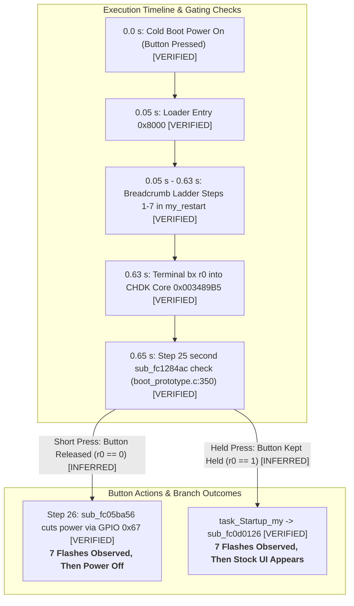

# PORT-24 T4: Owner Session Plan — Localizing Post-Loader Shutdown via Breadcrumb Ladder (GM1.10C)

- **Target Camera**: Canon PowerShot G3 X (Firmware **GM1.10C**, Platform ID `0x32A8` = 12968) `[VERIFIED: chdk-port/platform/g3x/sub/110c/boot_prototype.c:7; docs/PORT21_RAM_LIFETIME.md:3]`
- **Purpose**: Diagnostic execution plan for the camera owner to localise the post-loader shutdown in at most two physical power-ons using the opt-in Breadcrumb Ladder DISKBOOT candidate `[INFERRED]`
- **Evaluation Mode & Safety**: Phase 0 Read-Only regarding firmware and camera hardware (`docs/SAFETY.md:1-8`). STRICT NO-GO on firmware flashing, camera connection, binary modification, boot scripts, or unreviewed execution (`docs/SAFETY.md:1-8; AGENTS.md:19-25`) `[VERIFIED: docs/SAFETY.md:1-8; AGENTS.md:19-25]`
- **Base Document Dependencies**:
  - `docs/PORT24_BREADCRUMB_LADDER.md` (T3: Opt-in Breadcrumb Ladder Candidate Build, DISKBOOT.BIN SHA-256 `aa7963de9b6c04c8c5a3077efab12f8383a26db114d5d9b92e320780630abd3c`) `[VERIFIED: docs/PORT24_BREADCRUMB_LADDER.md:14, 517]`
  - `docs/PORT24_LOADER_TRACE.md` (T2: Restart path findings, Section `## Restart path`, lines 828–1029) `[VERIFIED: docs/PORT24_LOADER_TRACE.md:828-1029]`
  - `docs/PORT24_LOADER_TRACE.md` (T1: 29-step post-prologue trace & Section 6 ranked failure table, lines 721–793) `[VERIFIED: docs/PORT24_LOADER_TRACE.md:721-793]`
  - `docs/PORT24_POWERON_FIX.md` (Analysis of second power-on check in `boot_prototype.c:350` and O1 trial result) `[VERIFIED: docs/PORT24_POWERON_FIX.md:14-31]`
  - Owner Physical Trial Results (2026-11-01) `[VERIFIED: owner-reported in docs/PORT23_POWER_SUPERVISION.md:20-23; docs/PORT24_POWERON_FIX.md:16-18]`
- **Epistemic Classifications** `[VERIFIED: AGENTS.md:3]`:
  - `[VERIFIED]`: Directly proven by tracked repository files, static ROM manifests, or recorded physical hardware trials.
  - `[INFERRED]`: Logical deductions from verified ROM disassembly, architectural constraints, and hardware observations.
  - `[UNKNOWN]`: Unmeasured physical parameters, unread ROM routines outside approved slices, or uninstrumented hardware behaviors.

---

## 1. Exact SD Card Setup & Candidate Artifacts

The trial uses a single SD card configured identically to the owner's previous successful sessions `[VERIFIED: docs/PORT18_OWNER_TRIAL_PLAN.md:183-214; docs/PORT19_BOOTDISK_VBR.md:20-34]`.

### 1.1 Card Preparation Specifications

| Parameter | Required Value | Firmware Gating & Evidence Reference | Epistemic Status |
| :--- | :--- | :--- | :---: |
| **Filesystem** | **FAT32** (primary partition, $\le 32\text{ GB}$) | Supported by stock DryOS mounter; VBR checked by `sub_fc37aea6` (`0xFC05BC18`) | `[VERIFIED: docs/PORT19_BOOTDISK_VBR.md:20-34]` |
| **Write-Protect Tab** | **LOCKED** (slider in down position) | Checked by `StartDiskboot` via GPIO `0x14F` (`sub_fc05c4e0(1)` bit 0 == 1 at `0xFC05BC02..0xFC05BC0A`); if UNLOCKED, `StartDiskboot` exits cleanly at `0xFC05BC0A` to stock boot | `[VERIFIED: ROM 0xFC05BC02-0xFC05BC0A; PORT24-ROM-STARTDISKBOOT; INFERRED: docs/PORT24_LOADER_TRACE.md:948-951, 1014-1017]` |
| **`BOOTDISK` Marker** | String `"BOOTDISK"` at VBR offset **`0x1E0`** (480 dec) | Required by `sub_fc37aea6` at `0xFC05BC18` for FAT32 media; if absent, `StartDiskboot` branches at `0xFC05BC1C` to clean return `0xFC05BC34` | `[VERIFIED: ROM 0xFC05BC18-0xFC05BC1C; PORT24-ROM-STARTDISKBOOT; docs/PORT19_BOOTDISK_VBR.md:12-25, 90-120]` |
| **`SCRIPT` Marker** | String `"SCRIPT"` at VBR offset **`0x1F0`** (496 dec) | Read by filesystem mounter to set `is_scriptdisk` (enables Canon Basic script execution); does not gate `StartDiskboot` | `[VERIFIED: docs/PORT19_BOOTDISK_VBR.md:28-36, 105-135; docs/PORT24_LOADER_TRACE.md:961-965]` |

### 1.2 Binary File Placement on Card Root (`A/`)

Copy the built ladder candidate artifact from `candidate_breadcrumb_ladder/` to the SD card root directory:
- **Target File**: `A/DISKBOOT.BIN`
- **Candidate Size**: `118,257` bytes `[VERIFIED: docs/PORT24_BREADCRUMB_LADDER.md:14, 517]`
- **Exact Candidate SHA-256**: `aa7963de9b6c04c8c5a3077efab12f8383a26db114d5d9b92e320780630abd3c` `[VERIFIED: docs/PORT24_BREADCRUMB_LADDER.md:14, 517]`

> [!IMPORTANT]
> **Pre-Flight Hash Verification**: Before inserting the SD card into the camera, the owner must verify the SHA-256 digest directly from the mounted card filesystem:
> ```bash
> sha256sum /<card-mount-point>/DISKBOOT.BIN
> ```
> The output MUST strictly match `aa7963de9b6c04c8c5a3077efab12f8383a26db114d5d9b92e320780630abd3c`. If it differs by even one byte, DO NOT insert the card into the camera `[VERIFIED: docs/PORT24_BREADCRUMB_LADDER.md:517; docs/SAFETY.md:1-8]`.

---

## 2. Step-by-Step Execution Plan (At Most Two Power-Ons)

Unlike single-stage breadcrumbs (which required separate binaries and repeated card preparation), the PORT-24 T3 Breadcrumb Ladder Candidate executes sequentially through all 7 loader checkpoints in a single boot cycle `[VERIFIED: docs/PORT24_BREADCRUMB_LADDER.md:7]`. The plan is structured for **one, at most two, power-ons**.

### 2.1 Accounting for the Owner O1 Trial Result & Known Power Cut

In physical hardware trials on 2026-11-01, the camera owner established a critical operational distinction on the PORT-19 default candidate build (`DISKBOOT.BIN` SHA-256 `9468257364d753d9880791bfce0c0792dd5d0fee29b832566a5eca622a906136`) `[VERIFIED: owner-reported in docs/PORT24_POWERON_FIX.md:16-18; docs/PORT23_POWER_SUPERVISION.md:22]`:
1. **Short Press (Brief Tap)**: The camera powered off immediately after loader execution with the LCD backlight dark `[VERIFIED: owner-reported in docs/PORT24_POWERON_FIX.md:16-18; docs/PORT23_POWER_SUPERVISION.md:22]`.
2. **Continuous Hold until LCD Came On**: The camera booted successfully into the stock Canon user interface (`O1` result) `[VERIFIED: owner-reported in docs/PORT24_POWERON_FIX.md:16-18; docs/PORT23_POWER_SUPERVISION.md:22]`.

#### The Architectural Root Cause (**INFERRED**)
The failure mechanism on a short press is verified from static ROM disassembly and candidate ELF auditing `[VERIFIED: candidate_main.elf:0x34976C-0x349776; chdk-port/platform/g3x/sub/110c/boot_prototype.c:350-356; ROM 0xFC05B970-0xFC05BA56; docs/PORT24_LOADER_TRACE.md:921-930; docs/PORT24_POWERON_FIX.md:20-29]`:
- During native cold boot, `sub_fc1284ac` samples the power button BEFORE `task_Startup` is spawned `[VERIFIED: ROM 0xFC05B96C; PORT24-ROM-STARTUP-TASKS]`.
- In `boot_prototype.c:350-352`, the candidate code replicates Stage 5 (`sub_fc05b962_my`) and invokes `sub_fc1284ac` a **second time** `[VERIFIED: candidate_main.elf:0x34976C; boot_prototype.c:352]`.
- On a short tap, the owner has already released the physical button by the time Step 25 runs. Routine `sub_fc1284ac` samples GPIO 0x97 as released, returning `r0 = 0` `[VERIFIED: ROM 0xFC1284BC-0xFC128504; PORT24-ROM-POWERON-CHECK; INFERRED: docs/PORT24_LOADER_TRACE.md:927]`.
- At line 354, `boot_prototype.c` calls `sub_fc05ba56` (`0xFC05BA56`), which writes `0x004C0003` to GPIO 0x67 (MMIO `0xD20B099C`), terminating DC-DC power to the SoC and halting in `b .` `[VERIFIED: ROM 0xFC05BA56; PORT24-ROM-STARTUP-TASKS; candidate_main.elf:0x349772-0x349776; INFERRED: docs/PORT24_LOADER_TRACE.md:928-929]`.
- Conversely, holding the power button continuously maintains GPIO 0x97 asserted (`1`), causing `sub_fc1284ac` to return `1`. Execution branches to `loc_fc05b978` (`boot_prototype.c:358`), creating `task_Startup_my` and branching to `sub_fc0d0126` (`boot_prototype.c:438`), which presents the stock UI `[INFERRED: docs/PORT24_LOADER_TRACE.md:932-934]`.

### 2.2 Explicit Button Press Guidance: Short Press vs Continuous Hold

The ladder result is **NOT hidden** by this known power cut, provided the owner understands the exact execution timing and follows this protocol:



#### Why the Ladder Result is NOT Hidden by the Short-Press Cut `[INFERRED]`
1. **Execution Order** `[VERIFIED: docs/PORT24_LOADER_TRACE.md:725-731, 751; docs/PORT24_BREADCRUMB_LADDER.md:295-463]`: All 7 breadcrumb ladder steps reside entirely in `loader_main_breadcrumb.c` within `my_restart` (`0x8000..0x8332`). Terminal handoff occurs at Step 7 (`0x8332: bx r0`). The second button check (`sub_fc1284ac`) runs at Step 25 (`0x0034976C`) inside the CHDK core, substantially later in execution.
2. **Timing Separation** `[INFERRED: docs/PORT24_BREADCRUMB_LADDER.md:87-91, 137-141]`:
   - Single step nominal duration: $82.68\text{ ms}$ (loop only) `[INFERRED]`.
   - Full 7-step sequence nominal duration: $7 \times 82.68\text{ ms} = 578.76\text{ ms} \approx 0.58\text{ s}$ (fastest bound ~0.46 s, slowest bound ~1.39 s loop-only) `[INFERRED]`.
   - On a short tap (~100–200 ms), the physical button is released while the loader is executing its early steps. However, DC-DC power remains asserted by the hardware latch until Step 26 actively commands `0x004C0003` to GPIO 0x67 `[INFERRED: docs/PORT24_LOADER_TRACE.md:927-929]`.
   - Therefore, on a short press, **all 7 loader steps execute and emit their optical flashes before the power cut occurs**. The power cut terminates power only AFTER the loader has finished `[INFERRED]`.

---

### 2.3 Step-by-Step Session Protocol

#### Step 1: Power-On 1 — Short Press (Primary Ladder Run)
- **Guidance & Evidence Level**: Normal short tap of Power button (~100–200 ms duration; release immediately upon tactile click) `[INFERRED: protocol recommendation; docs/PORT24_LOADER_TRACE.md:996-999; button timing unmeasured UNKNOWN]`.
- **Purpose**: Observe the breadcrumb ladder flashes against a completely dark camera panel (clean diagnostic background without LCD glow or lens motor distraction) `[INFERRED]`.
- **Owner Action**:
  1. Insert charged battery and LOCKED SD card with `DISKBOOT.BIN` SHA-256 `aa7963de9b6c04c8c5a3077efab12f8383a26db114d5d9b92e320780630abd3c`.
  2. Dim room ambient lighting. Focus gaze directly on the **rear green status LED** (`0xD20B0884`).
  3. Give the Power button a firm, brief tap (~100–200 ms) and immediately release.
  4. Count every distinct flash of the green LED until the camera goes completely dark.
- **Expected Observations & Immediate Triage**:
  - **Count = 1 to 6 flashes, then dark**: The failure occurred INSIDE the loader between Step $k$ and Step $k+1$. The known cut at `boot_prototype.c:350` was never reached. The failure is localized directly by the count (see Section 3 Decode Table) `[INFERRED]`. Power-On 2 is NOT needed.
  - **Count = 7 flashes, then dark**: All 7 loader steps passed! Handoff via `bx r0` to `0x003489B5` succeeded. The camera powered off post-loader, exactly matching the expected behavior of the known button-release cut in `boot_prototype.c:350` (T1 Rank 1) `[INFERRED: docs/PORT24_LOADER_TRACE.md:782]`. Proceed to **Power-On 2** to confirm bypass via continuous hold.
  - **Count = 0 flashes (camera stays dark)**: Cold boot gate failed before Step 1, or `StartDiskboot` was skipped (see Section 4) `[INFERRED]`. Proceed to Power-On 2.

---

#### Step 2: Power-On 2 — Continuous Held Press (Confirmation & Discrimination Run)
- **Guidance & Evidence Level**: Continuous long press; maintain firm pressure on the Power button until the LCD illuminates (~1–2 s hold) `[VERIFIED: owner-reported in docs/PORT24_POWERON_FIX.md:16-18; INFERRED: docs/PORT24_LOADER_TRACE.md:1000-1002]`.
- **Purpose**: Run if Power-On 1 saw 7 flashes and powered off, to verify that suppressing the known second button check cut (`boot_prototype.c:350`) allows the ladder candidate to boot the stock UI (reproducing the O1 result on the ladder build) `[INFERRED]`.
- **Owner Action**:
  1. If the camera powered off, wait 5 seconds.
  2. Press and **HOLD the Power button continuously**. Do not release on click; keep held.
  3. Watch the rear green LED during the first second of the hold (count flashes), then watch for the LCD display to illuminate.
  4. As soon as the LCD backlight turns on or stock UI appears, release the button.
- **Discrimination Criteria**:
  - *7 flashes observed, then LCD illuminates and stock Canon UI appears*: **FULL VERIFICATION OF T1 RANK 1** `[INFERRED: docs/PORT24_LOADER_TRACE.md:1000-1002]`. Holding the button kept GPIO 0x97 asserted, passing `sub_fc1284ac` at `boot_prototype.c:350` and reaching stock continuation `sub_fc0d0126` (O1 outcome reproduced). This proves that the entire loader is 100% functional, and the sole cause of the short-press shutdown is the second button check in `boot_prototype.c:350`.
  - *7 flashes observed, but camera still powers off despite continuous hold*: Exonerates the button-release cut; implicates **T1 Rank 2 (External Sub-CPU Hardware Handshake Timeout)** or **T1 Rank 3 (Stray IRQ panic hang at Step 22b followed by supervisor cut)** `[INFERRED / UNKNOWN: docs/PORT24_LOADER_TRACE.md:783-784]`.
  - *0 flashes observed, but camera boots directly to stock UI*: Proves that `StartDiskboot` was cleanly **skipped** under Mechanism B (transient SD desynchronization or unlocked card switch; see Section 4) `[INFERRED: docs/PORT24_LOADER_TRACE.md:986-988]`.

---

#### Optional Single Power-On Alternative (Direct Continuous Hold)
If the owner chooses to minimize battery and power cycles by performing strictly **ONE power-on**:
- The owner may perform the **Continuous Held Press** directly on the first attempt `[INFERRED]`.
- The owner must watch the rear green LED intently for the first ~1.0 s after pressing the button, counting the optical flashes before looking at the LCD screen `[INFERRED]`.
- If 7 flashes occur followed by stock UI illumination, the session objective is fully achieved in a **single power-on** `[INFERRED]`.

---

## 3. Comprehensive LED Sequence & Final State Decode Table (with T1 Rankings)

Every breadcrumb ladder pulse loop is identical (`subs r2, #1; bne.n`) and operates on GPIO MMIO `0xD20B0884` using `0x004D0002` (ON) and `0x004C0003` (OFF) `[VERIFIED: docs/PORT24_BREADCRUMB_LADDER.md:10, 122-127]`. The total number of flashes observed before the camera powers off or goes dark directly decodes the execution milestone reached:

| Flash Count | Observed Signal & Final State | Loader Checkpoint Reached | Failing Execution Step & Mechanism | T1 Trace Step & Likelihood Ranking | Next Host Action |
| :---: | :--- | :--- | :--- | :--- | :--- |
| **0** | No light seen; camera stays completely dark and unpowered | None (failed before Step 1 pulse) | MBR load failure, dancingbits row 13 decrypt error, PID mismatch in `check_compat` (`0x32A8`), pre-startup button release cut in `sub_fc05b962` at `0xFC05B972`, or card switch UNLOCKED `[INFERRED: docs/PORT24_BREADCRUMB_LADDER.md:488; docs/PORT24_LOADER_TRACE.md:839-840]` | Step 1 / Pre-loader Gates<br>*(T2 Restart Path Gating)* | Check SD card format, inspect write-protect switch, verify dancingbits encoding row 13 |
| **1** | **1 flash**, then camera powers off (LCD dark) | `after_prologue`<br>(`0x000081E2`) | Step 1 pulse completed. Fault between Step 1 and Step 2: DRAM payload relocation write fault in `core_copy` (`0x003489B4`), or alignment fault during witness store at `0x0035F7A0` `[INFERRED: docs/PORT24_BREADCRUMB_LADDER.md:489]` | Step 3 (`core_copy`) & Step 4 (Witness write)<br>*(T1 Loader Phase I: Low)* | Audit DRAM memory mapping permissions at `0x003489B4`; check witness struct alignment |
| **2** | **2 flashes**, then camera powers off (LCD dark) | `after_copy`<br>(`0x00008246`) | Step 2 pulse completed. Fault between Step 2 and Step 3: transition into inline cache maintenance block (only adjacent breadcrumb pulse code runs here) `[INFERRED: docs/PORT24_BREADCRUMB_LADDER.md:490]` | Step 3/4 -> Step 5 transition<br>*(T1 Loader Phase I: Low)* | Audit instruction sequence between `core_copy` return and cache parameter setup |
| **3** | **3 flashes**, then camera powers off (LCD dark) | `before_dcache`<br>(`0x00008268`) | Step 3 pulse completed. Fault during D-cache clean & invalidate: argument setup, `ROM_DCACHE_CLEAN_INV` (`0xFC127AB1` DCCISW subroutine) fault, or bus lockup on `dsb sy` `[INFERRED: docs/PORT24_BREADCRUMB_LADDER.md:491]` | Step 5 (`ROM_DCACHE_CLEAN_INV`)<br>*(T1 Loader Phase I: Low)* | Verify DCCISW arguments (`r0 = 0x003489B4`, `r1 = 116816`); inspect ROM `0xFC127AB0` |
| **4** | **4 flashes**, then camera powers off (LCD dark) | `after_dcache`<br>(`0x00008296`) | Step 4 pulse completed. Fault between Step 4 and Step 5: transition from `after_dcache` into `before_icache` (only adjacent breadcrumb pulse code runs here) `[INFERRED: docs/PORT24_BREADCRUMB_LADDER.md:492]` | Step 5 -> Step 6 transition<br>*(T1 Loader Phase I: Low)* | Verify pulse execution timing and power hold rails |
| **5** | **5 flashes**, then camera powers off (LCD dark) | `before_icache`<br>(`0x000082B8`) | Step 5 pulse completed. Fault during I-cache & BP invalidation: argument setup, `ROM_ICACHE_INV_BP` (`0xFC127B09` ICIALLU/BPIALL subroutine), `dsb sy`, or pipeline sync (`isb sy`) `[INFERRED: docs/PORT24_BREADCRUMB_LADDER.md:493]` | Step 6 (`ROM_ICACHE_INV_BP`)<br>*(T1 Loader Phase I: Low)* | Verify ICIALLU arguments (`r0 = 0x003489B4`, `r1 = 116816`); inspect ROM `0xFC127B08` |
| **6** | **6 flashes**, then camera powers off (LCD dark) | `after_icache`<br>(`0x000082EA`) | Step 6 pulse completed. Fault between Step 6 and Step 7: privilege fault or mode trap on interrupt disable instruction `cpsid if` (`0x8308`) `[INFERRED: docs/PORT24_BREADCRUMB_LADDER.md:494]` | Step 6 -> Step 7 transition (`cpsid if`)<br>*(T1 Loader Phase I: Low)* | Audit CPU operating mode at loader hand-off (must be privileged System/Supervisor mode) |
| **7** | **7 flashes**, then camera powers off (LCD dark) on short press | `before_bx`<br>(`0x0000830E`) | Step 7 pulse completed. **Entire loader completed successfully!** Terminal handoff `bx r0` into CHDK core (`0x003489B5`) succeeded. Core executed until line 352 in `sub_fc05b962_my`, where released button caused `sub_fc05ba56` to cut power via GPIO 0x67 `[INFERRED: docs/PORT24_LOADER_TRACE.md:782, 927-929]` | Step 25 & 26 (Power Check & Cut)<br>**T1 RANK 1 (PRIMARY ROOT CAUSE)** | Execute Power-On 2 (Held Press); deploy PORT-24 Power-On Fix candidate (`boot_prototype.c:350`) |
| **7** | **7 flashes**, but camera powers off despite continuous hold | `before_bx`<br>(`0x0000830E`) | Loader completed, but CHDK core failed during early multi-tasking initialization or sub-CPU handshake despite held button `[INFERRED: docs/PORT24_LOADER_TRACE.md:783-784]` | Step 22b (IRQ unmask) / Sub-CPU<br>**T1 RANK 2 & RANK 3** | Investigate sub-CPU serial protocol (`SioDrv`) or audit stray interrupt masking at Step 22b |
| **7** | **7 flashes**, then LED remains solid ON, camera hangs with LCD glowing | `before_bx`<br>(`0x0000830E`) | Loader completed; CHDK core reached display controller initialization but hung in `task_Startup_my` or stock continuation `[INFERRED: docs/PORT23_OWNER_SESSION_PLAN.md:211]` | Step 27/28 (Startup Task drivers)<br>*(T1 Core Phase VII: Low)* | Perform battery pull recovery; audit `task_Startup_my` driver calls |
| **7** | **7 flashes**, then LCD turns on and **Stock Canon UI appears** | `before_bx`<br>(`0x0000830E`) | **FULL BOOT SUCCESS.** Loader completed all 7 steps; CHDK core executed through to stock continuation `sub_fc0d0126` (O1 outcome reproduced) `[INFERRED: docs/PORT24_LOADER_TRACE.md:932-934]` | Step 29 (`sub_fc0d0126` Handoff)<br>*(Execution Fully Successful)* | Record verified O1 ladder outcome; finalize PORT-24 short-press fix |

---

## 4. How to Tell from Physical Cues Whether StartDiskboot Was Skipped

In physical trials, an owner observing the camera boot directly to the stock Canon UI must distinguish whether `StartDiskboot` actually executed `DISKBOOT.BIN` through to continuation, or whether `StartDiskboot` bypassed the candidate entirely `[VERIFIED: docs/PORT24_LOADER_TRACE.md:970-988]`. T2 established the physical cues that discriminate these paths:

### 4.1 Cue 1: Rear Green Status LED Activity (Ladder-Qualified) `[INFERRED]`
- **Stock UI with 7 Distinct Flashes**: Proves that `StartDiskboot` executed `DISKBOOT.BIN` through the entire loader. The ladder ran, flashed all 7 checkpoints, jumped to core `_start`, and handed off to stock continuation `sub_fc0d0126` via the maintained button hold (Mechanism A) `[INFERRED: docs/PORT24_LOADER_TRACE.md:979-981, 1000-1002]`.
- **Stock UI with ZERO Flashes Seen**: Proves that `StartDiskboot` **cleanly bypassed** `DISKBOOT.BIN`! `StartDiskboot` took clean return sequence `0xFC05BC34` (`ldmia.w sp!, {r4, lr}; b.w 0xFC05C4DE: bx lr`), returning to caller `task_Startup` at `0xFC05B912` to boot pure factory firmware (Mechanism B) `[INFERRED: docs/PORT24_LOADER_TRACE.md:947-958, 986-988]`.
  - *Clean Return Triggers in ROM*:
    1. GPIO `0x14F` bit 0 == 0 (SD write-protect switch in UNLOCKED position at `0xFC05BC08..0xFC05BC0A`) `[VERIFIED: ROM 0xFC05BC08-0xFC05BC0A]`.
    2. GPIO `0x14E` bit 16 non-zero (`sub_fc05c4e0(0) != 0` at `0xFC05BBF8..0xFC05BBFC`; door switch / card detect) `[VERIFIED: ROM 0xFC05BBF8-0xFC05BBFC]`.
    3. Missing or corrupt `"BOOTDISK"` marker at VBR offset `0x1E0` (`sub_fc37aea6` returns 0 at `0xFC05BC18..0xFC05BC1C`) `[VERIFIED: ROM 0xFC05BC18-0xFC05BC1C]`.
    4. Missing `A/DISKBOOT.BIN` file on SD card root or invalid executable format (`sub_fc05bc3c` returns via pop to `0xFC05BC2E` at `0xFC05BC5C`/`0xFC05BC74`) `[VERIFIED: ROM 0xFC05BC2E-0xFC05BC74]`.
- **Camera Stays Dark with ZERO Flashes Seen**: `StartDiskboot` was never even called! Pre-startup button check `sub_fc1284ac` at `0xFC05B96C` returned 0, so `sub_fc05ba56` cut power at `0xFC05B972` before `task_Startup` was created `[VERIFIED: ROM 0xFC05B970-0xFC05B976; docs/PORT24_LOADER_TRACE.md:942]`.

### 4.2 Cue 2: SD Card Lock Switch State `[VERIFIED]`
- If the card's physical write-protect tab is in the **UNLOCKED** (up) position: GPIO `0x14F` reads bit 0 = 0. In ROM, `0xFC05BC08: beq.n 0xfc05bc34` branches directly to clean return `0xFC05BC34` without initializing the SD bus or loading `DISKBOOT.BIN` `[VERIFIED: ROM 0xFC05BC08-0xFC05BC0A; PORT24-ROM-STARTDISKBOOT; docs/PORT24_LOADER_TRACE.md:948-951, 1018-1020]`.

### 4.3 Cue 3: Canon Basic Witness Inspector Readout at `0x0035F7A0`
If the owner boots to the stock UI and runs the Canon Basic witness inspector (`extend.m` in Playback mode via `FUNC./SET`):
- **`CONT_ATTEMPTED` (Yellow / Stage 0x07)**: Indicates that DISKBOOT executed `task_Startup_my` and attempted continuation `sub_fc0d0126` `[VERIFIED: owner-reported in docs/PORT24_POWERON_FIX.md:16-18; docs/PORT18_OWNER_TRIAL_PLAN.md:262]`.
  - **Stale-RAM Caveat** `[INFERRED: docs/PORT24_LOADER_TRACE.md:935-937, 1024-1026; docs/PORT21_RAM_LIFETIME.md:44-48]`: Because DRAM retains data across warm boots without session nonces, a static witness value cannot prove whether the current boot ran DISKBOOT or retained stale data from a previous attempt. The **optical LED flashes (7 flashes)** provide the only unambiguous real-time proof of current-boot execution!
- **`WITNESS_INVALID` (Light Blue / Colour Index 3)**: The witness structure failed checksum/magic validation or was overwritten by stock DryOS heap allocations `[VERIFIED: docs/PORT18_OWNER_TRIAL_PLAN.md:267; docs/PORT24_LOADER_TRACE.md:1027-1029]`.

---

## 5. Verified Recovery Procedures

If the camera powers off, hangs, or behaves abnormally, follow these recovery procedures to restore factory stock UI operation:

### 5.1 Procedure 1: Normal Stock Start (Card Removal or Unlock)
- **Evidence Level**: `[VERIFIED: ROM 0xFC05BC08-0xFC05BC0A, 0xFC05BC34-0xFC05BC38; PORT24-ROM-STARTDISKBOOT; docs/PORT18_OWNER_TRIAL_PLAN.md:318-325; docs/PORT24_LOADER_TRACE.md:1018-1020]`.
- **Steps**:
  1. Turn off camera (or remove battery if unresponsive).
  2. Eject the SD card.
  3. Either leave the SD card out of the camera, OR slide the write-protect tab to the **UNLOCKED** (up) position and re-insert.
  4. Press the Power button.
  5. **Verification**: The camera boots normally into the factory stock Canon UI, the lens extends, the LCD display activates, and full normal camera shooting operation is restored `[VERIFIED: owner trial results 2026-11-01; docs/PORT18_OWNER_TRIAL_PLAN.md:323-325]`.

### 5.2 Procedure 2: Long-Press / Repeated-Press Recovery on Locked Card
- **Evidence Level**: `[VERIFIED: owner-reported in docs/PORT24_POWERON_FIX.md:16-18; docs/PORT23_POWER_SUPERVISION.md:22; INFERRED: docs/PORT24_LOADER_TRACE.md:931-937]`.
- **Steps**:
  1. If the locked SD card remains in the camera and the camera powered off, press and **HOLD the Power button continuously** until the LCD illuminates (~1–2 s).
  2. Holding the button keeps GPIO 0x97 asserted, allowing the second check `sub_fc1284ac` in `boot_prototype.c:350` to return `1`, bypassing `sub_fc05ba56` and handing off to stock continuation `sub_fc0d0126` `[INFERRED: docs/PORT24_LOADER_TRACE.md:932-934]`.
  3. Alternatively, repeated presses can coincidentally align with the sampling instant or cause transient SD bus desynchronization that causes `StartDiskboot` to return cleanly to stock firmware `[INFERRED: docs/PORT24_LOADER_TRACE.md:934, 959]`.

### 5.3 Procedure 3: Capacitor Discharge & PMIC Reset on Hang/Freeze
- **Evidence Level**: `[INFERRED: docs/PORT18_OWNER_TRIAL_PLAN.md:326-338; docs/PORT23_OWNER_SESSION_PLAN.md:238-246]`.
- **Condition**: Camera hangs with solid green LED, or LCD backlight glows blank screen without responding to button presses.
- **Steps**:
  1. Immediately open the battery door and remove the rechargeable battery.
  2. Eject the SD card.
  3. Leave the battery compartment open and unpowered for at least **30 seconds** to ensure complete capacitor discharge and PMIC reset `[INFERRED: docs/PORT18_OWNER_TRIAL_PLAN.md:330-332]`.
  4. Re-insert the fully charged battery with the SD card removed or unlocked.
  5. Press the Power button to confirm normal factory boot.

---

## 6. Machine-Readable Owner Report Template

The camera owner should fill out this structured report block and return it after completing the session:

```markdown
### PORT-24 Breadcrumb Ladder Trial Report

- **Date / Timestamp**: YYYY-MM-DD HH:MM UTC
- **Camera Model**: Canon PowerShot G3 X (Firmware GM1.10C)
- **Battery Status**: Freshly charged (voltage verified)
- **SD Card Format**: FAT32 primary partition, locked write-protect switch
- **VBR Marker Check**: BOOTDISK @ 0x1E0 confirmed, SCRIPT @ 0x1F0 confirmed
- **Binary Tested**: DISKBOOT.BIN
- **Measured SHA-256 on Card**: aa7963de9b6c04c8c5a3077efab12f8383a26db114d5d9b92e320780630abd3c

#### Power-On 1 (Short Press):
- **Button Action**: Short press / brief tap (~100–200 ms)
- **Flashes Observed**: [ 0 | 1 | 2 | 3 | 4 | 5 | 6 | 7 | Ambiguous ]
- **Flash Quality**: [ Distinct separate pulses | Blended / flicker fusion | Unsure ]
- **LCD Backlight State**: [ Completely dark / unpowered | Glowing black screen | Stock UI ]
- **Final Outcome**: [ Powered off cleanly | Hung with solid LED | Booted stock UI ]
- **Estimated Time to Dark / Boot**: ~______ seconds

#### Power-On 2 (Held Press, if run):
- **Button Action**: Continuous hold until LCD illuminated (~1–2 s)
- **Flashes Observed during Hold**: [ 0 | 1 | 2 | 3 | 4 | 5 | 6 | 7 | None seen ]
- **LCD Backlight State**: [ Illuminated with stock Canon UI | Dark / unpowered | Glowing blank ]
- **Stock UI Reached**: [ YES | NO ]
- **Inspector Overlay (if run)**: [ CONT_ATTEMPTED (Yellow) | WITNESS_INVALID (Blue) | None ]

#### Recovery & Operational Status:
- **Recovery Procedure Used**: [ None needed | Card unlocked | Card removed | Battery pull ]
- **Stock Camera Functionality Restored**: [ YES | NO ]
- **Owner Notes**: (Any unexpected lens motion, audible clicks, or visual timing observations)
```
