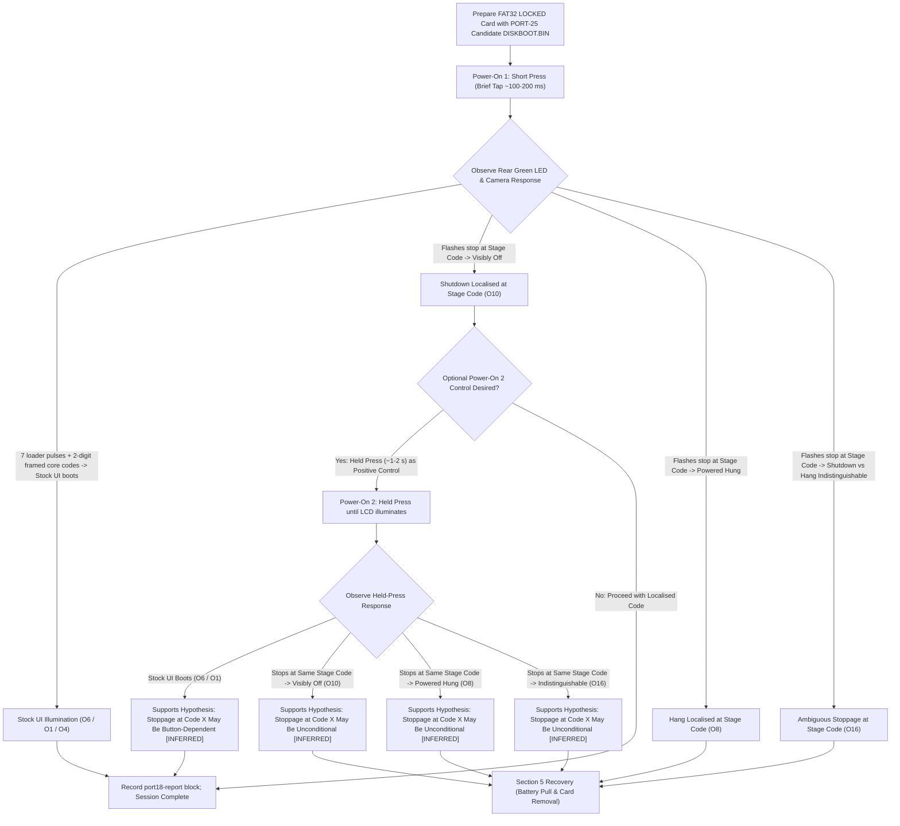

# PORT-25: Owner Trial Plan — Combined Breadcrumb Ladder + G3X_POWERON_FIX Candidate (GM1.10C)

**Target device**: Canon PowerShot G3 X `[VERIFIED: README.md:3; docs/FIRMWARE_ACQUISITION_PLAN.md:18]`.  
**Target firmware**: internal build `GM1.10C`, platform ID `0x32A8` (`12968` decimal) `[VERIFIED: docs/FIRMWARE_ACQUISITION_PLAN.md:19, 21; chdk-port/platform/g3x/sub/110c/g3x_trace.h:7; tools/build_candidate_port2a.py:232]`. DIGIC 6, DryOS 57 `[VERIFIED: chdk-port/platform/g3x/sub/110c/boot_prototype.c:6; tools/build_candidate_port2a.py:234]`.  
**Phase & Safety Gate**: Phase 0 is read-only regarding firmware and camera hardware `[VERIFIED: AGENTS.md:18-19; docs/SAFETY.md:3-4]`. STRICT NO-GO on firmware flashing, camera connection, binary modification, boot scripts or unreviewed execution on hardware `[VERIFIED: AGENTS.md:19-25; docs/SAFETY.md:1-8]`. Any phase transition requires explicit human approval `[VERIFIED: AGENTS.md:22]`. All host commands below build and validate artifacts offline on the host workstation; the owner executes the physical camera steps by hand only after recording separate human approval `[INFERRED: AGENTS.md:18-22; docs/SAFETY.md:7-8]`.

---

## 1. Host Candidate Build & Integrity Verification

The candidate combines the count-coded LED breadcrumb ladder (`LED_LADDER=1`) with the Stage 5 power-on fix (`G3X_POWERON_FIX=1`), single-emitter sequencing, and targeted interrupt-masked pulses `[VERIFIED: docs/PORT25_LADDER_FIX_CANDIDATE.md:8-25]`.

### 1.1 Exact Host Build Command

Run from the repository root on the host workstation with the pinned GCC toolchain present `[VERIFIED: docs/PORT25_LADDER_FIX_CANDIDATE.md:421-425; tools/build_candidate_port25_ladder_fix.py:32-56]`:

```bash
# Build the PORT-25 combined candidate (ladder=1, poweron_fix=1)
python3 -B tools/build_candidate_port25_ladder_fix.py --combined --out-dir candidate_port25_ladder_fix
```

*(Note: flags `--combined` or `--ladder-fix` explicitly select the combined build; invoking `python3 -B tools/build_candidate_port25_ladder_fix.py` without mode flags defaults to the combined candidate and `candidate_port25_ladder_fix` output directory `[VERIFIED: tools/build_candidate_port25_ladder_fix.py:502-549]`.)*

### 1.2 Expected Candidate Hashes, Sizes, and Component Offsets

The build output in `candidate_port25_ladder_fix/` must match the cryptographic and dimensional values established in `docs/PORT25_LADDER_FIX_CANDIDATE.md` `[VERIFIED: docs/PORT25_LADDER_FIX_CANDIDATE.md:385-393]`:

| Artifact | File Path | Expected SHA-256 Checksum | Expected Decimal Size | Epistemic Status & Evidence Citation |
|---|---|---|:---:|:---:|
| **Candidate DISKBOOT** | `candidate_port25_ladder_fix/DISKBOOT.BIN` | `9ba62067c17d654a3b8995fc6e8c26176321154054a138a465ca66f9ff763a15` | **124,865 bytes** | `[VERIFIED: docs/PORT25_LADDER_FIX_CANDIDATE.md:385]` |
| **Relocated Core Binary** | `candidate_port25_ladder_fix/candidate_main.bin` | *(Record owner-computed hash)* | **123,424 bytes** | `[VERIFIED size: docs/PORT25_LADDER_FIX_CANDIDATE.md:388]` |
| **Decrypted Loader Binary** | `candidate_port25_ladder_fix/candidate_loader.bin`| *(Record owner-computed hash)* | **124,864 bytes** | `[VERIFIED size: docs/PORT25_LADDER_FIX_CANDIDATE.md:389]` |
| **Witness Inspector Payload** | `candidate_port25_ladder_fix/witness_inspector_payload.bin` | *(Record owner-computed hash)* | **444 bytes** | `[VERIFIED size: docs/CHDK_PORT2A_CANDIDATE_INTEGRATION.md:115; docs/PORT16_OWNER_TRIAL_PLAN.md:35]` |

*(Note on intermediate component digests: While the final `DISKBOOT.BIN` target hash is pinned and verified in `docs/PORT25_LADDER_FIX_CANDIDATE.md:385`, the intermediate component binaries (`candidate_main.bin`, `candidate_loader.bin`, and `witness_inspector_payload.bin`) have verified expected byte sizes documented in the repository (`docs/PORT25_LADDER_FIX_CANDIDATE.md:388-389`; `docs/PORT16_OWNER_TRIAL_PLAN.md:35`), but their specific intermediate SHA-256 digests are not tracked in the documentation; the owner records the SHA-256 digests they compute themselves upon building.)*

- **`boot_witness` Address**: `0x00361170` (Section `.data`, Type `D`, 16-byte aligned, 32 B) `[VERIFIED: docs/PORT25_LADDER_FIX_CANDIDATE.md:390; tools/build_candidate_port25_ladder_fix.py:495]`.
- **`_end` Address**: `0x00368680` (DryOS heap allocation start `new_sa`) `[VERIFIED: docs/PORT25_LADDER_FIX_CANDIDATE.md:391; tools/build_candidate_port25_ladder_fix.py:496]`.
- **DancingBits Encoding**: Byte 0 is `0x00`, followed by 124,864 bytes scrambled via DancingBits Row 13 (`[6, 5, 3, 7, 0, 2, 4, 1]`) `[VERIFIED: docs/PORT19_DISKBOOT_ENCODING.md:17-22, 138-323; docs/PORT25_LADDER_FIX_CANDIDATE.md:392]`.

### 1.3 Baseline Invariance Verification Commands

Before touching an SD card, verify build reproducibility and baseline hash invariance on the host `[INFERRED: docs/SAFETY.md:7-8]`:

```bash
# 1. Run automated test suite verifying all 20 PORT-25 ladder-fix invariants
python3 -B -m unittest tests/test_port25_ladder_fix.py

# 2. Verify locally built DISKBOOT.BIN matches the pinned candidate hash exactly
sha256sum candidate_port25_ladder_fix/DISKBOOT.BIN
# Output MUST be: 9ba62067c17d654a3b8995fc6e8c26176321154054a138a465ca66f9ff763a15

stat -c %s candidate_port25_ladder_fix/DISKBOOT.BIN
# Output MUST be: 124865
```

- **Stop rule**: If either hash or size does not match, stop immediately and do not prepare an SD card `[INFERRED: docs/SAFETY.md:7-8]`.

---

## 2. SD Card Preparation Matching PORT-24

Card preparation matches the proven PORT-24 session setup, reusing existing card markers and auxiliary files `[VERIFIED: prompt p25-t4; docs/PORT24_OWNER_SESSION_SHEET.md:12-20; docs/PORT24_SESSION_PLAN.md:23-39]`.

### 2.1 Filesystem & VBR Markers

| Parameter | Required Value | Firmware Validation & ROM Citation | Epistemic Status |
|---|---|---|:---:|
| **Filesystem** | **FAT32** (primary partition) | Supported by stock DryOS mounter; VBR checked by `sub_fc37aea6` (`0xFC05BC18`). exFAT is unsupported `[VERIFIED: docs/PORT19_BOOTDISK_VBR.md:20-34, 73-74]`. | `[VERIFIED: docs/PORT19_BOOTDISK_VBR.md:20-34]` |
| **Card Capacity** | **$\le 32\text{ GB}$** (SDHC) | Recommended to avoid exFAT/SDXC partitions `[INFERRED: docs/PORT18_OWNER_TRIAL_PLAN.md:184; docs/PORT24_SESSION_PLAN.md:28]`. | `[INFERRED: docs/PORT18_OWNER_TRIAL_PLAN.md:184]` |
| **Write-Protect Tab** | **LOCKED** (slider down) | Checked by `StartDiskboot` via GPIO 0x14F (`sub_fc05c4e0(1)` bit 0 == 1 at `0xFC05BC02..0xFC05BC0A`) `[INFERRED: docs/PORT24_LOADER_TRACE.md:950; docs/HANDOFF.md:923]`. If UNLOCKED, `StartDiskboot` exits cleanly to stock boot without loading DISKBOOT `[VERIFIED: ROM 0xFC05BC02-0xFC05BC0A; docs/PORT24_LOADER_TRACE.md:948-951]`. | `[INFERRED: docs/PORT24_LOADER_TRACE.md:950; docs/HANDOFF.md:923]` |
| **`BOOTDISK` Marker** | `"BOOTDISK"` at VBR offset **`0x1E0`** (480 dec) | Required by `sub_fc37aea6` at `0xFC05BC18` for FAT32 media; if absent, `StartDiskboot` branches to clean return `0xFC05BC34` `[VERIFIED: docs/PORT19_BOOTDISK_VBR.md:23, 67-69; docs/PORT24_SESSION_PLAN.md:30]`. | `[VERIFIED: docs/PORT19_BOOTDISK_VBR.md:23, 67-69]` |
| **`SCRIPT` Marker** | `"SCRIPT"` at VBR offset **`0x1F0`** (496 dec) | Read by filesystem mounter to set `is_scriptdisk = 1`, enabling Canon Basic script parsing `[VERIFIED: docs/PORT19_BOOTDISK_VBR.md:31-34; docs/PORT24_SESSION_PLAN.md:31]`. | `[VERIFIED: docs/PORT19_BOOTDISK_VBR.md:31-34]` |

### 2.2 Root Directory File Population (`A/`)

Only `A/DISKBOOT.BIN` is updated with the PORT-25 combined candidate. All auxiliary files (`extend.m`, `WITNESS.BIN`, `script.req`) remain completely unchanged from the PORT-24 / PORT-18/19 card setup `[VERIFIED: prompt p25-t4; docs/PORT24_OWNER_SESSION_SHEET.md:15-19]`:

1. **`A/DISKBOOT.BIN`**: Copy `candidate_port25_ladder_fix/DISKBOOT.BIN` to the card root `[INFERRED: § 1.2; prompt p25-t4]`.
   - Size: `124,865` bytes `[VERIFIED: docs/PORT25_LADDER_FIX_CANDIDATE.md:385]`.
   - Hard Gate Check: Run `sha256sum /path/to/card/DISKBOOT.BIN` and verify it equals `9ba62067c17d654a3b8995fc6e8c26176321154054a138a465ca66f9ff763a15` `[VERIFIED: docs/PORT25_LADDER_FIX_CANDIDATE.md:385]`. If it differs, STOP and do not insert the card `[INFERRED: docs/SAFETY.md:7-8]`.
2. **`A/extend.m`**: Unchanged Canon Basic inspector script from PORT-24 (originating from `candidate_port2a/witness_inspector_gm110c.m` / `firmware/tools/witness_inspector_gm110c.m`) `[VERIFIED: docs/PORT18_OWNER_TRIAL_PLAN.md:201; docs/PORT24_OWNER_SESSION_SHEET.md:17; prompt p25-t4]`.
3. **`A/WITNESS.BIN`**: Unchanged witness inspector payload from PORT-24 (444 bytes, SHA-256 `241420a6eea2d7cbedd14046ec4f5988ed0404c5a82bb5d2ed6693fd74e612e2`) `[VERIFIED: docs/PORT18_OWNER_TRIAL_PLAN.md:202; docs/PORT24_OWNER_SESSION_SHEET.md:18; prompt p25-t4]`.
4. **`A/script.req`**: Unchanged script marker file from PORT-24 containing 17 ASCII bytes `for DC_scriptdisk` `[VERIFIED: docs/PORT18_OWNER_TRIAL_PLAN.md:203-206; docs/CANON_BASIC_ACTIVATION_INVESTIGATION.md:20, 49; docs/PORT24_OWNER_SESSION_SHEET.md:19; prompt p25-t4]`.

*(Technical Note on Witness Addresses & Outcome O6: The unchanged PORT-24 `WITNESS.BIN` and `extend.m` inspect the historical address `0x0035F7A0` `[VERIFIED: candidate_port2a/witness_inspector_gm110c.m:8-16; tools/validate_witness_inspector.py:65-67; docs/PORT19_WITNESS_ADDRESS.md:18-20]`, whereas the PORT-25 combined candidate relocates `boot_witness` to `0x00361170` `[VERIFIED: docs/PORT25_LADDER_FIX_CANDIDATE.md:390]`. If the owner activates the inspector via `FUNC./SET` on a booted camera, the inspector reads `0x0035F7A0`, fails magic/checksum checks, and displays `WITNESS_INVALID` (both title and status lines use palette index 3 `[VERIFIED: firmware/tools/witness_inspector_payload.S:193-194]`, which was recorded as light blue on this camera `[VERIFIED: docs/PORT18_OWNER_TRIAL_PLAN.md:267]`), which `tools/port18_trial_report.py` classifies as Outcome **`O6`** `[VERIFIED: tools/port18_trial_report.py:187-211, 838, 850, 1039-1042]`. The unchanged inspector cannot establish this candidate's witness stage, and any witness readout must be attributed `UNKNOWN` for this candidate `[UNKNOWN: docs/PORT25_LADDER_FIX_CANDIDATE.md:390]`. The primary observable diagnostic telemetry in PORT-25 is the real-time optical LED pulse train, satisfying the explicit prompt constraint of unchanged card setup while optical LED telemetry provides unambiguous stage localisation `[INFERRED: § 3; § 4]`.)*

5. **Unmount and Lock**: Execute `sync`, unmount cleanly, and slide the physical write-protect tab down to the **LOCKED** position `[INFERRED: docs/PORT18_OWNER_TRIAL_PLAN.md:211-214]`.

---

## 3. Step-by-Step Trial Protocol (At Most Two Power-Ons)

The session diagnostic budget is strictly defined as **at most two power-ons with the candidate card inserted** `[INFERRED: prompt p25-t4; docs/PORT24_SESSION_PLAN.md:45]`.



### 3.1 Step 1: Power-On 1 — Short Press (Primary Diagnostic Trial)

- **Guidance & Evidence Level**: Normal brief tap (~100–200 ms) of the Power button with charged battery and LOCKED card inserted `[INFERRED: § 3; docs/PORT24_POWERON_FIX.md:16-18; docs/PORT25_SHORT_PRESS_LOCALISE.md:55-58]`.
- **Diagnostic Objective**: Determine whether combining `G3X_POWERON_FIX=1` with `LED_LADDER=1` allows the camera to boot on a short press, and if execution halts, read the optical LED pulses to pinpoint the exact failure stage among the 8 candidates identified in `docs/PORT25_SHORT_PRESS_LOCALISE.md` `[INFERRED: § 3; docs/PORT25_LADDER_FIX_CANDIDATE.md:5-19]`.
- **Optical Capture Setup & Single Capture Requirement**:
  - **Timing Uncertainty Definition & Decodability Condition**:
    Timing uncertainty is defined as $U = T_{\text{frame}} + T_{\text{exp}}$ for video capture (where $T_{\text{frame}}$ is frame interval and $T_{\text{exp}}$ is shutter exposure), or $U = T_{\text{sample}} = 1 / f_{\text{sample}}$ for direct optical sensing `[INFERRED: timing arithmetic; § 4.1.3]`.
    As derived from `docs/PORT25_LADDER_FIX_CANDIDATE.md:253-268` in § 4.1.3, the smallest nominal margin to any band edge is **$0.4396\text{ ms}$** (the nominal frame-end gap $90.4396\text{ ms}$ against threshold $90.0\text{ ms}$, where margin is $90.4396 - 90.0 = 0.4396\text{ ms}$; similarly the nominal digit gap $48.4966\text{ ms}$ against threshold $48.0\text{ ms}$ has margin $48.4966 - 48.0 = 0.4966\text{ ms}$) `[VERIFIED: docs/PORT25_LADDER_FIX_CANDIDATE.md:253-268]`. Under the band-edge invalidation rule, any interval within $U$ of a band edge is marked `UNKNOWN`. Therefore, the decodability condition requires $U < 0.4396\text{ ms}$ `[VERIFIED: docs/PORT25_LADDER_FIX_CANDIDATE.md:253-268]`.
  - **Single Capture Requirement ($U \le 0.2\text{ ms}$)**:
    Optical capture MUST have timing uncertainty **$U \le 0.2\text{ ms}$**, which provides a safety factor of about 2 against the $0.4396\text{ ms}$ minimum margin `[INFERRED: § 4.1.3]`.
    - **Primary Method**: Direct optical sensing using a photodiode or phototransistor aimed at the rear green status LED (`0xD20B0884`), connected into an oscilloscope or logic analyser and sampled at **$\ge 10\text{ kHz}$** (sampling period $T_{\text{sample}} \le 0.1\text{ ms}$, giving $U \le 0.1\text{ ms} < 0.2\text{ ms}$) `[INFERRED: docs/PORT25_LADDER_FIX_CANDIDATE.md:27-32]`.
    - **High-Speed Video (Secondary)**: High-speed video is acceptable ONLY if $T_{\text{frame}} + T_{\text{exp}} \le 0.2\text{ ms}$, which requires roughly **$\ge 5000\text{ fps}$** with very short shutter exposure `[INFERRED: frame-timing arithmetic; § 4.1.3]`.
    - **Phone Slow-Motion Inadequacy & Below-Requirement Stoppage Rule**: Ordinary smartphone slow-motion (240, 480, or 960 fps) does **NOT** meet this requirement (e.g. 240 fps has $T_{\text{frame}} \approx 4.17\text{ ms}$; 480 fps has $T_{\text{frame}} \approx 2.08\text{ ms}$; 960 fps has $T_{\text{frame}} \approx 1.04\text{ ms}$; all far exceed $0.2\text{ ms}$ and $0.4396\text{ ms}$) `[INFERRED: frame-timing arithmetic; docs/PORT25_LADDER_FIX_CANDIDATE.md:253-268]`. With ordinary phone slow-motion (240/480/960 fps) or any capture failing to meet $U \le 0.2\text{ ms}$, the stage code cannot be resolved and MUST be reported as **`UNKNOWN`** with raw observations only (e.g. 'LED flickered, count not resolvable'). Do not decode non-nominal profiles or captures that fail $U \le 0.2\text{ ms}$.
  - **Continuous Capture Requirement**: The optical sensor or high-speed video recording must capture continuously from before initial power-on through terminal darkness (clean power-off) or a steady state (LCD illuminated or solid LED ON) `[VERIFIED: tests/test_port25_ladder_fix.py:410; docs/PORT25_LADDER_FIX_CANDIDATE.md:410-411]`. Truncated captures cannot be safely decoded and report `INCOMPLETE` `[VERIFIED: tests/test_port25_ladder_fix.py:410]`.
  - **Verbatim Decoding & Deadband Invalidation Rule**: Measured dark gaps and ON pulses are classified strictly using the candidate doc's verbatim nominal thresholds and deadbands in § 4.1.2 (`docs/PORT25_LADDER_FIX_CANDIDATE.md:263-274`): pulse gap $[4.0, 27.0]\text{ ms}$, Deadband 1 $(27.0, 48.0)\text{ ms}$, digit gap $[48.0, 69.0]\text{ ms}$, Deadband 2 $(69.0, 90.0)\text{ ms}$, and frame gap $\ge 90.0\text{ ms}$. Any measured ON or gap duration that falls in a deadband, or within timing uncertainty $U$ ($\pm U$, where $U \le 0.2\text{ ms}$) of a band edge, makes that digit **`UNKNOWN`** `[UNKNOWN: docs/PORT25_LADDER_FIX_CANDIDATE.md:265, 267, 411-412]`. Example: a $40\text{ ms}$ gap falls directly into Deadband 1 and is ambiguous, **NOT a separator** `[VERIFIED: docs/PORT25_LADDER_FIX_CANDIDATE.md:265]`.
- **Owner Execution**:
  1. Camera powered off. Insert fully charged NB-10L battery and LOCKED SD card `[INFERRED: docs/PORT18_OWNER_TRIAL_PLAN.md:222]`. Close and latch door `[INFERRED]`.
  2. Dim ambient lighting. Position the optical sensor (photodiode/phototransistor sampled at $\ge 10\text{ kHz}$) or compliant high-speed video camera ($T_{\text{frame}} + T_{\text{exp}} \le 0.2\text{ ms}$) steadily aimed at the rear green status LED (`0xD20B0884`) `[INFERRED: § 3.1; docs/PORT24_SESSION_PLAN.md:94-96]`.
  3. Start recording. Give the physical **Power button a standard brief press (tap of ~100–200 ms)** and release immediately `[INFERRED: docs/PORT24_POWERON_FIX.md:16-18; docs/PORT25_SHORT_PRESS_LOCALISE.md:55-58]`.
  4. Continuously observe and record the rear green LED until the camera reaches terminal darkness or a steady state (at least 10 seconds) `[INFERRED: docs/PORT24_SESSION_PLAN.md:96]`.
- **Observations & Immediate Triage**:
  - **Case 1A — Full Stock Boot**: LED emits 7 cumulative single blinks, pauses for transition gap (~58–138 ms), emits two-digit framed codes up to Code 44, LCD backlight illuminates, and Canon stock UI appears `[INFERRED: § 4]`.
    - *Action*: On this attempt the short press reached the stock UI `[VERIFIED: owner observation of this attempt]`. Whether this repeats on further short presses is `UNKNOWN`. Which change caused the boot to survive is `UNKNOWN`; one instrumented boot does not localise or confirm the root cause `[UNKNOWN: docs/PORT25_SHORT_PRESS_LOCALISE.md:236-246]`. Proceed to Step 3 to activate inspector or power off normally, then record results `[INFERRED: § 3.3; § 6]`. Power-On 2 is NOT required.
  - **Case 1B — Visibly Off / Clean Power-Off (Outcome `O10`)**: LED blinks up to a specific checkpoint and camera is visibly off (LED dark, LCD dark, no residual power consumption) `[INFERRED: § 4; tools/port18_trial_report.py:1019-1020; docs/PORT24_OWNER_SESSION_SHEET.md:36]`.
    - *Action*: Review optical capture, decode the observed code sequence using the Section 4 reading table, and apply the lower-bound reporting rule (§ 3.1.1): report the last confirmed checkpoint as a lower bound and the terminal code as unconfirmed candidate / `UNKNOWN` `[INFERRED: § 3.1.1; § 4]`. Note the matching T2 candidate. The owner may proceed to optional Power-On 2 (control) or directly record results in Section 6 `[INFERRED: § 3.2; § 6]`.
  - **Case 1C — Powered Hang / Freeze (Outcome `O8`)**: LED sequence stops at a stage code and camera stays powered but hung (LCD backlight on, LED stays solid ON, or camera draws power without progressing) `[INFERRED: § 4; tools/port18_trial_report.py:1015-1016; docs/PORT24_OWNER_SESSION_SHEET.md:37]`.
    - *Action*: Note last code (reporting last confirmed checkpoint as lower bound) or solid ON state. Route immediately to Section 5.1 recovery (battery pull) `[INFERRED: § 3.1.1; § 5.1; docs/PORT24_SESSION_PLAN.md:99]`.
  - **Case 1D — Indistinguishable Shutdown vs Hang (Outcome `O16`)**: LED sequence stops at a stage code, but shutdown versus powered hang cannot be told apart (e.g. LED dark, LCD dark, but residual power draw or unresponsiveness cannot be verified) `[INFERRED: § 4; tools/port18_trial_report.py:1011-1013]`.
    - *Action*: Note last code (with lower-bound attribution). Route to Section 5.1 recovery (battery pull) and classify as `O16` `[INFERRED: § 3.1.1; § 5.1; tools/port18_trial_report.py:1011-1013]`.
  - **Zero Flashes (Dark from Start)**: If zero flashes are observed, the camera emitted no pulses. This can mean the camera remained unpowered, `StartDiskboot` did not execute the loader (card unlocked, missing FAT32 VBR `0x1E0` marker, battery door switch open), OR the loader executed at `0x8000` and stalled or failed in `check_compat()` (`chdk-port/platform/g3x/sub/110c/loader_main_breadcrumb.c:41-45`) before Step 1 pulse. Whether the loader ran is `UNKNOWN` `[UNKNOWN: chdk-port/platform/g3x/sub/110c/loader_main_breadcrumb.c:41-45]`. Branch on camera state: if visibly off, record `camera_behaviour: no_power_on`, `outcome_id: O10`; if powered hung, record `camera_behaviour: hang`, `outcome_id: O8`; if shutdown versus hang cannot be told apart, record `camera_behaviour: unclassifiable`, `outcome_id: O16` `[VERIFIED: tools/port18_trial_report.py:1011-1020]`.

### 3.1.1 Truncated Final Code Limitation & Lower-Bound Reporting Rule

- **Truncated Final Code Limitation**:
  Power loss or shutdown during a units-digit gap can make a longer stage code look like a shorter valid stage code. For example, if execution cuts off during Code 32 ($3, 2$) after its first units pulse, the camera emits 3 tens pulses, a digit gap, 1 units pulse, and then powers off into terminal darkness. Because terminal darkness ($\ge 90.0\text{ ms}$) follows, an observer or optical decoder cannot distinguish this premature cutoff from a complete, valid emission of Code 31 ($3, 1$) followed by frame-end darkness. Recording through terminal darkness cannot rule this truncation out `[INFERRED: timing model; docs/PORT25_LADDER_FIX_CANDIDATE.md:274]`.
- **Required Reporting Rule**:
  1. Decode the full observed code sequence and check it against the expected ladder execution order from `docs/PORT25_LADDER_FIX_CANDIDATE.md:325-356` (11 $\to$ 12 $\to$ 13 $\to$ 14 $\to$ 15 $\to$ 21 $\to$ 22 $\to$ 23 $\to$ 24 $\to$ 25 $\to$ 26 $\to$ 31 $\to$ 32 $\to$ 33 $\to$ 34 $\to$ 35 $\to$ 41 $\to$ 42 $\to$ 43 $\to$ 44).
  2. Report the **LAST CONFIRMED checkpoint** as a **LOWER BOUND**. A confirmed checkpoint is the last code that is followed by a later valid code in sequence, or whose completion the candidate design makes unambiguous (e.g. entering a distinct subsequent execution phase or terminal state).
  3. Report the terminal observed code as **`UNKNOWN`** (an unconfirmed terminal candidate) unless its completion can be established independently.
  4. In the trial report notes, always phrase the finding using this lower bound: e.g. "Last confirmed checkpoint: Code 26 (lower bound); terminal observed code: Code 31 (unconfirmed due to truncation ambiguity; matching T2 Candidate 4)".

### 3.2 Step 2: Power-On 2 — Optional Held Press as a Control

- **Guidance & Evidence Level**: Optional second power-on with the same locked candidate card inserted `[INFERRED: prompt p25-t4; § 3]`. Applicability of held press guidance to candidate labelled INFERRED `[INFERRED: docs/PORT24_SESSION_PLAN.md:90; docs/PORT24_LOADER_TRACE.md:1000-1002]`.
- **Diagnostic Purpose**: Acts as a positive control. The held-button press is VERIFIED to have reached O1 with the PORT-19 default build and the PORT-24 power-on fix candidate `[VERIFIED: docs/PORT24_POWERON_FIX.md:16-18; docs/HANDOFF.md:2257]`. Running a held press with the PORT-25 combined candidate verifies hardware responsiveness, checks for battery/SD contact issues, and evaluates whether an observed stoppage at Code $X$ is button-release-dependent or unconditional `[INFERRED: § 3.2; docs/PORT25_SHORT_PRESS_LOCALISE.md:55-58]`.
- **Owner Execution**:
  1. Camera powered off (independently established or after Section 5 recovery) `[INFERRED: § 5]`.
  2. Start optical recording satisfying $U \le 0.2\text{ ms}$ (direct optical sensing at $\ge 10\text{ kHz}$ or compliant high-speed video with $T_{\text{frame}} + T_{\text{exp}} \le 0.2\text{ ms}$). Press and **HOLD the Power button continuously** until the LCD backlight illuminates and Canon stock UI appears (or until LED activity ceases for at least 10 s), then release `[INFERRED: § 3.1; docs/PORT24_SESSION_PLAN.md:95; docs/PORT24_OWNER_SESSION_SHEET.md:41]`.
  3. Record the complete LED pulse sequence and screen response `[INFERRED: § 3.2]`.
- **Comparative Triage & Epistemic Boundaries**:
  - *Held press reaches Stock UI (`O6` / `O1`), while Short Press halted at Code $X$*: Provides `[INFERRED]` evidence supporting the hypothesis that the stoppage at Code $X$ is button-release-dependent (e.g. T2 Candidate 4 unwritten startup cause at `0x00009BD0` or T2 Candidate 5 `task_PhySw` button release dispatch `[INFERRED: docs/PORT25_SHORT_PRESS_LOCALISE.md:234-261]`). However, differing outcomes between a single short press and a single held press can also arise from timing variations, scheduler preemption jitter, or intermittent contact/faults; therefore, a single comparison does NOT prove causality, and definitive causal attribution remains `[UNKNOWN]` `[UNKNOWN: docs/PORT25_SHORT_PRESS_LOCALISE.md:236-246]`.
  - *Held press ALSO halts at Code $X$*: Provides `[INFERRED]` evidence supporting the hypothesis that the stoppage at Code $X$ is unconditional and independent of button press duration (e.g. T2 Candidate 3 watchdog timer expiry or T2 Candidate 7 driver initialization failure `[INFERRED: docs/PORT25_SHORT_PRESS_LOCALISE.md:220-231, 278-293]`). However, matching failures can still stem from a button-dependent cause (for example, if button release occurred or was sampled before a downstream check, or if button release was sampled by hardware earlier in the sequence); therefore, a matching failure does NOT prove unconditional causality, and definitive causal attribution remains `[UNKNOWN]` `[UNKNOWN: docs/PORT25_SHORT_PRESS_LOCALISE.md:236-246]`.

### 3.3 Step 3: Inspector Activation Sequence (If Stock UI Boots)

If either power-on reaches the stock user interface, the camera boots into Shooting / Live View mode because power-on was initiated with the Power button `[VERIFIED: docs/PORT24_OWNER_SESSION_SHEET.md:29-32]`. Execute the following explicit sequence to run the inspector `[VERIFIED sequence: docs/PORT24_OWNER_SESSION_SHEET.md:29-32; docs/PORT19_GO_NOGO.md:164-167; docs/PORT18_OWNER_TRIAL_PLAN.md:238-247]`:

1. **Switch to Playback mode without restarting or power-cycling**: Once the camera is on and stock UI has booted, press the camera's physical Playback button (`[>|]`) to switch into Playback mode while keeping the camera continuously powered `[VERIFIED: docs/PORT24_OWNER_SESSION_SHEET.md:29-32; docs/PORT18_OWNER_TRIAL_PLAN.md:238-247]`. Do not restart or power-cycle the camera `[VERIFIED: docs/PORT24_OWNER_SESSION_SHEET.md:30]`.
2. **Execute Inspector**: Only once the camera is in Playback mode, press the center **`FUNC./SET`** button once to execute `extend.m` `[VERIFIED: docs/PORT24_OWNER_SESSION_SHEET.md:30; docs/PORT18_OWNER_TRIAL_PLAN.md:238; docs/CANON_BASIC_ACTIVATION_INVESTIGATION.md:51-52]`.
3. **Return to Shooting mode (Live View)**: Return to Shooting/Live View without restarting (e.g. half-press shutter) so retained OSD text is visibly rendered unoccluded by Playback menus `[VERIFIED: docs/PORT24_OWNER_SESSION_SHEET.md:31; docs/PORT18_OWNER_TRIAL_PLAN.md:240-247]`.
4. **Warning on False O4**: Skipping this sequence (e.g. pressing `FUNC./SET` in Shooting mode without entering Playback first, or not returning to Live View) can prevent `extend.m` from executing or leave the OSD occluded by menus, producing a false Outcome `O4` `[VERIFIED: docs/PORT24_OWNER_SESSION_SHEET.md:32; docs/PORT18_OWNER_TRIAL_PLAN.md:265; tools/port18_trial_report.py:1037]`.
5. **Photograph LCD Display & Note OSD Text**:
   - Because the unchanged PORT-24 `WITNESS.BIN` inspects historical address `0x0035F7A0`, whereas this candidate relocates `boot_witness` to `0x00361170` `[VERIFIED: candidate_port2a/witness_inspector_gm110c.m:8-16; docs/PORT25_LADDER_FIX_CANDIDATE.md:390]`, the inspector is expected to show `WITNESS_INVALID` (both title and status lines use palette index 3 `[VERIFIED: firmware/tools/witness_inspector_payload.S:193-194]`, recorded on this camera as light blue `[VERIFIED: docs/PORT18_OWNER_TRIAL_PLAN.md:267]`).
   - In `tools/port18_trial_report.py`, a normal stock boot with an inspector showing `WITNESS_INVALID` is classified as Outcome **`O6`**, not `O1` or `O4` `[VERIFIED: tools/port18_trial_report.py:187-211, 838, 850, 1039-1042]`.
   - Because the unchanged inspector reads `0x0035F7A0`, it cannot establish this candidate's witness stage, and any witness readout must be attributed `UNKNOWN` for this candidate `[UNKNOWN: docs/PORT25_LADDER_FIX_CANDIDATE.md:390]`.

---

## 4. Reading Table: Mapping LED Codes to Stages and T2 Candidates

The candidate implements two diagnostic transmission formats:
1. **Loader-Stage Cumulative Pulses (Steps 1–7)**: Emits $N$ single blinks via `LADDER_ASM_PULSE` (20.97–50.0 ms ON, 57.62–138.28 ms OFF) `[VERIFIED: docs/PORT25_LADDER_FIX_CANDIDATE.md:214-227]`.
2. **Core-Stage Two-Digit Framed Codes (Codes 11–44)**: Emits Tens ($T$) blinks, inter-digit dark gap (41.94–100.0 ms), Units ($U$) blinks, and frame-end dark gap (83.89–200.0 ms) `[VERIFIED: docs/PORT25_LADDER_FIX_CANDIDATE.md:236-249]`.

The table below covers every checkpoint from `docs/PORT25_LADDER_FIX_CANDIDATE.md`, mapping the last observed LED code to the technical stage reached, the emitting context, source location, and the corresponding T2 candidate from `docs/PORT25_SHORT_PRESS_LOCALISE.md:308-320`.

*(Reporting note on lower bounds: Per § 3.1.1, if a code sequence terminates at Code $C$, power loss during a units-digit gap could have truncated a longer code into $C$. Therefore, the last valid code preceding $C$ that was confirmed by a subsequent valid code is reported as the **LAST CONFIRMED lower bound**, while $C$ is reported as an unconfirmed candidate / UNKNOWN unless completion is established)*.

| Observed LED Code | Stage Symbol | Emitting Context | File & Line | Last Stage Reached (Lower Bound if terminal code unconfirmed) & Technical Meaning | Matching T2 Candidate (`docs/PORT25_SHORT_PRESS_LOCALISE.md`) | Epistemic Status & Diagnostic Meaning |
|:---:|---|:---:|---|---|---|:---:|
| **0 flashes** (dark from start) | `NO_BOOT` | ROM / Pre-Loader or Loader entry | `0xFC05BBEA` / `loader_main_breadcrumb.c:41-45` | Camera unpowered or `StartDiskboot` did not execute loader (card unlocked, missing FAT32 VBR `0x1E0` marker, battery door switch open); OR loader executed at `0x8000` and stalled or failed in `check_compat()` before Step 1 ladder pulse (`chdk-port/platform/g3x/sub/110c/loader_main_breadcrumb.c:41-45`). Whether the loader ran is `UNKNOWN` | **Pre-Loader** (check card lock switch, FAT32 VBR `0x1E0`, battery latch) or **Candidate 2** (loader stall / Sub-CPU power-cut during `check_compat()`) | `[UNKNOWN: whether loader ran; chdk-port/platform/g3x/sub/110c/loader_main_breadcrumb.c:41-45; INFERRED: docs/PORT24_LOADER_TRACE.md:950-965]` |
| **1 blink** | `STAGE_LOADER_AFTER_PROLOGUE` | Loader | `loader_main_breadcrumb.c:45` | Step 1: Entry prologue and `check_compat()` completed; stopped during core copy. If terminal, Step 0 is confirmed lower bound; Step 1 is unconfirmed candidate | **Candidate 2** (Sub-CPU Power-Hold Supervision timeout if button released early) | `[VERIFIED: docs/PORT25_LADDER_FIX_CANDIDATE.md:328; INFERRED: docs/PORT25_SHORT_PRESS_LOCALISE.md:200-217]` |
| **2 blinks** | `STAGE_LOADER_AFTER_COPY` | Loader | `loader_main_breadcrumb.c:99` | Step 2: Core payload copied to `0x003489B4`; stopped before D-cache flush. If terminal, Step 1 is confirmed lower bound; Step 2 is unconfirmed candidate | **Candidate 2** (Sub-CPU Power-Hold Supervision timeout) | `[VERIFIED: docs/PORT25_LADDER_FIX_CANDIDATE.md:329; INFERRED: docs/PORT25_SHORT_PRESS_LOCALISE.md:200-217]` |
| **3 blinks** | `STAGE_LOADER_BEFORE_DCACHE` | Loader | `loader_main_breadcrumb.c:116` | Step 3: Immediately before ROM D-cache clean/invalidate (`0xFC127AB1`). If terminal, Step 2 is confirmed lower bound; Step 3 is unconfirmed candidate | **Candidate 2** (Sub-CPU Power-Hold Supervision timeout) | `[VERIFIED: docs/PORT25_LADDER_FIX_CANDIDATE.md:330; INFERRED: docs/PORT25_SHORT_PRESS_LOCALISE.md:200-217]` |
| **4 blinks** | `STAGE_LOADER_AFTER_DCACHE` | Loader | `loader_main_breadcrumb.c:127` | Step 4: D-cache clean/invalidate completed; stopped before I-cache flush. If terminal, Step 3 is confirmed lower bound; Step 4 is unconfirmed candidate | **Candidate 2** (Sub-CPU Power-Hold Supervision timeout) | `[VERIFIED: docs/PORT25_LADDER_FIX_CANDIDATE.md:331; INFERRED: docs/PORT25_SHORT_PRESS_LOCALISE.md:200-217]` |
| **5 blinks** | `STAGE_LOADER_BEFORE_ICACHE` | Loader | `loader_main_breadcrumb.c:132` | Step 5: Immediately before ROM I-cache invalidate (`0xFC127B09`). If terminal, Step 4 is confirmed lower bound; Step 5 is unconfirmed candidate | **Candidate 2** (Sub-CPU Power-Hold Supervision timeout) | `[VERIFIED: docs/PORT25_LADDER_FIX_CANDIDATE.md:332; INFERRED: docs/PORT25_SHORT_PRESS_LOCALISE.md:200-217]` |
| **6 blinks** | `STAGE_LOADER_AFTER_ICACHE` | Loader | `loader_main_breadcrumb.c:144` | Step 6: I-cache invalidate completed; stopped before terminal branch. If terminal, Step 5 is confirmed lower bound; Step 6 is unconfirmed candidate | **Candidate 2** (Sub-CPU Power-Hold Supervision timeout) | `[VERIFIED: docs/PORT25_LADDER_FIX_CANDIDATE.md:333; INFERRED: docs/PORT25_SHORT_PRESS_LOCALISE.md:200-217]` |
| **7 blinks** | `STAGE_LOADER_BEFORE_BX` | Loader | `loader_main_breadcrumb.c:152` | Step 7: Loader finished; immediately before `bx r0` to core (`0x003489B5`). If terminal, Step 6 is confirmed lower bound; Step 7 is unconfirmed candidate | **Candidate 2** (Sub-CPU Power-Hold Supervision timeout / handoff stall) | `[VERIFIED: docs/PORT25_LADDER_FIX_CANDIDATE.md:334; INFERRED: docs/PORT25_SHORT_PRESS_LOCALISE.md:200-217]` |
| **Code 11** ($1, 1$) | `STAGE_BC_CORE_ENTRY` | Reset thread | `boot_prototype_ladder.c:92` | Core `boot()` entered; SP reset (`mov sp, r0`); stopped before BSS zeroing. If terminal, Step 7 is confirmed lower bound; Code 11 is unconfirmed candidate | **Candidate 2** (Sub-CPU Power-Hold Supervision timeout) | `[VERIFIED: docs/PORT25_LADDER_FIX_CANDIDATE.md:335; INFERRED: docs/PORT25_SHORT_PRESS_LOCALISE.md:200-217]` |
| **Code 12** ($1, 2$) | `STAGE_BC_POST_BSS` | Reset thread | `boot_prototype_ladder.c:154` | Low/High RAM copied, Canon BSS zeroed; stopped before Stage 3 entry. If terminal, Code 11 is confirmed lower bound; Code 12 is unconfirmed candidate | **Candidate 2** (Sub-CPU Power-Hold Supervision timeout) | `[VERIFIED: docs/PORT25_LADDER_FIX_CANDIDATE.md:336; INFERRED: docs/PORT25_SHORT_PRESS_LOCALISE.md:200-217]` |
| **Code 13** ($1, 3$) | `STAGE_BC_STAGE3_ENTRY` | Reset thread | `boot_prototype_ladder.c:175` | Entered `sub_fc05b3c8_my`; `witness_record_core` ran. If terminal, Code 12 is confirmed lower bound; Code 13 is unconfirmed candidate | **Candidate 8** (Heap headroom check failure: `0x006CE000 - new_sa < 0x000B1FEC` in `b loc_fc05b3d8`) or **Candidate 2** | `[VERIFIED: docs/PORT25_LADDER_FIX_CANDIDATE.md:337; INFERRED: docs/PORT25_SHORT_PRESS_LOCALISE.md:295-303]` |
| **Code 14** ($1, 4$) | `STAGE_BC_PRE_KERNEL_INIT` | Reset thread | `boot_prototype_ladder.c:256` | DryOS memory descriptors initialized; immediately before `blx sub_fc31b408`. If terminal, Code 13 is confirmed lower bound; Code 14 is unconfirmed candidate | **Candidate 2** (Sub-CPU Power-Hold Supervision timeout) | `[VERIFIED: docs/PORT25_LADDER_FIX_CANDIDATE.md:338; INFERRED: docs/PORT25_SHORT_PRESS_LOCALISE.md:200-217]` |
| **Code 15** ($1, 5$) | `STAGE_BC_STAGE4_ENTRY` | Initial Task | `boot_prototype_ladder.c:272` | Initial Task spawned; entered `sub_fc05b558_my`. If terminal, Code 14 is confirmed lower bound; Code 15 is unconfirmed candidate | **Candidate 7** (Stage 4 driver setup failure in `sub_fc05b5ea`: USER_MEM, dmSetup, etc.) or **Candidate 2** | `[VERIFIED: docs/PORT25_LADDER_FIX_CANDIDATE.md:339; INFERRED: docs/PORT25_SHORT_PRESS_LOCALISE.md:278-293]` |
| **Code 21** ($2, 1$) | `STAGE_BC_STAGE5_ENTRY` | Initial Task | `boot_prototype_ladder.c:346` | Entered Stage 5 `sub_fc05b962_my` after `push {r3, lr}`. If terminal, Code 15 is confirmed lower bound; Code 21 is unconfirmed candidate | **Candidate 2** (Sub-CPU Power-Hold Supervision timeout) or **Candidate 7** | `[VERIFIED: docs/PORT25_LADDER_FIX_CANDIDATE.md:340; INFERRED: docs/PORT25_SHORT_PRESS_LOCALISE.md:200-217]` |
| **Code 22** ($2, 2$) | `STAGE_BC_PRE_MPU_SETUP` | Initial Task | `boot_prototype_ladder.c:347` | Immediately before `bl sub_fc05ba68` (`pxSetup`, `dhcpc_setup`, `mpuSetup`). If terminal, Code 21 is confirmed lower bound; Code 22 is unconfirmed candidate | **Candidate 7** (Stage 5 setup error at `0xFC05BA6E`/`0xFC05BA82` calling `0xFC05BA8E`) or **Candidate 2** | `[VERIFIED: docs/PORT25_LADDER_FIX_CANDIDATE.md:341; INFERRED: docs/PORT25_SHORT_PRESS_LOCALISE.md:204-216, 278-293]` |
| **Code 23** ($2, 3$) | `STAGE_BC_POST_MPU_SETUP` | Initial Task | `boot_prototype_ladder.c:347` | `sub_fc05ba68` returned. Code 23 shows that `sub_fc05ba68` returned (`docs/PORT25_LADDER_FIX_CANDIDATE.md:342`). Whether setup succeeded is `UNKNOWN`, because the setup error handler may return into Stage 5 (`docs/PORT25_SHORT_PRESS_LOCALISE.md:133-137, 284-286`). If terminal, Code 22 is confirmed lower bound; Code 23 is unconfirmed candidate | **Candidate 2** or **Candidate 7** | `[VERIFIED: Code 23 shows sub_fc05ba68 returned: docs/PORT25_LADDER_FIX_CANDIDATE.md:342; UNKNOWN: whether setup succeeded, because the setup error handler may return into Stage 5: docs/PORT25_SHORT_PRESS_LOCALISE.md:133-137, 284-286; INFERRED: docs/PORT25_SHORT_PRESS_LOCALISE.md:204-217]` |
| **Code 24** ($2, 4$) | `STAGE_BC_PRE_POWER_CHECK` | Initial Task | `boot_prototype_ladder.c:348` / `tools/build_candidate_port25_ladder_fix.py:93-105, 117` | Immediately before button check `sub_fc1284ac`. In this combined build, the conditional GPIO power-cut branch of Candidate 1 is compiled out (`tools/build_candidate_port25_ladder_fix.py:93-105`), which keeps the check call `sub_fc1284ac` but forces success (`movs r0, #1; b loc_fc05b978`) afterward. Stopping between Code 24 and Code 25 does NOT implicate the disabled power-cut branch; the stop happened in the check call `sub_fc1284ac` itself or in code right after it, and the cause is `UNKNOWN` (`tools/build_candidate_port25_ladder_fix.py:93-105`). If terminal, Code 23 is confirmed lower bound; Code 24 is unconfirmed candidate | **Stall in `sub_fc1284ac` or immediately after** (Cause `UNKNOWN`; does NOT implicate disabled Candidate 1 power-cut branch) `[UNKNOWN: tools/build_candidate_port25_ladder_fix.py:93-105]` | `[VERIFIED code structure: tools/build_candidate_port25_ladder_fix.py:93-105, 117; UNKNOWN cause of stoppage: tools/build_candidate_port25_ladder_fix.py:93-105]` |
| **Code 25** ($2, 5$) | `STAGE_BC_POWER_CHECK_PASS`| Initial Task | `boot_prototype_ladder.c:361` | Label `loc_fc05b978` reached: **`G3X_POWERON_FIX=1` bypass executed**. If terminal, Code 24 is confirmed lower bound; Code 25 is unconfirmed candidate | **Candidate 1 EXONERATED** (Stage 5 power cut successfully bypassed!) | `[STATIC_VERIFIED: disassembly; VERIFIED: docs/PORT25_LADDER_FIX_CANDIDATE.md:344; INFERRED: docs/PORT25_SHORT_PRESS_LOCALISE.md:183-197]` |
| **Code 26** ($2, 6$) | `STAGE_BC_PRE_CREATE_STARTUP`| Initial Task | `boot_prototype_ladder.c:373` | Immediately before `blx sub_fc31bbc4` (CreateTask "Startup"); parent emits nothing after. If terminal, Code 25 is confirmed lower bound; Code 26 is unconfirmed candidate | **Candidate 2** or kernel task creation failure (Initial Task finished) | `[VERIFIED: docs/PORT25_LADDER_FIX_CANDIDATE.md:345; docs/PORT25_LADDER_FIX_CANDIDATE.md:288-318]` |
| **Code 28** ($2, 8$) | `STAGE_BC_FAIL_POWER_CUT` | Initial Task | `boot_prototype_ladder.c:357` | [Fail path when `G3X_POWERON_FIX=0`]. If seen, fix macro was NOT compiled | **Candidate 1** (Native button check returned 0; about to cut power via GPIO 0x67) | `[VERIFIED: docs/PORT25_LADDER_FIX_CANDIDATE.md:358-360; docs/PORT25_SHORT_PRESS_LOCALISE.md:183-197]` |
| **Code 29** ($2, 9$) | `STAGE_BC_HALT_SHUTDOWN` | Initial Task | `boot_prototype_ladder.c:358` | [Fail path when `G3X_POWERON_FIX=0`]. If seen, power cut helper returned | **Candidate 1** (`sub_fc05ba56` returned without cut; halted in `loc_fc05b976`) | `[VERIFIED: docs/PORT25_LADDER_FIX_CANDIDATE.md:359-360; docs/PORT25_SHORT_PRESS_LOCALISE.md:183-197]` |
| **Code 31** ($3, 1$) | `STAGE_BC_STARTUP_ENTRY` | Startup Task | `boot_prototype_ladder.c:389` | Startup Task created, scheduled, and entered. Stopped in early drivers. If terminal, Code 26 is confirmed lower bound; Code 31 is unconfirmed candidate | **Candidate 4** (Startup cause at `0x00009BD0` unwritten; consumed by early drivers) | `[VERIFIED: docs/PORT25_LADDER_FIX_CANDIDATE.md:346; INFERRED: docs/PORT25_SHORT_PRESS_LOCALISE.md:234-247]` |
| **Code 32** ($3, 2$) | `STAGE_BC_POST_EARLY_INIT` | Startup Task | `boot_prototype_ladder.c:393` | Early drivers (`sub_fc0d0150`..`sub_fc418eec`) returned; stopped before SD1stInit. If terminal, Code 31 is confirmed lower bound; Code 32 is unconfirmed candidate | **Candidate 4** (Startup cause at `0x00009BD0` unwritten) | `[VERIFIED: docs/PORT25_LADDER_FIX_CANDIDATE.md:347; INFERRED: docs/PORT25_SHORT_PRESS_LOCALISE.md:234-247]` |
| **Code 33** ($3, 3$) | `STAGE_BC_PRE_SD1STINIT` | Startup Task | `boot_prototype_ladder.c:402` | Reached SD1stInit gate check `sub_fc05c4e0(0)`; stopped during task creation. If terminal, Code 32 is confirmed lower bound; Code 33 is unconfirmed candidate | **Candidate 4** (Startup cause at `0x00009BD0` unwritten) | `[VERIFIED: docs/PORT25_LADDER_FIX_CANDIDATE.md:348; INFERRED: docs/PORT25_SHORT_PRESS_LOCALISE.md:234-247]` |
| **Code 34** ($3, 4$) | `STAGE_BC_POST_SD1STINIT` | Startup Task | `boot_prototype_ladder.c:407` | Label `1:` after SD1stInit veneer; stopped before watchdog arming. If terminal, Code 33 is confirmed lower bound; Code 34 is unconfirmed candidate | **Candidate 4** (Startup cause at `0x00009BD0` unwritten) | `[VERIFIED: docs/PORT25_LADDER_FIX_CANDIDATE.md:349; INFERRED: docs/PORT25_SHORT_PRESS_LOCALISE.md:234-247]` |
| **Code 35** ($3, 5$) | `STAGE_BC_PRE_WATCHDOG_START` | Startup Task | `boot_prototype_ladder.c:413` | Immediately before `bl sub_fc418f2a` (watchdog arming helper); pre-arming exit. If terminal, Code 34 is confirmed lower bound; Code 35 is unconfirmed candidate | **Candidate 4** (Startup cause at `0x00009BD0` unwritten) | `[VERIFIED: docs/PORT25_LADDER_FIX_CANDIDATE.md:350; INFERRED: docs/PORT25_SHORT_PRESS_LOCALISE.md:234-247]` |
| **Code 41** ($4, 1$) | `STAGE_BC_POST_WATCHDOG_START`| Startup Task | `boot_prototype_ladder.c:413` | `sub_fc418f2a` returned: **Hardware watchdog is actively armed!**. If terminal, Code 35 is confirmed lower bound; Code 41 is unconfirmed candidate | **Candidate 3** (Watchdog timeout expiry) or **Candidate 4** | `[VERIFIED: docs/PORT25_LADDER_FIX_CANDIDATE.md:351; INFERRED: docs/PORT25_SHORT_PRESS_LOCALISE.md:220-231, 234-247]` |
| **Code 42** ($4, 2$) | `STAGE_BC_PRE_PHYSW_CREATE` | Startup Task | `boot_prototype_ladder.c:418` / `tools/build_candidate_port25_ladder_fix.py:125` | Immediately before `bl sub_fc1283d2` (`task_PhySw` spawner). Code 42 is emitted before the PhySw creation helper and Code 43 after it returns (`tools/build_candidate_port25_ladder_fix.py:125`). PhySw may run and dispatch an event before the helper returns (`docs/PORT25_SHORT_PRESS_LOCALISE.md:250-258`), though whether Candidate 5 actually runs is `UNKNOWN`. If terminal, Code 41 is confirmed lower bound; Code 42 is unconfirmed candidate | **Candidates 3, 4 and 5** (**Candidate 3**: Watchdog timeout expiry; **Candidate 4**: Startup cause at `0x00009BD0` unwritten; **Candidate 5**: `task_PhySw` button release event dispatch) | `[VERIFIED: Code 42 is emitted before the PhySw creation helper and Code 43 after it returns: tools/build_candidate_port25_ladder_fix.py:125; docs/PORT25_LADDER_FIX_CANDIDATE.md:352; INFERRED: PhySw may run and dispatch an event before the helper returns: docs/PORT25_SHORT_PRESS_LOCALISE.md:250-258; docs/PORT25_SHORT_PRESS_LOCALISE.md:220-231, 234-247; UNKNOWN: whether Candidate 5 actually runs]` |
| **Code 43** ($4, 3$) | `STAGE_BC_POST_PHYSW_CREATE` | Startup Task | `boot_prototype_ladder.c:418` | `sub_fc1283d2` helper returned; stopped before continuation `sub_fc0d0126`. (Confirms only helper return; does NOT prove `task_PhySw` was newly created or executed, as `sub_fc1283d2` skips creation if a task handle already exists at `0xFC1283E4-0xFC1283E8` `[STATIC_VERIFIED: ROM 0xFC1283E4-0xFC1283E8; docs/PORT25_SHORT_PRESS_LOCALISE.md:353-358]`; task creation and execution are `[UNKNOWN]` `[UNKNOWN: docs/PORT25_SHORT_PRESS_LOCALISE.md:353-358]`). If terminal, Code 42 is confirmed lower bound; Code 43 is unconfirmed candidate | **Candidate 5** (`task_PhySw` button release event dispatch), **Candidate 3**, or **Candidate 4** | `[VERIFIED helper return: docs/PORT25_LADDER_FIX_CANDIDATE.md:353; docs/PORT25_SHORT_PRESS_LOCALISE.md:350, 355; task creation/execution UNKNOWN: docs/PORT25_SHORT_PRESS_LOCALISE.md:353-358]` |
| **Code 44** ($4, 4$) | `STAGE_BC_PRE_FIRMWARE_CONT` | Startup Task | `boot_prototype_ladder.c:442` / `tools/build_candidate_port25_ladder_fix.py:124-126` | Reached `b.w sub_fc0d0126`; CHDK prototype prologue completed successfully. Code 44 is emitted before firmware continuation (`tools/build_candidate_port25_ladder_fix.py:124-126`), and its whole frame comes after arming (`docs/PORT25_LADDER_FIX_CANDIDATE.md:351-354`). The watchdog could expire during that frame or after it. Seeing Code 44 alone does not show that stock continuation was entered. If terminal, Code 43 is confirmed lower bound; Code 44 is unconfirmed candidate | **Candidate 6** (Downstream Canon firmware interlocks / `TurnOffE1_FW`), **Candidate 5** (`task_PhySw` button release event dispatch), **Candidate 4** (Startup cause at `0x00009BD0` unwritten), or **Candidate 3** (Watchdog timeout expiry) | `[VERIFIED: Code 44 is emitted before firmware continuation: tools/build_candidate_port25_ladder_fix.py:124-126; whole frame comes after arming: docs/PORT25_LADDER_FIX_CANDIDATE.md:351-354; INFERRED: watchdog could expire during that frame or after it; seeing Code 44 alone does not show that stock continuation was entered; docs/PORT25_SHORT_PRESS_LOCALISE.md:220-231, 234-247, 250-258, 264-275]` |
| **Post-44 / Canon UI** | `STOCK_BOOT_SUCCESS` | Stock Firmware | `0xFC0D0126` | Stock Canon UI illuminates and boots normally | **No failure stage observed on this attempt** (On this attempt the short press reached the stock UI; whether this repeats on further short presses is `UNKNOWN`, and which change caused the boot to survive is `UNKNOWN`; one instrumented boot does not localise or confirm the root cause) | `[VERIFIED: owner observation of this attempt; UNKNOWN repeatability and root cause attribution: docs/PORT25_SHORT_PRESS_LOCALISE.md:236-246]` |
| **Solid Green LED ON** | `HANG_DURING_PULSE` | Loader / Core | Active delay loop | LED asserted (`0x004D0002`) and stays ON without final OFF | **CPU Hang / Exception** during active pulse window | `[INFERRED: docs/PORT24_BREADCRUMB_LADDER.md:497]` |
| **Ambiguous / Deadband** | `AMBIGUOUS_FRAMING` | Decoded trace | Deadband window | Observed dark gap falls into nominal deadband ($(27.0, 48.0)\text{ ms}$ or $(69.0, 90.0)\text{ ms}$), or within timing uncertainty $U$ ($\pm U$, $U \le 0.2\text{ ms}$) of a band edge, or timings match fast/slow bounds, or profile cannot be confirmed nominal. Example: a 40 ms gap is ambiguous, not a separator `[VERIFIED: docs/PORT25_LADDER_FIX_CANDIDATE.md:265, 267]` | **Deadband / Fast-Slow Ambiguity / Indistinguishable Profile**: Record stage reading as `UNKNOWN`. If clean shutdown, file `O10` with code `UNKNOWN`; if powered hung, file `O8`; if shutdown vs hang cannot be told apart, file `O16` `[VERIFIED: tools/port18_trial_report.py:1011-1020; UNKNOWN: docs/PORT25_LADDER_FIX_CANDIDATE.md:272-273, 411-412]` | `[INFERRED: docs/PORT25_LADDER_FIX_CANDIDATE.md:250-274; UNKNOWN: line 411-412]` |

### 4.1 Single Decoding Procedure, Nominal Thresholds, and Deadbands

Optical pulse decoding is calibrated strictly against the **nominal timing profile** (150 MHz CPU clock) specified in `docs/PORT25_LADDER_FIX_CANDIDATE.md:263-274` `[VERIFIED: docs/PORT25_LADDER_FIX_CANDIDATE.md:263-274]`.

#### 4.1.1 Rationale for Decoding Only the Nominal Profile
In the candidate implementation, ON pulses are executed inside macro `LADDER_PULSE_ON_OFF` with CPU interrupts strictly masked via `cpsid i` and restored only after LED OFF `[STATIC_VERIFIED: disassembly; docs/PORT25_LADDER_FIX_CANDIDATE.md:24, 250-255]`. Because ON pulses are non-preemptible, their duration depends strictly on the hardware CPU execution frequency `[INFERRED: docs/PORT25_LADDER_FIX_CANDIDATE.md:24, 145-165]`. Under the nominal 150 MHz profile, a single ON pulse lasts **20.97 ms** (typical acceptance window 12.0–30.0 ms) `[VERIFIED: docs/PORT25_LADDER_FIX_CANDIDATE.md:153; tests/test_port25_ladder_fix.py:200-201]`.

The trial **decodes only the nominal profile** and does not decode fast or slow profile bounds, for two critical reasons:
1. **Absence of Fast-Profile Thresholds**: While `docs/PORT25_LADDER_FIX_CANDIDATE.md:29-30, 151-164` models fast-bound hardware execution (200 MHz, ON pulse ~15.73 ms, cumulative digit separator ~36.37 ms), the candidate documentation defines decoding thresholds and deadbands only for the nominal and slow bounds; **no fast-profile decoding thresholds exist** in `docs/PORT25_LADDER_FIX_CANDIDATE.md:250-274` `[VERIFIED: docs/PORT25_LADDER_FIX_CANDIDATE.md:250-274]`.
2. **Deadband Collision**: The fast-bound ON pulse (~15.73 ms) falls inside the nominal ON acceptance window ($[12.0, 30.0]\text{ ms}$), but its cumulative digit separator (~36.37 ms) falls directly inside nominal Deadband 1 ($(27.0, 48.0)\text{ ms}$) `[VERIFIED: docs/PORT25_LADDER_FIX_CANDIDATE.md:29-30, 152, 156, 160, 265]`. Similarly, valid nominal separators collide with slow-profile deadbands (e.g. nominal frame separator ~90.44 ms falls directly into slow Deadband 1 $(66.0, 115.0)\text{ ms}$) `[VERIFIED: docs/PORT25_LADDER_FIX_CANDIDATE.md:254, 259]`.

Therefore, the trial strictly decodes only against the nominal profile thresholds.

#### 4.1.2 Pulse/Gap Classification and Deadband Rules (`docs/PORT25_LADDER_FIX_CANDIDATE.md:263-274`)

The trial uses exactly ONE decoding procedure, quoting and citing verbatim the pulse/gap classification and deadband rules from `docs/PORT25_LADDER_FIX_CANDIDATE.md:153, 263-274`:
- **ON pulse duration**: $[12.0\text{ ms}, 30.0\text{ ms}]$ ($20.97\text{ ms}$ nominal) `[VERIFIED: docs/PORT25_LADDER_FIX_CANDIDATE.md:153; tests/test_port25_ladder_fix.py:200-201]`
- **Pulse gap with preemption (intra-digit OFF)**: $[4.0\text{ ms}, 27.0\text{ ms}]$ ($6.55\text{ ms}$ nominal) `[VERIFIED: docs/PORT25_LADDER_FIX_CANDIDATE.md:264]`
- **Ambiguous Deadband 1**: $(27.0\text{ ms}, 48.0\text{ ms})$ `[VERIFIED: docs/PORT25_LADDER_FIX_CANDIDATE.md:265]`
- **Digit gap with preemption (inter-digit separator)**: $[48.0\text{ ms}, 69.0\text{ ms}]$ ($48.50\text{ ms}$ nominal) `[VERIFIED: docs/PORT25_LADDER_FIX_CANDIDATE.md:266]`
- **Ambiguous Deadband 2**: $(69.0\text{ ms}, 90.0\text{ ms})$ `[VERIFIED: docs/PORT25_LADDER_FIX_CANDIDATE.md:267]`
- **Frame gap with preemption / terminal darkness**: $\ge 90.0\text{ ms}$ ($90.44\text{ ms}$ nominal) `[VERIFIED: docs/PORT25_LADDER_FIX_CANDIDATE.md:268, 274]`

**Deadband & Band-Edge Invalidation Rule**:
Any measured ON or gap duration that falls in a deadband, or within timing uncertainty $U$ ($\pm U$, where $U \le 0.2\text{ ms}$) of a band edge (e.g. within $U$ of $4.0\text{ ms}$, $12.0\text{ ms}$, $27.0\text{ ms}$, $30.0\text{ ms}$, $48.0\text{ ms}$, $69.0\text{ ms}$, or $90.0\text{ ms}$), makes that digit **`UNKNOWN`** `[UNKNOWN: docs/PORT25_LADDER_FIX_CANDIDATE.md:265, 267, 411-412]`.
- **Explicit Example**: A $40\text{ ms}$ gap falls directly in Deadband 1 ($(27.0\text{ ms}, 48.0\text{ ms})$); it is ambiguous and makes that digit `UNKNOWN`, **NOT a separator** `[VERIFIED: docs/PORT25_LADDER_FIX_CANDIDATE.md:265]`.

#### 4.1.3 Single Capture Requirement & Worked Examples

##### (a) Timing Uncertainty Definition, Margins, and Decodability Condition
- **Definition of Timing Uncertainty ($U$)**:
  - For video capture: $U = T_{\text{frame}} + T_{\text{exp}}$, where $T_{\text{frame}}$ is the frame interval ($1 / \text{fps}$) and $T_{\text{exp}}$ is the shutter exposure duration `[INFERRED: timing arithmetic]`.
  - For direct optical sensing: $U = T_{\text{sample}} = 1 / f_{\text{sample}}$, where $T_{\text{sample}}$ is the discrete sampling period `[INFERRED: timing arithmetic]`.

- **Nominal Intervals, Band Edges, and Distance Margins**:
  From `docs/PORT25_LADDER_FIX_CANDIDATE.md:253-268`, the nominal timing profile (150 MHz CPU clock) defines the following durations and classification thresholds:
  1. **Nominal ON pulse**: $20.9715\text{ ms}$ (nominal window $[12.0, 30.0]\text{ ms}$ `[VERIFIED: docs/PORT25_LADDER_FIX_CANDIDATE.md:153, 263]`).
     - Margin to lower band edge ($12.0\text{ ms}$): $20.9715 - 12.0 = 8.9715\text{ ms}$ `[VERIFIED: docs/PORT25_LADDER_FIX_CANDIDATE.md:153, 263]`.
     - Margin to upper band edge ($30.0\text{ ms}$): $30.0 - 20.9715 = 9.0285\text{ ms}$ `[VERIFIED: docs/PORT25_LADDER_FIX_CANDIDATE.md:153, 263]`.
     - Margin to nearest band edge: **$8.9715\text{ ms}$** `[VERIFIED: docs/PORT25_LADDER_FIX_CANDIDATE.md:153, 263]`.
  2. **Nominal intra-digit pulse gap**: $6.5536\text{ ms}$ (nominal window $[4.0, 27.0]\text{ ms}$ `[VERIFIED: docs/PORT25_LADDER_FIX_CANDIDATE.md:252, 264]`).
     - Margin to lower band edge ($4.0\text{ ms}$): $6.5536 - 4.0 = 2.5536\text{ ms}$ `[VERIFIED: docs/PORT25_LADDER_FIX_CANDIDATE.md:252, 264]`.
     - Margin to upper band edge ($27.0\text{ ms}$): $27.0 - 6.5536 = 20.4464\text{ ms}$ `[VERIFIED: docs/PORT25_LADDER_FIX_CANDIDATE.md:252, 264]`.
     - Margin to nearest band edge: **$2.5536\text{ ms}$** `[VERIFIED: docs/PORT25_LADDER_FIX_CANDIDATE.md:252, 264]`.
  3. **Nominal digit gap (inter-digit separator)**: $48.4966\text{ ms}$ ($6.5536 + 41.9430\text{ ms}$; nominal window $[48.0, 69.0]\text{ ms}$ `[VERIFIED: docs/PORT25_LADDER_FIX_CANDIDATE.md:253, 266]`).
     - Margin to lower band edge ($48.0\text{ ms}$): $48.4966 - 48.0 = \mathbf{0.4966\text{ ms}}$ `[VERIFIED: docs/PORT25_LADDER_FIX_CANDIDATE.md:253, 266]`.
     - Margin to upper band edge ($69.0\text{ ms}$): $69.0 - 48.4966 = 20.5034\text{ ms}$ `[VERIFIED: docs/PORT25_LADDER_FIX_CANDIDATE.md:253, 266]`.
     - Margin to nearest band edge: **$0.4966\text{ ms}$** `[VERIFIED: docs/PORT25_LADDER_FIX_CANDIDATE.md:253, 266]`.
  4. **Nominal frame gap (frame-end separator)**: $90.4396\text{ ms}$ ($6.5536 + 83.8860\text{ ms}$; nominal threshold $\ge 90.0\text{ ms}$ `[VERIFIED: docs/PORT25_LADDER_FIX_CANDIDATE.md:254, 268]`).
     - Margin to lower band edge ($90.0\text{ ms}$): $90.4396 - 90.0 = \mathbf{0.4396\text{ ms}}$ `[VERIFIED: docs/PORT25_LADDER_FIX_CANDIDATE.md:254, 268]`.
     - Margin to nearest band edge: **$0.4396\text{ ms}$** `[VERIFIED: docs/PORT25_LADDER_FIX_CANDIDATE.md:254, 268]`.

- **Smallest Margin and Decodability Condition**:
  The smallest nominal margin to any band edge across all features is visibly:
  $$\min(8.9715, 2.5536, 0.4966, 0.4396) = 0.4396\text{ ms}\quad\text{[VERIFIED: docs/PORT25_LADDER_FIX_CANDIDATE.md:253-268]}$$
  Under the band-edge invalidation rule (§ 4.1.2), any observation falling within timing uncertainty $U$ of a band edge makes that digit `UNKNOWN`. Therefore, the **decodability condition** is:
  $$U < 0.4396\text{ ms}\quad\text{[VERIFIED: docs/PORT25_LADDER_FIX_CANDIDATE.md:253-268]}$$
  If $U \ge 0.4396\text{ ms}$ (for example, video at 720 fps where $T_{\text{frame}} \approx 1.389\text{ ms} > 0.4396\text{ ms}$), the nominal frame gap margin ($0.4396\text{ ms}$) and nominal digit gap margin ($0.4966\text{ ms}$) both fall within $U$ of their band edges, causing every nominal separator to be invalidated as `UNKNOWN` `[VERIFIED: docs/PORT25_LADDER_FIX_CANDIDATE.md:253-268]`.

##### (b) Single Capture Requirement ($U \le 0.2\text{ ms}$)
To ensure robust decodability with a safety factor of about 2 against the $0.4396\text{ ms}$ minimum margin ($\frac{0.4396\text{ ms}}{0.2\text{ ms}} \approx 2.2$):
- **Stated Requirement**: Optical capture MUST have timing uncertainty **$U \le 0.2\text{ ms}$** `[INFERRED: timing arithmetic; § 4.1.3]`.
- **Primary Method (Direct Optical Sensing)**:
  Direct optical sensing is the primary method: a photodiode or phototransistor positioned over the rear green status LED (`0xD20B0884`), connected into an oscilloscope or logic analyser, and sampled at **$\ge 10\text{ kHz}$** (sample period $T_{\text{sample}} \le 0.1\text{ ms}$, yielding $U \le 0.1\text{ ms}$, which provides a safety factor $> 4$ against $0.4396\text{ ms}$) `[INFERRED: docs/PORT25_LADDER_FIX_CANDIDATE.md:27-32]`.
- **High-Speed Video (Secondary Method)**:
  High-speed video capture is acceptable ONLY if it satisfies $T_{\text{frame}} + T_{\text{exp}} \le 0.2\text{ ms}$, which requires roughly **$\ge 5000\text{ fps}$** with very short shutter exposure `[INFERRED: frame-timing arithmetic]`.
- **Ordinary Phone Slow-Motion Inadequacy**:
  Ordinary smartphone slow-motion video (240 fps with $T_{\text{frame}} \approx 4.17\text{ ms}$, 480 fps with $T_{\text{frame}} \approx 2.08\text{ ms}$, or 960 fps with $T_{\text{frame}} \approx 1.04\text{ ms}$) does **NOT** meet this requirement, as their frame intervals alone exceed both $0.2\text{ ms}$ and the $0.4396\text{ ms}$ decodability limit `[INFERRED: frame-timing arithmetic; docs/PORT25_LADDER_FIX_CANDIDATE.md:253-268]`.
- **Below-Requirement Stoppage Rule**:
  With ordinary phone slow-motion (240/480/960 fps) or any capture failing to meet $U \le 0.2\text{ ms}$, the stage code cannot be decoded and MUST be reported as **`UNKNOWN`** with raw observations only (e.g. 'LED flickered, count not resolvable'). Do not decode non-nominal profiles or captures that fail $U \le 0.2\text{ ms}$.

##### (c) Worked Examples Following the Exact Classification and Deadband Rules
Under compliant capture satisfying $U \le 0.2\text{ ms}$ (evaluated here with direct optical sensing at 10 kHz, where $U = T_{\text{sample}} = 0.10\text{ ms}$, and with upper-bound compliant capture at $U = 0.20\text{ ms}$):
1. **Measured ON pulse of $20.97\text{ ms}$**:
   $20.97\text{ ms} \in [12.0, 30.0]\text{ ms}$. Distance to lower edge $12.0\text{ ms}$ is $8.97\text{ ms} \gg U$; distance to upper edge $30.0\text{ ms}$ is $9.03\text{ ms} \gg U$. Decodes unambiguously as a valid ON pulse.
2. **Measured intra-digit pulse gap of $6.55\text{ ms}$**:
   $6.55\text{ ms} \in [4.0, 27.0]\text{ ms}$. Distance to lower edge $4.0\text{ ms}$ is $2.55\text{ ms} \gg U$; distance to upper edge $27.0\text{ ms}$ is $20.45\text{ ms} \gg U$. Decodes unambiguously as an intra-digit pulse gap (same digit continues).
3. **Measured gap of $40.0\text{ ms}$**:
   Falls in Deadband 1 ($(27.0\text{ ms}, 48.0\text{ ms})$). Ambiguous; makes that digit **`UNKNOWN`** (not a separator).
4. **Measured nominal digit gap of $48.50\text{ ms}$ ($48.4966\text{ ms}$)**:
   $48.50\text{ ms} \in [48.0, 69.0]\text{ ms}$. Distance to lower edge $48.0\text{ ms}$ is $48.4966 - 48.0 = 0.4966\text{ ms}$. With $U \le 0.20\text{ ms}$ (e.g. $U = 0.10\text{ ms}$ at 10 kHz), the distance $0.4966\text{ ms} > U$ (margin exceeds uncertainty with safety factor $> 2$). Distance to upper edge $69.0\text{ ms}$ is $20.50\text{ ms} \gg U$. Decodes unambiguously as a digit gap (transitions from tens to units).
5. **Measured nominal frame gap of $90.44\text{ ms}$ ($90.4396\text{ ms}$)**:
   $90.44\text{ ms} \ge 90.0\text{ ms}$. Distance to threshold edge $90.0\text{ ms}$ is $90.4396 - 90.0 = 0.4396\text{ ms}$. With $U \le 0.20\text{ ms}$ (e.g. $U = 0.10\text{ ms}$ at 10 kHz), the distance $0.4396\text{ ms} > U$ (margin exceeds uncertainty with safety factor $> 2$). Decodes unambiguously as a frame gap / terminal darkness (end of stage code).
6. **Measured gap of $75.0\text{ ms}$**:
   Falls in Deadband 2 ($(69.0\text{ ms}, 90.0\text{ ms})$). Ambiguous; makes that digit **`UNKNOWN`**.
7. **Measured gap within $U$ of a band edge (e.g. $48.10\text{ ms}$ with $U = 0.20\text{ ms}$)**:
   Distance to the $48.0\text{ ms}$ band edge is $48.10 - 48.0 = 0.10\text{ ms} \le U$. Because it lies within timing uncertainty $U$ of a band edge, it makes that digit **`UNKNOWN`** under the band-edge invalidation rule. (Similarly, with non-compliant capture where $U > 0.4396\text{ ms}$, nominal $48.50\text{ ms}$ and $90.44\text{ ms}$ fall within $U$ of their band edges and are invalidated as `UNKNOWN`).

#### 4.1.4 Invalidation, Ambiguity, and Recording Route for `tools/port18_trial_report.py`
- **Mandatory UNKNOWN for Deadbands, Band-Edge Uncertainty, or Profile Ambiguity**:
  If any measured interval falls in a deadband, within timing uncertainty $U$ ($\pm U$, $U \le 0.2\text{ ms}$) of a band edge, matches fast/slow bounds, or if capture quality does not satisfy the single capture requirement ($U \le 0.2\text{ ms}$), the stage reading MUST be recorded as **`UNKNOWN`** `[UNKNOWN: docs/PORT25_LADDER_FIX_CANDIDATE.md:272-273, 411-412]`. Do not invent new thresholds or guess a stage code.
- **Recording Route for `tools/port18_trial_report.py`**:
  When a stage code cannot be safely resolved due to deadbands, band-edge uncertainty, or below-requirement capture, branch on observable physical camera state:
  1. **Clean Power-Off / Shutdown**: If the camera is visibly off (LCD dark, LED dark, no response), record `camera_behaviour: no_power_on`, `witness_observed: no`, `trace_log_present: no`, `outcome_id: O10`, and state in `notes` that flashes were observed but stage reading is UNKNOWN due to deadband / profile ambiguity `[VERIFIED: tools/port18_trial_report.py:248-256, 1019-1020]`.
  2. **Powered Hang / Freeze**: If the camera stays powered but hung (LCD backlight on or LED solid ON), record `camera_behaviour: hang`, `witness_observed: no`, `trace_log_present: no`, `outcome_id: O8`, noting that stage reading is UNKNOWN `[VERIFIED: tools/port18_trial_report.py:222-236, 1015-1016]`.
  3. **Indistinguishable Shutdown vs Hang**: If shutdown versus powered hang cannot be told apart, or physical state is ambiguous, use the existing **Outcome `O16` / indistinguishable route**: record `camera_behaviour: unclassifiable`, `witness_observed: unknown`, `trace_log_present: no`, `outcome_id: O16`, with `notes` explaining that the stage reading is UNKNOWN due to deadband / profile ambiguity and physical shutdown vs hang is indistinguishable `[VERIFIED: tools/port18_trial_report.py:314-323, 1011-1013, 1050-1051]`.

---

## 5. Recovery Procedures (docs/PORT18_OWNER_TRIAL_PLAN.md:318-355)

`docs/SAFETY.md:7` requires a known recovery path and rollback conditions before any hardware test `[VERIFIED]`. The recovery steps below reuse the established mechanisms and procedures from `docs/PORT18_OWNER_TRIAL_PLAN.md:318-355` `[VERIFIED: docs/PORT18_OWNER_TRIAL_PLAN.md:318-355; prompt p25-t4]`.

### 5.1 Reversible Boot & Recovery Basis

- **R-a. Unlock or remove the SD card**: SD card boot requires the write-protect switch to be in the LOCKED position `[VERIFIED: docs/HANDOFF.md:923; docs/PROJECT_STATE.md:333]`. An unlocked card or no card leads directly to a normal factory firmware start `[INFERRED: docs/HANDOFF.md:923; docs/CHDK_PORT1C1_CRITICAL_AUDIT.md:230-242; docs/PORT18_OWNER_TRIAL_PLAN.md:324]`.
- **R-b. Plain card without `BOOTDISK` marker**: SD boot requires the `"BOOTDISK"` VBR signature at offset `0x1E0` `[VERIFIED: docs/HANDOFF.md:923; docs/PORT19_BOOTDISK_VBR.md:20-25]`. A card lacking this signature boots stock factory firmware `[INFERRED: docs/PORT18_OWNER_TRIAL_PLAN.md:325]`.
- **R-c. Clean return if `StartDiskboot` loads nothing**: When `StartDiskboot` loads nothing, it returns through `0xFC05BC38` → `0xFC05C4DE` (`bx lr`) and `task_Startup` continues normal boot at `0xFC05B912` `[VERIFIED: docs/CHDK_PORT1C1_CRITICAL_AUDIT.md:230-239; docs/PORT18_OWNER_TRIAL_PLAN.md:326]`.
- **R-d. Candidate runs from volatile RAM**: The loader executes at `0x8000` `[VERIFIED: tools/build_candidate_port2a.py:536]`, and the core executes at `0x003489B4..0x00368680` `[VERIFIED: docs/PORT25_LADDER_FIX_CANDIDATE.md:390-391]`. The loader source code executes only DRAM relocation, witness store, cache invalidation, and branch to core, containing no flash writes and no `SetParameterData` calls `[VERIFIED: chdk-port/platform/g3x/sub/110c/loader_main_breadcrumb.c:1-205]`. The prototype source code has no direct flash writes and no `SetParameterData` calls `[VERIFIED: chdk-port/platform/g3x/sub/110c/boot_prototype.c:1-487; chdk-port/platform/g3x/sub/110c/boot_prototype_ladder.c:1-485; docs/PORT18_OWNER_TRIAL_PLAN.md:327]`. That a power cycle discharges volatile RAM and eliminates the candidate is `[INFERRED: docs/PORT18_OWNER_TRIAL_PLAN.md:327]`. Whether downstream or stock-firmware persistence happens after hand-off is `[UNKNOWN: docs/PORT16_OWNER_TRIAL_PLAN.md:271-274; docs/PORT18_OWNER_TRIAL_PLAN.md:327]` (persistence risks such as flash/EEPROM corruption by downstream code, mechanical damage, or watchdog loops are listed in `docs/PORT16_OWNER_TRIAL_PLAN.md:271-274` `[VERIFIED that they are listed]`; their likelihood is `[UNKNOWN]`).

### 5.2 Specific Recovery Action Sequences

#### 5.2.1 Hang or Freeze (Outcome `O8`, `O9`) `[docs/PORT18_OWNER_TRIAL_PLAN.md:329-338]`
1. Do not press buttons repeatedly `[INFERRED]`.
2. Open the battery/card door and remove the battery immediately `[INFERRED: docs/PORT18_OWNER_TRIAL_PLAN.md:332]`. (Removing only the card can leave the camera powered and hung `[INFERRED: docs/PORT24_SESSION_PLAN.md:1347-1351]`.)
3. Remove the SD card `[INFERRED: R-a]`.
4. Leave the camera completely without power for at least **30 seconds** to allow power rail capacitors to fully discharge and reset the PMIC microcontroller `[INFERRED: docs/PORT18_OWNER_TRIAL_PLAN.md:334; docs/PORT24_SESSION_PLAN.md:1347-1351]`.
5. Reinsert the charged battery with **NO card**. Power on by pressing Playback `[INFERRED: R-a; docs/PORT18_OWNER_TRIAL_PLAN.md:335]`.
6. Confirm stock camera behaviour: normal Playback display, responsive menus, and live view in Shooting mode `[INFERRED: docs/PORT18_OWNER_TRIAL_PLAN.md:336]`.
7. On the host, unlock the card (slider up) or rename `DISKBOOT.BIN` before inserting it into the camera again `[INFERRED: R-a, R-b; docs/PORT18_OWNER_TRIAL_PLAN.md:337]`.

#### 5.2.2 No Power-On or Shutdown (Outcome `O10`, `O15`) `[docs/PORT18_OWNER_TRIAL_PLAN.md:339-346]`
1. Remove the battery and the card `[INFERRED: docs/PORT18_OWNER_TRIAL_PLAN.md:341]`.
2. Check battery charge in the external charger and ensure it is fully charged `[INFERRED: docs/PORT18_OWNER_TRIAL_PLAN.md:342]`.
3. Check that the battery/card door latches securely (door switch must be closed) `[INFERRED: docs/PORT18_OWNER_TRIAL_PLAN.md:343]`.
4. Insert the charged battery with **no card**, close the door, and press Playback `[INFERRED: docs/PORT18_OWNER_TRIAL_PLAN.md:344]`.
5. If still unpowered: leave without battery for 60 seconds (capacitor discharge), then retry once with no card `[INFERRED: docs/PORT18_OWNER_TRIAL_PLAN.md:345]`. If still unresponsive, stop and report `[INFERRED]`.

#### 5.2.3 Abnormal State or Error Code (Outcome `O11`, `O12`, `O16`) `[docs/PORT18_OWNER_TRIAL_PLAN.md:347-354]`
1. Remove the battery immediately. Do not permit a reboot loop or error state to continue `[INFERRED: docs/PORT18_OWNER_TRIAL_PLAN.md:349]`.
2. Remove the card and keep it unmodified for host inspection `[INFERRED: docs/PORT18_OWNER_TRIAL_PLAN.md:350]`.
3. Reinsert the battery with **no card** and power on in Playback `[INFERRED: docs/PORT18_OWNER_TRIAL_PLAN.md:352]`.
4. **Abort rule**: If stock behaviour does not return (lens error, blank screen, restart loop), **STOP IMMEDIATELY, DO NOT RETRY**, and report with Section 6 `[INFERRED: docs/SAFETY.md:7; docs/PORT18_OWNER_TRIAL_PLAN.md:353]`.

---

## 6. Result Recording for `tools/port18_trial_report.py`

Following the physical trial, the owner records the observed results in a structured report. The report is parsed, validated, and classified using the repository's ingest tool `tools/port18_trial_report.py` `[VERIFIED: tools/port18_trial_report.py:8-22, 830-1194]`.

### 6.1 Applicable Outcome Classes for PORT-25

The following outcome identifiers (`outcome_id`) from `tools/port18_trial_report.py` cover every possible classification for this trial `[VERIFIED: tools/port18_trial_report.py:91-324, 846-852, 1011-1052; docs/PORT18_OWNER_TRIAL_PLAN.md:281-315]`. Under `--strict`, every field must match the exact values in the table below to be accepted `[VERIFIED: tools/port18_trial_report.py:26, 1148-1150]`:

| Outcome ID | `camera_behaviour` | `witness_observed` | `trace_log_present` | Required `notes` Readout Match | Typical Observation & Physical Meaning | Exact Parser & Decision Citation | Next Action & Triage |
|:---:|---|---|:---:|---|---|---|---|
| **`O6`** | `normal_stock_boot` | `yes` | `no` | Must contain `WITNESS_INVALID` | **Success Boot with Stale Inspector**: Stock UI booted; `extend.m` run via `FUNC./SET` in Playback showed `WITNESS_INVALID` (both title and status lines use palette index 3 `[VERIFIED: firmware/tools/witness_inspector_payload.S:193-194]`, recorded on this camera as light blue `[VERIFIED: docs/PORT18_OWNER_TRIAL_PLAN.md:267]`). Produced because unchanged `WITNESS.BIN` inspects historical `0x0035F7A0`, not candidate's `boot_witness` at `0x00361170`. | `[VERIFIED: tools/port18_trial_report.py:187-211, 838, 850, 1039-1042]` | Save LCD photo. Inspector cannot establish witness stage for this candidate (attributed `UNKNOWN`); decode LED pulse sequence for stage confirmation. File report with `outcome_id: O6` and include `WITNESS_INVALID` in `notes`. |
| **`O1`** | `normal_stock_boot` | `yes` | `no` | Must contain `CONT_ATTEMPTED` | **Success Boot with Matching Witness**: Stock UI illuminated; inspector executed and rendered `CONT_ATTEMPTED` (both title and status lines use palette index 4 `[VERIFIED: firmware/tools/witness_inspector_payload.S:173-174]`; actual on-camera colour of index 4 is `UNKNOWN` `[UNKNOWN]`) in Live View (only possible if inspector was updated to `0x00361170` or historical RAM matched). | `[VERIFIED: tools/port18_trial_report.py:92-114, 847, 1041-1042]` | Save LCD photo; file report with `O1` and include `CONT_ATTEMPTED` in `notes`. |
| **`O2`** | `normal_stock_boot` | `yes` | `no` | Must contain `CORE_REACHED` | Stock UI booted; inspector executed and showed `CORE_REACHED` (title line uses palette index 1, status line uses palette index 4 `[VERIFIED: firmware/tools/witness_inspector_payload.S:145-146]`; actual on-camera colours of indices 1 and 4 are `UNKNOWN` `[UNKNOWN]`). | `[VERIFIED: tools/port18_trial_report.py:116-132, 848, 1041-1042]` | Save LCD photo; file report with `O2` and include `CORE_REACHED` in `notes`. |
| **`O3`** | `normal_stock_boot` | `yes` | `no` | Must contain `LOADER_REACHED` | Stock UI booted; inspector executed and showed `LOADER_REACHED` (title line uses palette index 1, status line uses palette index 4 `[VERIFIED: firmware/tools/witness_inspector_payload.S:135-136]`; actual on-camera colours of indices 1 and 4 are `UNKNOWN` `[UNKNOWN]`). | `[VERIFIED: tools/port18_trial_report.py:134-148, 849, 1041-1042]` | Save LCD photo; file report with `O3` and include `LOADER_REACHED` in `notes`. |
| **`O4`** | `normal_stock_boot` | `no` or `unknown` | `no` | None (no recognised readout string) | Stock UI illuminated normally, but inspector was not run or no OSD overlay was visible. (Skipping Playback sequence produces false O4). | `[VERIFIED: tools/port18_trial_report.py:150-168, 1036-1038]` | File report with `O4`; check why inspector was not observed. |
| **`O5`** | `normal_stock_boot` | `yes` | `yes` | None | Stock UI booted; `TRACE.LOG` was written to card AND witness inspector was observed. **Separated from O14 by `witness_observed: yes`** (vs `no`/`unknown` for O14). | `[VERIFIED: tools/port18_trial_report.py:170-185, 1028-1031]` | Save LCD photo; copy `TRACE.LOG` to host for parsing; file report with `O5`. |
| **`O7`** | `normal_stock_boot` | `yes` | `no` | Must contain `STALE / REPLAY` | Stock UI booted; inspector showed `STALE / REPLAY` (both title and status lines use palette index 4 `[VERIFIED: firmware/tools/witness_inspector_payload.S:183-184]`; actual on-camera colour of index 4 is `UNKNOWN` `[UNKNOWN]`). | `[VERIFIED: tools/port18_trial_report.py:213-220, 851, 1041-1042]` | Save LCD photo; file report with `O7` and include `STALE / REPLAY` in `notes`. |
| **`O8`** | `hang` | `no` or `unknown` | `no` | None | **Hang / Freeze**: LED sequence stopped at a stage code or LED stayed solidly ON, and camera remained hung / frozen with no `TRACE.LOG`. | `[VERIFIED: tools/port18_trial_report.py:222-236, 1015-1016]` | Note last code; execute § 5.2.1 recovery; file report with `O8`. |
| **`O9`** | `hang` | Any (`no`, `yes`, `unknown`) | `yes` | None | Hang as in `O8`, with an unexpected `TRACE.LOG` found on the card. | `[VERIFIED: tools/port18_trial_report.py:238-246, 1015-1016]` | Execute § 5.2.1 recovery; parse trace on host; file report with `O9`. |
| **`O10`** | `no_power_on` | `no` or `unknown` | `no` | None | **Clean Power-Off / Shutdown**: LED blinked up to a stage code, then power cut cleanly (e.g. short-press power cut recurred); no `TRACE.LOG`. | `[VERIFIED: tools/port18_trial_report.py:248-256, 1019-1020]` | Review optical capture; decode last stage code in § 4 table; file `O10` with code and matching T2 candidate in `notes`. |
| **`O11`** | `abnormal_state` | `no` or `unknown` | `no` | None | Abnormal state: Reboot loop, error codes on screen, or abnormal lens movement without `TRACE.LOG`. | `[VERIFIED: tools/port18_trial_report.py:258-266, 1023-1025]` | Execute § 5.2.3 recovery; stop immediately; file report with `O11`. |
| **`O12`** | `abnormal_state` | Any (`no`, `yes`, `unknown`) | `yes` | None | Abnormal state: Reboot loop, error codes on screen, or ROM assert with `TRACE.LOG` present on card. | `[VERIFIED: tools/port18_trial_report.py:268-276, 1023-1025]` | Execute § 5.2.3 recovery; stop; copy `TRACE.LOG` to host for parsing; file report with `O12`. |
| **`O13`** | `normal_stock_boot` | `yes` | `no` | Must match regex in `tools/port18_trial_report.py:840`: `'PORT-1G: ERR...'` (e.g. `'PORT-1G: ERR_OPEN'`) or specific tokens `'ERR_COMPAT'`, `'ERR_ALLOC'`, `'ERR_OPEN'`, `'ERR_READ'`, `'ERR_CLOSE'`. (The literal string `'SCRIPT_ERROR'` is NOT recognised by the parser `[tools/port18_trial_report.py:840]`). | **Inspector Script Error**: Stock UI booted, but Canon Basic script `extend.m` failed during execution (syntax error, memory alloc failure, or file open/read error). (In `firmware/tools/witness_inspector_gm110c.m:85-86`, script errors are rendered with title and status lines both using palette index 1 `[VERIFIED: firmware/tools/witness_inspector_gm110c.m:85-86]`; actual on-camera colour of index 1 is `UNKNOWN` `[UNKNOWN]`). | `[VERIFIED: tools/port18_trial_report.py:278-286, 840, 852, 1041-1042]` | Record screen error string matching accepted tokens; inspect SD card files on host; file report with `O13`. |
| **`O14`** | `normal_stock_boot` | `no` or `unknown` | `yes` | None | Normal stock boot with `TRACE.LOG` written to card, but inspector was NOT run or not observed. **Separated from O5 by `witness_observed in ("no", "unknown")`** (vs `yes` for O5). | `[VERIFIED: tools/port18_trial_report.py:288-296, 1028, 1033-1034]` | Copy `TRACE.LOG` to host; file report with `O14`. |
| **`O15`** | `no_power_on` | Any (`no`, `yes`, `unknown`) | `yes` | None | No power-on as in `O10`, with an unexpected `TRACE.LOG` found on the card. | `[VERIFIED: tools/port18_trial_report.py:298-313, 1019-1020]` | Copy trace to host; file report with `O15`. |
| **`O16`** | `unclassifiable` | Any | Any | None | Any unclassifiable anomaly not fitting `O1`–`O15`. | `[VERIFIED: tools/port18_trial_report.py:314-323, 1011-1013, 1050-1051]` | Stop; keep card unmodified; describe in notes; file report with `O16`. |

### 6.2 Fenced Results Report Templates (`port18-report`)

#### 6.2.1 Requirement for Separate Report Files
The report ingest tool `tools/port18_trial_report.py:461-465` extracts report data by compiling regex `fence_pattern = re.compile(r"^```port18-report\s*$(.*?)^```\s*$", re.MULTILINE | re.DOTALL)` and calling `match = fence_pattern.search(content)`, which parses **only the first fenced block in the file** `[VERIFIED: tools/port18_trial_report.py:461-465]`.

> [!WARNING]
> **Appending a second fenced block to one file silently drops the second result!** `[VERIFIED: tools/port18_trial_report.py:461-465]`. The parser ignores everything after the closing delimiter of the first fenced block.

Therefore, the owner MUST create a separate report file for each physical power-on attempt:
- **Power-On 1 (Short Press Primary Diagnostic)**: Save to `private/port25/trial_report_short.md` `[INFERRED: § 6.2; prompt p25-t4]`.
- **Power-On 2 (Optional Held Press Control)**: Save to `private/port25/trial_report_held.md` `[INFERRED: § 6.2; prompt p25-t4]`.
*(Both paths are inside `private/`, which is git-ignored via `.gitignore:34` `[VERIFIED: .gitignore:34]`.)*

#### 6.2.2 Template 1: Power-On 1 (Short Press Primary Diagnostic)

Save to `private/port25/trial_report_short.md` `[INFERRED: § 6.2.1]`:

```port18-report
candidate_sha256: 9ba62067c17d654a3b8995fc6e8c26176321154054a138a465ca66f9ff763a15
candidate_size: 124865
trial_date: 2026-11-02
card_prepared: yes
camera_behaviour: normal_stock_boot
witness_observed: yes
trace_log_present: no
trace_log_path: none
witness_dump_path: none
outcome_id: O6
notes: Power-On 1 (short press): Observed 7 loader blinks, transition gap, then core codes 11-15, 21-26, 31-35, 41-44; Canon stock UI booted; entered Playback mode and pressed FUNC./SET; returned to Live View; inspector showed WITNESS_INVALID (expected because unchanged WITNESS.BIN reads 0x0035F7A0 rather than 0x00361170; witness stage attribution is UNKNOWN).
```

*(Field Guidance for Power-On 1 by Observed Case)*:
- **Case 1A — Stock Boot with Inspector Run Showing `WITNESS_INVALID`**: If `extend.m` is executed and shows `WITNESS_INVALID`, record `camera_behaviour: normal_stock_boot`, `witness_observed: yes`, `trace_log_present: no`, `outcome_id: O6`, and include `WITNESS_INVALID` in `notes` as shown in the template above `[VERIFIED: tools/port18_trial_report.py:187-211, 838, 850, 1040-1042]`.
- **Case 1A — Stock Boot without Inspector / No Overlay Visible**: If the camera boots normally to stock UI but `extend.m` is not executed or no overlay is seen, record `camera_behaviour: normal_stock_boot`, `witness_observed: no` (or `unknown`), `trace_log_present: no`, `outcome_id: O4` `[VERIFIED: tools/port18_trial_report.py:150-168, 1036-1038]`.
- **Case 1A — Stock Boot with Inspector Script Error**: If `extend.m` encounters a script failure, record `camera_behaviour: normal_stock_boot`, `witness_observed: yes`, `trace_log_present: no`, `outcome_id: O13`, and include an accepted error token in `notes` (e.g. `'PORT-1G: ERR_OPEN'`, `'ERR_COMPAT'`, `'ERR_ALLOC'`, `'ERR_OPEN'`, `'ERR_READ'`, or `'ERR_CLOSE'`) `[VERIFIED: tools/port18_trial_report.py:278-286, 840, 852, 1040-1042]`.
- **Case 1A — Stock Boot with Other Inspector Readouts**: If the inspector displays another recognized string, record `camera_behaviour: normal_stock_boot`, `witness_observed: yes`, `trace_log_present: no`, and match `outcome_id` and `notes`: `CONT_ATTEMPTED` $\to$ `O1`; `CORE_REACHED` $\to$ `O2`; `LOADER_REACHED` $\to$ `O3`; `STALE / REPLAY` $\to$ `O7` `[VERIFIED: tools/port18_trial_report.py:1040-1042]`.
- **Case 1A — Stock Boot with `TRACE.LOG` Present on Card**: If an unexpected `TRACE.LOG` is written, record `camera_behaviour: normal_stock_boot`, `trace_log_present: yes`, and set `trace_log_path`; classify as `outcome_id: O5` if `witness_observed: yes` `[VERIFIED: tools/port18_trial_report.py:1029-1031]`, or `outcome_id: O14` if `witness_observed` is `no` or `unknown` `[VERIFIED: tools/port18_trial_report.py:1032-1034]`.
- **Case 1B — Visibly Off / Clean Shutdown on Short Press**: If the camera is visibly off (LCD and LED off, no response):
  - If `trace_log_present: no`: record `camera_behaviour: no_power_on`, `witness_observed: no`, `trace_log_present: no`, `outcome_id: O10`, and in `notes`, apply the lower-bound reporting rule (§ 3.1.1), e.g.: `notes: Power-On 1 (short press): Observed 7 loader blinks, then Core Codes 11-15, 21-26, and observed Code 31 before shutdown; last confirmed checkpoint: Code 26 (lower bound); terminal code: Code 31 (unconfirmed due to truncation ambiguity; matching T2 Candidate 4: Startup Cause at 0x00009BD0)` `[INFERRED: § 3.1.1; § 4; § 6.1; tools/port18_trial_report.py:1020]`.
  - If `trace_log_present: yes`: record `camera_behaviour: no_power_on`, `trace_log_present: yes`, `outcome_id: O15` `[VERIFIED: tools/port18_trial_report.py:1020]`.
- **Case 1C — Powered Hang / Freeze**: If the camera stays powered but hung (LCD backlight on, LED stays solid ON, or camera draws power without progressing):
  - If `trace_log_present: no`: record `camera_behaviour: hang`, `witness_observed: no`, `trace_log_present: no`, `outcome_id: O8`, and in `notes`, record: `notes: Power-On 1 (short press): Observed 7 loader blinks, then Core Codes up to Code 31; camera remained powered and hung after Code 31; last confirmed checkpoint: Code 26 (lower bound); terminal code: Code 31 (unconfirmed due to truncation ambiguity)` `[INFERRED: § 3.1.1; § 4; § 6.1; tools/port18_trial_report.py:1016]`.
  - If `trace_log_present: yes`: record `camera_behaviour: hang`, `trace_log_present: yes`, `outcome_id: O9` `[VERIFIED: tools/port18_trial_report.py:1016]`.
- **Case 1D — Indistinguishable Shutdown vs Hang**: If shutdown versus powered hang cannot be told apart (e.g. LED is dark, but power draw or unresponsiveness cannot be verified), record `camera_behaviour: unclassifiable`, `witness_observed: unknown`, `trace_log_present: no`, `outcome_id: O16`, and note: `notes: Power-On 1 (short press): Observed flashes stopped at Code 31; last confirmed checkpoint: Code 26 (lower bound); unable to distinguish powered hang from shutdown` `[INFERRED: § 3.1.1; § 4; § 6.1; tools/port18_trial_report.py:1050-1051]`.

#### 6.2.3 Template 2: Power-On 2 (Optional Held Press Control)

Save to `private/port25/trial_report_held.md` `[INFERRED: § 6.2.1]`.

*(Note: The block below provides an illustrative template for the scenario where held press boots the stock UI and the inspector is executed showing `WITNESS_INVALID`. The owner MUST NOT assume this outcome; the actual report must be filled conditionally based on what is observed, following the complete field guidance below `[INFERRED: § 3.2; tools/port18_trial_report.py:1027-1048]`.)*

```port18-report
candidate_sha256: 9ba62067c17d654a3b8995fc6e8c26176321154054a138a465ca66f9ff763a15
candidate_size: 124865
trial_date: 2026-11-02
card_prepared: yes
camera_behaviour: normal_stock_boot
witness_observed: yes
trace_log_present: no
trace_log_path: none
witness_dump_path: none
outcome_id: O6
notes: Power-On 2 (held press control): Held Power button until LCD illuminated; observed 7 loader blinks, transition gap, then core codes 11-15, 21-26, 31-35, 41-44; Canon stock UI booted; entered Playback mode and pressed FUNC./SET; returned to Live View; inspector showed WITNESS_INVALID (expected because unchanged WITNESS.BIN reads 0x0035F7A0 rather than 0x00361170; witness stage attribution is UNKNOWN).
```

*(Field Guidance for Power-On 2 by Observed Case)*:
The owner must record the held-press trial conditionally based on observed behaviour, mapping each observation to its outcome class per `tools/port18_trial_report.py:1016, 1020, 1024, 1027-1048, 1050-1051` `[VERIFIED]`:
- **Held Press Reaches Stock UI (`camera_behaviour: normal_stock_boot`)**:
  - **No `TRACE.LOG` on Card (`trace_log_present: no`)**:
    - *Inspector not run or no overlay visible*: If `extend.m` was not run or produced no overlay (or if Playback sequence was skipped), record `witness_observed: no` (or `unknown`), `trace_log_present: no`, `outcome_id: O4`, with notes omitting recognized readout tokens `[VERIFIED: tools/port18_trial_report.py:1036-1038]`.
    - *Inspector shows `WITNESS_INVALID`*: If `extend.m` was executed and rendered `WITNESS_INVALID`, record `witness_observed: yes`, `trace_log_present: no`, `outcome_id: O6`, and include `WITNESS_INVALID` in `notes` as shown in Template 2 `[VERIFIED: tools/port18_trial_report.py:1040-1042]`.
    - *Inspector script error*: If `extend.m` encountered a script error, record `witness_observed: yes`, `trace_log_present: no`, `outcome_id: O13`, and include the exact recognized script error token in `notes` (e.g. `'PORT-1G: ERR_OPEN'`, `'ERR_COMPAT'`, `'ERR_ALLOC'`, `'ERR_OPEN'`, `'ERR_READ'`, or `'ERR_CLOSE'`) `[VERIFIED: tools/port18_trial_report.py:840, 1040-1042]`.
    - *Any other inspector readout*: If the inspector displayed another recognized string, record `witness_observed: yes`, `trace_log_present: no`, and match `outcome_id` and `notes`: `CONT_ATTEMPTED` $\to$ `outcome_id: O1`; `CORE_REACHED` $\to$ `outcome_id: O2`; `LOADER_REACHED` $\to$ `outcome_id: O3`; `STALE / REPLAY` $\to$ `outcome_id: O7` `[VERIFIED: tools/port18_trial_report.py:1040-1042]`.
  - **`TRACE.LOG` Present on Card (`trace_log_present: yes`)**:
    - If `witness_observed == "yes"`: record `witness_observed: yes`, `trace_log_present: yes`, `outcome_id: O5`, with `trace_log_path` set to the log file `[VERIFIED: tools/port18_trial_report.py:1029-1031]`.
    - If `witness_observed in ("no", "unknown")`: record `witness_observed: no` (or `unknown`), `trace_log_present: yes`, `outcome_id: O14`, with `trace_log_path` set to the log file `[VERIFIED: tools/port18_trial_report.py:1032-1034]`.
- **Held Press Halts at Same Stage Code $X$ (or Camera Fails to Boot Stock UI)**:
  - **Visibly Off (Clean Shutdown)**: If the camera powers off cleanly (LCD dark, LED dark, no response):
    - If `trace_log_present: no`: record `camera_behaviour: no_power_on`, `witness_observed: no`, `trace_log_present: no`, `outcome_id: O10`, and note: `notes: Power-On 2 (held press): Held Power button continuously; observed 7 loader blinks, then Core Codes 11-15, 21-26, and observed Code 31; camera powered completely off after Code 31 despite button held; last confirmed checkpoint: Code 26 (lower bound); terminal code: Code 31 (unconfirmed candidate; supports unconditional failure hypothesis)` `[INFERRED: § 3.1.1; § 3.2; § 6.1; tools/port18_trial_report.py:1020]`.
    - If `trace_log_present: yes`: record `camera_behaviour: no_power_on`, `trace_log_present: yes`, `outcome_id: O15`, noting the trace log path `[VERIFIED: tools/port18_trial_report.py:1020]`.
  - **Powered Hang / Freeze**: If the camera remains powered but hung (LCD backlight on, LED stays solid ON, or camera draws power without progressing):
    - If `trace_log_present: no`: record `camera_behaviour: hang`, `witness_observed: no`, `trace_log_present: no`, `outcome_id: O8`, and note: `notes: Power-On 2 (held press): Held Power button continuously; observed 7 loader blinks, then Core Codes up to Code 31; camera remained powered and hung after Code 31 despite button held; last confirmed checkpoint: Code 26 (lower bound); terminal code: Code 31 (unconfirmed candidate; supports unconditional failure hypothesis)` `[INFERRED: § 3.1.1; § 3.2; § 6.1; tools/port18_trial_report.py:1016]`.
    - If `trace_log_present: yes`: record `camera_behaviour: hang`, `trace_log_present: yes`, `outcome_id: O9`, noting the trace log path `[VERIFIED: tools/port18_trial_report.py:1016]`.
  - **Abnormal State**: If the camera enters a restart loop, displays error codes, or ROM assert:
    - If `trace_log_present: no`: record `camera_behaviour: abnormal_state`, `trace_log_present: no`, `outcome_id: O11` `[VERIFIED: tools/port18_trial_report.py:1024]`.
    - If `trace_log_present: yes`: record `camera_behaviour: abnormal_state`, `trace_log_present: yes`, `outcome_id: O12`, noting the trace log path `[VERIFIED: tools/port18_trial_report.py:1024]`.
  - **Indistinguishable (Shutdown vs Hang Cannot Be Told Apart)**: If shutdown versus powered hang cannot be distinguished, record `camera_behaviour: unclassifiable`, `witness_observed: unknown`, `trace_log_present: no`, `outcome_id: O16`, and note: `notes: Power-On 2 (held press): Held Power button continuously; observed flashes stopped at Code 31; last confirmed checkpoint: Code 26 (lower bound); unable to distinguish powered hang from shutdown` `[INFERRED: § 3.1.1; § 3.2; § 6.1; tools/port18_trial_report.py:1050-1051]`.

### 6.3 Host Verification & Ingestion Procedure

Recording and validating the trial report requires two distinct verification steps: host-side binary checksum/size validation and ingest schema/classification parsing.

#### 6.3.1 Step 1: Host-Side Binary Checksum and Size Verification

Before ingesting the report, verify the cryptographic integrity and exact byte size of the built `DISKBOOT.BIN` directly on the host `[INFERRED: docs/SAFETY.md:7-8]`:

```bash
# 1. Verify candidate SHA-256 checksum against pinned candidate hash
sha256sum candidate_port25_ladder_fix/DISKBOOT.BIN
# Output MUST be: 9ba62067c17d654a3b8995fc6e8c26176321154054a138a465ca66f9ff763a15

# 2. Verify candidate decimal byte size
stat -c %s candidate_port25_ladder_fix/DISKBOOT.BIN
# Output MUST be: 124865
```

*(Note: If verifying the binary directly on the SD card mount point, run the same commands against `/path/to/card/DISKBOOT.BIN` before inserting the card into the camera.)*

#### 6.3.2 Step 2: Report Ingestion with Dedicated `--out` Paths

Ingest and validate each filled trial report independently using the supported CLI options of `tools/port18_trial_report.py` `[VERIFIED: tools/port18_trial_report.py:8-22, 1403-1407]`:

```bash
# Ingest and validate Power-On 1 (short press) report to dedicated JSON summary
python3 -B tools/port18_trial_report.py private/port25/trial_report_short.md --strict --out private/port25/summary_short.json

# Ingest and validate Power-On 2 (optional held press control) report to dedicated JSON summary
python3 -B tools/port18_trial_report.py private/port25/trial_report_held.md --strict --out private/port25/summary_held.json
```

- **Collision Protection and Dedicated Output Paths**: The `--out` option writes the structured JSON summary directly to disk while validating that the output path never collides with or clobbers any input report or evidence file `[VERIFIED: tools/port18_trial_report.py:397-420, 1274-1278, 1325-1329]`. Specifying distinct `--out` paths (`private/port25/summary_short.json` and `private/port25/summary_held.json`) ensures that both trial summaries are preserved independently for downstream analysis without overwriting each other `[INFERRED: tools/port18_trial_report.py:397-420]`.
- **Strict Decision Matrix Enforcement (`--strict`)**: The `--strict` flag commands the ingest tool to evaluate the decision matrix from reported observables (`camera_behaviour`, `witness_observed`, `trace_log_present`, and `notes` readout strings) and exit non-zero if the reported `outcome_id` disagrees with the evidence-implied outcome `[VERIFIED: tools/port18_trial_report.py:26, 1148-1150]`. (Option `--strict-hash` is unsupported and does not exist in `tools/port18_trial_report.py` `[VERIFIED: tools/port18_trial_report.py:26-36]`).
- **Parser Scope**: The ingest tool parses and validates the formatting of all 11 required keys (verifying that `candidate_sha256` is a 64-character lowercase hex string or `'none'`, and `candidate_size` is a non-negative decimal integer `[VERIFIED: tools/port18_trial_report.py:532-551]`). The ingest parser checks field formats only; it does NOT compare these values against a binary file on disk. Hence, Step 1 above is mandatory to confirm binary integrity.

---

## 7. Epistemic Status Ledger & Citations

- `[VERIFIED: docs/PORT25_LADDER_FIX_CANDIDATE.md:385]`: Combined candidate DISKBOOT.BIN SHA-256 is `9ba62067c17d654a3b8995fc6e8c26176321154054a138a465ca66f9ff763a15` (124,865 bytes).
- `[VERIFIED: docs/PORT19_BOOTDISK_VBR.md:23, 32]`: `"BOOTDISK"` is at VBR offset `0x1E0` on FAT32; `"SCRIPT"` is at VBR offset `0x1F0`.
- `[STATIC_VERIFIED: disassembly; tools/build_candidate_port25_ladder_fix.py:93-105]`: Combined candidate compiles `G3X_POWERON_FIX=1`, replacing the native button check conditional power-cut branch with `movs r0, #1; b loc_fc05b978` in `sub_fc05b962_my`. The conditional power-cut branch calling `sub_fc05ba56` is compiled out; therefore stopping between Code 24 and Code 25 does NOT implicate the disabled power-cut branch, and the cause is `UNKNOWN` `[UNKNOWN: tools/build_candidate_port25_ladder_fix.py:93-105]`.
- `[STATIC_VERIFIED: ROM 0xFC05BA56; PORT25-ROM-STARTUP-TASKS]`: Default build (`G3X_POWERON_FIX=0`) cuts power via GPIO 0x67 (`0xD20B099C`) in `sub_fc05ba56` if `sub_fc1284ac` returns 0.
- `[VERIFIED: tools/port18_trial_report.py:840, 893-930]`: The ingest tool recognizes script errors for Outcome `O13` via regex `r"\bPORT-1G:\s*ERR(?:_[A-Z0-9]+)?\b|\bERR_(?:COMPAT|ALLOC|OPEN|READ|CLOSE)\b"` (matching `'PORT-1G: ERR...'` or specific tokens `'ERR_COMPAT'`, `'ERR_ALLOC'`, `'ERR_OPEN'`, `'ERR_READ'`, `'ERR_CLOSE'`); the literal string `'SCRIPT_ERROR'` is not recognized.
- `[UNKNOWN: whether loader ran when 0 flashes observed]`: When zero flashes are observed, either the camera was unpowered / `StartDiskboot` did not execute loader (card unlocked, missing FAT32 VBR `0x1E0` marker, battery door switch open), OR the loader executed at `0x8000` and stalled or failed during `check_compat()` before the Step 1 pulse (`chdk-port/platform/g3x/sub/110c/loader_main_breadcrumb.c:41-45`). Whether the loader ran cannot be determined from zero flashes alone.
- `[INFERRED: timing arithmetic; docs/PORT25_LADDER_FIX_CANDIDATE.md:253-268]`: Timing uncertainty $U = T_{\text{frame}} + T_{\text{exp}}$ (video) or $U = T_{\text{sample}}$ (optical sensing) must be strictly less than the smallest nominal margin to any band edge ($0.4396\text{ ms}$ at the $90.0\text{ ms}$ frame-gap threshold, and $0.4966\text{ ms}$ at the $48.0\text{ ms}$ digit-gap threshold) to prevent false invalidation. The single capture requirement $U \le 0.2\text{ ms}$ provides a safety factor of ~2; ordinary phone slow-motion (240/480/960 fps) fails this condition, requiring stage reading UNKNOWN with raw observations only.
- `[INFERRED: timing model; docs/PORT25_LADDER_FIX_CANDIDATE.md:274]`: Truncated final code limitation: premature power loss during a units-digit gap can make a longer code appear as a shorter valid code (e.g. Code 32 truncated after first units pulse appears as Code 31 followed by terminal darkness). Required reporting rule establishes the last code followed by a later valid code as the last confirmed checkpoint (lower bound), reporting the terminal code as UNKNOWN unless completion is established.
- `[UNKNOWN: docs/PORT25_LADDER_FIX_CANDIDATE.md:265, 267, 411-412]`: Deadband and band-edge invalidation rule: any measured ON or gap duration falling in a deadband ($(27.0, 48.0)\text{ ms}$ or $(69.0, 90.0)\text{ ms}$), or within timing uncertainty $U$ ($\pm U$, where $U \le 0.2\text{ ms}$) of a band edge, makes that digit UNKNOWN.
- `[VERIFIED: docs/PORT25_LADDER_FIX_CANDIDATE.md:263-268]`: Nominal timing profile defines pulse gap $[4.0, 27.0]\text{ ms}$, Deadband 1 $(27.0, 48.0)\text{ ms}$, digit gap $[48.0, 69.0]\text{ ms}$, Deadband 2 $(69.0, 90.0)\text{ ms}$, and frame gap $\ge 90.0\text{ ms}$. Example: a 40 ms gap falls in Deadband 1 and is ambiguous (not a separator). Fast/slow bounds and non-nominal profiles are not decoded and yield stage reading UNKNOWN `[VERIFIED: docs/PORT25_LADDER_FIX_CANDIDATE.md:265]`.
- `[VERIFIED: docs/PORT18_OWNER_TRIAL_PLAN.md:267]`: In owner trial results on this camera, `LCDMsg_ChangeColor` palette index 3 was observed to render light blue.
- `[VERIFIED: firmware/tools/witness_inspector_payload.S:131-197]`: In `witness_inspector_payload.S`, `LOADER_REACHED` (lines 135-136) and `CORE_REACHED` (lines 145-146) use title palette index 1 and status palette index 4; `CONT_ATTEMPTED` (lines 173-174) and `STALE / REPLAY` (lines 183-184) use palette index 4 for both title and status lines; `WITNESS_INVALID` (lines 193-194) uses palette index 3 for both title and status lines.
- `[UNKNOWN: actual on-camera rendered colour of palette indices 1 and 4]`: Neither palette index 1 nor palette index 4 has a recorded on-camera colour observation on this camera; their actual visual rendering colours are unknown.
- `[VERIFIED: chdk-port/platform/g3x/sub/110c/boot_prototype.c:1-487; chdk-port/platform/g3x/sub/110c/boot_prototype_ladder.c:1-485; docs/PORT18_OWNER_TRIAL_PLAN.md:327]`: Prototype source code has no direct flash writes and no `SetParameterData` calls.
- `[VERIFIED: chdk-port/platform/g3x/sub/110c/loader_main_breadcrumb.c:1-205]`: Loader source code has no flash writes and no `SetParameterData` calls, executing only core DRAM relocation, boot witness store, cache invalidation, and branch to core.
- `[UNKNOWN: docs/PORT16_OWNER_TRIAL_PLAN.md:271-274; docs/PORT18_OWNER_TRIAL_PLAN.md:327]`: Whether downstream or stock-firmware persistence happens after hand-off is unknown (persistence risks listed in `docs/PORT16_OWNER_TRIAL_PLAN.md:271-274` `[VERIFIED that they are listed]`; likelihood `UNKNOWN`).
- `[INFERRED: timing model; docs/PORT25_LADDER_FIX_CANDIDATE.md:27-45, 263-271]`: Nominal preemption tolerance envelope ($\le 20.0$ ms) ensures timestamped edges decode without label ambiguity under interrupt jitter within the envelope.
- `[UNKNOWN: candidate witness stage attribution]`: The unchanged `WITNESS.BIN` inspects historical address `0x0035F7A0`, whereas the candidate's `boot_witness` struct is at `0x00361170`. The inspector consequently displays `WITNESS_INVALID` (Outcome `O6`), and witness stage attribution is `[UNKNOWN]` for this candidate.
- `[UNKNOWN: button-dependent causal attribution]`: Comparing one short press against one held press provides `[INFERRED]` evidence supporting a button-dependent or unconditional hypothesis, but causal attribution remains `[UNKNOWN]` due to timing jitter or intermittent factors `[docs/PORT25_SHORT_PRESS_LOCALISE.md:236-246]`.
- `[UNKNOWN: task_PhySw creation and execution]`: Code 43 confirms `sub_fc1283d2` helper returned; whether `task_PhySw` was newly created or scheduled/executed by DryOS remains `[UNKNOWN]` because `sub_fc1283d2` skips creation if a task handle already exists at `0xFC1283E4-0xFC1283E8` and no execution checkpoint exists inside `task_PhySw` `[docs/PORT25_SHORT_PRESS_LOCALISE.md:353-358]`.
- `[UNKNOWN: hardware register documentation]`: Hardware watchdog counter countdown duration programmed into MMIO `0xD20A0000`.
- `[UNKNOWN: external microcontroller firmware]`: Whether sub-CPU PMIC firmware enforces an autonomous power-rail cut-off timeout if the power button is released early.
