# PORT-3C: Restart Readiness & Blocker Consolidation Matrix (GM1.10C)

Date: 2026-10-25 · Workspace: `/Users/avp/project/g3x-lite`  
ROM Source: Canon PowerShot G3 X Firmware GM1.10C (`firmware/dumps/GM1.10C/PRIMARY.BIN`, 32 MiB, SHA-256 `9911855772e433c877a9914f16d3735e15a48ca63352633e8f10364182912578`)  
Audit Inputs:
- [`docs/PORT3A_RESTART_IRQ_AUDIT.md`](PORT3A_RESTART_IRQ_AUDIT.md) (Claude Code)
- [`docs/PORT3B_IRQ_REGISTER_SEMANTICS.md`](PORT3B_IRQ_REGISTER_SEMANTICS.md) (Claude Code)
- [`docs/RESTART_SD_HOST_AUDIT.md`](RESTART_SD_HOST_AUDIT.md) (Claude Code)
- [`docs/CODEX_INDEPENDENT_RESTART_REVIEW.md`](CODEX_INDEPENDENT_RESTART_REVIEW.md) (Codex)
- [`docs/PROJECT_STATE.md`](PROJECT_STATE.md)
- PR #3 Owner / Adversarial Review Feedback (ChatGPT / s4urj3ng)  
Hardware Status: **STRICT NO-GO** (Read-only offline investigation; zero flashing, zero SD boot, zero deployment).

---

## 1. Executive Summary & Tri-Agent Verdict

**Master Restart Readiness Verdict: `NOT_PROVEN_SAFE / INSUFFICIENT EVIDENCE / STRICT NO-GO`**

All three independent agent reviews—Claude Code (PORT-3A/PORT-3B), Gemini (PORT-3C initial consolidation), and Codex (`CODEX_INDEPENDENT_RESTART_REVIEW.md`), as well as PR #3 adversarial review—unanimously conclude that **a warm restart cannot be declared safe on physical camera hardware**.

While isolated prototype artifacts (`boot_prototype.c`, `stubs_prototype.S`) have demonstrated offline memory isolation, AAPCS-compliant loader handoff, dynamic witness address resolution, and static reconstruction of the omitted `SD1stInit` invocation, **static code structure does not establish physical hardware execution or device readiness**.

The fundamental unresolved blockers preventing hardware deployment are:

1. **Retained Hardware State across the Earliest IRQ Unmask**:
   - The first post-restart task dispatched by the DryOS kernel is the initial bootstrap task (`sub_fc05b558_my`), which subsequently creates `task_Startup_my`.
   - Task wrapper `0xBFE11722` passes 0 and invokes helper `0xFC267BE6` (`mrs r1, apsr; bic r1, r1, #0x80; orr r1, r1, #0; msr cpsr_fsxc, r1`).
   - The architectural mask write instruction that clears `CPSR.I` (`I=0`) is `msr cpsr_fsxc, r1` at **`0xFC267BF2`**.
   - The inherited IRQ hazard window therefore opens *immediately upon initial bootstrap task dispatch*, preceding `task_Startup_my`.
   - At this moment, the DryOS interrupt handler table at `0x0003F4F4` (zeroed in BSS by `boot()`) contains **strictly one registered entry** (system timer tick `0x1B`).
   - If any peripheral line enabled during the first boot asserts before its driver re-registers, DryOS enters the conditional panic path `0xFC084BBC: b .` (`DRYOS PANIC: Illegal inter`).
   - Whether repeated kernel controller initialization (`0xFC05E500(0x1B0)`) clears peripheral enable state in Canon's proprietary `0xD401xxxx` interrupt controller is **UNKNOWN** and unprovable from ROM disassembly alone.

2. **Conditional SD Host Execution vs Inferred Clean Mount**:
   - Recreating the `SD1stInit` creator call in `task_Startup_my` provides a static invocation path, but does not guarantee execution or clean storage recovery.
   - `SD1stInit` contains a conditional predicate check (`0x010E1774() == 1`); failing this predicate leads to a non-CMD0 branch that sets bit 2, clears bit 0, and signals event flag `[0x0000AC98]` without issuing `CMD0_Initialize`.
   - Storage Mounter waiter `0x010E181E` waits on `[0x0000AC98]` with a **10-second timeout**. Flag signaling or timeout expiration does not prove CMD0 execution, SD card reset from `TRAN` state, or successful filesystem mounting. Actual mounting is **UNKNOWN**.

3. **Observability & Witness Stage 3 Placement**:
   - Witness Stage 3 (`STAGE_CONTINUATION` / `0x33333333`) in `boot_prototype.c` is recorded **before** restoring registers and branching to continuation target `sub_fc0d0126`.
   - `cont_tick = 0x0014F200` is a hardcoded assigned constant, not a measured system timer reading.
   - Core PC is an assigned constant.
   - Stage 3 proves only reaching the pre-branch recorder; it **does not prove** execution of the continuation target, driver completion, SD card re-enumeration, or successful filesystem mounting.

Passing offline test suites (such as 17/17 in `tests/test_restart_sd_audit.py` and 10/10 in `tests/test_restart_irq_audit.py`) verifies **static byte sequences, literal pins, and source-level invariant preservation**, but **does not prove runtime safety on physical camera hardware**.

---

## 2. Master Restart Precondition & Readiness Matrix (P01–P20)

Classification standards:
- **VERIFIED (V)**: Directly proven from ROM byte disassembly, linker symbol maps, or static algorithmic proof.
- **PLAUSIBLE (P)**: Supported by architectural patterns or specifications, but unmeasured on camera hardware.
- **UNKNOWN (U)**: Hardware silicon semantics or runtime state transitions unprovable from static code alone.
- **CONTRADICTED (X)**: A prior project assumption refuted by primary-source evidence.

> [!IMPORTANT]
> The existence of ROM instructions or static call paths is strictly separated from the satisfaction of a physical hardware readiness precondition.

| ID | Domain | Precondition | Required Safe State | Actual Observed State | Status | Blocker? |
|---|---|---|---|---|:---:|:---:|
| **P01** | CPU State | Mode at Core Entry | Privileged Supervisor (`0x13`), Thumb-2 (`T=1`) | Loader terminal `81ce: cpsid if`, `81d6: bx r0` enters `0x003489B5` in SVC Thumb | **V** | No |
| **P02** | CPU State | Interrupt Mask at Core Entry | IRQ masked (`I=1`), FIQ masked (`F=1`) | Explicitly forced by loader `cpsid if`; verified in `test_loader_masks_irq_fiq_before_core_branch` | **V** | No |
| **P03** | CPU State | Stack Pointer Alignment | 8-byte aligned at all transitions | Loader `_start` sets `sp=0x8000`, `my_restart` push makes `sp=0x7FF8`, `boot()` sets `sp=0x4000` | **V** | No |
| **P04** | Memory | Spatial Relocation Gap | Relocation source and destination strictly disjoint | Loader buffer (`0x8280..0x24AD0`) to destination (`0x003489B4..0x00366CB0`): 3.14 MiB non-overlap gap | **V** | No |
| **P05** | Memory | MPU PMSAv7 Configuration | DRAM regions executable, privileged RW | Region 0 covers entire 4 GiB (`DRACR=0x0121`, Inner WB, Write-Allocate); MPU invariant across restart | **V** | No |
| **P06** | Memory | Cache Coherency | Decoupled clean before invalidation | Decoupled sequence: `0xFC127AB1` (DCCISW) $\to$ `dsb` $\to$ `0xFC127B09` (ICIALLU/BPIALL) $\to$ `isb` | **V** | No |
| **P07** | Memory | Heap Collision Protection | DryOS heap shift above CHDK core | `boot()` zeroes BSS to `0x003489B4`; `startup()` shifts heap start to `new_sa = 0x00366C90` / `0x00366CB0` | **V** | No |
| **P08** | Task Scheduler | Task Table Reinitialization | Kernel task table clean and uncorrupted | Kernel init `sub_fc31b408` clears OS task lists; only `task_ClockSave` and bootstrap tasks registered | **V** | No |
| **P09** | Task Scheduler | Premature Task Suppression | No CHDK tasks run before continuation | `CreateTask_spytask` commented out; no GUI, keyboard, or script tasks spawned | **V** | No |
| **P10** | SD Host | Duplicate Task Prevention | `SD1stInit` creator callable without panic | Guard byte `[0x0000AC94]` reset to 1 by Low RAM recopy; creator sets `0x81` and exits if called again | **V** | No |
| **P11** | SD Host | Storage Mounter Synchronization | Mounter waits and synchronizes cleanly with SD initialization | ROM waiter code (`0x010E181E`) verified; waiter has 10s timeout; conditional branch in SD1stInit can skip CMD0. Runtime synchronization and mount completion are unproven. | **V (code) / U (runtime)** | **YES (HIGH)** |
| **P12** | SD Host | SD Controller Hardware Reset | Host controller MMIO `0xC8060000` reset to idle | No soft reset write identified in ROM SD driver; FIFO/DMA state across restart unproven | **U** | **YES (HIGH)** |
| **P13** | SD Host | Card State across Restart | Card accepts CMD0 from transfer state | File closed before DISKBOOT, but unmount skipped; card in `TRAN` state is an architectural hypothesis (**P**); electrical state, clock, voltage, and CMD0 response in UHS mode without power cycle are unproven. | **P (state) / U (response)** | **YES (HIGH)** |
| **P14** | Interrupts | Controller Architecture Model | Identified controller model & register semantics | Canon proprietary `0xD401xxxx` block verified (refuting ARM GIC). Full silicon register semantics, side effects, and reset guarantees are unproven. | **V (accesses) / U (semantics)** | No (analytical model updated; semantics in P17) |
| **P15** | Interrupts | Pre-Unmask CPU Masking | CPU IRQ disabled until first task | Pre-DISKBOOT jump masks `I`; loader enforces `cpsid if`; `boot()` and kernel init never unmask | **V** | No |
| **P16** | Interrupts | First Unmask Handler Table State | Handler table populated for all enabled/deliverable lines | Table at `0x0003F4F4` zeroed in BSS; only tick `0x1B` registered before unmask at `0xFC267BF2`. Condition of having handler coverage for all deliverable lines is **UNSATISFIED / UNRESOLVED**. | **V (table wiped) / U (coverage)** | **YES (CRITICAL)** |
| **P17** | Interrupts | Peripheral Line Enable Quiescence | First-boot enabled lines cleared or quiet | No bulk disable (`0xD4011018`) executed; bulk `+0xC` write hardware semantics unproven | **U** | **YES (CRITICAL)** |
| **P18** | Interrupts | Pre-Restart Peripheral Quiesce | First-boot drivers disabled before branch | Stock `StartDiskboot` closes DISKBOOT file, but disables no peripheral IRQs before jump | **U** | **YES (HIGH)** |
| **P19** | Observability | Non-Persistent Diagnostic Readout | Verifiable boot progress without flash writes | RAM witness (`boot_witness_t`) placed in dedicated `.data`; readable via Canon Basic `LCDMsg` | **V** | No |
| **P20** | Observability | Witness Freshness & Continuation Proof | Positive proof that witness is fresh and downstream boot succeeded | Stage 3 recorded **prior** to continuation branch; tick sentinel `0x0014F200` is hardcoded; default nonce is fixed; lack of RTC and warm DRAM retention prevent freshness certainty. Stage 3 does not prove continuation. | **U** | **YES (EVIDENCE BLOCKER)** |

---

## 3. Separation: ROM-Proven Facts vs Inferred Hardware Behavior

To prevent conflating static assembly instructions with physical hardware execution:

```
+-----------------------------------------------------------------------------------------+
|                                EVIDENCE SEPARATION                                      |
+-----------------------------------------------------------------------------------------+
|  ROM-PROVEN FACTS (Definitive Static Proof) |  INFERRED HARDWARE BEHAVIOR (Unproven)     |
|  - Exact instruction opcodes & addresses    |  - Silicon response to MMIO register writes|
|  - Register offsets, read/write ordering    |  - Whether +0xC clears enables vs pendings |
|  - Memory zeroing bounds (0x3F4F4..)        |  - Whether SD controller resets FIFOs/DMA  |
|  - First unmask helper (0xFC267BE6/BF2)     |  - Card response to CMD0 from TRAN in UHS  |
|  - Stage 3 recorder precedes branch         |  - Execution of continuation target code   |
|  - Mounter waiter 10-second timeout         |  - Successful storage mounting outcome     |
+-----------------------------------------------------------------------------------------+
```

### 3.1 ROM-Proven Facts (Verified from Disassembly & Linker Evidence)

1. **Interrupt Entry & Dispatch**:
   - Vector slot `0xFC05B4AC` branches to `0xFC05B6A8`.
   - Entry routine reads 32-bit active interrupt ID from MMIO `0xD4011000` (`0xFC05B6F2`).
   - Handler dispatch table is located at physical RAM address `0x0003F4F4`, formatted as 8 bytes per ID (`handler_fn`, `arg`).
   - If `handler_fn == 0`, code prints `"\n-- Illegal inter 0x%x(%d) --"`, calls `0xFC084BA4(0x40, 2)` (`DRYOS PANIC`), and executes `0xFC084BBC: b .` (infinite hang).
   - After handler execution, the entry routine writes the ID back to MMIO `0xD4011010` (`0xFC05B70E`).

2. **Kernel Initialization Sequence (`0xFC05E500`)**:
   - BSS clearing loop in `boot()` zero-fills `0x0003F4F4..0x003489B4`, completely zeroing the handler table.
   - Repeated kernel init runs `0xFC05E500(0x1B0)`:
     - Writes `0xFFFFFFFF` to `0xD4010000 + 16*i + 0x0C` for $i = 0..15$.
     - Writes `1` to `0xD401010C`.
     - Executes `dsb` and reads `0xD4011200`.
     - Writes `1` to `0xD4011200`.
     - Stores `0x1B0` into `[0x8064]`.
     - Executes `dsb` and reads `0xD4011200`.
   - Tick registration (`0xBFE1149C` $\to$ `0xFC05C65E`): registers `0xFC0BADBC` for ID `0x1B`, configures line `0x1D` at `0xD4013000 + 4*0x1D`, and writes `0x1B` to `0xD4011010`.

3. **CPU Context & Earliest Unmask Timing**:
   - The kernel first dispatches initial bootstrap task `sub_fc05b558_my`, with saved CPSR `0x000000F3` (Supervisor mode, Thumb, `I=1`, `F=1`).
   - Task wrapper `0xBFE11722` passes 0 and invokes unmask helper `0xFC267BE6`.
   - Unmask helper executes: `mrs r1, apsr` (`...BE6`), `bic r1, r1, #0x80` (`...BEA`), `orr r1, r1, #0` (`...BEE`), `msr cpsr_fsxc, r1` (`0xFC267BF2`), `bx lr` (`...BF6`).
   - Architectural unmask occurs at **`0xFC267BF2`** before the initial bootstrap task body runs, preceding `task_Startup_my` creation.

4. **SD Host Call Chain & Synchronization**:
   - Stock `StartDiskboot` (`0xFC05BBEA`) evaluates Gate 1 (`(PC-5) >> 24 != 0`) and Gate 2 (`sub_fc05c4e0(0) & 1 == 0`).
   - Gate 2 evaluates Bit 16 (0-indexed, bitmask `0x00010000`) of MMIO `0xD20B0538`.
   - Calls veneer `0xFC31B1F4` $\to$ High RAM creator `0x010E17E0`.
   - Creator checks `[0x0000AC94] == 1`, sets `[0x0000AC94] = 0x81`, creates event flag `[0x0000AC98]`, and spawns `CreateTask("SD1stInit", 0x18, 0, 0x010E17A5, 0)`.
   - Low RAM recopy in `boot()` copies `0xFCE91058` to `0x8000..0x3F4F4`, resetting software guard `[0x0000AC94]` to `1`.
   - Storage Mounter waiter `0xFC37A702 -> 0xFC31BB1C -> 0x010E181E` checks bit 7 (0x80) of `[0x0000AC94]` and calls `WaitEventFlag` on `[0x0000AC98]` with a **10-second timeout**.
   - `StartDiskboot` opens `A/DISKBOOT.BIN`, reads it, and closes the file handle (`0xFC37B4B0`), but **omits unmounting** (`0xFC37AE2A(0)` is skipped).

5. **Witness Stage 3 Recorder Placement**:
   - In `boot_prototype.c` (`task_Startup_my`), Stage 3 (`STAGE_CONTINUATION` / `0x33333333`) and assigned `cont_tick = 0x0014F200` are written **before** restoring registers and branching to `sub_fc0d0126`.
   - The witness records reaching the pre-branch recorder; it does not record execution of `sub_fc0d0126`, storage mounting, or downstream system operation.

### 3.2 Inferred Hardware Behavior (Plausible Hypotheses Requiring Hardware Proof)

1. **Interrupt Controller Register Semantics**:
   - `0xD4011010` is an "Enable by ID" register; `0xD4011018` is a "Disable by ID" register (Plausible, based on paired usage on IDs `0xE7`, `0x16D`, and `0x1B`).
   - Bank register offset `+4` is a "Pending Status" register (Plausible, based on timer tick correction `0xBFE148E2` checking bit `0x1B`).
   - Bank register offset `+0xC` is an "Acknowledge" or "Clear Attribute" register (Plausible inference from write `0xFFFFFFFF`, but exact function is unproven).
   - Whether any pre-unmask write clears enable masks or resets controller state is **UNKNOWN**.

2. **SD Host Controller & Bus State**:
   - Closing the file handle before branching leaves the card in SD Protocol State 4 (`TRAN` - Transfer State) (Plausible architectural hypothesis based on SD Physical Layer Specification §4.3; unmeasured on hardware).
   - Re-issuing CMD0 resets the card state machine to `IDLE` state (Plausible from `CMD0_Initialize` routine `0x010EE7D2`, but unproven for cards in high-speed UHS mode without a physical power drop).
   - Whether `SD1stInit` executes CMD0 and succeeds or times out/aborts is **UNKNOWN**.

3. **Canon Warm-Restart Routine `0xFC0D03E8`**:
   - Calling bulk write `0xFC0D9C52` quiesces the interrupt controller before restart (Plausible conjecture, but reachability with `mode != 7` is unproven).

---

## 4. Hazard Window & Timeline Analysis

The startup sequence spans four interdependent subsystems. Below is the verified chronological sequence and hazard timeline:

```
TIME ───►
[ Cold Boot ] ──► [ StartDiskboot ] ──► [ DISKBOOT Loader ] ──► [ CHDK boot() ] ──► [ Earliest IRQ Unmask ] ──► [ task_Startup_my ] ──► [ SD1stInit / Mounter ]
     │                   │                      │                     │                     │                        │                         │
     ▼                   ▼                      ▼                     ▼                     ▼                        ▼                         ▼
Drivers register    File read/closed      Cache sync &         BSS zeroed            CPSR.I = 0 (0xFC267BF2)  Pre-branch Stage 3       Conditional path:
IRQs in 0x3F4F4     Card left mounted     cpsid if forced      Handler table empty   Tick 0x1B ONLY           Witness recorded         CMD0 reachability U;
                    (TRAN plausible)                           (0x3F4F4..0x3489B4)   ┌───────────────────┐    cont_tick=0x0014F200     10s timeout;
                                                                                     │   HAZARD WINDOW   │    branch to sub_fc0d0126   Clean mount UNKNOWN
                                                                                     └───────────────────┘
```

### 4.1 Chronological Subsystem Trace & Static vs Runtime Boundaries

1. **Phase 1: Cold Boot to StartDiskboot**
   - Stock boot initializes kernel, registers tick handler `0x1B`, and unmasks IRQs.
   - `task_Startup` calls early drivers (`sub_fc0d0150`, `sub_fc05ba34`, `sub_fc05bb94`, `sub_fc418eec`).
   - Drivers register peripheral interrupt lines into `0x0003F4F4` and enable them via `0xD4011010`.
   - `StartDiskboot` loads `A/DISKBOOT.BIN` via Mounter filesystem helpers.
   - File is closed, but SD card remains mounted and active. Skipped unmount leaves card protocol state unreset (`TRAN` state is plausible, but unverified by hardware telemetry).
   - Jump veneer masks CPU IRQs (`CPSR.I = 1`) and jumps to `0x8000`.

2. **Phase 2: Loader to CHDK Core Handoff**
   - Loader relocates core, records Witness Stage 1, cleans/invalidates caches (`0xFC127AB1` / `0xFC127B09`), and executes terminal `cpsid if` before jumping to `0x003489B5`.
   - `startup()` zeroes CHDK BSS.
   - `boot()` switches `sp = 0x4000`, recopies vectors, sets peripheral clock gate (`0xC0242010 |= 1`), recopies High RAM, recopies Low RAM (resetting guard `[0x0000AC94] = 1`), and **zeroes Canon BSS (`0x0003F4F4..0x003489B4`)**.
   - **Crucial Event**: All previously registered driver IRQ handlers in RAM are erased.

3. **Phase 3: Kernel Init & Earliest Unmask Hazard Window**
   - `startup()` shifts DryOS heap to `0x00366CB0` and calls stock kernel init `sub_fc31b408`.
   - Kernel init re-runs `0xFC05E500(0x1B0)`, executing bulk write `0xFFFFFFFF` to bank register `+0xC`.
   - Kernel init re-registers tick handler `0x1B` and enables it via `0xD4011010`.
   - **The Vulnerable Window Opens**: Kernel dispatches initial bootstrap task (`sub_fc05b558_my`).
   - Task wrapper `0xBFE11722` passes 0 and invokes helper `0xFC267BE6`. Architectural mask write instruction `msr cpsr_fsxc, r1` at **`0xFC267BF2`** clears `CPSR.I`.
   - **Vulnerability**: At this moment, only tick ID `0x1B` has a registered handler in `0x0003F4F4`. If any hardware line enabled during Phase 1 remained enabled through Phase 2 and 3, and asserts now, the camera executes `b .` in `DRYOS PANIC`!

4. **Phase 4: Conditional SD1stInit & Storage Mount Path**
   - Initial bootstrap task spawns `task_Startup_my`.
   - Inside `task_Startup_my`, early drivers re-run: `sub_fc0d0150`, `sub_fc05ba34`, `sub_fc05bb94`, `sub_fc418eec`.
   - In the remediated slot (omitting `StartDiskboot`), code checks Gate 2 and calls `blx sub_fc31b1f4`.
   - Creator verifies `[0x0000AC94] == 1`, marks `0x81`, creates event flag `[0x0000AC98]`, and spawns `SD1stInit` (`0x010E17A5`).
   - `task_Startup_my` records Witness Stage 3 (`0x33333333`) with fixed constant `cont_tick = 0x0014F200`, and branches to continuation `sub_fc0d0126`.
   - Continuation reaches Storage Mounter `0xFC37A702` $\to$ waiter `0x010E181E`.
   - Waiter observes bit 7 is set (`0x81`), and calls DryOS `WaitEventFlag` on `[0x0000AC98]` with a 10-second timeout.
   - **Static vs Runtime Boundary**:
     - `SD1stInit` evaluates predicate `0x010E1774() == 1`. If the predicate fails, it branches around `CMD0_Initialize` (`0x010EE7D2`), sets bit 2 (`0x85`), clears bit 0, and signals `[0x0000AC98]` without issuing CMD0.
     - The Mounter waiter wakes when the event flag is signaled or when the 10-second timeout expires.
     - Neither task creation, flag signaling, nor timeout expiration proves CMD0 reachability, card recovery from `TRAN` state, or successful filesystem mounting.
     - **Clean storage mount after restart is UNKNOWN.**

---

## 5. Audit Contradiction Ledger

This section formally reconciles conflicting claims across all project audits (PORT-2C, PORT-3A, PORT-3B, RESTART-SD-1, Codex Independent Review, and PR #3 reviews):

| # | Topic | Prior Claim & Document | Proven Fact & ROM Evidence | Resolution / Correction |
|---|---|---|---|---|
| **C01** | SD1stInit Execution & Clean Mount | "SD1stInit executes CMD0 and storage mounts cleanly" (`PORT-3C` §4.1) | `SD1stInit` execution is conditional (`0x010E1774() == 1`); failing branch skips CMD0, sets bit 2, and signals flag; Mounter waiter has a 10s timeout. | **CONTRADICTED / CORRECTED**. Recreating task creation provides a conditional call path, not a verified runtime outcome. CMD0 reachability and clean mounting are **UNKNOWN**. |
| **C02** | Earliest Unmask Task Attribution | "First unmask occurs at dispatch of `task_Startup_my`" (`PORT-3C` §1, §4.1) | Kernel execution ledger and disassembly prove kernel first dispatches initial bootstrap task `sub_fc05b558_my`, which later creates `task_Startup_my`. | **CONTRADICTED / CORRECTED**. First wrapper unmask precedes initial bootstrap task entry. The IRQ hazard window begins earlier than previously stated. |
| **C03** | Exact Mask-Changing Instruction | "First unmask at `0xFC267BE6`" (`PORT-3A`, `PORT-3B`, `PORT-3C`) | `0xFC267BE6` is helper entry (`mrs r1, apsr`); `0xFC267BEA` is `bic`; the architectural mask write is `msr cpsr_fsxc, r1` at **`0xFC267BF2`**. | **CLARIFIED / CORRECTED**. `0xFC267BE6` is the helper entry; `0xFC267BF2` is the exact instruction clearing `CPSR.I`. |
| **C04** | Readiness vs Partial Fact Inversion | Preconditions P14 and P16 marked V / No blocker in initial matrix (`PORT-3C` §2) | Knowing register addresses is not a verified register model (P14); having only tick registered leaves handler coverage for deliverable lines unsatisfied (P16). | **CORRECTED**. P14 register semantics marked UNKNOWN; P16 handler coverage marked **UNSATISFIED / UNKNOWN / CRITICAL BLOCKER**. |
| **C05** | Pre-DISKBOOT Driver Caller Enumeration | "Audit 4 routines to completely resolve Rank 1 blocker offline" (`PORT-3C` §9) | Overlaps two classifier-stopped searches (PORT-3B §4); absence of calls in a selected subset cannot prove hardware controller state. | **RETRACTED**. Classifier-blocked investigations must not be retried or reframed. Milestone redirected to external vetted documentation review. |
| **C06** | Interrupt Controller Architecture | "ARM Generic Interrupt Controller (GIC) with `GICD_*`/`GICC_*` registers" (`PORT-2C` §2.1, `PROJECT_STATE`) | ROM disassembly at `0xFC05B6F2` proves IRQ vector reads ID from `0xD4011000` and writes to `0xD4011010`. No GIC registers exist on this path. | **CONTRADICTED / CORRECTED**. Controller is Canon's proprietary `0xD401xxxx` block. Prior GIC distributor persistence reasoning is retracted. |
| **C07** | SD Bus State at DISKBOOT | "Card remains in `TRAN` state as fact" (`PORT-3C` §5, C5) | `StartDiskboot` closes file handle (`0xFC05BBDE`) but skips unmount (`0xFC37AE2A(0)`). Physical card state is an architectural inference (**PLAUSIBLE**), not measured telemetry. | **CLARIFIED / DOWNGRADED TO PLAUSIBLE**. Electrical state, clock, voltage, and CMD0 response in UHS mode without power cycle are **UNKNOWN**. |
| **C08** | Artifact Byte Identity Discrepancy | "Loader artifacts equal older candidate" (`RESTART-IRQ-1` §1) | Pinned prototype loader SHA-256 (`d3057360...`) differs from preserved candidate loader (`bac0431c...`). | **RESOLVED**. Time/version difference between candidate and prototype branches; candidate artifacts in `candidate_port2a/` remain preserved byte-for-byte. |
| **C09** | Witness Address Target Divergence | SD audit describes witness at `0x0035F7A0`; inspector metadata targets `0x0035F780`. | Different targets: prototype ELF places witness at `0x0035F7A0`; preserved candidate ELF places it at `0x0035F780`. | **RESOLVED**. Dynamic witness tooling extracts address from active target ELF; candidate and prototype targets must not be conflated. |
| **C10** | Witness Stage 3 Meaning | Stage 3 proves successful continuation (`CONTINUATION_CONFIRMED`) | Stage 3 is recorded **prior** to register restore and continuation branch; `cont_tick` (`0x0014F200`) is hardcoded; validator boolean is caller-supplied. | **CONTRADICTED / CORRECTED**. Stage 3 records reaching the pre-branch recorder; it does NOT prove downstream execution or successful continuation. |

---

## 6. Evidence Boundary Analysis

Questions are strictly categorized by what evidence can resolve them:

```
+------------------------------------------------------------------------------------------+
|                                EVIDENCE BOUNDARIES                                       |
+------------------------------------------------------------------------------------------+
|  CAN BE RESOLVED OFFLINE FROM ROM       |  REQUIRES EXTERNAL DOCS OR PHYSICAL OBSERVATION|
|  - Exact instruction & branch addresses |  - Hardware semantics of 0xD401xxxx bank +0xC  |
|  - Witness recorder placement & sentinels|  - Hardware FIFO/DMA reset state of 0xC8060000|
|  - Software guard & flag mechanics      |  - Physical SD card response to CMD0 in TRAN   |
|  - Mounter timeout & error paths        |  - Downstream continuation execution & mount   |
+------------------------------------------------------------------------------------------+
```

### 6.1 Questions Answerable with Already Available ROM Evidence
1. **Instruction & Dispatch Paths**:
   - Exact helper routines, unmask instructions (`0xFC267BF2`), and dispatcher logic.
2. **Software State Transitions**:
   - Zeroing of BSS `0x3F4F4..0x3489B4`, reset of guard `[0xAC94] = 1`, and setting of `[0xAC94] = 0x81`.
3. **Observability Structure**:
   - Pre-branch placement of Stage 3 witness; hardcoded nature of `cont_tick = 0x0014F200`.

### 6.2 Questions Fundamentally Requiring External Documentation or Hardware Observation
1. **Silicon Semantics of Canon Interrupt Controller `0xD401xxxx`**:
   - Does writing `0xFFFFFFFF` to `0xD4010000 + 16*i + 0x0C` clear per-line enable bits in silicon?
   - Does writing `1` to `0xD401010C` or `0xD4011200` perform a master controller reset?
   - *Requires*: Vetted Canon DIGIC 6 hardware documentation or physical logic analyzer capture.
2. **SD Host Controller Silicon State (`0xC8060000`)**:
   - Does MMIO `0xC8060000` clear internal FIFOs and DMA channels, or lock up if an in-flight transfer was aborted?
3. **Physical SD Card Compliance & Mount Outcome**:
   - Does a specific card model acknowledge CMD0 after being left in transfer state (`TRAN`), or require a physical VDD power drop?
   - Does storage mount cleanly after warm restart?
   - *Requires*: Physical telemetry on camera hardware (strictly NO-GO in Phase 0).

---

## 7. Integrated Dependency Graph

Below is the complete causal dependency graph linking restart preconditions and evidence boundaries:

```mermaid
flowchart TD
    subgraph Legend
        V_NODE["VERIFIED (Offline ROM)"]:::verified
        P_NODE["PLAUSIBLE (Inferred)"]:::plausible
        U_NODE["UNKNOWN (Blocker)"]:::unknown
    end

    SAFE_RESTART["SAFE_WARM_RESTART"]:::unknown

    %% CPU State
    SAFE_RESTART --> CPU_OK["CPU State & Context Invariants"]:::verified
    CPU_OK --> C1["Privileged SVC Mode (0x13)"]:::verified
    CPU_OK --> C2["Thumb-2 State (T=1)"]:::verified
    CPU_OK --> C3["IRQ & FIQ Masked (cpsid if)"]:::verified
    CPU_OK --> C4["8-Byte Stack Alignment"]:::verified

    %% Memory & Cache
    SAFE_RESTART --> MEM_OK["Memory & Cache Invariants"]:::verified
    MEM_OK --> M1["Disjoint Relocation (3.14 MiB gap)"]:::verified
    MEM_OK --> M2["MPU Region 0 Phase-Invariant"]:::verified
    MEM_OK --> M3["Decoupled Cache Sync (DCCISW -> ICIALLU)"]:::verified
    MEM_OK --> M4["Shifted Heap (new_sa >= 0x00366CB0)"]:::verified

    %% SD Subsystem
    SAFE_RESTART --> SD_OK["SD Host & Storage Mounting"]:::unknown
    SD_OK --> S1["SD1stInit Task Call Recreated (P10)"]:::verified
    SD_OK --> S2["Low RAM Recopy Resets [0xAC94]=1"]:::verified
    SD_OK --> S3["Mounter Waiter Sync & Clean Mount (P11)"]:::unknown
    SD_OK --> S4["Host 0xC8060000 Hardware Reset (P12)"]:::unknown
    SD_OK --> S5["Card Accepts CMD0 in TRAN Mode (P13)"]:::unknown
    S5 --> S5A["Card in TRAN State"]:::plausible
    S5 --> S5B["Physical CMD0 Response in UHS"]:::unknown

    %% Interrupt Subsystem
    SAFE_RESTART --> IRQ_OK["Interrupt Quiescence across Unmask"]:::unknown
    IRQ_OK --> I1["Pre-Unmask Masking Maintained"]:::verified
    IRQ_OK --> I2["Tick Handler 0x1B Re-Registered"]:::verified
    IRQ_OK --> I3["Handler Coverage for Deliverable Lines (P16/P17)"]:::unknown
    
    I3 --> I3A["Precondition A: Controller Init Clears Enables"]:::unknown
    I3A --> I3A1["Bank +0xC Bulk Write Clears Enables"]:::unknown
    I3A --> I3A2["0xD401010C / 0xD4011200 Resets Controller"]:::unknown
    
    I3 --> I3B["Precondition B: Peripheral Lines Quiescent"]:::unknown

    %% Observability
    SAFE_RESTART --> OBS_OK["Observability & Continuation Proof"]:::unknown
    OBS_OK --> O1["Non-Persistent RAM Witness (P19)"]:::verified
    OBS_OK --> O2["Freshness & Downstream Continuation (P20)"]:::unknown

    classDef verified fill:#d4edda,stroke:#28a745,stroke-width:2px;
    classDef plausible fill:#fff3cd,stroke:#ffc107,stroke-width:2px;
    classDef unknown fill:#f8d7da,stroke:#dc3545,stroke-width:2px;
```



---

## 8. Prioritized List of Unresolved Blockers

The blockers preventing Phase 1 hardware execution are ranked by causal severity:

### Rank 1: Deliverable IRQs vs Registered Handlers across Earliest Unmask (CRITICAL / UNKNOWN)
- **Description**: CPU interrupts are unmasked at `0xFC267BF2` with an empty handler table (`0x0003F4F4`), containing only tick `0x1B`. If any line enabled prior to restart asserts before its handler is re-registered, the camera enters `DRYOS PANIC: Illegal inter` (`0xFC084BBC: b .`).
- **Preconditions Needed**: Vetted proof that repeated controller init (`0xFC05E500`) clears enables, or proof that no enabled lines can deliver an interrupt to an empty slot.
- **Tractability**: Silicon register semantics require vetted external controller documentation or approved hardware observation.

### Rank 2: SD Host Controller Hardware State across Restart (HIGH / UNKNOWN)
- **Description**: MMIO host controller `0xC8060000` retains in-flight state across soft restart. No hardware soft-reset or FIFO flush sequence has been identified in ROM.
- **Preconditions Needed**: Vetted host controller reset requirements or driver recovery analysis.
- **Tractability**: External DIGIC 6 host controller documentation.

### Rank 3: Physical SD Card Response to CMD0 from Retained State (HIGH / PLAUSIBLE to UNKNOWN)
- **Description**: The card is left mounted after DISKBOOT; `TRAN` state is plausible but unmeasured. Re-issuing CMD0 without power-cycling may fail or hang on certain UHS-I SDXC cards.
- **Preconditions Needed**: Physical telemetry under controlled, recoverable test harnesses.
- **Tractability**: Requires physical hardware observation (Phase 1 approval required; strictly NO-GO in Phase 0).

### Rank 4: Fresh Artifact-Bound Downstream Continuation Evidence (HIGH / EVIDENCE BLOCKER / UNKNOWN)
- **Description**: Witness Stage 3 is recorded **prior** to the continuation branch; `cont_tick = 0x0014F200` is hardcoded; default nonce is fixed (0); inspector reports freshness unverified. No post-branch downstream execution or clean storage mount has been demonstrated.
- **Preconditions Needed**: Telemetry or observation occurring strictly *after* the continuation boundary, distinguishing SD mount success from timeout.
- **Tractability**: Phase 1 hardware observation.

### Rank 5: Equivalence of Inherited CPU/Bus/Cold-Only State (MEDIUM / UNKNOWN)
- **Description**: Boot ROM writes `0` to `0xD4020000` and `0xD4020040` (`0xFC000444`) on cold boot, but this is skipped on warm restart. Architectural annotations disagree on Cortex-A9 vs Cortex-R4.
- **Preconditions Needed**: Silicon verification of `0xD402xxxx` block and processor configuration.
- **Tractability**: External documentation or offline register identification.

---

## 9. Proposed Next Offline-Only Research Milestone

### Retraction of Classifier-Blocked Investigations
The earlier proposal (PORT-3D) to audit the pre-DISKBOOT driver call tree (`0xFC0D0150`, `0xFC05BA34`, `0xFC05BB94`, `0xFC418EEC`) is **formally retracted**:
1. It overlaps two investigations that were previously stopped by the safety classifier (driver IRQ caller enumeration and SD register-write-site enumeration).
2. Proving that four specific driver routines do not call `RegisterInterrupt` cannot prove controller quiescence: earlier kernel init, other call paths, and inherited hardware state remain unaddressed; absence of calls in a selected subset cannot prove controller hardware state.

### Authorized Next Milestone: Controller Documentation Applicability Review

**Objective**: Determine whether vetted external documentation for Canon's `0xD401xxxx` interrupt controller proves that the **already recorded** pre-unmask initialization sequence establishes that no IRQ can be delivered to an unregistered handler slot.

**Scope & Rules**:
- Search only vetted external reverse-engineering archives (Magic Lantern DIGIC 6 documentation, CHDK upstream discussions, QEMU DIGIC models).
- If an applicable source is found, extract exact citation, URL, retrieval date, model stepping, and the specific guarantee stated regarding bank `+0xC` (`0xFFFFFFFF`), `0xD401010C`, or `0xD4011200`.
- If no applicable vetted documentation exists, record **`NO_APPLICABLE_SOURCE / UNKNOWN`** and **stop at the offline evidence boundary**.
- Do **not** substitute IRQ caller searches, SD register-write searches, new candidate builds, or guessed mitigations.
- SD recovery, card response, and downstream continuation observability remain separate unresolved blockers regardless of controller findings.

---

## 10. Multi-Agent Synthesis & Cross-Reference Matrix

All three independent agent reviews and PR #3 reviews are cross-referenced below, preserving all disagreements and UNKNOWN classifications:

| Agent & Review | Key Findings | Disagreements & Corrections | Status & Verdict |
|---|---|---|:---:|
| **Claude Code**<br>([`PORT-3A`](PORT3A_RESTART_IRQ_AUDIT.md), [`PORT-3B`](PORT3B_IRQ_REGISTER_SEMANTICS.md)) | Refuted GIC model; identified `0xD401xxxx` block; traced handler table `0x0003F4F4` (zeroed in BSS); identified panic hang `0xFC084BBC: b .`; classified bank `+0xC` semantics as UNKNOWN. | Attempted IRQ caller enumeration and stopped due to safety classifier. Classified all register semantics beyond accesses as UNKNOWN. | **`NOT_PROVEN_SAFE`**<br>(Read-only offline) |
| **Gemini**<br>(PORT-3C initial draft) | Consolidated P01–P20 preconditions; reconciled Gate 2 Bit 16 arithmetic; structured hazard timeline; ranked blockers 1 to 4. | Overreach in initial draft: claimed SD1stInit executes CMD0 and storage mounts cleanly; treated TRAN as proven fact; marked P11/P14/P16 as verified/no blocker; proposed PORT-3D driver IRQ enumeration. | **`NOT_PROVEN_SAFE / BLOCKED`**<br>(Read-only offline) |
| **Codex**<br>([`CODEX_INDEPENDENT_RESTART_REVIEW.md`](CODEX_INDEPENDENT_RESTART_REVIEW.md)) | Adversarial evidence review; verified 65 fixed ROM byte/word pins via inert literal evaluation; corrected unmask instruction to `0xFC267BF2` and task attribution to initial bootstrap task (`sub_fc05b558_my`); refuted PORT-3D proposal; proved Stage 3 is pre-branch with fixed sentinel. | Corrected Gemini overreach: demonstrated SD1stInit CMD0 path is conditional and storage mount is UNKNOWN; proved Stage 3 does not demonstrate downstream continuation; enforced classifier boundary. | **`INSUFFICIENT EVIDENCE / HARDWARE NOT READY`**<br>(STRICT NO-GO) |
| **ChatGPT / PR #3 Owner**<br>(PR #3 Review) | Confirmed documentation-only scope respected; confirmed PORT-3A/3B preserve UNKNOWN MMIO semantics; requested PORT-3C revisions before merge. | Required: (1) rewrite SD1stInit/CMD0/mount as conditional static call paths; (2) separate ROM code from hardware readiness in P01–P20; (3) retract PORT-3D caller enumeration; (4) replace `file://` links with repo-relative paths. | **`REVISE BEFORE MERGE`**<br>(STRICT NO-GO) |
| **Unified Consensus** | Hardware readiness is **NOT PROVEN SAFE**; warm restart on physical hardware remains **STRICT NO-GO**. Zero executable code, test, firmware, or candidate modifications. Offline evidence boundary respected. | All agents agree: handler table is erased; controller semantics are UNKNOWN; SD recovery is UNKNOWN; Stage 3 does not prove continuation; offline test passes do not prove hardware safety. | **`STRICT NO-GO`** |
