# PORT-3C: Restart Readiness & Blocker Consolidation Matrix (GM1.10C)

Date: 2026-10-25 · Author: Independent Verification & Documentation Engineer · Workspace: `/Users/avp/project/g3x-lite`  
ROM Source: Canon PowerShot G3 X Firmware GM1.10C (`firmware/dumps/GM1.10C/PRIMARY.BIN`, 32 MiB, SHA-256 `9911855772e433c877a9914f16d3735e15a48ca63352633e8f10364182912578`)  
Audit Inputs: [`docs/PORT3A_RESTART_IRQ_AUDIT.md`](file:///Users/avp/project/g3x-lite/docs/PORT3A_RESTART_IRQ_AUDIT.md), [`docs/PORT3B_IRQ_REGISTER_SEMANTICS.md`](file:///Users/avp/project/g3x-lite/docs/PORT3B_IRQ_REGISTER_SEMANTICS.md), [`docs/RESTART_SD_HOST_AUDIT.md`](file:///Users/avp/project/g3x-lite/docs/RESTART_SD_HOST_AUDIT.md), [`docs/PROJECT_STATE.md`](file:///Users/avp/project/g3x-lite/docs/PROJECT_STATE.md)  
Hardware Status: **STRICT NO-GO** (Read-only investigation; zero flashing, zero SD boot, zero deployment).

---

## 1. Executive Summary & Overall Verdict

**Overall Restart Readiness Verdict: `NOT_PROVEN_SAFE / BLOCKED`**

While isolated prototypes have successfully demonstrated offline memory isolation, AAPCS-compliant loader handoff, dynamic boot witness tracking, and the static recreation of the omitted `SD1stInit` task creation call, **a warm restart cannot be declared safe on physical camera hardware**. 

The fundamental blocker is the **Retained Hardware State across the First IRQ Unmask**:
1. At the first post-restart task dispatch (`task_Startup_my`), the task wrapper (`0xFC267BE6`) unmasks CPU IRQs (`CPSR.I = 0`).
2. At that precise moment, the DryOS interrupt handler table at `0x0003F4F4` contains **strictly one registered entry** (system timer tick `0x1B`).
3. If any peripheral line enabled during the pre-restart boot asserts before its driver re-registers, DryOS enters `0xFC084BBC` (`DRYOS PANIC: Illegal inter`) and hangs in an infinite loop (`b .`).
4. Whether the repeated kernel controller initialization (`0xFC05E500(0x1B0)`) clears peripheral enable state in the proprietary Canon `0xD401xxxx` interrupt controller is **UNKNOWN** and unprovable from ROM disassembly alone.

Passing offline test suites (including 17/17 PASS in `tests/test_restart_sd_audit.py` and 10/10 PASS in `tests/test_restart_irq_audit.py`) proves **static consistency, ABI compliance, and invariant preservation**, but **does not establish physical-device runtime safety**.

---

## 2. Master Restart Precondition & Readiness Matrix

Classification standards:
- **VERIFIED (V)**: Directly proven from ROM byte disassembly, linker symbol maps, or algorithmic proof.
- **PLAUSIBLE (P)**: Strongly supported by architectural usage patterns, register pairing, or sister DIGIC 6 ports, but lacking silicon documentation.
- **UNKNOWN (U)**: Hardware silicon semantics or runtime state transitions unprovable from static code alone.
- **CONTRADICTED (X)**: A prior project assumption refuted by primary-source evidence.

| ID | Domain | Precondition | Required Safe State | Actual Observed State | Status | Blocker? |
|---|---|---|---|---|:---:|:---:|
| **P01** | CPU State | Mode at Core Entry | Privileged Supervisor (`0x13`), Thumb-2 (`T=1`) | Loader terminal `81ce: cpsid if`, `81d6: bx r0` enters `0x003489B5` in SVC Thumb | **V** | No |
| **P02** | CPU State | Interrupt Mask at Core Entry | IRQ masked (`I=1`), FIQ masked (`F=1`) | Explicitly forced by loader `cpsid if`; verified in `test_loader_masks_irq_fiq_before_core_branch` | **V** | No |
| **P03** | CPU State | Stack Pointer Alignment | 8-byte aligned at all transitions | Loader `_start` sets `sp=0x8000`, `my_restart` push makes `sp=0x7FF8`, `boot()` sets `sp=0x4000` | **V** | No |
| **P04** | Memory | Spatial Relocation Gap | Relocation source and destination strictly disjoint | Loader buffer (`0x8280..0x24AD0`) to destination (`0x003489B4..0x00366CB0`): 3.14 MiB non-overlap gap | **V** | No |
| **P05** | Memory | MPU PMSAv7 Configuration | DRAM regions executable, privileged RW | Region 0 covers entire 4 GiB (`DRACR=0x0121`, Inner WB, Write-Allocate); MPU invariant across restart | **V** | No |
| **P06** | Memory | Cache Coherency | Decoupled clean before invalidation | Decoupled sequence: `0xFC127AB1` (DCCISW) $\to$ `dsb` $\to$ `0xFC127B09` (ICIALLU/BPIALL) $\to$ `isb` | **V** | No |
| **P07** | Memory | Heap Collision Protection | DryOS heap shift above CHDK core | `boot()` zeroes BSS to `0x003489B4`; `startup()` shifts heap start to `new_sa = 0x00366C90` / `0x00366CB0` | **V** | No |
| **P08** | Task Scheduler | Task Table Reinitialization | Kernel task table clean and uncorrupted | Kernel init `sub_fc31b408` clears OS task lists; only `task_ClockSave` and `task_Startup_my` registered | **V** | No |
| **P09** | Task Scheduler | Premature Task Suppression | No CHDK tasks run before continuation | `CreateTask_spytask` commented out; no GUI, keyboard, or script tasks spawned | **V** | No |
| **P10** | SD Host | Duplicate Task Prevention | `SD1stInit` creator callable without panic | Guard byte `[0x0000AC94]` reset to 1 by Low RAM recopy; creator sets `0x81` and exits if called again | **V** | No |
| **P11** | SD Host | Storage Mounter Synchronization | Mounter waits for SD init completion | Creator sets `[0x0000AC94] = 0x81`; Mounter waiter `0x010E181E` checks bit 7 and waits on `[0x0000AC98]` | **V** | No |
| **P12** | SD Host | SD Controller Hardware Reset | Host controller MMIO `0xC8060000` reset to idle | No soft reset write identified in ROM SD driver; FIFO/DMA state across restart unproven | **U** | **YES** |
| **P13** | SD Host | Card State across Restart | Card accepts CMD0 from transfer state | File closed before DISKBOOT, but unmount skipped; card in `TRAN` state responding to CMD0 is card-dependent | **P / U** | **YES** |
| **P14** | Interrupts | Controller Architecture Model | Identified controller model & register map | Canon proprietary `0xD401xxxx` block; prior ARM GIC model refuted | **V** | No |
| **P15** | Interrupts | Pre-Unmask CPU Masking | CPU IRQ disabled until first task | Pre-DISKBOOT jump masks `I`; loader enforces `cpsid if`; `boot()` and kernel init never unmask | **V** | No |
| **P16** | Interrupts | First Unmask Handler Table State | Handler table populated for enabled lines | Handler table at `0x0003F4F4` zeroed in BSS; only tick `0x1B` registered before unmask at `0xFC267BE6` | **V** | No |
| **P17** | Interrupts | Peripheral Line Enable Quiescence | First-boot enabled lines cleared or quiet | No bulk disable (`0xD4011018`) executed; bulk `+0xC` write hardware semantics unproven | **U** | **YES (CRITICAL)** |
| **P18** | Interrupts | Pre-Restart Peripheral Quiesce | First-boot drivers disabled before branch | Stock `StartDiskboot` closes DISKBOOT file, but disables no peripheral IRQs before jump | **U** | **YES** |
| **P19** | Observability | Non-Persistent Diagnostic Readout | Verifiable boot progress without flash writes | RAM witness (`boot_witness_t`) placed in dedicated `.data`; readable via Canon Basic `LCDMsg` | **V** | No |
| **P20** | Observability | Witness Warm-Restart Freshness | Positive proof that witness is fresh | Early boot lacks RTC time authority; warm DRAM retention prevents 100% freshness certainty | **U** | No (yellow) |

---

## 3. Separation: ROM-Proven Facts vs Inferred Hardware Behavior

To prevent conflating what the assembly code does with what the hardware does:

```
+-----------------------------------------------------------------------------------------+
|                                EVIDENCE SEPARATION                                      |
+-----------------------------------------------------------------------------------------+
|  ROM-PROVEN FACTS (Definitive)          |  INFERRED HARDWARE BEHAVIOR (Unproven)        |
|  - Exact instruction bytes & addresses  |  - Silicon response to MMIO register writes   |
|  - Register offsets, read/write order   |  - Whether +0xC clears enables vs pendings    |
|  - Memory zeroing bounds (0x3F4F4..)    |  - Whether SD controller resets FIFOs/clocks  |
|  - Context switch CPSR values (0xF3)    |  - Whether card in TRAN mode resets on CMD0   |
+-----------------------------------------------------------------------------------------+
```

### 3.1 ROM-Proven Facts (Verified from Disassembly & Linker Evidence)
1. **Interrupt Entry & Dispatch**:
   - Vector slot `0xFC05B4AC` branches to `0xFC05B6A8`.
   - Entry routine reads 32-bit active interrupt ID from MMIO `0xD4011000` (`0xFC05B6F2`).
   - Handler dispatch table is located at physical RAM address `0x0003F4F4`, formatted as 8 bytes per ID (`handler_fn`, `arg`).
   - If `handler_fn == 0`, code prints `"\n-- Illegal inter 0x%x(%d) --"`, calls `0xFC084BA4(0x40, 2)` (`DRYOS PANIC`), and executes `0xFC084BBC: b .` (infinite hang).
   - After handler execution, the entry routine writes the ID back to MMIO `0xD4011010` (`0xFC05B70E`).
2. **Kernel Initialization Sequence (`0xFC05E500`)**:
   - BSS clearing loop in `boot()` zero-fills `0x0003F4F4..0x003489B4`, completely zeroing the handler table.
   - Repeated kernel init runs `0xFC05E500(0x1B0)`:
     - Writes `0xFFFFFFFF` to `0xD4010000 + 16*i + 0x0C` for $i = 0..15$.
     - Writes `1` to `0xD401010C`.
     - Executes `dsb` and reads `0xD4011200`.
     - Writes `1` to `0xD4011200`.
     - Stores `0x1B0` into `[0x8064]`.
     - Executes `dsb` and reads `0xD4011200`.
   - Tick registration (`0xBFE1149C` $\to$ `0xFC05C65E`): registers `0xFC0BADBC` for ID `0x1B`, configures line `0x1D` at `0xD4013000 + 4*0x1D`, and writes `0x1B` to `0xD4011010`.
3. **CPU Context & First Unmask**:
   - `task_Startup` is created with initial saved CPSR `0x000000F3` (Supervisor mode, Thumb, IRQ masked `I=1`, FIQ masked `F=1`).
   - Task wrapper `0xBFE11722` calls `0xFC267BE6`: `mrs r1, apsr; bic r1, r1, #0x80; msr cpsr_fsxc, r1`, clearing bit 7 (`I=0`).
   - This constitutes the **first time CPU interrupts are enabled** following cold boot or restart.
4. **SD Host Call Chain & Synchronization**:
   - Stock `StartDiskboot` (`0xFC05BBEA`) evaluates Gate 1 (`(PC-5) >> 24 != 0`) and Gate 2 (`sub_fc05c4e0(0) & 1 == 0`).
   - Gate 2 evaluates Bit 16 (0-indexed, bitmask `0x00010000`) of MMIO `0xD20B0538`.
   - Calls veneer `0xFC31B1F4` $\to$ High RAM creator `0x010E17E0`.
   - Creator checks `[0x0000AC94] == 1`, sets `[0x0000AC94] = 0x81`, creates event flag `[0x0000AC98]`, and spawns `CreateTask("SD1stInit", 0x18, 0, 0x010E17A5, 0)`.
   - Low RAM recopy in `boot()` copies `0xFCE91058` to `0x8000..0x3F4F4`, resetting `[0x0000AC94]` to `1`.
   - Storage Mounter waiter `0xFC37A702 -> 0xFC31BB1C -> 0x010E181E` checks bit 7 (0x80) of `[0x0000AC94]` and waits on event flag `[0x0000AC98]` with a 10-second timeout.
   - `StartDiskboot` opens `A/DISKBOOT.BIN`, reads it, and closes the file handle (`0xFC37B4B0`), but **omits unmounting** (`0xFC37AE2A(0)` is skipped).

### 3.2 Inferred Hardware Behavior (Plausible Hypotheses Requiring Hardware Proof)
1. **Interrupt Controller Register Semantics**:
   - `0xD4011010` is an "Enable by ID" register; `0xD4011018` is a "Disable by ID" register (Plausible, based on paired usage on IDs `0xE7`, `0x16D`, and `0x1B`).
   - Bank register offset `+4` is a "Pending Status" register (Plausible, based on timer tick correction `0xBFE148E2` checking bit `0x1B`).
   - Bank register offset `+0xC` is an "Acknowledge" or "Clear Attribute" register (Plausible inference from write `0xFFFFFFFF`, but exact function is unproven).
2. **SD Host Controller & Bus State**:
   - Closing the file handle before branching leaves the card in SD Protocol State 4 (`TRAN` - Transfer State) (Plausible, based on standard SD Physical Layer Specification §4.3).
   - Re-issuing CMD0 resets the card state machine to `IDLE` state (Plausible, based on `CMD0_Initialize` routine `0x010EE7D2`, but unproven for cards in high-speed UHS mode).
3. **Canon Warm-Restart Routine `0xFC0D03E8`**:
   - Calling bulk write `0xFC0D9C52` quiesces the interrupt controller before restart (Plausible conjecture, but reachability with `mode != 7` is unproven).

---

## 4. System Cross-Consistency Analysis

The startup sequence spans four interdependent subsystems. Below is the verified chronological sequence and hazard timeline:

```
TIME ───►
[ Cold Boot ] ──► [ StartDiskboot ] ──► [ DISKBOOT Loader ] ──► [ CHDK boot() ] ──► [ First IRQ Unmask ] ──► [ SD1stInit ] ──► [ Mounter ]
     │                   │                      │                     │                    │                   │               │
     ▼                   ▼                      ▼                     ▼                    ▼                   ▼               ▼
Drivers register    File read/closed      Cache sync &         BSS zeroed           CPSR.I = 0          Task spawned    Waits on flag
IRQs in 0x3F4F4     Card in TRAN state    cpsid if forced      Handler table empty  Tick 0x1B ONLY      Issues CMD0     10s timeout
                                                                                    ┌───────────────┐
                                                                                    │ HAZARD WINDOW │
                                                                                    └───────────────┘
```

### 4.1 Chronological Cross-Subsystem Trace

1. **Phase 1: Cold Boot to StartDiskboot**
   - Stock boot initializes kernel, registers tick handler `0x1B`, and unmasks IRQs.
   - `task_Startup` calls early drivers (`sub_fc0d0150`, `sub_fc05ba34`, `sub_fc05bb94`, `sub_fc418eec`).
   - Drivers register peripheral interrupt lines into `0x0003F4F4` and enable them via `0xD4011010`.
   - `StartDiskboot` loads `A/DISKBOOT.BIN` via Mounter filesystem helpers.
   - File is closed, but SD card remains mounted and active.
   - Jump veneer masks CPU IRQs (`CPSR.I = 1`) and jumps to `0x8000`.

2. **Phase 2: Loader to CHDK Core Handoff**
   - Loader relocates core, records Witness Stage 1, cleans/invalidates caches (`0xFC127AB1` / `0xFC127B09`), and executes terminal `cpsid if` before jumping to `0x003489B5`.
   - `startup()` zeroes CHDK BSS.
   - `boot()` switches `sp = 0x4000`, recopies vectors, sets peripheral clock gate (`0xC0242010 |= 1`), recopies High RAM, recopies Low RAM (resetting `[0x0000AC94] = 1`), and **zeroes Canon BSS (`0x0003F4F4..0x003489B4`)**.
   - **Crucial Event**: All previously registered driver IRQ handlers in RAM are erased.

3. **Phase 3: Kernel Init & The Vulnerable Unmask Window**
   - `startup()` shifts DryOS heap to `0x00366CB0` and calls stock kernel init `sub_fc31b408`.
   - Kernel init re-runs `0xFC05E500(0x1B0)`, executing bulk write `0xFFFFFFFF` to bank register `+0xC`.
   - Kernel init re-registers tick handler `0x1B` and enables it via `0xD4011010`.
   - **The Vulnerable Window Opens**: First task (`task_Startup_my`) is dispatched; task wrapper `0xFC267BE6` clears `CPSR.I` (unmasking CPU interrupts).
   - **Vulnerability**: At this moment, only tick ID `0x1B` has a registered handler in `0x0003F4F4`. If any hardware line enabled during Phase 1 remained enabled through Phase 2 and 3, and asserts now, the camera executes `b .` in DRYOS PANIC!

4. **Phase 4: SD1stInit Task Creation & Storage Mounting**
   - Inside `task_Startup_my`, early drivers re-run: `sub_fc0d0150`, `sub_fc05ba34`, `sub_fc05bb94`, `sub_fc418eec`.
   - In the remediated slot (omitting `StartDiskboot`), code checks Gate 2 and calls `blx sub_fc31b1f4`.
   - Creator verifies `[0x0000AC94] == 1`, marks `0x81`, creates event flag `[0x0000AC98]`, and spawns `SD1stInit` (`0x010E17A5`).
   - `task_Startup_my` finishes, records Witness Stage 3, and branches to continuation `sub_fc0d0126`.
   - Continuation reaches Storage Mounter `0xFC37A702` $\to$ waiter `0x010E181E`.
   - Waiter observes bit 7 is set (`0x81`), and calls DryOS `WaitEventFlag` on `[0x0000AC98]` with a 10-second timeout.
   - Concurrently, `SD1stInit` executes `CMD0_Initialize` (`0x010EE7D2`), initializes the SD host and card, sets bit 1 (`0x83`), clears bit 0, and signals `[0x0000AC98]`.
   - Mounter waiter wakes up, clears bit 7, and storage mounts cleanly.

---

## 5. Audit Contradiction Ledger

This section formally reconciles conflicting claims across prior project documentation:

| # | Topic | Prior Claim & Document | Proven Fact & ROM Evidence | Resolution / Correction |
|---|---|---|---|---|
| **C1** | Interrupt Controller Architecture | "ARM Generic Interrupt Controller (GIC) with `GICD_*`/`GICC_*` registers" (`PORT-2C` §2.1, `PROJECT_STATE`) | ROM disassembly at `0xFC05B6F2` proves IRQ vector reads ID from `0xD4011000` and writes to `0xD4011010`. No GIC registers exist on this path. | **CONTRADICTED / CORRECTED**. Controller is Canon's proprietary `0xD401xxxx` block. Prior GIC distributor persistence reasoning is retracted. |
| **C2** | Handler Table Availability | "DryOS interrupt handler is active during restart" (`PORT-2C` §2.2) | ROM evidence proves `boot()` zeroes Canon BSS (`0x3F4F4..0x3489B4`). Handler table at `0x0003F4F4` is wiped clean; unhandled IDs panic. | **CONTRADICTED / CORRECTED**. Handler stub is present in ROM, but handler table is empty except for tick `0x1B`. |
| **C3** | Kernel Init Enable Clearing | "DryOS kernel init clears peripheral interrupt enable masks" (`PORT-2B.1` §2.3) | ROM disassembly of `0xFC05E500` shows only bulk write of `0xFFFFFFFF` to bank `+0xC`. By-id disable register `0xD4011018` is never written in bulk. | **UNSUPPORTED / DOWNGRADED TO UNKNOWN**. Whether bank `+0xC` write clears enables, pendings, or other attributes is unproven. |
| **C4** | MMIO Writes during Boot | "Zero MMIO writes exist during bootloader execution" (`PORT-2A` Safety Gate) | `boot()` executing `sub_fc02000c` explicitly performs `0xC0242010 |= 1` (peripheral bus clock gate). | **CONTRADICTED / CORRECTED**. `0xC0242010 |= 1` is a verified stock-path clock gate write; "zero MMIO writes" retracted in `PORT-2B.1`. |
| **C5** | SD Bus State at DISKBOOT | "File closed before branch implies a safe, quiescent SD bus state" (`PORT-2C` §2.2) | `StartDiskboot` calls `Fclose` (`0xFC05BBDE`), but does NOT call unmount (`0xFC37AE2A(0)` is skipped). Drive remains mounted; card remains in `TRAN` state. | **CONTRADICTED / CORRECTED**. File close $\neq$ unmount. SD bus and controller retain active state across handoff. |
| **C6** | StartDiskboot Gate Bit Index | "Gate 2 tests MMIO bit 17" (early audit notes) | ROM disassembly of `0xFC0D73D6` shows `lsls r0, r0, #15` followed by `bpl`. Arithmetic proof: `k + 15 = 31 => k = 16`. | **RESOLVED**. Gate tests **Bit 16 (0-indexed, bitmask 0x00010000)**. In 1-indexed notation, this is the 17th bit. Both descriptions reconciled. |
| **C7** | Native Soft Restart Routine | "ROM has no native soft restart path" (`PORT-2B.1` §2.3) | ROM disassembly of `0xFC0D03E8` proves a warm-restart function exists that masks IRQ, calls `0xFC0D9C52`, and branches to `0xFC020001` if `mode != 7`. | **CLARIFIED / PARTIAL**. Routine exists in ROM, but its sole static caller passes `mode = 7` (which returns). Runtime reachability of the jump is unproven. |

---

## 6. Evidence Boundary Analysis

To guide future research, questions are strictly categorized by what evidence can resolve them:

```
+------------------------------------------------------------------------------------------+
|                                EVIDENCE BOUNDARIES                                       |
+------------------------------------------------------------------------------------------+
|  CAN BE RESOLVED OFFLINE FROM ROM       |  REQUIRES EXTERNAL DOCS OR PHYSICAL OBSERVATION |
|  - Pre-DISKBOOT driver call tree        |  - Hardware semantics of 0xD401xxxx bank +0xC  |
|  - Driver IRQ registration call sites   |  - Hardware FIFO/DMA reset state of 0xC8060000 |
|  - Dynamic callers to 0xFC0D03E8        |  - Physical SD card response to CMD0 in TRAN   |
|  - Mounter timeout & error paths        |  - Secondary core / inter-core interrupt state |
+------------------------------------------------------------------------------------------+
```

### 6.1 Questions Answerable with Already Available ROM Evidence
1. **The Pre-DISKBOOT Driver Call Tree**:
   - Exactly which routines run in stock `task_Startup` before `StartDiskboot`?
   - Answerable by disassembling `sub_fc0d0150`, `sub_fc05ba34`, `sub_fc05bb94`, and `sub_fc418eec`.
   - Do any of these 4 specific routines invoke `RegisterInterrupt` (`0xBFE14F00` / `0xFC31BDBC`), `0xFC05E51C` (enable), or write to `0xD4013000`?
2. **StartDiskboot Mounter Helper IRQ Access**:
   - Do Mounter routines `0xFC37AE78`, `0xFC37AEA6`, or `0xFC37AED4` enable SD host interrupts prior to reading DISKBOOT?
3. **Canon Warm-Restart Caller Search (`0xFC0D03E8`)**:
   - Are there indirect callers, event procedures (`EventProcedure`), or debug menu handlers that call `0xFC0D03E8` with `mode != 7`?

### 6.2 Questions Fundamentally Requiring External Documentation or Hardware Observation
1. **Silicon Semantics of Canon Interrupt Controller `0xD401xxxx`**:
   - Does writing `0xFFFFFFFF` to `0xD4010000 + 16*i + 0x0C` clear per-line enable bits in silicon?
   - Does writing `1` to `0xD401010C` or `0xD4011200` perform a master controller reset?
   - *Requires*: Proprietary Canon DIGIC 6 hardware specification, QEMU/Magic Lantern reverse-engineering documentation, or physical logic analyzer capture.
2. **SD Host Controller Silicon State (`0xC8060000`)**:
   - Does MMIO `0xC8060000` clear its internal FIFOs and DMA transfer channels when DryOS drivers reinitialize, or does it lock up if an in-flight transfer was aborted?
3. **Physical SD Card Compliance**:
   - Does a specific card model (e.g. SanDisk Extreme PRO UHS-I) acknowledge CMD0 after being left in transfer state (`TRAN`), or does it require a physical VDD power drop?
   - *Requires*: Physical oscilloscope/telemetry observation on camera hardware.

---

## 7. Integrated Dependency Graph

Below is the complete causal dependency graph illustrating what must be true for the restart to execute safely:

```mermaid
flowchart TD
    subgraph Legend
        V_NODE["VERIFIED (Offline ROM)"]:::verified
        P_NODE["PLAUSIBLE (Inferred)"]:::plausible
        U_NODE["UNKNOWN (Blocker)"]:::unknown
    end

    SAFE_RESTART["SAFE_WARM_RESTART"]:::unknown

    %% CPU State
    SAFE_RESTART --> CPU_OK["CPU State & Context Invariants"]:::verified
    CPU_OK --> C1["Privileged SVC Mode (0x13)"]:::verified
    CPU_OK --> C2["Thumb-2 State (T=1)"]:::verified
    CPU_OK --> C3["IRQ & FIQ Masked (cpsid if)"]:::verified
    CPU_OK --> C4["8-Byte Stack Alignment"]:::verified

    %% Memory & Cache
    SAFE_RESTART --> MEM_OK["Memory & Cache Invariants"]:::verified
    MEM_OK --> M1["Disjoint Relocation (3.14 MiB gap)"]:::verified
    MEM_OK --> M2["MPU Region 0 Phase-Invariant"]:::verified
    MEM_OK --> M3["Decoupled Cache Sync (DCCISW -> ICIALLU)"]:::verified
    MEM_OK --> M4["Shifted Heap (new_sa >= 0x00366CB0)"]:::verified

    %% SD Subsystem
    SAFE_RESTART --> SD_OK["SD Host & Storage Mounting"]:::unknown
    SD_OK --> S1["SD1stInit Task Spawned (P10)"]:::verified
    SD_OK --> S2["Low RAM Recopy Resets [0xAC94]=1"]:::verified
    SD_OK --> S3["Mounter Waiter Sync on [0xAC98]"]:::verified
    SD_OK --> S4["Host 0xC8060000 Reinitialization"]:::unknown
    SD_OK --> S5["Card Accepts CMD0 in TRAN Mode"]:::plausible

    %% Interrupt Subsystem
    SAFE_RESTART --> IRQ_OK["Interrupt Quiescence across Unmask"]:::unknown
    IRQ_OK --> I1["Pre-Unmask Masking Maintained"]:::verified
    IRQ_OK --> I2["Tick Handler 0x1B Re-Registered"]:::verified
    IRQ_OK --> I3["No Peripheral Lines Assert in Hazard Window"]:::unknown
    
    I3 --> I3A["Precondition A: Controller Init Clears Enables"]:::unknown
    I3A --> I3A1["Bank +0xC Bulk Write Clears Enables"]:::unknown
    I3A --> I3A2["0xD401010C / 0xD4011200 Resets Controller"]:::unknown
    
    I3 --> I3B["Precondition B: Pre-DISKBOOT Lines are Quiescent"]:::unknown
    I3B --> I3B1["Pre-DISKBOOT Driver Call Tree Audited"]:::plausible
    I3B --> I3B2["Zero Unregistered Lines Assert"]:::unknown

    classDef verified fill:#d4edda,stroke:#28a745,stroke-width:2px;
    classDef plausible fill:#fff3cd,stroke:#ffc107,stroke-width:2px;
    classDef unknown fill:#f8d7da,stroke:#dc3545,stroke-width:2px;
```



---

## 8. Prioritized List of Unresolved Blockers

The blockers preventing Phase 1 hardware execution are ranked by severity and analytical tractability:

### Rank 1: Retained Interrupt Line Assertion in Vulnerable Unmask Window (CRITICAL / UNKNOWN)
- **Description**: CPU interrupts are unmasked at `0xFC267BE6` with an empty handler table (`0x0003F4F4`). If any line enabled prior to restart asserts before its handler is re-registered, the camera hangs in `DRYOS PANIC: Illegal inter`.
- **Preconditions Needed**: Proof that repeated controller init (`0xFC05E500`) clears enables, or proof that all lines enabled prior to DISKBOOT are quiescent.
- **Tractability**: Bounded offline static call-tree analysis can determine which lines were actually enabled before DISKBOOT. Silicon register semantics require hardware observation or vetted silicon documentation.

### Rank 2: SD Host Controller Hardware State across Restart (HIGH / UNKNOWN)
- **Description**: MMIO host controller `0xC8060000` retains in-flight state across soft restart. No hardware soft-reset or FIFO flush sequence has been identified in ROM.
- **Preconditions Needed**: Verification of host driver re-initialization registers.
- **Tractability**: High-RAM driver disassembly can audit all register accesses in `CMD0_Initialize` and `sddom*`.

### Rank 3: Physical SD Card Response to CMD0 from Transfer State (HIGH / PLAUSIBLE)
- **Description**: The card is left in SD State 4 (`TRAN`) after reading DISKBOOT. Re-issuing CMD0 without power-cycling the card may fail on certain UHS-I SDXC cards.
- **Preconditions Needed**: Physical telemetry or empirical testing under controlled, recoverable test harnesses.
- **Tractability**: Requires physical hardware observation (Phase 1 approval required; strictly NO-GO in Phase 0).

### Rank 4: Canon Warm-Restart Path Reachability (`0xFC0D03E8`) (MEDIUM / UNKNOWN)
- **Description**: Canon's built-in warm-restart routine executes bulk write `0xFC0D9C52` before jumping to `0xFC020001`, but its only static caller passes `mode = 7` (which returns).
- **Preconditions Needed**: Search for dynamic/indirect callers to prove whether Canon itself uses this path for warm reboots.
- **Tractability**: Fully solvable offline from ROM.

---

## 9. Proposed Next Offline-Only Research Task

### Task Proposal: PORT-3D — Bounded Pre-DISKBOOT Driver IRQ Call-Tree Audit

**Objective**: Determine the exact set of interrupt lines enabled prior to DISKBOOT during stock cold boot.

**Rationale**:
- Rather than attempting an impossible global silicon proof of `0xD4010000+16*i+0xC`, we can bound Precondition B: **Did the first boot actually enable any dangerous peripheral lines before DISKBOOT?**
- Stock `task_Startup` (`0xFC05B8FC`) executes exactly four subroutines before `StartDiskboot`:
  1. `0xFC0D0150`
  2. `0xFC05BA34`
  3. `0xFC05BB94`
  4. `0xFC418EEC`
  5. `StartDiskboot` (`0xFC05BBEA`): Mounter calls `0xFC37AE78`, `0xFC37AEA6`, `0xFC37AED4`.
- If a complete static call-tree analysis of these 5 bounded routines proves that **none of them invokes `RegisterInterrupt` (`0xBFE14F00` / `0xFC31BDBC`) or writes to `0xD4011010`**, then:
  - The set of enabled lines at the first unmask consists **strictly of timer tick `0x1B`**!
  - Timer tick `0x1B` is already proven to be re-registered and enabled before the unmask!
  - The Rank 1 Critical Blocker would be **completely resolved offline without needing silicon register documentation**!

**Scope & Safety**:
- Strictly read-only static analysis of GM1.10C ROM bytes.
- Zero builds, zero code modifications, zero SD card or hardware operations.
