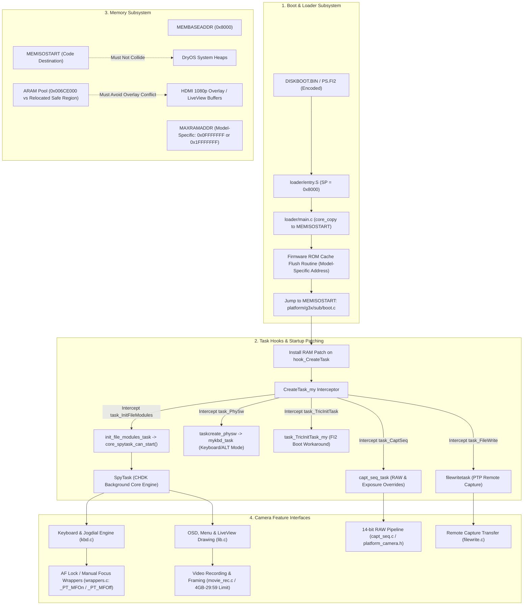

# CHDK DIGIC 6 Port Readiness Audit — Canon PowerShot G3 X

Updated: 2026-10-16  
Phase: 0D — Port Readiness Audit  
Authoritative Baseline: CHDK SVN r5491 (`21b9a14eb2043aeffdd2cb141081e7dcfe75f7e6`) / r5492 (`8cded093bccce82ffe34d904da640fc55e087314`)  
Scope: Read-only source code archaeology and architectural specification. No firmware modification, binary execution, or hardware access.

---

## 1. Executive Summary & Scope Boundary

This document establishes the comprehensive port readiness audit for porting CHDK (or deriving the G3X Lite firmware extension) to the **Canon PowerShot G3 X** (DIGIC 6). 

Based on primary-source inspection of CHDK trunk reference ports—specifically the **PowerShot G5 X** (author ranma's starting reference), **EOS M10** and **PowerShot SX710 HS** (DryOS R57 peers), and **PowerShot G16** (early DIGIC 6 / capdis reference)—we have mapped every required platform component, file responsibility, runtime dependency, validation gate, and evidence classification.

### Safety & Scope Boundaries
- **Strict Read-Only Status**: This audit derives strictly from inspected public CHDK source code and published technical documentation.
- **Zero Guessed Constants**: No memory address, task vector, GPIO pin, or stub target is assumed or borrowed from another camera.
- **Independent Component Verification**: Every G3 X-specific structure is classified by whether it can be satisfied by reusable framework code or requires primary firmware binary extraction in an approved future phase.

---

## 2. CHDK Platform Component Inventory for DIGIC 6

A bootable and functional DIGIC 6 CHDK port requires three distinct file clusters within the source tree:
1. `platform/g3x/` — Camera-wide hardware definitions, UI drivers, framebuffers, and lens controls.
2. `platform/g3x/sub/<fw_version>/` — Firmware-revision-specific boot hooks, task interceptions, disassembled handlers, and symbol stubs (target owner build `110c` for `GM1.10C`; historical references `110e` and `120a`).
3. `loader/g3x/` — Low-level bootloader payload, CPU cache flush invoker, and core decompression/copy routine.

### 2.1 Camera-Wide Components (`platform/g3x/`)

| File | Purpose in CHDK Architecture | DIGIC 6 Reference Source (r5491) | Dependencies | Validation Requirements | Evidence Status |
|---|---|---|---|---|---|
| `Makefile` | Build integration; invokes `platform/makefile.platform`. | `platform/g5x/Makefile` | CHDK top-level build rules | Makefile syntax validation; clean compilation rule | **VERIFIED** (Standard pattern across all DIGIC 6 ports) |
| `makefile.inc` | Defines platform identity: `PLATFORMID=12968` (`0x32A8`, E037), `PLATFORMOS=dryos`, `PLATFORMOSVER=57`, `THUMB_FW=1`, `DIGIC=60`, `MEMBASEADDR=0x8000`, `ROMBASEADDR=0xFC000000`, `MAXRAMADDR`, `NEED_ENCODED_DISKBOOT`, `KEYSYS`, `FI2FLAGS`. | `platform/g5x/makefile.inc`, `platform/m10/makefile.inc`, `platform/sx710hs/makefile.inc` | Camera hardware architecture; bootloader key system; DryOS version | `PLATFORMID=12968` (`0x32A8`) confirmed from physical camera screen (E037); loader keys validated against firmware ROM | **PARTIALLY VERIFIED** (`PLATFORMID=0x32A8`/`12968` verified, E037; R57 reported by author; exact keysys/diskboot require ROM extraction) |
| `platform_camera.h` | Macro configuration: `CAM_PROPSET`, sensor geometry (RAW rows/cols, JPEG dimensions, active area), CFA pattern, color matrices, DNG lens info, bitmap resolution (720x480 LCD, EVF handling), AF/MF override capabilities. | `platform/g5x/platform_camera.h` | Sensor specifications; Canon property-set enum; optical formula | Color matrices derived from Adobe DNG Converter / raw shots; propset verified against firmware property handlers | **PLAUSIBLE** (Sensor dimensions known from 1" 20.2MP specs; propset & EVF dynamic resize require verification) |
| `platform_kbd.h` | Key constant definitions, key bitmasks, jogdial masks, ALT mode key assignment (`KEY_WIFI`, `KEY_VIDEO`, `KEY_PLAYBACK`, etc.). | `platform/g5x/platform_kbd.h`, `platform/sx710hs/platform_kbd.h` | Physical switch bitmask table | Verified against `physw_bits.txt` and hardware button matrix | **UNKNOWN** (G3 X has unique dial/button layout requiring firmware bit inspection) |
| `kbd.c` | Physical switch task hook (`wrap_kbd_p1_f`, `mykbd_task`), key polling, jogdial counter polling (`get_jogdial_counter`, `handle_jogdial`), USB remote power sensing (`get_usb_bit`). | `platform/g5x/kbd.c` | DryOS `_GetKbdState` stub, GPIO registers | Non-blocking key interception; no missed button events; reliable ALT-mode toggle | **PLAUSIBLE** (Mechanism identical to G5 X; bitmasks and dial registers require ROM dump) |
| `lib.c` | Framebuffer access: `vid_get_bitmap_fb()`, `vid_get_opacity_active_buffer()`, `vid_get_viewport_live_fb()`, LED control (`camera_set_led`), shutdown routines (`shutdown`, `shutdown_soft`), screen rotation / EVF detection. | `platform/g5x/lib.c` | Firmware display buffers (`_GetActiveViewportBuffer`), GPIO base `0xd20b0000` | Display overlay drawn without tearing or flicker; HDMI connection does not overrun buffer boundaries | **PLAUSIBLE** (G5 X architecture matches; exact YUV/bitmap pointers must be confirmed via stubs) |
| `main.c` | Platform initialization: `startup()`, focal length mapping (`get_focal_length`, `get_effective_focal_length`, `get_zoom_x`), battery thresholds (`get_vbatt_min`, `get_vbatt_max`). | `platform/g5x/main.c` | 24-600mm equivalent lens zoom table; ADC battery curves | Zoom position correctly reports 24-600mm equivalent across 25x range; battery status accurate | **PLAUSIBLE** (Zoom steps need extraction from G3 X lens table; framework hooks verified) |
| `shooting.c` | Shooting mode translation: `get_file_next_counter()`, `get_target_file_num()`, `get_target_dir_name()`, shooting mode tables. | `platform/g5x/shooting.c`, `platform/generic/shooting.c` | Firmware directory/file state variables; propset shooting modes | Directory and file naming match Canon DCIM scheme; no duplicate counter allocations | **PLAUSIBLE** (Follows standard DIGIC 6 DryOS pattern) |
| `wrappers.c` | Hardware wrappers: focus subject distance (`lens_get_focus_pos`), manual focus lock (`DoMFLock`, `UnlockMF`), ND filter control (`_PutInNdFilter`, `_PutOutNdFilter`), focus stepping (`_MoveFocusLensToDistance`). | `platform/g5x/wrappers.c`, `platform/generic/wrappers.c` | Firmware eventprocs / stubs: `_PT_MFOn`, `_PT_MFOff`, `_PutInNdFilter_FW`, `_MoveFocusLensToDistance_FW` | `DoMFLock()` successfully locks focus distance; `_MoveFocusLensToDistance` does not crash camera | **PLAUSIBLE** (G5 X implementation directly demonstrates `_PT_MFOn` / `_PT_MFOff` calls) |
| `notes.txt` | Developer notes, observed firmware idiosyncrasies, known issues. | `platform/g5x/notes.txt` | Developer inspection | N/A | **VERIFIED** (Standard documentation practice) |

---

### 2.2 Firmware-Specific Components (`platform/g3x/sub/<fw_version>/`)

| File | Purpose in CHDK Architecture | DIGIC 6 Reference Source (r5491) | Dependencies | Validation Requirements | Evidence Status |
|---|---|---|---|---|---|
| `Makefile` | Sub-directory makefile. | `platform/g5x/sub/100c/Makefile` | CHDK build system | Clean build pass | **VERIFIED** |
| `makefile.inc` | Revision-specific memory addresses: `MEMISOSTART` (CHDK code load destination), `ARAM_HEAP_START`, `ARAM_HEAP_SIZE`, allocator overrides. | `platform/g5x/sub/100c/makefile.inc`, `platform/sx710hs/sub/101a/makefile.inc` | Firmware RAM allocation map, DryOS system heap layout | Free memory verified safe from DryOS heap collisions and video DMA overruns | **UNKNOWN / BLOCKED** (Relocation history indicates unresolved stability; requires ROM analysis) |
| `boot.c` | Startup sequence: install `CreateTask` patch in RAM, create `SpyTask`, replace `task_InitFileModules`, redirect `task_PhySw`, apply FI2 boot fix via `task_TricInitTask_my`. | `platform/g5x/sub/100c/boot.c`, `platform/sx710hs/sub/101a/boot.c` | Disassembled startup code, task creation signatures | Clean boot to Canon GUI; SpyTask starts only after filesystem is ready (`core_spytask_can_start`) | **PLAUSIBLE** (Author confirmed 4 hooks worked for playback boot; code unrecovered) |
| `capt_seq.c` | Disassembled and patched `capt_seq_task()`: hooks raw capture buffer pointer, handles exposure overrides, dark frame subtraction control (`USE_STUBS_NRFLAG`). | `platform/g5x/sub/100c/capt_seq.c` | `capdis` disassembly of G3 X `task_CaptSeq`, firmware raw buffer structs | Raw image buffer pointer captured correctly; raw hooks execute without timing deadlock | **UNKNOWN** (Not among author's minimal 4 hooks; requires clean `capdis` generation) |
| `filewrite.c` | Disassembled and patched `filewritetask()`: intercepts JPEG/RAW writing to SD card for PTP remote capture; camera-specific `fwt_data_struct`. | `platform/g5x/sub/100c/filewrite.c`, `platform/sx710hs/sub/101a/filewrite.c` | `capdis` disassembly of G3 X `task_FileWrite`, `fwt_data_struct` chunk layout | PTP file upload/remote capture functional without corrupting SD filesystem | **PLAUSIBLE** (Author reported `task_FileWrite` hooked for PTP remote write; implementation unrecovered) |
| `movie_rec.c` | Video recording task interception: video tables, bitrates, quality adjustments. | `platform/g5x/sub/100c/movie_rec.c` | `task_MovieRecord` disassembly (optional) | Video records cleanly; no dropped frames or thermal runaway | **PLAUSIBLE** (Can start with minimal stubs or empty implementation as in G5 X / SX710) |
| `stubs_entry.S` | Primary entry stubs: addresses of DryOS firmware functions, task entry points, event procedures, and global variables. | `platform/g5x/sub/100c/stubs_entry.S` | `stubs_auto.S`, firmware disassembler | All entry points branch to valid Thumb-2 code with correct argument registers | **UNKNOWN / BLOCKED** (Requires firmware binary disassembly or patch recovery) |
| `stubs_entry_2.S` | Manual symbol overrides for functions incorrectly identified by automated signature matching. | `platform/g5x/sub/100c/stubs_entry_2.S` | Manual reverse engineering review | Functions verified to match expected calling conventions | **UNKNOWN** |
| `stubs_min.S` | Minimal stubs required for loader execution before core initialization. | `platform/g5x/sub/100c/stubs_min.S` | Firmware low-level routines | Loader executes without faulting | **UNKNOWN** |
| `stubs_auto.S` | Automatically generated stubs generated by CHDK tool `finsig_thumb2`. | `platform/g5x/sub/100c/stubs_auto.S` | `finsig_thumb2` run against G3 X `PRIMARY.BIN` | Signature tool completes with zero fatal ambiguities | **UNKNOWN / BLOCKED** (Requires raw firmware image) |
| `funcs_by_name.csv` / `funcs_by_address.csv` | Full symbol databases correlating named Canon OS functions with ROM addresses. | `platform/g5x/sub/100c/funcs_by_name.csv` | Output of `finsig_thumb2` | Cross-checked against string references and event procedure tables | **UNKNOWN / BLOCKED** (Requires raw firmware image) |
| `physw_bits.txt` | Table of physical switch bit positions mapped to GPIO word indices. | `platform/g5x/sub/100c/physw_bits.txt` | ROM disassembly of `taskcreate_physw` / keyboard read loops | Button presses map uniquely to expected logical keys | **UNKNOWN / BLOCKED** (Requires raw firmware image) |

---

### 2.3 Loader Subsystem (`loader/g3x/`)

| File | Purpose in CHDK Architecture | DIGIC 6 Reference Source (r5491) | Dependencies | Validation Requirements | Evidence Status |
|---|---|---|---|---|---|
| `Makefile` | Loader compilation rule; includes `loader/makefile_loader.inc`. | `loader/g5x/Makefile` | CHDK loader build infrastructure | Produces valid ELF and binary payload | **VERIFIED** |
| `entry.S` | Loader entry point: sets SP to `MEMBASEADDR` (0x8000), jumps to `my_restart()`. | `loader/g5x/entry.S`, `loader/m10/entry.S` | ARM/Thumb transition, stack initialization | Executes cleanly in CPU Thumb state | **VERIFIED** (Identical across all DIGIC 6 loaders) |
| `main.c` | Decompresses/copies CHDK core from blob to `MEMISOSTART`, enables diagnostic LED (`0xd20b0994` on G5X/M10/SX710; G3 X forum post 149971 reports `0xd20b0884`/`0xd20b0810`, see E025/C006), calls firmware cache-flush routine, branches to `MEMISOSTART + 1`. | `loader/g5x/main.c`, `loader/m10/main.c`, `loader/sx710hs/main.c` | `check_compat()`, GPIO LED address, ROM cache-flush address | Core copied without corruption; cache flushed; clean handover to core `boot.c` | **PLAUSIBLE / ADDRESS BLOCKED** (Loader logic identical; LED and cache-flush ROM addresses model-dependent) |
| `blobs.S` | Embeds the compressed CHDK core ELF into the loader image. | `loader/g5x/blobs.S` | Core binary compilation | Binary size correctly calculated | **VERIFIED** (Standard across all CHDK platforms) |

---

## 3. Subsystem Dependency Map

### Detailed Subsystem Interdependencies

1. **Boot Flow & Loader Chain**:
   - **Pre-execution**: Camera ROM boot code evaluates SD card bootflag and loads `DISKBOOT.BIN` (or `PS.FI2`).
   - **Loader Entry**: Sets `SP = 0x8000`, enters `my_restart()`.
   - **Integrity & Copy**: `check_compat()` verifies target camera platform ID; `core_copy()` copies payload from `blob_chdk_core` to `MEMISOSTART`.
   - **Cache Coherency**: Invokes firmware-specific cache flush function (`blx r2`). On G5 X 100C this is `0xFC150D5B`; on SX710 101A this is `0xfc11f607`. On G3 X this address **must be identified from ROM disassembly**.
   - **Handover**: Executes `bx r0` to jump into `boot.c` at `MEMISOSTART + 1` (Thumb state).

2. **Task Hooks & Startup Interception**:
   - `boot.c` overwrites the first instructions of Canon's `CreateTask` in RAM with a jump to `CreateTask_my`.
   - As Canon DryOS startup proceeds, every `CreateTask` call passes through `CreateTask_my`.
   - **Mandatory Minimum Hooks**:
     - `task_InitFileModules`: Signals `core_spytask_can_start()`. Required to prevent filesystem access before SD card mount.
     - `task_PhySw`: Replaced by `mykbd_task` to intercept button presses, detect ALT key, and block native handling when CHDK console is active.
     - `task_TricInitTask`: Replaced by `task_TricInitTask_my` to fix FI2 boot lockups.
     - `task_FileWrite`: Replaced by `filewritetask` to divert image streams over USB/PTP.
     - `task_CaptSeq`: Replaced by `capt_seq_task` to hook raw sensor data and override exposure/aperture.

3. **Memory Architecture & Safety Boundaries**:
   - `MEMBASEADDR`: `0x8000` (declared across inspected DIGIC 6 `THUMB_FW=1` reference ports; exact CPU core identity is not declared in `makefile.inc`, see C009).
   - `MEMISOSTART`: Base address in DRAM where CHDK core resides. Must be located above DryOS kernel structures and below dynamic memory pools (`MEMISOSTART` on G5 X is `0x39124C`).
   - **ARAM Allocation Hazard**: Historical reports from author ranma indicate live-view crashes over HDMI (1080p). Ranma reported that relocating ARAM allocation seemed to help, but explicitly noted it "needs more testing" (see `docs/RESEARCH_LOG.md` E020). G3 X memory layout must be formally mapped in Phase 1 before choosing between DRAM and ARAM for CHDK heaps.

4. **AF & Focus Lock Interfaces**:
   - Goal: Evaluate manual focus lock and shutter response optimization for G3X Lite.
   - Reference pattern: In `platform/g5x/wrappers.c`, focus lock is implemented via `_PT_MFOn()` and `_PT_MFOff()`.
   - Focus stepping: Done via `_MoveFocusLensToDistance_FW()`, which crashes unless the camera is already in Manual Focus mode.
   - Requirement for G3 X: Locate `_PT_MFOn`, `_PT_MFOff`, `_GetFocusLensSubjectDistance`, and `_GetCurrentTargetDistance` in firmware entry stubs.

5. **Video Recording Subsystem**:
   - Stock G3 X limit: Canon User Guide documents video stops at 4 GB or 29:59 (see `docs/RESEARCH_LOG.md` E009).
   - DIGIC 6 implementation: `movie_rec.c` in reference ports is largely minimal or uses stubs, as DIGIC 6 video encoding is handled by dedicated hardware pipelines rather than simple DryOS task loops.
   - G3X Lite requirement: Video limits and bitrate overrides require deeper analysis of `task_MovieRecord` and H.264 encoder event procedures.

---

## 4. Reusable Framework Code vs. Camera-Specific Code

To maintain strict code hygiene and avoid premature reverse engineering, the codebase must be cleanly partitioned into reusable framework components and camera-specific components requiring firmware analysis:

### 4.1 Reusable CHDK Framework Code (Ready Immediately)
These modules are hardware-independent and can be compiled and used directly without modification once platform headers and stubs exist:
- **Core Engine (`core/`)**: GUI windowing, menu system, fonts, OSD elements, script virtual machines (Lua and uBasic), file selectors, text reader, configuration management (`conf.c`).
- **Generic Drivers (`platform/generic/`)**:
  - `platform/generic/main.c` (generic battery status, startup orchestration)
  - `platform/generic/palette.c` (standard YUV-to-RGB color palette translation)
  - `platform/generic/shooting.c` (standard shutter speed / aperture calculation algorithms)
  - `platform/generic/wrappers.c` (default wrapper dispatchers)
- **Math & Utilities (`lib/`)**: Floating point math emulation, libc string/memory primitives, zlib decompression.
- **PTP Infrastructure**: Remote control protocol handler and script execution bridge over USB.

### 4.2 Camera-Specific Code Requiring Primary Firmware Analysis
These components **cannot be copied** from G5 X, M10, or SX710 without causing crashes, boot failures, or potential hardware damage. They strictly require primary extraction from a verified G3 X firmware image:
1. **Entry Points & Symbols (`stubs_entry.S`, `stubs_auto.S`)**:
   - DryOS kernel functions: `CreateTask`, `TakeSemaphore`, `GiveSemaphore`, `SleepTask`.
   - Hardware drivers: `_GetKbdState`, `_GetActiveViewportBuffer`, `_SetLED`.
   - Lens & Focus procs: `_PT_MFOn`, `_PT_MFOff`, `_GetFocusLensSubjectDistance`.
2. **Disassembled Task Slices (`capdis`)**:
   - `capt_seq_task()`: Must be disassembled directly from G3 X `task_CaptSeq` to preserve original instruction sequences and insert CHDK hooks.
   - `filewritetask()`: Must be disassembled directly from G3 X `task_FileWrite` and matched with G3 X `fwt_data_struct`.
   - `task_TricInitTask_my()`: FI2 initialization loop patch derived from G3 X ROM.
3. **Loader Cache Flush Subroutine**:
   - The absolute branch address in `loader/g3x/main.c` must match the specific G3 X firmware version's cache invalidation routine.
4. **Hardware Bitmaps & Tables**:
   - `physw_bits.txt`: GPIO bit definitions for the physical buttons and dials on the G3 X body.
   - Optical zoom table in `platform/g3x/main.c`: Must reflect the 24-600mm (25x) focal length curve and steps.
   - Framebuffer parameters in `platform_camera.h`: Dimensions and buffer strides for the 3.2" LCD and optional EVF-DC2 electronic viewfinder (E001).

---

## 5. Comprehensive Blocker Register

The following blockers currently prevent proceeding beyond Phase 0:

| Blocker ID | Description | Impact | Resolution Requirement |
|---|---|---|---|
| **BLK-01** | Physical Camera Firmware Version Identification (**RESOLVED**) | Confirmed target is `GM1.10C` (public `1.1.0.0`, `PLATFORMID = 0x32A8` / `12968`, `PAL D`, E037). Note that public `1.1.0.0` has at least two internal builds (`GM1.10C` vs `GM1.10E`, C011). | Resolved by owner's physical camera firmware screen (`docs/FIRMWARE_ACQUISITION_PLAN.md` §1). Target subdirectory is `platform/g3x/sub/110c/`. |
| **BLK-02** | Absence of Verified G3 X `GM1.10C` Firmware Dump (`PRIMARY.BIN`) | Cannot run `finsig_thumb2`, generate stubs, or disassemble `GM1.10C` tasks. | Owner approval and execution of S1 read-only Canon Basic dump per `docs/FIRMWARE_ACQUISITION_PLAN.md` §3–§5; verify exact `33,554,432`-byte (`0x2000000`) size (E039, C008) and SHA-256 hash. |
| **BLK-03** | Inaccessible Historical Patch (`g3x_110e.patch`, Att. 16495) & Build Divergence (`110e` vs `110c`) | Historical reference code remains unavailable via guest access, and even if obtained targets `GM1.10E` rather than `GM1.10C` (C011). | Proceed with clean-room derivation on `GM1.10C` `PRIMARY.BIN` via `finsig_thumb2` + `capdis` in Phase 1 (treat `g3x_110e.patch` as supplementary reference only if later provided). |
| **BLK-04** | Unresolved Memory Layout & HDMI Live-View Instability | Risk of memory corruption and crashes during live-view or video operation. | Binary analysis of DryOS heap initialization, Xtensa DSP memory buffers, and display controller overlay allocations in Phase 1. |
| **BLK-05** | Human Authorization Gate (Gates A2 & A3) | Repository policy strictly mandates Phase 0 boundary and explicit approval before any camera script execution. | Explicit user sign-off required on `Approval A3` (on-camera S1 Canon Basic dump) and `Approval A2` (Phase 1 entry) in `docs/FIRMWARE_ACQUISITION_PLAN.md` §5.2. |

---

## 6. Audit Conclusion

The architectural requirements for a DIGIC 6 CHDK port on the Canon PowerShot G3 X are fully understood and mapped. The framework and build structure are mature and well-tested on sibling cameras (G5 X, SX710 HS, EOS M10). However, because CHDK operates via tight binary-level patching and hardware-specific register manipulation, **no further progress can be made by reading existing CHDK source alone**. 

Transition to **Phase 1 (Firmware Acquisition & Offline Binary Analysis)** is the sole viable path forward, governed by the entry checklist defined in `docs/PHASE1_ENTRY_CHECKLIST.md`.
